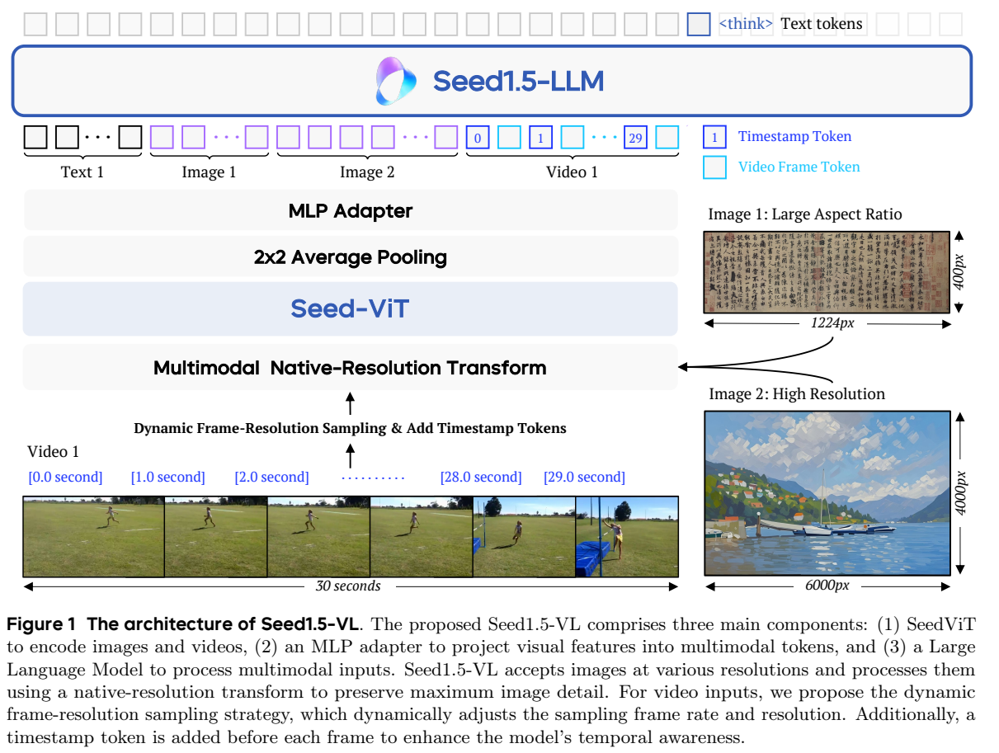
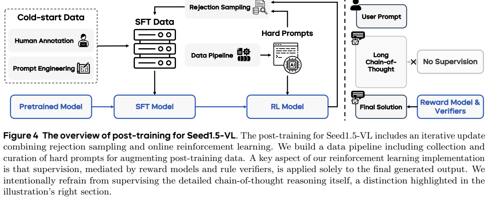
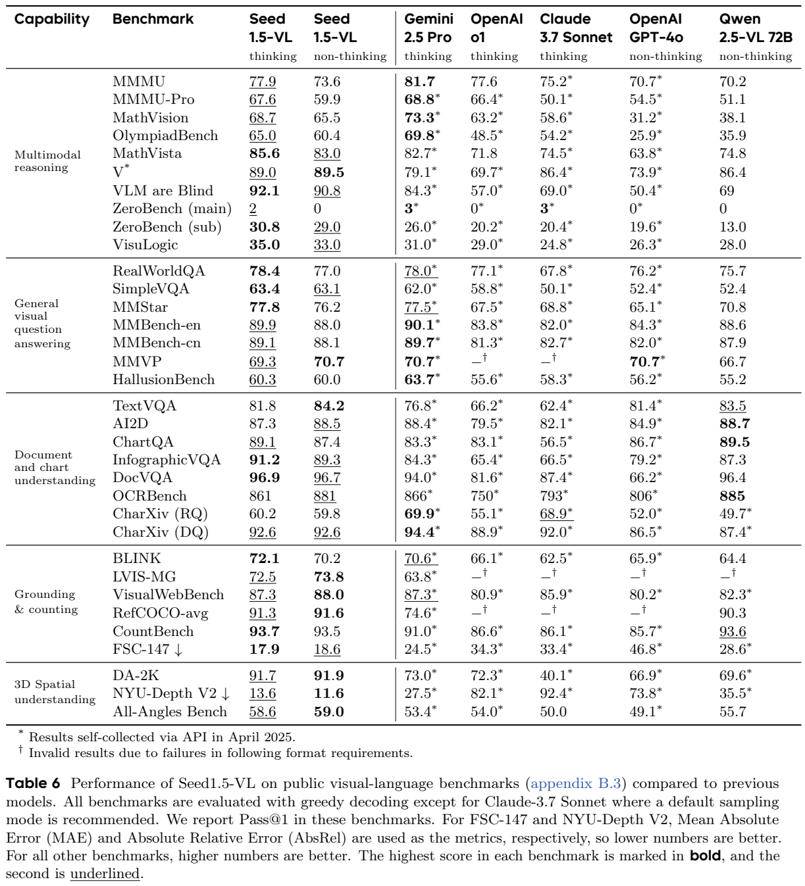
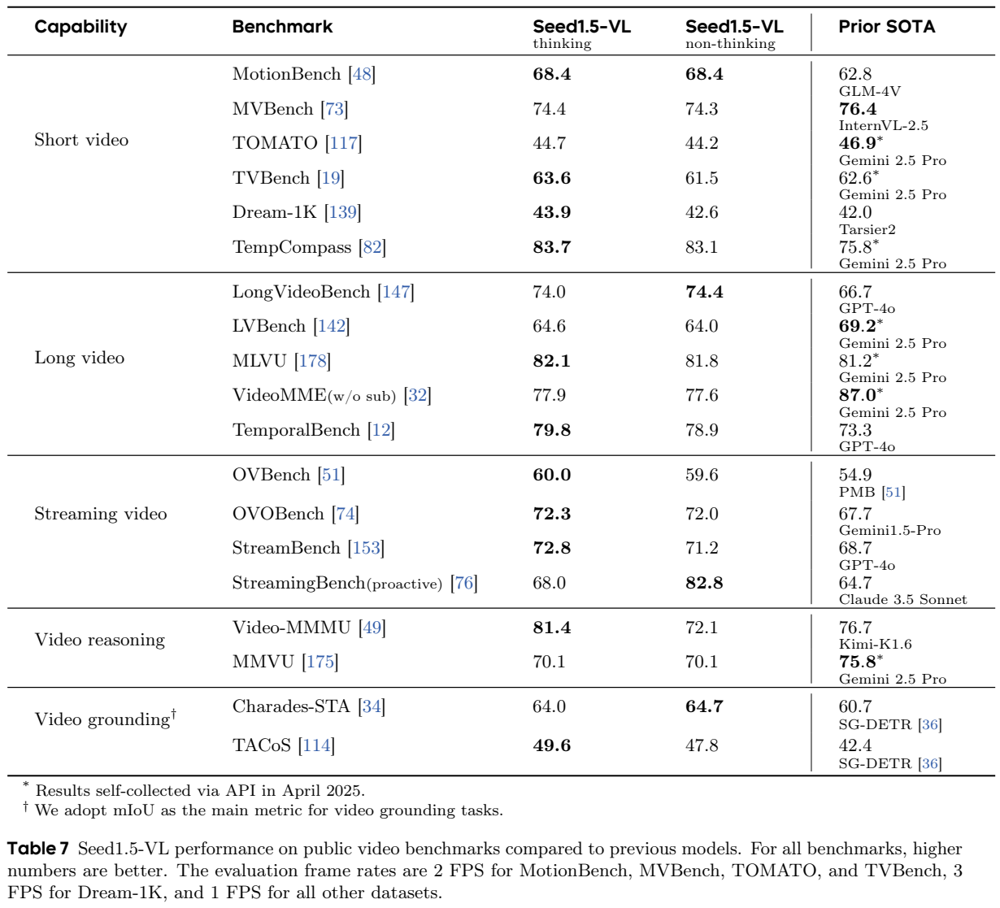
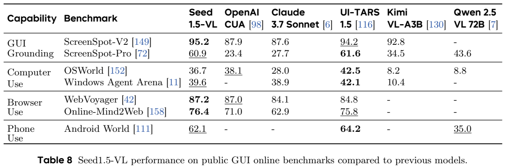

<!-- article-header:start -->
[项目首页](../../../README.md) › [模型系列](../../../reports/model-family-index.md) › [Seed](../README.md)
<!-- article-header:end -->

# Seed1.5-VL：以原生分辨率视觉与混合强化学习连接感知和推理

<!-- article-toc:start -->

**本篇目录** · [论文定位](#paper-info) · [快速概览](#overview) · [整体架构](#architecture) · [核心原理](#principles) · [数据构建](#data) · [训练流程](#training) · [实验结果](#experiments)
<!-- article-toc:end -->

## 1. 论文信息与模型定位

原文为 ByteDance Seed 的 **Seed1.5-VL Technical Report**，本文固定使用 [arXiv 2505.07062v1](https://arxiv.org/abs/2505.07062v1) 的77页报告。版本标识为2025年5月11日，所缓存PDF封面另印有 June 13, 2025；这里保留这项日期差异，技术内容以该PDF为准。封面列出的服务模型标识为 `doubao-1-5-thinking-vision-pro-250428`，这只是报告当时的访问标识。

它是图像、视频和文本输入、文本及结构化坐标输出的基础视觉语言模型，重点覆盖OCR、图表、定位计数、3D理解、视频与GUI操作。系统由532M参数的SeedViT、两层MLP和约20B**激活参数**的MoE语言模型构成；20B不是报告公开的总参数量。通过系统提示选择简短回答或LongCoT推理。ViT预训练用到音视频对齐数据，并不表示这个版本开放了音频输入或语音生成接口。〔PDF第1–7、13、16页〕

## 2. 快速概览

报告的主要价值，是展示如何同时改善视觉细节与跨任务推理：原生分辨率编码保留长宽比例，动态视频采样在帧数和每帧细节之间分配预算；大规模数据把OCR、定位、STEM、GUI等能力组织成明确任务；后训练混合偏好奖励与可验证奖励，并反复将RL正确轨迹回收为SFT数据。

两种回答模式的关系需要逐项看。Table 6中MathVista由非推理83.0升至推理85.6，MMMU由73.6升至77.9；TextVQA反而由84.2降至81.8，OCRBench由881降至861。LongCoT在复杂推理上有用，却不能替代精细感知，也没有保证每个指标都会增加。作者汇总的“60项中38项领先”基于其选定基准、比较对象和当时API结果，不能解释为全面超过所有模型。〔PDF第23–26、32页〕

## 3. 整体架构

读Figure 1时可从下向上看：图像或视频帧进入SeedViT，相邻2×2特征平均池化，将空间token数量压缩至约四分之一；两层MLP把它们映射到语言模型输入空间。图像token、视频帧token、时间戳和文本交错输入Seed1.5-LLM，输出回答及可选思维链。视频左侧的时间标签是显式文本时间戳，避免仅靠帧序号表达真实时间间隔。截图完整保留原图和图注。

SeedViT使用14×14 patch、2D RoPE、27层Transformer、1280维隐藏表示和20个注意力头，单头64维，MLP扩展比4。输入以双线性插值调整到最接近的28倍数尺寸；这为14 patch及2×2池化提供兼容网格，并不表示完全不做缩放。训练借鉴NaViT将多张图像打包，用分块注意力掩码隔离不同图像，避免ViT阶段跨图污染。〔Table 1，PDF第6页〕

视频默认1 FPS，时序任务可用2 FPS、运动与计数任务可用5 FPS；每段视频的视觉token预算为81,920。帧分辨率在640、512、384、256、160、128六档中调整。很长的视频即使降到最低档仍超预算时，再均匀减少整段视频的帧数。因此“支持长视频”依赖空间和时间压缩，不能理解为保留所有原始帧。正式评测采样率另按数据集规定，见第7节。〔PDF第7页〕

## 4. 核心创新与数学原理

**视觉编码器先学通用表征，再接入语言模型。** SeedViT预训练包含三个不同目标：首先随机遮蔽75%的patch及其RoPE位置信息，以EVA02-CLIP-E特征为教师，通过余弦相似度学习遮蔽位置的表示；随后结合SigLIP与SuperClass图文目标学习语义；最后用MiCo对视频、音频与相应文本进行多模态对齐。第一阶段重建的是教师特征，不能写成像素均方误差；这些视觉预训练阶段也不能和后续VLM的Stage 0–2混淆。〔PDF第6–7页〕

**数据规模与局部性能预测。** 原文式(1)–(3)借用参数量与数据量的幂律分析，在固定模型的Stage 1中简化为：

$$
\widehat L\sim B D^{-\beta},\qquad
\log\widehat L\sim-\beta\log D+\log B.
$$

这里D是训练token规模，损失是平均负对数似然。作者拟合OCR子集得到 `log(L_ocr) ≈ -0.1817 log(D) - 0.7011`，grounding得到 `-0.0785 log(D) - 0.0745`。这意味着在其观测范围内，两种能力的损失下降速度不同。ChartQA与OCR损失的局部关系为 `Acc ≈ -0.0968 log(L_ocr) + 0.7139`，这些准确率来自预训练模型，不能与最终RL结果直接混用；准确率有上下界，局部线性拟合也不能无限外推。〔Figure 3，PDF第14–15页〕

**混合奖励让模型探索推理路径。** 泛化视觉问答使用生成式奖励模型，STEM、定位等任务使用可验证奖励。同一批混合两类提示，共享一个critic，两类奖励都归一到[0,1]。一般任务的KL系数是1e-5，可验证任务为0。奖励模型只看最终solution，截去thought；数学用SymPy判断答案，定位以IoU奖励，格式失败可置零。下面仅是对原文奖励分流的**解释性写法**，不是报告给出的完整PPO目标：

$$
R(x,y)=\begin{cases}
R_{\mathrm{RM}}(x,\mathrm{solution}(y)),&\text{一般任务},\\
R_{\mathrm{verifier}}(x,\mathrm{solution}(y)),&\text{可验证任务}.
\end{cases}
$$

奖励模型采用两回答的生成式偏好判别，并交换回答顺序计算概率来降低位置偏差。最终答案正确带来的奖励会优化整条生成轨迹，但“不给thought直接监督”不能推出每一步思考都正确。附录Figure 25甚至展示了最终答案正确、推理错误的3D案例。〔PDF第17–20、63页〕

## 5. 数据构建与处理

VLM预训练数据覆盖3T token规模的图文及相关任务。网页图文先按图像尺寸、极端长宽比、文本长度、CLIP相关性和URL/内容去重过滤。作者还针对类别长尾进行重采样。Table 3用1.1B激活参数的小模型、相同12B训练token预算验证这一策略：随机采样时常见类别78.92、稀有类别10.46；每类最多100例、重复3轮时分别60.31和89.41。稀有类别改善伴随常见类别退化，这是平衡策略的取舍，不是所有类别同时提升。该实验采用开放问答及LLM判分，不能当作传统分类Top-1。〔PDF第8–9页〕

OCR部分超过1B样本，涵盖文档、场景文字、表格、图表和流程图，包含大量合成数据：超过200M文本密集图像、100M图表、50M表格。文字用SynthDog及多字体生成，并加入透视、弯曲、模糊和摩尔纹等扰动；图表用Matplotlib、ECharts或LLM生成代码渲染；表格来自HTML、LaTeX、Markdown等结构。前代VLM根据图像及OCR/表格结构产生QA，再由内部LLM过滤语义不一致的问答。因此这些样本数不能等同于同样数量的真实独立照片。〔Figure 2，PDF第9–10页〕

定位数据同时使用框和点：公开标注清洗及多任务改写约48M样本、41B token；网页名词短语经Grounding DINO标框并由CLIP/NMS筛选，约200M样本、200B token；Molmo和CountGD辅助构建170M点指令、110B token；从框与点衍生8M计数样本、13B token。坐标统一归一到[0,999]，OCR和GUI也遵循此约定。上述任务数据可能衍生自同一图像，不能简单相加为独立图像总量。〔PDF第10–11页〕

3D数据包含200万网页图像的相对深度、18M绝对深度指令、770K 3D定位指令；STEM有教育图像定位、化学式和坐标图合成，以及超过100M K12习题清洗。视频除描述与QA，还加入时间段定位、按时间交错的问答、逐帧主动响应和同步解说。GUI主要沿用UI-TARS数据构建思路，联合元素感知、坐标定位和包含观察、思考、动作的多步轨迹。〔PDF第11–12页〕

RLVR进一步筛难题：STEM每题生成16次，剔除准确率0或超过75%的题，删除仅凭文字能答的样本，将多选题改成开放答案，并排除多问句及难验证的复杂文本答案。这样控制任务难度和视觉依赖，但也会排除当前模型完全不会解的任务。〔PDF第18–19页〕

## 6. 训练流程与目标

ViT独立预训练的三个阶段分别使用2.2B无标注、4.8B图文、65M多模态训练样本；这是训练样本统计，不能当作VLM阶段token预算。语言模型初始化于内部预训练的decoder-only MoE。VLM的三个阶段如下。〔Table 2、4，PDF第6、13页〕

|阶段|训练token预算|序列长度|可训练部分|最大学习率→最小值|
|---|---:|---:|---|---|
|Stage 0 对齐|16B|32,768|仅MLP，ViT与LLM冻结|2.52e-4→4.50e-5|
|Stage 1 能力积累|3T|32,768|全部参数|5.22e-5→5.22e-6|
|Stage 2 任务平衡与长上下文|240B|131,072|全部参数|5.22e-6保持不变|

三阶段使用AdamW，β=(0.9,0.95)，权重衰减0.1，bias与归一化参数不衰减。Stage 0批量8.4M token，后两段71M token；前两段余弦衰减，Stage 2继承优化器状态、没有warmup。Stage 1加入约5%的纯文本token维持语言能力；Stage 2重新平衡能力并加入视频、代码和3D。冻结LLM但同时训练ViT的初始对齐方案，以及跳过对齐阶段，作者报告都较差，但没有给出足以独立量化每项贡献的完整消融表。〔PDF第13页〕

Figure 4左侧是“冷启动SFT→RL→正确回答回收”的循环，右侧画出最终答案接受奖励、思维链不直接受评判。初始人工指令约13K；社区1.5M条候选经聚类、拒绝采样、LLM和奖励模型筛选后保留约30K。最终约50K多模态SFT样本结合内部纯文本及LongCoT数据，训练2轮；ViT冻结，其他参数训练，序列131,072，批量为16个序列长度，学习率2e-5→2e-6，10% warmup。

混合RL采用PPO变体：输入上下文8,192、最大输出16,384；每episode采样4,096条，mini-batch 512，更新8步，clip 0.2；actor/critic学习率分别6e-7和7.5e-7。一般任务每提示采1次，可验证任务采4或8次；critic先预热100步。报告版本经历4轮RL与拒绝采样SFT迭代。工程采用视觉编码器/MLP的ZeRO数据并行与LLM专家、流水线、数据、上下文并行，视觉按FLOPS贪心分配，RL基于verl与vLLM。报告成本按H800归一：预训练1.3M GPU小时、RL 60K、奖励模型24K；这不是可直接换算出的统一人民币成本。〔PDF第16–22页〕

## 7. 实验设置与主要结果

公开基准使用0-shot instruction-tuned模型；Table 6主要报告Pass@1及greedy decoding，Claude 3.7按推荐默认采样。星号表示2025年4月通过API自行收集，其他值来自相应报告；Gemini采用Preview 03-25。不同闭源模型的输入预算、内部推理预算和API版本不能完全控制。Table 6与正文个别描述不一致，下面以原表数值和模式列为准。本文未运行或复现模型。〔PDF第23–24、71–77页〕

|基准|Seed推理|Seed非推理|Gemini 2.5 Pro推理|Qwen2.5-VL-72B非推理|
|---|---:|---:|---:|---:|
|MMMU|77.9|73.6|81.7|70.2|
|MathVista|85.6|83.0|82.7|74.8|
|MMBench-en / cn|89.9 /89.1|88.0 /88.1|90.1 /89.7|88.6 /87.9|
|ChartQA|89.1|87.4|83.3|89.5|
|DocVQA|96.9|96.7|94.0|96.4|
|OCRBench（原始分数）|861|881|866|885|
|RefCOCO-avg|91.3|91.6|74.6|90.3|
|FSC-147 MAE，越低越好|17.9|18.6|24.5|28.6|

截图的左两列分别是thinking和non-thinking，不能按行挑最高值后合称同一个配置。尤其DocVQA 96.9在**推理列**，正文一处称非推理96.9，本文遵循Table 6；VisualWebBench非推理为88.0而非正文的87.8。Seed在MathVista、InfographicVQA和定位计数上突出，但MMMU低于Gemini，ChartQA和OCRBench低于Qwen。NYU-Depth V2表中的13.6/11.6对应AbsRel 0.136/0.116，越低越好；3D检测SUN-RGBD的AP@15由非推理33.5下降到推理32.0，也表明增加思考并不自动增强3D感知。〔PDF第23–25页〕

视频评测采用128K上下文、最多640帧。MotionBench、MVBench、TOMATO、TVBench为2 FPS，Dream-1K为3 FPS，其余1 FPS；Table 7的Prior SOTA按每个任务选用公开或API取得的最佳对手，不是一个固定模型。**Video-MME无字幕**的推理/非推理为77.9/77.6，低于Gemini 2.5 Pro的87.0；LongVideoBench为74.0/74.4，超过所列GPT-4o 66.7。Video-MMMU从72.1增至81.4，但MMVU为70.1，低于Gemini 75.8。主动StreamingBench的非推理82.8明显高于推理68.0，符合及时回应任务可能不受益于更长思考的结果。Charades-STA mIoU为64.0/64.7，TACoS为49.6/47.8，不能把它们写成分类准确率。

GUI采用推理模式：ScreenSpot-V2 95.2，ScreenSpot-Pro 60.9；WebVoyager 87.2、Online-Mind2Web 76.4。OSWorld 36.7高于Claude 28.0，却低于OpenAI CUA 38.1及UI-TARS-1.5 42.5；AndroidWorld 62.1也低于UI-TARS 64.2。Table 9的14个Poki游戏按完成关卡或分数评价、最多100步，Seed大多领先，但Hex-Frvr 1414低于UI-TARS 1583.7。不能将GUI定位分数代替真实多步操作成功率。〔PDF第25–28页〕

内部评测超过100任务、12K样本，Table 10按作者选定权重聚合，Seed推理总分59.3低于Gemini 61.6、高于o1 54.0；OOD 44.1则略高于Gemini 43.1。它提供了中文与综合能力的补充证据，权重和LLM判分仍影响结果。报告没有独立分离大规模数据、原生视觉、各奖励源及多轮回收的全部贡献；公开的长尾采样实验与局部scaling曲线可以支持具体解释，不能代替完整因果消融。作者指出遮挡计数、时序推理、组合搜索、多图逻辑与知识先验压过视觉证据仍有不足。更可信的结论是：Seed1.5-VL将精细视觉训练和可验证推理训练结合得较系统，优势集中在指定任务与配置，长思维链的收益需逐项核验。〔PDF第29–32、63–69页〕

<!-- article-footer:start -->
---

[← 上一篇：感知、推理、思考与规划](../../multimodal-reasoning-survey/arxiv-2505.04921/README.md) · [按发表时间浏览](../../../reports/paper-reading-guide.md#year-2025) · [下一篇：BLIP3-o →](../../blip3-o/arxiv-2505.09568/README.md)

[返回本篇目录](#article-toc) · [返回模型系列](../README.md)
<!-- article-footer:end -->
