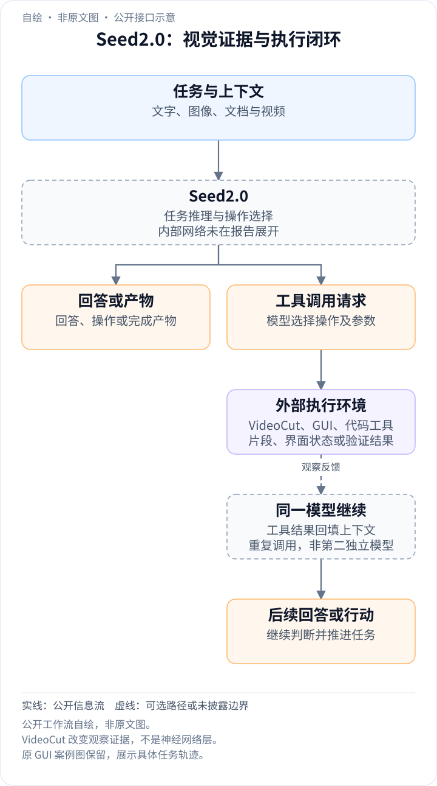
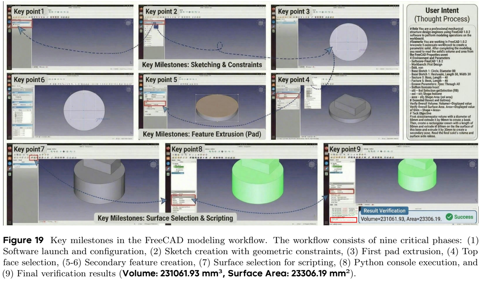
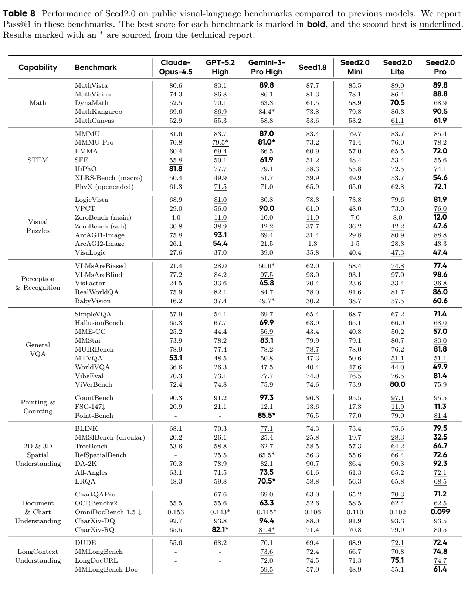
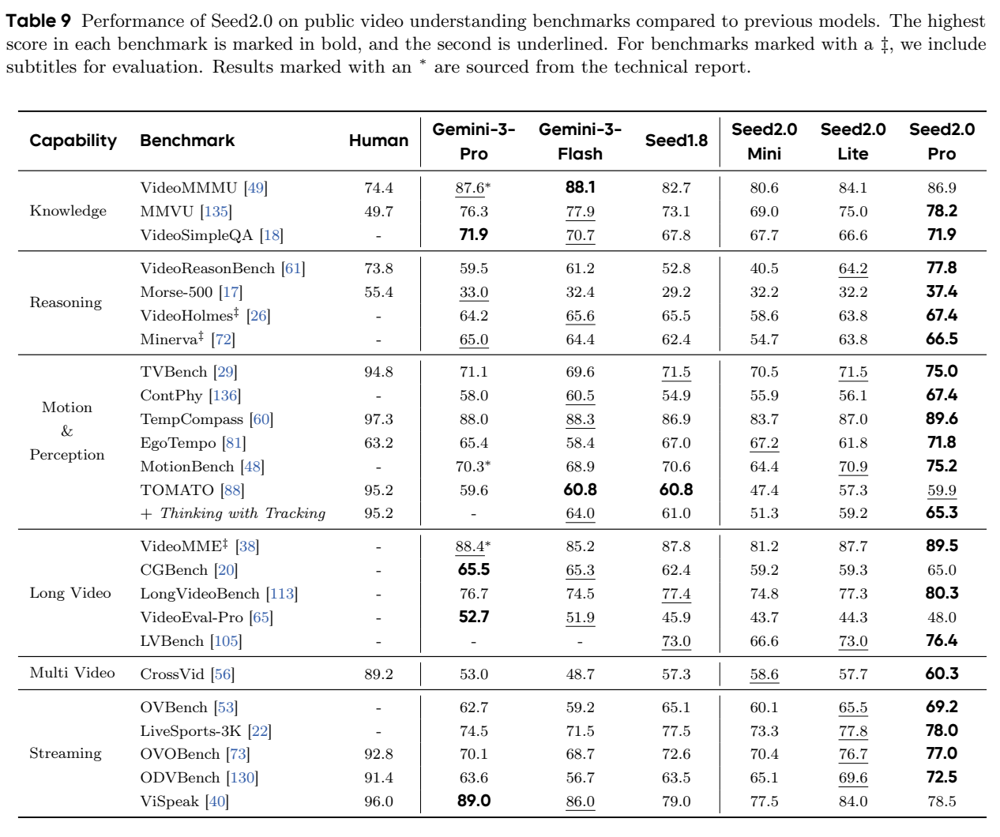
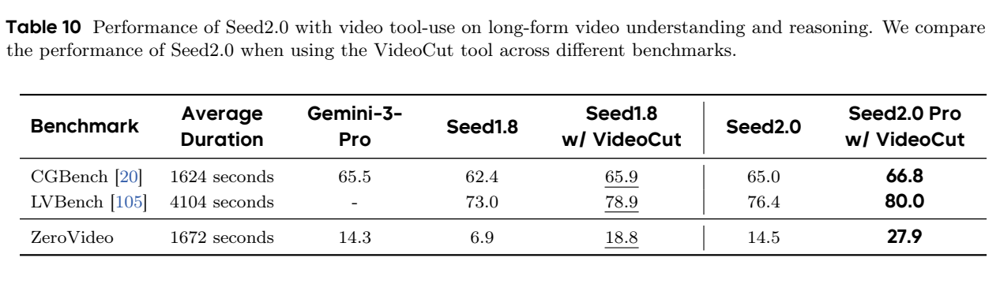

<!-- article-header:start -->
[项目首页](../../../README.md) › [模型系列](../../../reports/model-family-index.md) › [Seed](../README.md)
<!-- article-header:end -->

# Seed2.0：面向真实复杂任务的多模态模型卡与工作流评测

<!-- article-toc:start -->
<a id="article-toc"></a>

**本篇目录** · [论文定位](#paper-info) · [快速概览](#overview) · [整体架构](#architecture) · [核心原理](#principles) · [数据构建](#data) · [训练流程](#training) · [实验结果](#experiments)
<!-- article-toc:end -->

<a id="paper-info"></a>

## 1. 论文信息与模型定位

目录将此条目称为Seed2.0 Technical Report，原文正式标题是 **Seed2.0 Model Card: Towards Intelligence Frontier for Real-World Complexity**，作者为ByteDance Seed。本文依据 [arXiv 2607.00248v1](https://arxiv.org/abs/2607.00248v1) 的87页PDF；首页标注2026年6月30日，不从编号中的“2607”推断另一个发布日期。

Seed2.0包含Pro、Lite、Mini三个档位，面向视觉问答、文档处理、视频、代码、检索、工具调用与长程工作流。Pro定位高能力任务，Lite平衡能力与成本，Mini面向高吞吐应用。报告没有公开这三者的精确参数量、总/激活参数、视觉编码器配置或完整训练配方，不能把它们换算成确定的B数，也不能套用Seed1.5-VL的532M ViT、20B激活MoE架构。原文重点是模型能力和部署行为的证据，而非可复现的网络训练报告。〔PDF第1–4页〕

<a id="overview"></a>

## 2. 快速概览

作者将真实复杂任务拆成科学研究、整仓库生成、上下文学习与现实工作完成四类，基础层则评估语言、图像、视频、检索和工具使用。它强调的变化是从回答问题走向完成交付：读需求、规划、调用软件、观察错误、修正结果并验证。

视觉Table 8中Pro的MMMU为85.4、MathVista 89.8、MathVision 88.8；视频Table 9的Video-MME为89.5，**包含字幕**。VideoCut允许返回相关片段、以更高帧率重看，Table 10的LVBench由76.4升至80.0。与此同时，Pro的MMMU低于Gemini-3-Pro High的87.0，SWE-Evo 8.5明显低于Claude-Opus-4.5的27.1，NL2Repo-Bench 27.9低于GPT-5.2 High的49.3。因此“工作流导向”是目标与部分实证，不能表述为已经可靠解决全部现实任务。〔PDF第13–18页〕

Table 1列出当时Pro/Lite/Mini输入每百万token分别0.47/0.09/0.03美元，输出2.37/0.53/0.31美元，并说明区间定价只取代表值。这些是报告快照的价格，不是本文核验过的现行报价；低token价格也不直接等于端到端任务成本更低，工具次数、推理长度、失败重试都会改变总成本。〔PDF第3–4页〕

<a id="architecture"></a>

## 3. 整体架构

<!-- derived-architecture:start -->


*自绘公开接口示意（非原文图）。依据下述公开资料归纳；方框表示功能组件，不代表逐层实现。*

依据：[2607.00248v1; VideoCut / GUI and coding workflow cases](https://arxiv.org/pdf/2607.00248v1)。
<!-- derived-architecture:end -->

**内部网络架构未披露。** 原文没有给出视觉patch、连接器、位置编码、专家路由、层数或注意力实现，所以这一节采用报告可观察的系统工作流解释能力接口。文本、图像、文档和视频提供任务证据；模型生成回答或操作；工具返回执行信息或补充视觉片段；模型根据新证据继续判断。这样的工作流描述不代表底层采用某种特定encoder或MoE设计。

VideoCut是报告明确介绍的视觉工具：面对长视频或快运动片段，模型可以重放相关时间段并提高FPS，细看先前低密度输入遗漏的动作。它改变的是可见证据与调用过程，不是报告证明的一种新的可训练网络模块。原文未给出具体工具schema、调用次数、单次片段上限或统一延迟预算。〔PDF第15页〕



Figure 19是**GUI案例工作流图，非模型网络结构图**。从箭头看，代理创建圆形草图与约束、拉伸圆柱、在顶面增加矩形凸台，再通过脚本读取体积和面积。附录记录Ubuntu上的FreeCAD 1.0.2中文界面，共96个操作步骤、8次错误工具选择恢复；直接点击失败后转向菜单和Elements列表，并通过Python `Shape.Volume` / `Shape.Area`验证输出。截图保留全部九个关键画面及图注。它证明一个被展示的任务轨迹完成，不是96步任务的总体成功率。〔PDF第66–70页〕

在代码场景中，Figure 4的Decouple式库构建由需求分析、实现配置、测试调试组成，37轮交互后通过22项模型编写测试，并检查安装和跨目录导入。这体现“输出文件之后验证交付”的系统路径；这些自写测试没有自动等价于独立隐藏测试。〔PDF第21–22、76–78页〕

| 模块 | 输入与输出 | 公开机制 |
|---|---|---|
| 多模态上下文 | 图像、视频与问题 → 理解和推理上下文 | Pro/Lite/Mini提供公开能力接口；本卡未列出编码器与融合层规格 |
| 显式目标跟踪 | 视频帧与提示 → 逐帧框及运动判断 | Thinking with Tracking通过提示组织推理证据，不是已披露的新检测网络 |
| VideoCut | 候选片段 → 更高FPS的局部视频证据 | 全系列默认具备调用能力；评测分别报告是否启用工具 |
| 工具与环境 | 代码、CAD或GUI请求 → 执行结果 | 外部执行产生可检验反馈，模型据此继续或修复 |
| 结果验证 | 候选答案、工具结果 → 最终交付 | 公开案例含自检与修正，内部验证器及训练算法未完整披露 |


<a id="principles"></a>

## 4. 核心创新与数学原理

### 4.1 轨迹证据与局部回放

Thinking with Tracking要求推理过程中显式输出移动对象的逐帧框，再依据轨迹判断运动类型。Table 9中Pro在TOMATO普通提示59.9，加入tracking后65.3；Gemini-3-Flash从60.8到64.0。这是推理提示策略的结果，不是新增定位模块的训练消融，也未证明输出的每一个框都准确。VideoCut则从输入端补充局部高帧率证据，针对不同瓶颈，两者不能混成同一个方法。〔PDF第14–15页〕

逐帧框把“它向哪运动”分解为先确定同一目标的位置、再读其随时间变化的轨迹。错误框仍可能形成误导轨迹，所以输出结构化中间结果不自动保证运动判断正确。VideoCut从输入侧补充帧，Tracking从输出侧组织证据：前者改变可见信息，后者改变推理提示；Table 9与Table 10应分开理解。〔v1第14–15页，§4.3〕

### 4.2 一致性指标如何放大局部失败

DynaMath采用worst-case accuracy，每个原题的10种变体全部正确才计分。以下是对原文评价规则的**解释性数学表达**，并非报告的训练公式：

```math
\mathrm{Acc}_{\mathrm{worst}}
=\frac{1}{M}\sum_{i=1}^{M}\prod_{j=1}^{10}
\mathbf 1[\widehat y_{ij}=y_{ij}].
```

M为原始问题数，乘积意味着任何变体错误会使该组归零。这种指标检查跨扰动稳定性，所以不能和普通MathVista平均准确率直接比较。类似地，FSC-147采用MAE、OmniDocBench 1.5采用归一化编辑距离NED，数值越低越好；ARC-AGI-Image同时输入文本矩阵与渲染图像，也不同于仅有文本的ARC测试。〔PDF第5、9、13页〕

前述worst-case规则中，一个变体失败就使该原题整组不得分。因此平均单题准确率提升与整组稳健性提升不必同步，不能将这项指标当作模型参数或训练损失。这里保留原有评价公式，用于解释报告的测量对象；它不证明Seed2.0采用最坏情况优化。〔原有DynaMath评价说明；本轮重点核对视频机制第14–15页〕

### 4.3 外部计算作为可检查反馈

FreeCAD案例规定直径80mm、高40mm的圆柱，加50×30×20mm矩形凸台。以下为本文根据案例尺寸补充的几何核算，**不是模型训练目标或原文新算法**，假设凸台底面完整位于圆柱顶面：

```math
V=\pi\cdot40^2\cdot40+50\cdot30\cdot20
\approx231061.93\ \mathrm{mm}^{3},
```

```math
A=2\pi\cdot40^2+2\pi\cdot40\cdot40
+2(50+30)\cdot20
\approx23306.19\ \mathrm{mm}^{2}.
```

圆柱顶面被覆盖的矩形面积与凸台顶面面积抵消，因此只新增凸台四侧面积；两值与图中程序读数相符。这样的核算说明为什么脚本或几何约束比单凭截图“看起来完成”更适合确认工程交付。

与TOMATO依靠模型自报框不同，CAD和Python可以返回由几何体或程序实际计算的量。二者的证据强度不同：程序正确执行只能验证指定几何或代码条件，仍需核对视觉需求是否被正确翻译。文中尺寸推导的用途是检查案例，不代表模型把体积公式写入网络结构。〔保留原卡FreeCAD案例及已有几何核算；工具证据机制对照§4.3 VideoCut〕

### 4.4 领域约束与通用代理接口

Figure 12的量子编译案例涉及SU(2)到SO(3)的双覆盖，旋转表示可能丢失U与−U的全局相位。模型修正在回映射边界恢复相位，使 `exp(iφ)·U_decomp = U_target`，而不是为某个门加固定补丁。这是报告展示的任务求解原理，不能声称Seed2.0网络专门内置群论模块。附录E的数学证明采用solve–verify–refine，Putnam采用Lean/Python多轮工具与Pass@8；这些推理流程同样不是后训练算法披露。〔PDF第34、82–87页〕

报告对VideoCut的公开描述同样体现“生成操作—取得结果—继续推理”的接口边界：新增工具能取得此前未读到的片段，却没有改变底层闭源网络的可确认范围。科学案例中的群论约束、编译验证和多次采样属于不同任务的求解协议，不宜合成一个通用的Seed2.0训练目标。〔第15页Video Tool-Use；领域案例沿用原文出处〕


<a id="data"></a>

## 5. 数据构建与处理

**模型训练语料的规模、混合比例、来源筛选、去重和合成流水线未公开。** 报告说重视长尾领域知识和复杂指令，但没有给出可以复现的预训练数据表。公开的主要是部署观察及评价数据设计，以下分别说明，避免把评测样本误当训练样本。

部署分布来自授权客户的Doubao Collaboration Incentive Program；行业与场景数据描述该项目样本的使用情况，不能代表所有中国企业或证明它们全部进入了模型训练。作者另观察代码代理轨迹，前端和修bug请求较多，Vue使用量超过React三倍；这些样本说明产品需求的偏向，没有公布训练集由此新增多少条代码或截图。〔Figure 1–2，PDF第2–3页〕

知识评价包括专业论坛长尾问题LPFQA、从书籍原子知识动态组合的Encyclo-K；HLE-Verified请领域专家删除模糊、有歧义或难验证的问题。这些都是评价设计，不是训练语料配方。图像套件覆盖50个公开基准、视频覆盖24个公开基准。MTVQA采用DeepSeek-V3-0324判分，VibeEval将1–5尺度归一到0–100，OCRBenchv2报告中英文整体分数均值，XLRS-Bench报告lite子集宏平均，均须与原始分数口径对应。〔PDF第4–6页〕

复杂中文指令内部集有912个案例、17个加权维度，包括格式、条件、指定内容、措辞、语气、emoji、few-shot及中英文长度约束。高级任务则设计NL2Repo、科学代码AInstein Bench、带噪技术文档DeR2，以及企业知识库问答、信息抽取和工作流。它们不是单一分布，内部集与公开集结果不宜直接合并成一个“总能力分”。〔PDF第7–8、11–12页〕

Agent评测修复执行脚本和失效环境，采用预构建镜像与内部包镜像，并排除参考答案自身不过验、非确定性、网络依赖、异常磁盘占用及复杂下载等情况。Terminal-Bench 2.0明确删除 `extract-moves-from-video`、`mailman`、`install-windows-3.11` 三个案例，再适配内部代理框架。作者称保留原评价标准，但过滤后的集合与其他组织直接报告的原集合并非天然等价，跨模型比较必须保留这一限制。〔PDF第6–7页〕

<a id="training"></a>

## 6. 训练流程与目标

原文没有说明Seed2.0各档的预训练阶段数、token预算、SFT/RL数据量、优化器、学习率、冻结模块或奖励函数，也未发布结构/训练组件消融。不能仅因Seed前代用了PPO、RLVR或多轮拒绝采样，就推定本代沿用相同配方；本文也不为它补写交叉熵、GRPO或蒸馏公式。

可以从报告确认的是**模型研发的评价反馈机制**。第5.5节采用模型分析模型的诊断流水线：第一层聚合分数、输出、思考与执行轨迹，以及token、格式、轮数、emoji和best-of-N等统计；第二层针对不同场景分析；第三层生成报告，指出代码混用语言、重复CoT、条件边界漂移等行为。Table 15列出诊断成本，例如XBench覆盖9个模型、每模型100例，分析耗时2435秒、输入0.9M和输出0.1M token。这是诊断执行成本，不是Seed2.0训练消耗。〔PDF第46–48页〕

诊断还能区分“方法潜力”和“稳定性”：在IMO-Bench示例中，报告的best-of-N与worst-of-N差距0.211；WorldTravel错误包含时间窗口、结构顺序和价格约束，多类错误比例可重叠，不能相加成失败率。这些反馈适合指导后续数据与训练改进，但原文没有披露具体如何转成梯度更新或新增训练样本。因此训练部分的可复现边界止于研发目标与诊断机制，而不是一份可执行的训练recipe。

附录E的solve–verify–refine、GUI的反思重试、VideoCut的重看，以及代码中的执行测试，均发生在案例或评价推理环节。它们可以提高单次任务完成度，却不等于公开了如何训练模型获得这些行为。报告的IMO金牌级35/42、CMO 114/126建立在迭代证明评价，Putnam35.5使用8次机会和工具，不能当成单次无工具生成的数学能力。〔PDF第8、11、26、82页〕

<a id="experiments"></a>

## 7. 实验设置与主要结果

**图像结果。** Table 8报告Pass@1，星号表示取自相应技术报告；其余结果使用作者评价体系。表头明确区分Claude-Opus-4.5、GPT-5.2 High、Gemini-3-Pro High、Seed1.8及Seed2.0三档，不能把High推理档与未知预算配置描述为完全等算力。表中未报告传统DocVQA、ChartQA或MMBench，本条目不从其他发布页填补。〔PDF第5、12–13页〕



|基准|Seed1.8|2.0 Mini|2.0 Lite|2.0 Pro|Gemini-3-Pro High|
|---|---:|---:|---:|---:|---:|
|MMMU|83.4|79.7|83.7|85.4|87.0|
|MathVista|87.7|85.5|89.0|89.8|89.8|
|MathVision|81.3|78.1|86.4|88.8|86.1|
|DynaMath（10变体全对）|61.5|58.9|70.5|68.9|63.3|
|ChartQAPro|63.0|65.2|70.3|71.2|69.0|
|OCRBenchv2|52.6|58.5|62.4|62.5|63.3|
|OmniDocBench 1.5 NED↓|0.106|0.110|0.102|0.099|0.115|
|FSC-147 MAE↓|13.6|17.3|11.9|11.3|12.1|
|MMLongBench-Doc|57.0|48.9|55.1|61.4|59.5|

Pro在MathVision、图表和文档解析上领先这组对手，MMMU、OCRBenchv2仍低于Gemini。档位排序不是每行单调：DynaMath的Lite 70.5高于Pro 68.9，CountBench Lite 97.1高于Pro 95.5，ViVerBench Lite 80.0高于Pro 75.9。LogicVista原表是81.9，正文一处写81.4，本文遵循表格；CharXiv正文说综合DQ/RQ，Table 8实际分别列出，不能在未说明的情况下将93.5和80.5任意合为统一成绩。OCRBenchv2也不能同前代OCRBench原始总分881直接相减。

**视频结果。** Morse-500用5 FPS；运动感知的TVBench、ContPhy、TempCompass、EgoTempo、TOMATO、MotionBench用2 FPS，比较模型也采用同设置。报告没有给出所有视频统一的最大帧数、分辨率、token上限与上下文预算，所以不能移植Seed1.5-VL的“最多640帧”配置。Table 9的‡是**加字幕**，涵盖Video-MME、VideoHolmes、Minerva。〔PDF第6、14–15页〕



|基准|Mini|Lite|Pro|Seed1.8|Gemini-3-Pro|
|---|---:|---:|---:|---:|---:|
|Video-MME，含字幕|81.2|87.7|89.5|87.8|88.4|
|VideoMMMU|80.6|84.1|86.9|82.7|87.6|
|MMVU|69.0|75.0|78.2|73.1|76.3|
|VideoReasonBench|40.5|64.2|77.8|52.8|59.5|
|LongVideoBench|74.8|77.3|80.3|77.4|76.7|
|CrossVid|58.6|57.7|60.3|57.3|53.0|
|ViSpeak|77.5|84.0|78.5|79.0|89.0|

VideoReasonBench Pro 77.8超过表中人类73.8，但Morse-500 37.4低于人类55.4、TOMATO加tracking后65.3仍低于95.2；这不是全面超越人类视频理解。Video-MME 89.5为有字幕配置，不能和Seed1.5-VL无字幕77.9描述成11.6点纯视觉代际增益。ViSpeak Pro还低于Lite与Gemini，显示实时视觉指称仍有短板。



Table 10应从“Seed2.0”基础列与最右“Pro w/VideoCut”列对应读：CGBench平均视频1624秒，65.0→66.8；LVBench4104秒，76.4→80.0；ZeroVideo1672秒，14.5→27.9。工具带来的额外片段与推理开销没有统一披露，故这是允许重看时的能力增益，不能当成同计算预算的网络架构提升；该表也没有给出Video-MME开启VideoCut的独立成绩。

**语言、代理与真实交付。** Table 3中Pro的SimpleQA Verified 36.0低于Gemini72.1，FactScore71.2低于Gemini92.6；报告关于长尾知识的目标并未消除事实幻觉。中文内部指令总分由Seed1.8的72.89升至75.26，是**2.37个百分点**，而Content维度90.48降至87.76，格式维度仍只有46.0。〔PDF第9、12页〕

Table 11中Pro的BrowseComp-zh 82.4、MM-BrowseComp48.8和HLE-VL39.2体现检索及视觉代理优势；SWE-Bench Verified76.5低于Claude-Opus80.9，SWE-Evo8.5低于27.1，终端任务55.8低于GPT62.4。Table 13的整仓库NL2Repo-Bench27.9、NL2Repo Pass@1仅3.0，也限制了从单个成功示例外推的幅度。比较时还需考虑作者用官方与自测的较高值作为对手最终分数，部分表用括号另标对齐设置，及前述任务过滤。〔PDF第6–7、16、18页〕

原报告不同表对部分同名任务给出不同值，例如Scicode Pro在Table 11为48.5、Table 13为52.1，FrontierSci-research在Table 3为25.0、Table 13为23.3，不能未经说明把它们合为同一统一配置。科学案例也包含失败：作者指出生物分子分析会捏造文献和PDB细节，有机机理遗漏更具体的电荷转移解释。Erdős证明由作者称专家核验，并借Seed-Prover 1.5形式化1051；本文没有独立检查Lean证明或认定它们是新解决的开放问题。〔PDF第40、42–44、82–87页〕

这份模型卡最有用的证据是将图像/视频成绩、可操作工具和检查交付的案例放在一起，并主动列出长尾知识、整仓库、上下文学习和约束闭合的短板。没有公开的训练配方与组件消融，使我们能够描述“哪些任务表现较好、哪些推理工具有效”，但无法据此还原网络或判断每项训练创新的独立贡献。全部数值为作者报告，本文未调用模型或复现实验。

<!-- article-footer:start -->
---

[← 上一篇：Qwen-RobotWorld](../../qwen/arxiv-2606.17030/README.md) · [按发表时间浏览](../../../reports/paper-reading-guide.md#year-2026) · [下一篇：VideoChat3 →](../../videochat/arxiv-2607.14935/README.md)

[返回本篇目录](#article-toc) · [返回模型系列](../README.md)
<!-- article-footer:end -->
