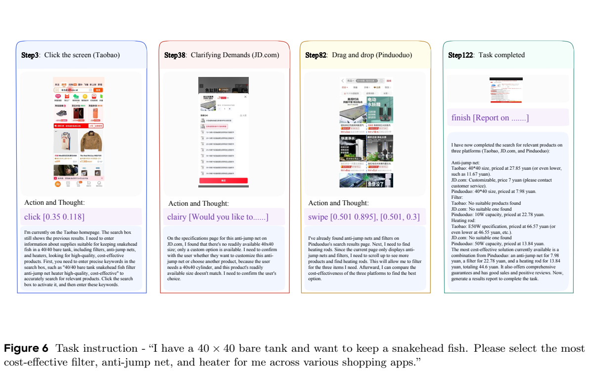
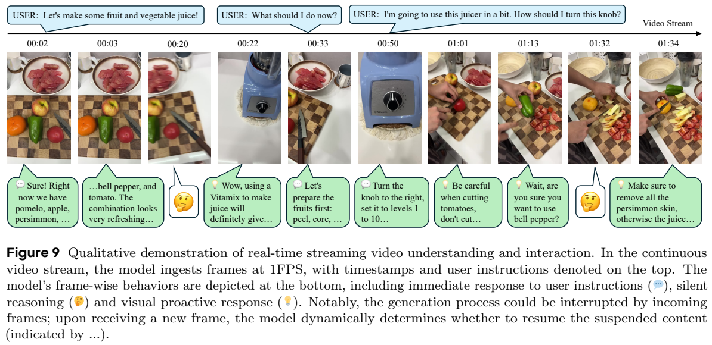
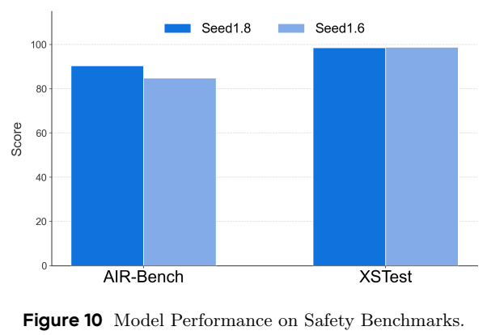
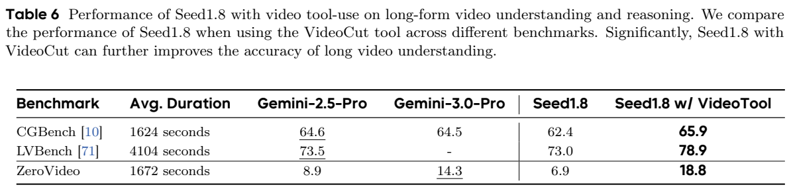
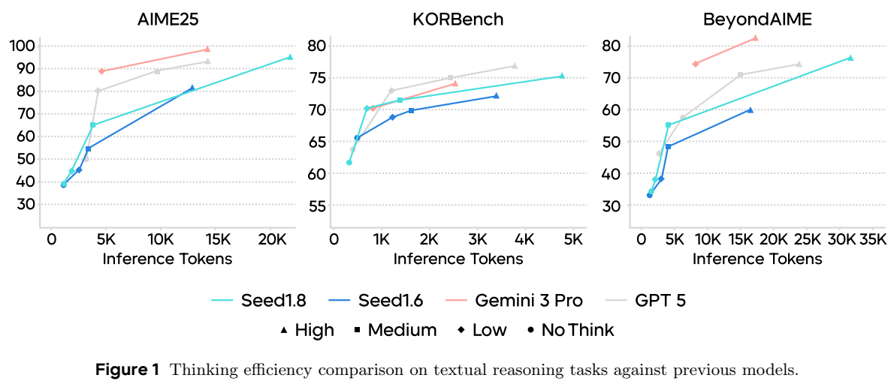
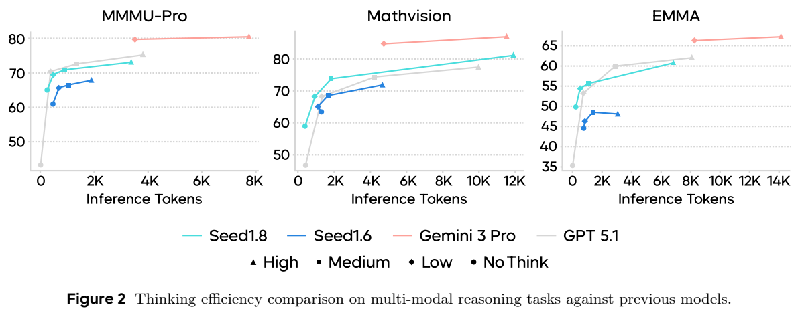
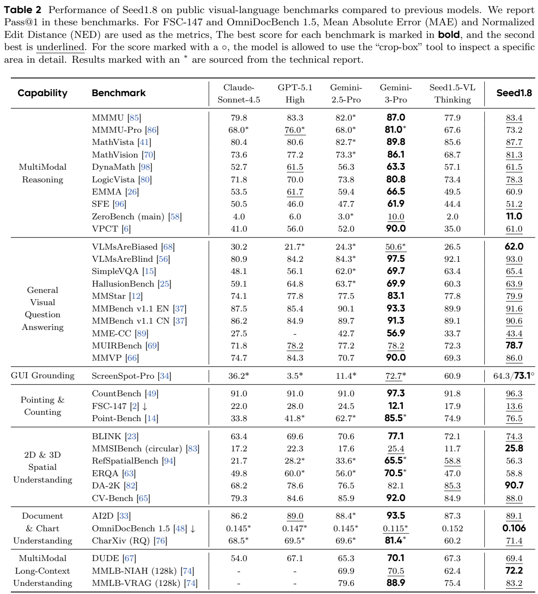

<!-- article-header:start -->
[项目首页](../../../README.md) › [模型系列](../../../reports/model-family-index.md) › [Seed](../README.md)
<!-- article-header:end -->

# Seed1.8：面向真实任务的视觉感知、推理与多步执行

<!-- article-toc:start -->

**本篇目录** · [论文定位](#paper-info) · [快速概览](#overview) · [整体架构](#architecture) · [核心原理](#principles) · [数据构建](#data) · [训练流程](#training) · [实验结果](#experiments)
<!-- article-toc:end -->

## 1. 论文信息与模型定位

| 项目 | 内容 |
| --- | --- |
| 原文题名 | Seed1.8 Model Card: Towards Generalized Real-World Agency |
| 团队 | ByteDance Seed |
| 原文日期 | PDF 首页标注 2025 年 12 月 17 日 |
| 依据版本 | [官方 48 页模型卡](https://lf3-static.bytednsdoc.com/obj/eden-cn/lapzild-tss/ljhwZthlaukjlkulzlp/research/Seed-1.8-Modelcard.pdf)，本仓库固定 2026-10-08 获取快照；获取日期不等于发布时间 |
| 模型定位 | 融合语言、视觉、工具使用与多步交互的通用助手 |
| 主要输入与行为 | 文字、图像、文档、图表、视频、GUI 画面；生成回答、代码、工具请求及界面操作 |
| 主要披露范围 | 公开/内部基准结果、推理预算、视频重采样工具和交互案例；未披露可复现的网络及训练配方 |

Seed1.8 的目标是从单次预测走向持续执行：它需要理解用户要求、观察环境、检索或操作工具，并根据返回结果调整后续步骤。模型卡强调一套模型具备语言与视觉基础能力，并在统一交互中支持搜索、代码和 GUI 工作流。**“统一模型”不能据此展开成未披露的共享层数、MoE 路由或视觉连接结构**；原文也没有公开参数规模、权重开放许可或训练数据总量，本文不从其他 Seed 版本补填。[PDF 第 1 页](https://lf3-static.bytednsdoc.com/obj/eden-cn/lapzild-tss/ljhwZthlaukjlkulzlp/research/Seed-1.8-Modelcard.pdf#page=1)

## 2. 快速概览

| 方向 | Seed1.8 处理的实际问题 | 公开证据 |
| --- | --- | --- |
| 基础语言与视觉 | 推理、知识、约束遵循、图像/文档/空间理解 | Table 1–3 的分项基准 |
| 搜索与代码执行 | 多次获取外部资料、修改仓库、运行工具并整合结果 | Table 4 的检索、编码、写作和工具使用 |
| 界面操作 | 通过截图理解屏幕并执行点击、滑动、澄清等动作 | Table 5 与 Figure 6 |
| 视频主动观察 | 长视频定位后重新查看关键片段，连续视频中判断何时回应 | Table 6、Figure 7–9 |
| 计算预算控制 | 依据难度选择思考深度或增加推理路径 | 四种 thinking modes、Figure 1–4、Table 7 |

原文为普通评测使用 **think-high**，另外提供 **no_think、think-low、think-medium** 三档，分析性能和推理 token 的关系。工具增强、并行思考与常规高档思考是不同设置。视频评测中，有的输入含字幕，有的采用主动回应协议；内部 WorldTravel 还报告 best-of-5。阅读总分前，需要先看这些条件。[PDF 第 2、5、7、9–11 页](https://lf3-static.bytednsdoc.com/obj/eden-cn/lapzild-tss/ljhwZthlaukjlkulzlp/research/Seed-1.8-Modelcard.pdf#page=2)

它的强项包括若干视觉诊断、运动感知和复杂检索任务，弱项仍包括高难知识、部分函数调用及专业推理。模型卡的实际表格也不支持“所有基准都领先”的结论。例如 MMMU-Pro 为 73.2，低于表中的 GPT-5.1 High 76.0 和 Gemini 3 Pro 81.0；BFCL-v4 为 57.2，低于 Claude Sonnet 4.5 的 68.7。介绍会保留这些差异，而不只摘最佳项目。[PDF 第 4、7 页](https://lf3-static.bytednsdoc.com/obj/eden-cn/lapzild-tss/ljhwZthlaukjlkulzlp/research/Seed-1.8-Modelcard.pdf#page=4)

## 3. 整体架构

**原文披露的是行为与系统接口，缺少底层网络图。** 可以按交互流程理解：用户输入及环境观察进入模型，模型决定回答还是采取行动，工具或 GUI 执行器返回结果，再进入下一轮。搜索提供新证据，代码工具提供可计算结果，视觉感知把截图、文档、图表和视频纳入决策。这里的流程是对模型卡所描述行为的归纳，不是原文公布的 Transformer 模块图。[PDF 第 1、6–8、16–17 页](https://lf3-static.bytednsdoc.com/obj/eden-cn/lapzild-tss/ljhwZthlaukjlkulzlp/research/Seed-1.8-Modelcard.pdf#page=16)

**读图方式。** Figure 6 从左到右列第 3、38、82 和 122 步，并非完整 122 步日志。点击和滑动的数字是界面动作参数；中间的澄清动作让用户确认规格选择；最后一列汇总多个平台的信息。图的意义在于观察、行动、信息保存和澄清需要连成一条任务轨迹。它是单个完成案例，不是 122 步平均成本、总体购物成功率或已经下单的证据。第 16 页称其为多平台比较任务，图中具体需求是为鱼缸选择过滤器、防跳网和加热棒。[PDF 第 16–17 页](https://lf3-static.bytednsdoc.com/obj/eden-cn/lapzild-tss/ljhwZthlaukjlkulzlp/research/Seed-1.8-Modelcard.pdf#page=17)

视频有两种接口。**离线长视频**允许调用 **VideoCut**，指定片段起止时间和 1–5 FPS，由工具重新取帧，模型继续观察与推理。**流式视频**的示例以 1 FPS 持续输入，模型可以直接回答用户、保持安静观察，或由视觉事件触发主动回应。新帧可中断正在生成的内容，模型再判断是否继续。这两种时间调度机制不能合并成“全程高帧率实时处理”。[PDF 第 8–9、16–20 页](https://lf3-static.bytednsdoc.com/obj/eden-cn/lapzild-tss/ljhwZthlaukjlkulzlp/research/Seed-1.8-Modelcard.pdf#page=8)

Figure 9 上方时间轴标输入画面和用户发问，下方不同符号表示回答、静默思考和视觉触发回应，省略号表示被新输入打断后可能恢复。它展示的是带中断的交互案例，没有给出端到端延迟或吞吐统计。同页 Figure 10 是独立的安全结果，深浅蓝对应 Seed1.8 和 Seed1.6；柱高不能用于解释视频能力。图中未标精确柱值，本文不从像素估算成小数分数。[PDF 第 17、20 页](https://lf3-static.bytednsdoc.com/obj/eden-cn/lapzild-tss/ljhwZthlaukjlkulzlp/research/Seed-1.8-Modelcard.pdf#page=20)

## 4. 核心创新与数学原理

**把推理用于闭环行动。** 用一个概念式表达交互：

$$
h_t=(q,o_0,a_0,o_1,\ldots,a_{t-1},o_t),
\qquad a_t\sim\pi_\theta(\cdot\mid h_t).
$$

$q$ 是用户目标，$o_t$ 是当前观察，$a_t$ 可以是工具调用、界面操作或结束回答。该式只是本文解释，不是模型卡中的策略梯度算法。与只生成一次答案相比，下一次动作取决于外部结果：截图可能显示商品缺货，检索可能带来相互矛盾的资料，工具也可能报错。因此模型需要保存关键证据，并在必要时调整计划或澄清条件。原文没有披露这一能力具体由哪种训练目标获得。[PDF 第 1、7–8、16–17 页](https://lf3-static.bytednsdoc.com/obj/eden-cn/lapzild-tss/ljhwZthlaukjlkulzlp/research/Seed-1.8-Modelcard.pdf#page=1)

**用局部再观察缓解长视频的信息损失。** 若长度为 $T$ 的视频按帧率 $f$ 抽样，帧数大致随 $Tf$ 增长；每帧视觉 token 的编码方式未披露，不能把这一关系继续换算为固定 token 数。VideoCut 允许把高密度观察集中在候选区间 $[t_s,t_e]$，而非提高整段视频的抽样率。Figure 7 的例子中，模型先找车牌与店名相关时刻，首次查看未找到目标，再扩大时间窗口重新观察。能力来源是定位、检索、重采样和推理协作，而不是回放凭空补回原视频不存在的内容。[PDF 第 8–9、18–19 页](https://lf3-static.bytednsdoc.com/obj/eden-cn/lapzild-tss/ljhwZthlaukjlkulzlp/research/Seed-1.8-Modelcard.pdf#page=18)

**思考预算需要看任务收益。** 图中横轴是推理 token，纵轴是任务分数，不是 GPU FLOPs 或秒。不同模型 tokenizer、运行硬件和工具等待不同，因此同等 token 更高分说明该图协议下的 token 效率，不能直接断言同等货币成本或同等延迟。原文还采用并行推理路径及中间结果聚合，但没有公开路径数、选择器、聚合规则或停止准则，本文不将它补写为树搜索、投票或奖励模型筛选。[PDF 第 9–11 页](https://lf3-static.bytednsdoc.com/obj/eden-cn/lapzild-tss/ljhwZthlaukjlkulzlp/research/Seed-1.8-Modelcard.pdf#page=9)

上方表格直接比较是否启用视频工具；下方两个图分别是文本与多模态推理。颜色区分模型，点形区分思考档位。应先沿同一颜色比较预算变化，再比较不同模型。Seed1.8 通常比 Seed1.6 更有效利用预算，但图中 Gemini 3 Pro 在多个任务的分数仍更高，不能把“较前代改进”读成“所有点支配全部模型”。[PDF 第 9–10 页](https://lf3-static.bytednsdoc.com/obj/eden-cn/lapzild-tss/ljhwZthlaukjlkulzlp/research/Seed-1.8-Modelcard.pdf#page=9)

**真实任务的正确性包含约束满足。** WorldTravel 的任务同时涉及预算、开放时间、行程顺序和预订界面，可用以下概念式理解：

$$
\text{find }x\quad\text{such that}\quad c_i(x)=\mathrm{true},\ i=1,\ldots,m.
$$

必要时再优化偏好或成本。原文称每项任务包含 10 至超过 20 个相互耦合的条件，并使用“难解、易验”的自动验证；它未公开统一目标函数、约束求解器或整套判分代码。这里强调的是能把约束落实到完整计划，不是证明模型实现了某种优化算法或产生实际投资回报。[PDF 第 11、39–40 页](https://lf3-static.bytednsdoc.com/obj/eden-cn/lapzild-tss/ljhwZthlaukjlkulzlp/research/Seed-1.8-Modelcard.pdf#page=39)

## 5. 数据构建与处理

**训练数据没有披露；可详细核实的是评测数据。** 模型卡未公开预训练 token、图文/视频样本数、清洗、去重、合成指令、训练轨迹比例或数据混合权重。附录 B 介绍的基准不能改写为 Seed1.8 的训练集，测试题的专家审核也不能作为训练数据全无污染的证明。

| 基准 | 公开构建方式与规模 | 目的 |
| --- | --- | --- |
| MM-BrowseComp | 224 道人工设计并验证的难题；提示或关键网页包含图像、视频；逐题提供核验清单 | 判断跨模态查证和多步检索，区分推导与偶然猜中 |
| WideSearch | 200 项任务，中英文各 100 | 持续收集分散信息，测覆盖与一致性 |
| Multi-SWE-Bench | Java、TS、JS、Go、Rust、C、C++ 共 1,632 实例；68 名专家审核 2,456 候选 | 非 Python 仓库 issue 解决 |
| AInstein-SWE-Bench | 真实科学仓库、历史快照、容器化 fail-to-pass 测试；任务总数未披露 | 科学知识与实际代码修改协同 |
| U-Artifacts | 199 案例、13 主题；自动合成与人工场景并用，GUI 代理模拟用户 | 交互、界面及需求满足 |
| BIOBench | 150 道高难生物题，80% 多模态、20% 纯文本；专家标注复核 | 生物知识与图像推理 |
| XpertBench | 超过 200 名专家，五大领域、超过 140 种真实任务类型；多轮审查提示及带权 rubric | 专业输出质量；140 是类型数，不是样本总数 |
| WorldTravel | 150 人工任务，多重约束，作者报告人类专家平均约 1.5 小时 | 视觉信息与复杂行程规划 |

这些数字均为原文所述，AInstein、BIOBench、U-Artifacts、XpertBench 和 WorldTravel 等属于内部评测，不能据此声称题目及完整裁判已对外开放。[PDF 第 29–31、39 页](https://lf3-static.bytednsdoc.com/obj/eden-cn/lapzild-tss/ljhwZthlaukjlkulzlp/research/Seed-1.8-Modelcard.pdf#page=29)

原文还解释若干数据质量策略：BeyondAIME 人工改题、限制依赖冷门知识并用正整数答案明确验证；LPFQA 从专业论坛收集 502 个问题，经过自动质检与专家确认；Inverse IFEval 用 1,012 道中英文题考查模型是否能克服固化回答习惯；DiscoX 用 200 篇、七领域、平均超过 1,700 token 的专业文本检查篇章翻译。它们反映团队希望把评测从简单选择题扩展到长任务和复杂约束，不意味着这些数据都是本报告首次发布。[PDF 第 30–31 页](https://lf3-static.bytednsdoc.com/obj/eden-cn/lapzild-tss/ljhwZthlaukjlkulzlp/research/Seed-1.8-Modelcard.pdf#page=30)

六类基础业务评测涵盖教育、客服、信息处理、意图识别、信息抽取和 SOP 工作流。附录给出输入与要求的例子，例如仅使用指定产品知识回答、抽取字段时保留单位、按订单类别选择后续处理步骤。多数未给完整样本数和细粒度判分协议。WorldTravel 使用合成网页模拟真实预订与时间约束，因此不是直接在持续变化的真实旅游网站上执行订单。[PDF 第 11、28、32–39 页](https://lf3-static.bytednsdoc.com/obj/eden-cn/lapzild-tss/ljhwZthlaukjlkulzlp/research/Seed-1.8-Modelcard.pdf#page=32)

## 6. 训练流程与目标

**本文不能据模型卡复现训练。** 预训练、SFT、偏好优化、强化学习是否使用及其顺序、奖励形式、冻结对象、学习率、优化器、GPU、训练步数和上下文扩展方法都未公开。正文的“增强了主动回应”与“优化视觉编码”是能力及效率描述，没有给出具体实现，不能写成已知的 RL 配方或视觉压缩算法。

| 已披露的开发/运行信息 | 未披露、不能反推的信息 |
| --- | --- |
| 以语言、视觉、交互和真实业务基准引导模型开发 | 各能力对应的数据来源、阶段比例或训练 loss |
| 四种思考档位，可分配不同测试时计算 | 档位如何训练、是否采用蒸馏及内部停止规则 |
| 图像与视频编码旨在降低输入 token 消耗 | patch 大小、动态切块、token 合并/压缩模块 |
| 通过 VideoCut 观察关键片段 | 该工具的监督或强化学习训练轨迹配置 |
| 可并行探索推理路径并整合结果 | 路径数、聚合器、采样温度及奖励模型 |
| 安全基准及若干拒答实例 | 安全训练数据量、奖励函数、标注流程和对抗训练细节 |

运行层面，主结果用 **think-high**；长视频能力比较设最大视频 token 81,920；Figure 3 还比较约 32K、48K、64K、80K 的预算。上下文基准中的 128K 是该项评测条件，不足以单独证明所有产品接口、模态和任务统一支持同样上下文。视频 token 上限也不等于输出推理预算。[PDF 第 2、4、6、10–11 页](https://lf3-static.bytednsdoc.com/obj/eden-cn/lapzild-tss/ljhwZthlaukjlkulzlp/research/Seed-1.8-Modelcard.pdf#page=10)

安全部分用 AIR-Bench、XSTest 及内部风险类别检查行为。Figure 10 显示相对 Seed1.6 的 AIR-Bench 提升，XSTest 保持较高；Table 9 展示若干拒答或谨慎回答。样例不提供广泛攻击成功率、视觉越狱或长工具轨迹的完整风险测量，也不能由此推出所有 GUI 行动都经过可靠授权判断。[PDF 第 17、20–21 页](https://lf3-static.bytednsdoc.com/obj/eden-cn/lapzild-tss/ljhwZthlaukjlkulzlp/research/Seed-1.8-Modelcard.pdf#page=20)

## 7. 实验设置与主要结果

**比较协议需要逐表确认。** Table 1 通常不使用工具，但 IMO-AnswerBench 明确有代码工具；Table 2 的 **crop-box** 标记是额外视觉工具；Table 3 的字幕和主动评测有不同标注；Table 4 包含交互工具，WorldTravel 又是 best-of-5；Table 7 扩展思考结果明确全部无工具。带星号的其他模型分数摘自其报告，不能把这些表理解为所有模型共享同一套环境、延迟和动作预算。

**读表方式。** 最右列是 Seed1.8，加粗及下划线标表中第一、第二名；星号指报告引用值，空缺不是零分。FSC-147 的 MAE 和 OmniDocBench 的 NED 越低越好；ScreenSpot-Pro 的 64.3/73.1 分别是基础与裁剪工具设置。图中不同指标不能加总，也不能把 crop-box 的收益解释成无工具性能。

| 代表视觉指标 | Seed1.8 | 对照与解释 |
| --- | --- | --- |
| MMMU / MMMU-Pro | 83.4 / 73.2 | 前代 77.9 / 67.6；Gemini 3 Pro 87.0 / 81.0 |
| MathVista / MathVision | 87.7 / 81.3 | 改善明显，表中仍低于 Gemini 3 Pro 89.8 / 86.1 |
| ZeroBench main / VLMsAreBiased | 11.0 / 62.0 | 表中最高，但 11.0 本身说明极难视觉题仍大量失败 |
| ScreenSpot-Pro | 64.3；工具后 73.1 | 基础值低于 Gemini 3 Pro 72.7；额外观察后才超过 |
| OmniDocBench 1.5 | NED 0.106 | 优于前代 0.152 与 Gemini 3 Pro 0.115，低值更好 |
| MMLB-NIAH / VRAG，128K | 72.2 / 83.2 | 找针项较高；VRAG 低于 Gemini 3 Pro 88.9 |

空间理解也不应只看最优列：DA-2K 为 90.7，MMSIBench circular 为 25.8，但 RefSpatialBench 为 56.3，略低于前代 58.8。视频中 TVBench 71.5、MotionBench 70.6 和 EgoTempo 67.0 较强，学科知识任务 VideoMMMU 82.7 与 MMVU 73.1 则低于 Gemini 3 Pro 87.6/76.3。VideoMME 87.8 是**含字幕**设置，不是无字幕成绩。[PDF 第 4–6 页](https://lf3-static.bytednsdoc.com/obj/eden-cn/lapzild-tss/ljhwZthlaukjlkulzlp/research/Seed-1.8-Modelcard.pdf#page=5)

**工具能提高长视频结果，但改变了输入观察成本。** Table 6：CGBench 从 62.4 到 65.9，LVBench 从 73.0 到 78.9，内部 ZeroVideo 从 6.9 到 18.8。ZeroVideo 只有 101 道高难题，表中平均视频长 1,672 秒；增益支持“再观察关键片段有用”，尚未同时报告各题工具次数、延迟和消耗。Figure 3 显示 Seed1.8 用 32K 最大视频 token 在三个任务上高于前代 80K，但 CGBench 的自身分数也有 64K 63.0 到 80K 62.4 的波动，增加预算不保证每个任务单调提升。[PDF 第 9–10 页](https://lf3-static.bytednsdoc.com/obj/eden-cn/lapzild-tss/ljhwZthlaukjlkulzlp/research/Seed-1.8-Modelcard.pdf#page=9)

**并行思考属于更高推理预算设置。**

| Table 7，无工具 | 常规 Seed1.8 | 增加思考 |
| --- | --- | --- |
| AIME-25，Avg@10 | 94.3 | 97.3 |
| HMMT25 Feb，Avg@10 | 89.7 | 96.7 |
| 表中标为 LeetCodeBench(v6)，Avg@8 | 79.4 | 84.7 |
| HLE full / text / vision，Pass@1 | 21.4 / 22.1 / 17.3 | 25.6 / 26.4 / 20.2 |

Avg@10/8 标注不能改写成从 10/8 个答案取最好结果的 Pass@10/8；报告没有完整公开这一设置的选择和聚合细节。Table 7 的编码基准名称与 Table 1 的 LiveCodeBench(v6) 不同，79.4 和 79.5 也不同，本文保留各表原值。Table 1 中 LiveCodeBench pro 的 1930 是该表所列评分值，显然不能解释为 1930% 的 Pass@1。[PDF 第 3、11 页](https://lf3-static.bytednsdoc.com/obj/eden-cn/lapzild-tss/ljhwZthlaukjlkulzlp/research/Seed-1.8-Modelcard.pdf#page=11)

代理搜索方面，Table 4 的 BrowseComp-en 67.6、BrowseComp-zh 81.3、GAIA 87.4 和 MM-BrowseComp 46.3 较强；SWE-Bench Verified 72.9 低于 Claude Sonnet 4.5 的 77.2，BFCL-v4 57.2 和 $\tau^2$-Bench 72.0 也未领先。GUI 的 OSWorld/Realbench/Online-Mind2web/AndroidWorld 分别为 61.9/49.1/85.9/70.7，OSWorld 仍略低于表中 Claude 62.9，因此不能沿用正文“全部最佳”的概括。Figure 4 的 BrowseComp 在低/中预算下用少于 50 步达到 45.0/55.0，允许更长轨迹时在 150 步达到 67.6；这是分数与执行步骤的折中，不是更长代理轨迹已无失败风险。[PDF 第 7–8、11 页](https://lf3-static.bytednsdoc.com/obj/eden-cn/lapzild-tss/ljhwZthlaukjlkulzlp/research/Seed-1.8-Modelcard.pdf#page=7)

**原文内部有数值及结论差异。** 本文以对应结果表为主，明确保留：GAIA 表格 87.4、正文 93.2；BrowseComp-zh 表格 81.3、正文 78.5；FinSearchComp T2&T3 表格 62.8、正文 56.2；TOMATO 表格 60.8、正文 60.6。模型卡没有说明是否来自不同评测版本，不能选最高值或把它们平均。第 5 页“其他 VQA 全部第二”的说法也与 HallusionBench、MME-CC 等行不完全吻合，分项表更适合核查。[PDF 第 4–8 页](https://lf3-static.bytednsdoc.com/obj/eden-cn/lapzild-tss/ljhwZthlaukjlkulzlp/research/Seed-1.8-Modelcard.pdf#page=7)

内部教育与客服为 60.8、69.0，专业 XpertBench 金融/法律为 62.0/55.2，WorldTravel 多模态 best-of-5 为 47.2。它们支持在规定题目上衡量实用能力，不能直接换算为生产效率或投资回报。特别是科学编码案例：第 16 页称任务完成，但 Appendix C.4 明确说完整执行受缺少 Cactus 构建环境阻碍，只做部分编译尝试与文件一致性检查。本文据此将该例视为推导、修改和部分验证的演示，**不声称模型已跑通完整数值仿真测试**。[PDF 第 3、7、16、39、48 页](https://lf3-static.bytednsdoc.com/obj/eden-cn/lapzild-tss/ljhwZthlaukjlkulzlp/research/Seed-1.8-Modelcard.pdf#page=48)

总体可核实的是模型在部分视觉、搜索和长视频再观察协议下的进步；训练机制、完整成本、内部任务可复现性和跨环境可靠性仍未充分公开。本文没有运行 Seed1.8，也没有把附录中模型生成的法律、金融或科学回答作为已经独立验证的事实来源。

<!-- article-footer:start -->
---

[← 上一篇：GPT-5.2](../../gpt/document-e2a1f413a7a5/README.md) · [按发表时间浏览](../../../reports/paper-reading-guide.md#year-2025) · [下一篇：DeepSeek-OCR 2 →](../../deepseek/document-536ef2604f4a/README.md)

[返回本篇目录](#article-toc) · [返回模型系列](../README.md)
<!-- article-footer:end -->
