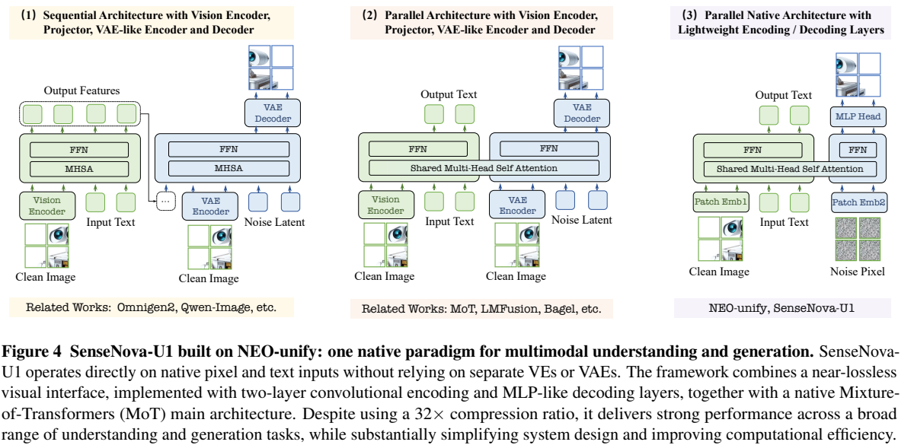
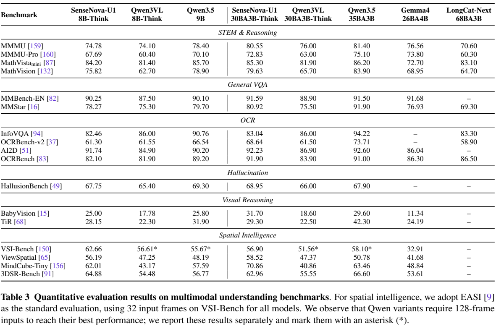
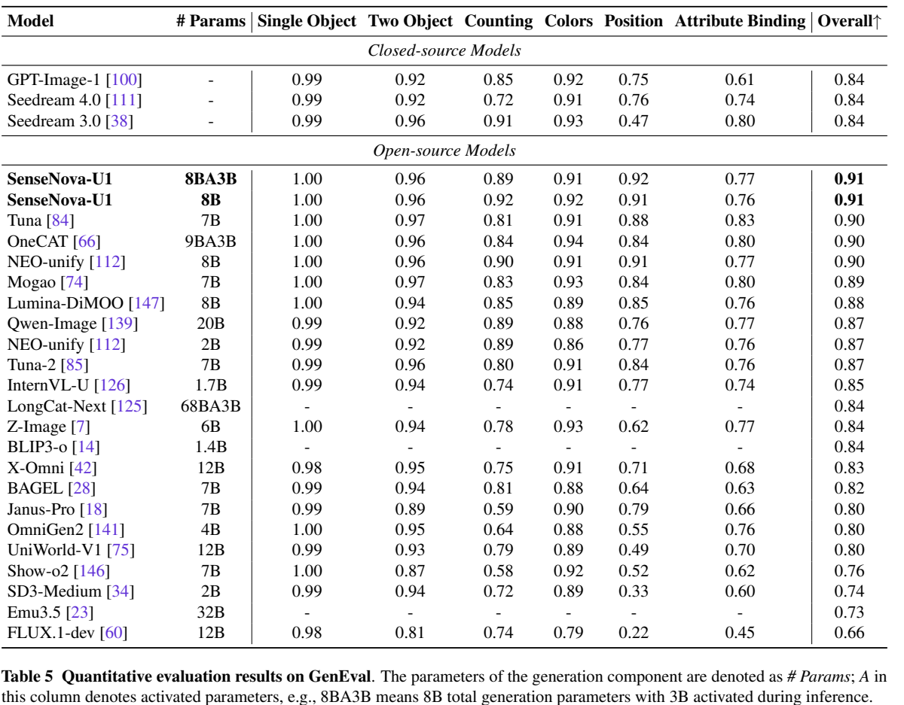

<!-- article-header:start -->
[项目首页](../../../README.md) › [模型系列](../../../reports/model-family-index.md) › [SenseNova](../README.md)
<!-- article-header:end -->

# SenseNova-U1：以原生像素连接理解、生成与交错推理

<!-- article-toc:start -->
<a id="article-toc"></a>

**本篇目录** · [论文定位](#paper-info) · [快速概览](#overview) · [整体架构](#architecture) · [核心原理](#principles) · [数据构建](#data) · [训练流程](#training) · [实验结果](#experiments)
<!-- article-toc:end -->

<a id="paper-info"></a>

## 1. 论文信息与模型定位

| 项目 | 信息 |
|---|---|
| 原文 | **SenseNova-U1: Unifying Multimodal Understanding and Generation with NEO-unify Architecture** |
| 团队 | SenseNova / 商汤 |
| 发表日期 | **2026-05-12**，arXiv v1；官方仓库另记录5月10日报告发布 |
| 固定版本 | [2605.12500v1 PDF](https://arxiv.org/pdf/2605.12500v1) |
| 代码与模型 | [官方仓库](https://github.com/OpenSenseNova/SenseNova-U1) · [官方组织](https://huggingface.co/sensenova) |
| 规模与任务 | 8B-MoT与A3B-MoT；理解、文字生成、文生图、编辑和图文交错输出 |

SenseNova-U1建立在NEO-unify上，把干净图像、噪声图像和文字送进原生MoT，不依赖外部预训练视觉编码器或VAE。这里“无编码器”指取消独立大型视觉主干，模型仍有可学习卷积patch接口；“近无损”是设计与重建结果支持的描述，并非对任意图像严格可逆的数学保证。[§3，第7–12页](https://arxiv.org/pdf/2605.12500v1#page=7)

<a id="overview"></a>

## 2. 快速概览

| 设计 | 核心作用 | 需要区分 |
|---|---|---|
| 两层patch编码 | 像素直接进入统一隐藏空间 | 每token对应32×32区域，不是VAE latent |
| 原生MoT | 理解状态向生成状态传递语义 | 共享注意力交互不等于共享全部投影/FFN参数 |
| 双目标学习 | 文字自回归 + 像素流匹配 | 图像通过连续去噪生成，不是RGB离散token自回归 |
| 分阶段训练 | 先稳定理解，再生成，后联合 | 生成预训练时理解支路冻结 |
| 后训练与蒸馏 | OCR/风格/美感奖励，减少函数求值 | 理解主结果没有专门理解RL；图像后训练不能泛化为所有任务RL |

GenEval两种规模均报告0.91；MMMU分别74.78和80.55。生成表的参数量仅标**生成分支**，与理解表的30B-A3B口径不同，不能混成整个系统只需8B参数。[Tables1/3/5，第8、16、18页](https://arxiv.org/pdf/2605.12500v1#page=8)

<a id="architecture"></a>

## 3. 整体架构



*Figure4，PDF第7页；完整保留三种方案对比与图注，右侧为本模型的原生路径。*

| 模块 | 输入与输出 | 公开机制 |
|---|---|---|
| Patch编码层 | 干净/噪声RGB → 视觉token | 两层卷积stride16、2，GELU与2D正弦位置编码，图像边界标记 |
| 文字接口 | 文字 → 文字嵌入 | 沿用语言骨干tokenizer，与视觉嵌入投向共同空间 |
| 理解支路 | 干净图文 → 理解隐状态/文字 | 原生RoPE，独立投影、归一化与FFN，线性词表头自回归输出 |
| 生成支路 | 噪声视觉状态和干净条件 → 干净像素预测 | 按token类型选生成参数；MLP head直接输出像素patch |
| 共享注意力计算 | 两类支路状态 → 上下文交互 | 文字因果、图内双向；生成可读干净条件，干净状态不可读噪声 |
| 推理服务 | 文字/图像请求 → 流式图文输出 | LightLLM负责理解和控制，LightX2V负责去噪，交换KV等状态 |

Table1中8B-MoT为42层、隐藏4096、Q/KV头32/8，有Pre-Buffer，理解/生成参数各列8.2B。A3B-MoT为48层、隐藏2048、Q/KV32/4，无Pre-Buffer；理解128专家共30B、生成32专家共8.2B，两路每token各激活8专家。单头RoPE的时间/高/宽维数均为64/32/32。MoT的支路选择与MoE的专家选择是两个不同层次。[§3.2 / Table1，第8页](https://arxiv.org/pdf/2605.12500v1#page=8)

一次编辑请求先把参考图和指令放进理解支路，再让噪声图像支路读取其上下文，迭代生成目标像素；文字回复仍沿自回归路径。交错输出可经历文字→触发生成→图像反馈→继续文字。部署上分两个引擎不代表训练时退回两套独立模型，分离主要服务于自回归与去噪不同的调度需求。[§3.5 / Figure5，第12–13页](https://arxiv.org/pdf/2605.12500v1#page=12)

<a id="principles"></a>

## 4. 核心创新与数学原理

### 4.1 同序列交互与支路参数解耦

MoT把干净图文和噪声生成状态排列在同一序列，每层执行联合注意力，但Q/K/V投影、归一化和FFN按支路独立。文字只看前文，同一图像块内部双向；噪声块可以看干净条件，反向访问被遮罩。这既让生成持续获得语义，也防止随机噪声污染用于理解的状态。

Native RoPE把LLM原有head维数重新分给时间、高、宽轴，文字沿时间轴移动而高宽索引为0，图像另带空间坐标；重分配不额外添加位置参数。8B版本浅层Pre-Buffer帮助映射原始像素/文字，后续保留LLM语言能力；A3B版本采用支路内MoE且无Pre-Buffer，不可机械套用同一层结构。[§3.2，第8页](https://arxiv.org/pdf/2605.12500v1#page=8)

### 4.2 直接像素的x预测与速度损失

原文Eq.(3–5)令时间0为噪声、1为干净图：

```math
z_t=tx+(1-t)\sigma_R\epsilon,\qquad v_\theta=\frac{\hat x_\theta(z_t,t,s_t)-z_t}{1-t},\qquad v^\star=\frac{x-z_t}{1-t},\qquad \mathcal L_{\mathrm{Gen}}=\mathbb E\Vert v_\theta-v^\star\Vert_2^2.
```

$`x`$ 是RGB图像，$`\epsilon`$ 为标准高斯噪声，$`\sigma_R`$ 随分辨率调节噪声，$`s_t`$ 是时间与噪声尺度条件。网络预测干净终点 $`\hat x_\theta`$，再转换成速度训练，而不是直接把网络输出说成速度。分母 $`1-t`$ 使靠近干净端的预测误差权重不同，式中不应直接代入 $`t=1`$；原文该式描述连续流内部时刻。文字CE与图像MSE在联合阶段权重为0.1:1，这是不同目标的配比，不能按参数数量解释。[§3.3，第8–9页](https://arxiv.org/pdf/2605.12500v1#page=9)

### 4.3 分辨率自适应噪声与双条件引导

视觉token数 $`N(H,W)=HW/32^2`$，噪声尺度按 $`\sigma_R=\sigma_0\sqrt{N/N_0}`$ 调整；Table2设 $`\sigma_0=1,N_0=64`$。噪声尺度归一化后进入独立正弦MLP，与时间嵌入相加，模型因而显式知道同一时间下不同分辨率的噪声统计。该策略改变训练和ODE初始化，不是仅在输入图像上加随机增强。

Eq.(6)分别调节文字条件相对仅图像条件、图像条件相对无条件的引导差分。实践使用文字guidance4、图像guidance1、timestep shift3；训练随机丢文字或同时丢文字/图像来学习这些分支。因此编辑参考图与文字指令的作用可分开控制，代价是引导所需额外模型求值。[§3.1/3.3 / Table2，第7、9–10页](https://arxiv.org/pdf/2605.12500v1#page=7)

### 4.4 图像RL以任务奖励交替优化

文字渲染奖励使用PaddleOCR识别结果和目标文字的**多重集合交并比**，计入重复文字次数；它不是框坐标IoU。风格由VLM给1–4分再映射到0–1，美感用HPSv3。先训练OCR，再交替“文字+0.5×风格”和美感两组奖励，避免把美感收益误当作文字准确率收益。

生成分辨率从容易的面积/比例逐渐放开：Eq.(7)按当前epoch与难度门控各分辨率的采样概率后重新归一化。8B与A3B通用RL分别1600和200epoch；理解支路、生成最后三层与MLP头冻结以缓解网格伪影。原文把空间PixelShuffle解码头列为后续方向，U1实际仍是独立patch MLP，不能提前套用U1.5的改进。[§3.4，第10–11页](https://arxiv.org/pdf/2605.12500v1#page=11)

### 4.5 通过分布匹配蒸馏缩短生成路径

DMD2用学生生成器G、估计学生分布的fake flow F及教师T进行分布匹配，三者均从教师初始化。只优化生成分支和patch编解码，混合文生图、编辑、交错任务；G每五次F更新后更新一次。作者把图像生成函数求值数从100降到8，这不是把多步推理严格变为一次，也不证明任何条件下都无质量损失。理解分支继续提供条件，编辑/交错的反向模拟使用真值参考图。[§3.4，第12页](https://arxiv.org/pdf/2605.12500v1#page=12)

<a id="data"></a>

## 5. 数据构建与处理

| 数据流 | 构建与筛选 | 披露范围 |
|---|---|---|
| 理解预训 | 图文32%、caption17%、信息图14%、纯文37%；跨源去重、质量过滤、平衡重描述 | 为数据构成，不可当作联合训练采样比例 |
| 理解中训/SFT | SenseNova V6.5内部数据，CLIP聚类及属性分层采样、增强指令后统一重答、多维核验 | 正确性、幻觉、指令遵循均纳入评分 |
| 文生图 | Nature/People/Design及合成信息图、双语文字；去重、VLM描述与质量筛选 | 自然40.5%、人物26.7%、设计20.7%为该语料内部比例 |
| 编辑 | 源/目标对与指令，分解“应改变/应保留”目标并检查物理一致性 | 包括增删、背景、身份、组合与推理编辑 |
| 图文交错 | 视频、生活、信息图、推理，检验文字/图像/轨迹一致性 | 生活约44%、信息图29%、视频19%、推理8% |

SFT从中训候选池进一步提高质量及难度，拼成长上下文/多图/多轮样本，拒绝采样保留中等难度推理。完整内部来源、标注教师与全部样本清单未公开；模型评分不等于逐条人工核验。[§4，第13–15页](https://arxiv.org/pdf/2605.12500v1#page=13)

<a id="training"></a>

## 6. 训练流程与目标

| 阶段 | 更新与目标 | Table2关键配置 |
|---|---|---|
| 1 理解预热 | NEO的QK轴向投影/归一化融合后先恢复注意力，再全理解支路续训 | 120K步，0.75T token，32K长度 |
| 2 生成预训 | 理解冻结，像素流匹配；三期逐步升分辨率并加编辑/交错 | 120K/60K/120K步，0.25T/0.25T/0.88T token |
| 3 联合中训 | 全模型，理解/文生图/编辑/交错比0.33/0.37/0.24/0.06 | 84K步，1.19T token，CE:MSE=0.1:1 |
| 4 联合SFT | 全模型指令对齐，沿用联合比例 | 9K步，0.13T token，学习率2e-5降至0 |
| 5 生成RL | Flow-GRPO，OCR、风格与美感奖励 | 冻结理解及部分生成末端，动态分辨率预热 |
| 6 蒸馏 | DMD2减少CFG/求值开销 | 仅生成支路，100→8 NFE |

生成训练主要到2048²像素，理解可至4096²；两者接口窗口不应混淆。A3B在生成预训/联合阶段另设MoE平衡系数5e-3/1e-3。表中token规模为阶段消耗量，不等于独立样本数。作者提供较多配方，但没有由此公开全部内部数据。[§3.4 / Table2，第9–12页](https://arxiv.org/pdf/2605.12500v1#page=10)

<a id="experiments"></a>

## 7. 实验设置与主要结果



*Table3，第16页；保留空间评测帧数及星号说明。*



*Table5，第18页；参数量列指生成分支，A表示激活规模。*

| 任务 | 8B-MoT | A3B-MoT | 口径 |
|---|---:|---:|---|
| MMMU / MMMU-Pro | 74.78 / 67.69 | 80.55 / 72.83 | Table3，thinking |
| MathVision | 75.82 | 79.63 | Table3 |
| OCRBench-v2 | 61.30 | 68.64 | 不等同OCRBench |
| GenEval | 0.91 | 0.91 | Table5 |
| DPG-Bench | 87.78 | 88.14 | Table6 |
| OneIG英文 / 中文综合 | 0.549 / 0.535 | 0.543 / 0.540 | Tables7–8 |

理解评测用EvalScope、GPT-4o-mini-2024-07-18裁判，temperature0.6、top-p0.95、top-k20、40,960最大序列，开启thinking。优先采用官方结果，不足处在建议设置下复测。VSI-Bench采用32帧，但表内Qwen星号为128帧另测结果，不应称每列完全同预算。生成先出2K再缩到1K评测，不能忽略该分辨率流程。[§5.1，第16–20页](https://arxiv.org/pdf/2605.12500v1#page=16)

它在GenEval表现强，但DPG整体仍低于表中Qwen-Image88.32，OneIG中文综合低于0.548；理解若干OCR指标也未超过Qwen3.5。统一能力不意味着每项领先，文中网格伪影与少步生成的质量权衡仍需关注。本仓库整理作者值，未复现模型或声称全文附录均已复核。

<!-- article-footer:start -->
---

[← 上一篇：MiniCPM-V 4.6](../../minicpm/document-eb1014c14dfe/README.md) · [按发表时间浏览](../../../reports/paper-reading-guide.md#year-2026) · [下一篇：Cosmos 3 →](../../cosmos/arxiv-2606.02800/README.md)

[返回本篇目录](#article-toc) · [返回模型系列](../README.md)
<!-- article-footer:end -->
