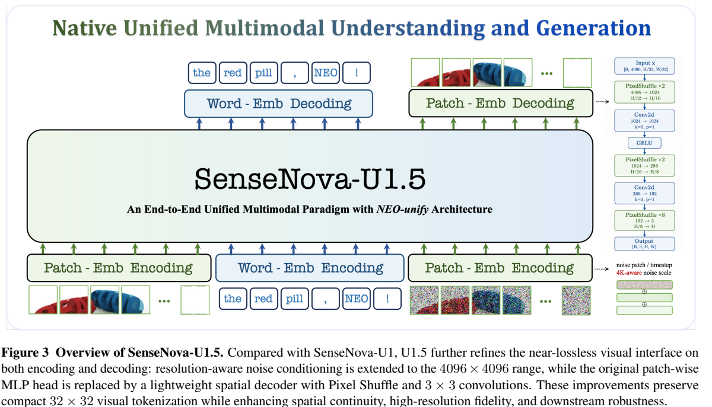
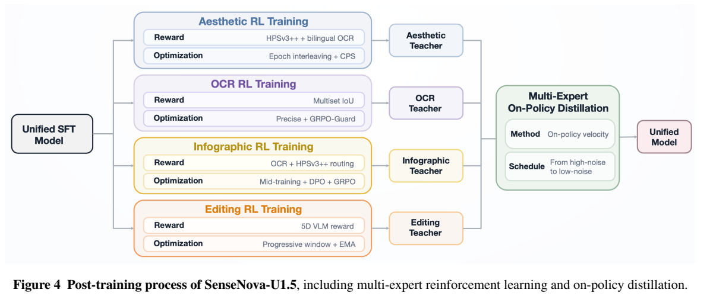
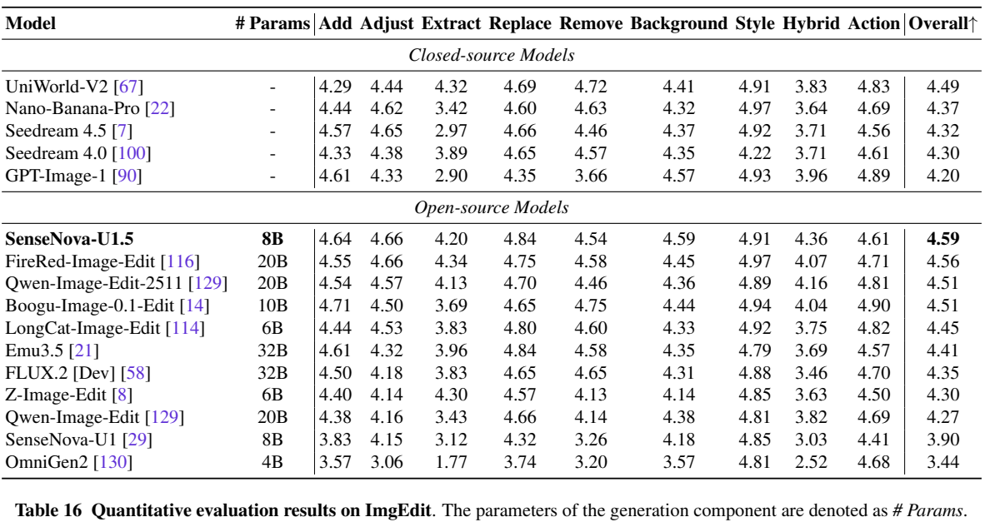

<!-- article-header:start -->
[项目首页](../../../README.md) › [模型系列](../../../reports/model-family-index.md) › [SenseNova](../README.md)
<!-- article-header:end -->

# SenseNova-U1.5：空间解码、原生4K与多专家能力蒸馏

<!-- article-toc:start -->
<a id="article-toc"></a>

**本篇目录** · [论文定位](#paper-info) · [快速概览](#overview) · [整体架构](#architecture) · [核心原理](#principles) · [数据构建](#data) · [训练流程](#training) · [实验结果](#experiments)
<!-- article-toc:end -->

<a id="paper-info"></a>

## 1. 论文信息与模型定位

| 项目 | 信息 |
|---|---|
| 原文 | **SenseNova-U1.5: Towards Native Unified Visual Intelligence** |
| 团队 | SenseNova / 商汤 |
| 发表日期 | **2026-09-10**，arXiv v1；官方仓库9月11日宣布发布 |
| 固定版本 | [2609.11929v1 PDF](https://arxiv.org/pdf/2609.11929v1) |
| 代码与模型 | [官方仓库](https://github.com/OpenSenseNova/SenseNova-U1) · [U1.5模型集合](https://huggingface.co/collections/sensenova/sensenova-u15) |
| 任务 | 8B-MoT原生理解、文生图、图像编辑与图文交错推理 |

U1.5沿用U1的像素/文字统一路线，重点升级生成接口、高分辨率数据和后训练。它把U1独立预测32×32 patch的MLP头换成能跨patch通信的空间解码器，再用美感、双语文字、信息图和编辑四个专家训练统一学生。报告摘要承诺开放训练代码，不能仅凭该承诺声称SFT/RL/蒸馏全套代码已随v1公开。[摘要 / §3，第1、6–12页](https://arxiv.org/pdf/2609.11929v1#page=6)

<a id="overview"></a>

## 2. 快速概览

| 升级 | 作用 | 相对U1的区别 |
|---|---|---|
| PixelShuffle空间解码 | 减少网格接缝与局部纹理不连续 | 相邻patch在输出阶段交换信息 |
| 4K噪声尺度条件 | 跨分辨率/比例稳定建模 | 归一化参考从2048²拓展至4096² |
| Flow + LPIPS | 同时约束像素轨迹与视觉结构 | 后期加入感知损失0.1权重 |
| 四类专家RL | 针对文字、布局、美感、编辑分别优化 | 采用任务奖励路由，避免异质分数简单混加 |
| 多专家on-policy蒸馏 | 把专长汇入一个统一学生 | 教师只提供学生轨迹上的速度监督，并非推理时调用四模型 |

它在GenEval从U1的0.91到0.92，ImgEdit从3.90到4.59；MMMU则74.78降到73.86、OCRBench-v2从61.30降到59.07。主要改进偏向生成与编辑，不能写成理解指标全面提升。[Tables3/6/16，第15、17、22页](https://arxiv.org/pdf/2609.11929v1#page=15)

<a id="architecture"></a>

## 3. 整体架构



*Figure3，PDF第7页；保留主路径、解码器细节与图注。*

| 模块 | 输入与输出 | 公开机制 |
|---|---|---|
| 原生patch接口 | 干净/噪声像素 → 32×32区域token | 两层卷积缩放16再2，GELU、2D正弦位置、图像边界标记 |
| 文字与理解支路 | 图文条件 → 理解状态/文字输出 | 原语言tokenizer、Pre-Buffer、Native RoPE，文字自回归 |
| 噪声条件 | 时间与目标分辨率 → 条件向量 | 噪声尺度除以4K参考最大尺度，经NSEmb与时间嵌入相加 |
| MoT统一注意力 | 干净条件与噪声状态 → 跨流交互 | 文字因果、图内双向；噪声可读干净状态，干净状态不能反读噪声 |
| 支路专属计算 | token隐状态 → 分支隐状态 | 理解/生成使用各自注意力投影、归一化和FFN，按类型路由 |
| 空间解码器 | 视觉隐状态网格 → RGB干净端点 | 复原2D拓扑，PixelShuffle按2、2、8上采样，间插3×3卷积 |

Table1列42层、隐藏4096、Q/KV32/8，头维时间/高/宽64/32/32，理解/生成参数分别8.2B/8.2B。“8B-MoT”是分支尺度标识，不能把整套双分支参数误写为总计8.2B。模型取消外部预训练视觉主干和VAE，但仍有可训练的卷积接口与空间解码器。[§3.1 / Table1，第6–8页](https://arxiv.org/pdf/2609.11929v1#page=7)

一次参考图编辑先构建干净图文上下文，生成分支从按分辨率缩放的噪声开始，多步预测RGB端点并形成速度更新；空间解码把token重新放回网格、让邻域信息跨边界交换。图文交错沿统一序列继续生成文字/图像，四个RL专家只用于后训练监督，不是每次推理必经的四条调用支路。

<a id="principles"></a>

## 4. 核心创新与数学原理

### 4.1 从独立patch到空间耦合重建

U1的MLP独立输出每个32×32块，边界像素难共同决策，可能形成接缝。U1.5先将 $`H\in\mathbb R^{B\times hw\times d}`$ 重排为 $`H_{2D}\in\mathbb R^{B\times d\times h\times w}`$，再按2、2、8逐级上采样，空间倍率总计32。PixelShuffle重排通道到空间，3×3卷积让相邻token区域交流，因此细节修复不再完全局限于单个patch。

这仍是轻量像素输出接口，不引入预训练VAE latent。代价是增加少量空间计算，收益主要针对高分辨率的局部连续性；报告没有单独给所有任务“只替换解码器”的完整因果消融，不能把全部提升都归给它。[§3.1 / Figure3，第7页](https://arxiv.org/pdf/2609.11929v1#page=7)

### 4.2 4K噪声条件、流匹配与感知监督

噪声尺度随分辨率变化，模型把 $`\bar\sigma_R=\sigma_R(H,W)/\sigma_{\max}`$ 经正弦MLP后加到时间嵌入；本代 $`\sigma_{\max}`$ 对应4096×4096参考。原文Eq.(2–6)同时训练像素流与感知结构：

```math
z_t=tx+(1-t)\sigma_R(H,W)\epsilon,\qquad v_\theta=\frac{\hat x_\theta-z_t}{1-t},\qquad v^\star=\frac{x-z_t}{1-t}.
```

```math
\mathcal L=\lambda_{\mathrm{AR}}\mathcal L_{\mathrm{AR}}+\lambda_{\mathrm{Flow}}\mathbb E\Vert v_\theta-v^\star\Vert_2^2+\lambda_{\mathrm{Perc}}\mathrm{LPIPS}(\hat x_\theta,x).
```

$`x`$ 为干净RGB图，$`\epsilon`$ 为高斯噪声，时间0是噪声、1是干净端，网络输出 $`\hat x_\theta`$ 后换算速度。LPIPS提供特征空间误差，与RGB速度损失互补；训练期使用感知网络不意味着推理依赖外部视觉编码器。第三期生成预训起加入LPIPS，之后权重列0.1:1:0.1。端点速度分式不直接在 $`t=1`$ 求值。[§3.1–3.2 / Table2，第7–9页](https://arxiv.org/pdf/2609.11929v1#page=8)

### 4.3 四专家按任务优化，奖励保留不同语义



*Figure4，第10页；保留四类专长、对应优化与蒸馏路径。*

美感专家交替使用HPSv3++和OCR任务，CPS采样 $`\eta=0.7`$；OCR专家用Precise采样 $`\eta=1.5`$ 与GRPO-Guard。两者均每题16候选、30步轨迹，在前10步中抽连续5步更新，重点学习早期布局。信息图专家先专项中训，再OCR强化、DPO、OCR/美感轮换；它**没有另造独立信息图reward模型**。

OCR按英文词/中文字符计算多重集合IoU：$`R_{\mathrm{ocr}}=\frac{\sum_t\min(g_t,o_t)}{\sum_t\max(g_t,o_t)}`$，其中 $`g_t,o_t`$ 是目标/识别文字的出现次数，惩罚漏字、多字与重复错误，且不强求不可靠的版面阅读顺序。美感分数和OCR分数按任务选择，并非每张图归一化后相加。[§3.2–3.3 / Eq7–9，第10–12页](https://arxiv.org/pdf/2609.11929v1#page=10)

### 4.4 编辑奖励盯住最薄弱的一项

编辑专家分别评估指令落实、编辑执行、总体质量、未编辑区域保留，涉及文字时再加入文字修改质量。归一化后取适用维度的**最小值**（Eq10），没有可见修改时执行分为0；一个维度高分不能掩盖其他维度失效。该规则适合抑制“整体漂亮但没改对”或“改对了却破坏背景”，也使奖励受最弱裁判维度噪声影响。

训练用24候选、学习率4e-5、KL0.01及EMA，避免该设置下带来残噪的SDE轨迹采样。渐进滑窗把更新从早期语义移动到后期纹理，并非全程只优化最早5步；不能把美感/OCR采样方案不加区分套到编辑专家。[§3.2–3.3，第10–12页](https://arxiv.org/pdf/2609.11929v1#page=11)

### 4.5 学生自身轨迹上的多专家速度蒸馏

每个训练样本按能力硬路由到一个冻结教师，学生先生成自己的轨迹，师生在相同状态、时间、条件下比较速度：

```math
\mathcal L_{\mathrm{OPD}}=\mathbb E\left\Vert v_\theta(\mathrm{sg}(\hat x_{\theta,t}),t,c)-v_m(\mathrm{sg}(\hat x_{\theta,t}),t,c)\right\Vert_2^2.
```

$`m`$ 表示四个专家之一，$`c`$ 为条件，$`\mathrm{sg}`$ 截断采样轨迹的梯度。教师指导学生实际会遇到的状态，减少只学习教师离线样本的分布偏移；每epoch只用一个能力分区，再按固定顺序轮换。查询位置从Beta(2,5)逐渐移到Beta(5,2)，由高噪结构学习转向低噪细节；仍使用30步确定性ODE轨迹，每条只查询一个时刻，查询后立即停止未用后缀以节约成本。

美感/OCR/信息图按CFG4匹配速度，编辑为1；800优化步、global batch128、每领域25,600样本。理解支路、生成最后三层和输出头冻结。这是能力汇合，不是U1中100→8 NFE的DMD少步蒸馏，不能沿用上一代数字来宣称本代蒸馏速度。[§3.2 Stage5，第11页](https://arxiv.org/pdf/2609.11929v1#page=11)

<a id="data"></a>

## 5. 数据构建与处理

| 数据 | 增量与处理 | 口径 |
|---|---|---|
| 文生图 | 78来源新增约59M图文对；多粒度caption、双语文字一致性检查、稀有布局合成 | 有效训练量88.2%超过1024²、64.4%超过2048²，不是独立图像数占比的保证 |
| 编辑 | 约38M，覆盖通用、信息图、参考与空间控制；指令明确改变/保留内容 | 约43%通用、42%空间控制信息图、15%参考；最多10参考图为数据构造信息 |
| 交错 | 生活44%、信息图29%、视频19%、推理8% | 统一图文轨迹并检查整体一致性，不能单靠比例推断原生视频生成接口 |
| 专家RL | 美感约280K prompt、OCR约60K、DPO约120K偏好对、编辑约120K | 编辑约80%局部/20%全局；去低质量并检查源图可落实性 |

美感问题先生成多图，移除奖励差异过小组；OCR抽取prompt指定文字作在线目标；编辑同时检查源图、目标图与指令，避免任务根本不可执行。程序与模型核验提高质量，但完整内部来源、去重阈值和全部教师版本没有公开。[§4，第13–14页](https://arxiv.org/pdf/2609.11929v1#page=13)

<a id="training"></a>

## 6. 训练流程与目标

| 阶段 | 更新范围与配方 | 作用 |
|---|---|---|
| 1 生成预训三期 | 理解冻结；180K/100K/185K步；分辨率256²–1024²后升至512²–4096² | 先文生图，第三期加编辑/交错与LPIPS |
| 2 联合中训 | 两路训练，80K步、32,768长度、2e-5学习率 | 理解/文生图/编辑/交错=0.30/0.40/0.20/0.10 |
| 3 联合SFT | 全模型10.5K步，2e-5余弦降至0 | 提高指令遵循，沿用联合损失系数 |
| 4 专项训练 | 从SFT模型训练四类专家，各自reward/采样/冻结设置 | 获得互补专长，处理目标冲突 |
| 5 多专家OPD | 固定教师监督学生轨迹，800步、batch128 | 将四种能力整合到统一模型 |

Table2的SFT数据栏列0.30/0.40/0.30/0.10，合计1.10，而正文说与联合中训构成相似；原文没有解释是否为未归一权重或排印错误，本文不擅自改成某个精确比例。第一期长度表列8,196，后两期20,480，也不替它自动改成常见的8,192。上述是固定v1的公开配方，并非可从中复建所有训练样本的完整发布。[§3.2 / Table2，第9–11页](https://arxiv.org/pdf/2609.11929v1#page=9)

<a id="experiments"></a>

## 7. 实验设置与主要结果



*Table16，第22页；保留编辑类型、总分及生成分支参数口径。*

| 指标 | U1 8B | U1.5 8B | 说明 |
|---|---:|---:|---|
| MMMU / MathVision | 74.78 / 75.82 | 73.86 / 73.55 | Table3，thinking |
| IFEval / IFBench | 91.13 / 67.01 | 93.35 / 69.00 | Table3 |
| GenEval | 0.91 | 0.92 | Table6 |
| GenEval2 | 0.43 | 0.55；PE后0.71 | Table7 |
| Qwen-Image-Bench英/中 | 48.28 / 45.99 | 52.82 / 52.43；PE后60.22 / 60.13 | Tables4–5 |
| ImgEdit | 3.90 | 4.59 | Table16 |
| GEdit英/中总体 | 7.47 / 7.70 | 8.26 / 8.24 | Table17 |
| Uni-MMMU-GaU平均 | 35.0（U1-SFT） | 29.6 | Table23，不是单调改进 |

这里PE为**prompt enhancement（提示增强）**，不是增加Perception Encoder；有PE/无PE成绩必须分列。Table3星号为VLMEvalKit复测值，其余对比不宜视作全部统一重跑。不同生成表标注生成分支参数，且使用各自基准裁判，报告没有为所有闭源行给出一致采样预算；本文不从U1照搬其评测超参。[§5 / Tables3–23，第15–25页](https://arxiv.org/pdf/2609.11929v1#page=15)

提升最显著的是编辑与复杂提示生成；中文OneIG综合0.536仍低于表中Qwen-Image0.548，GaU也低于U1-SFT，理解部分指标回落。因此原生统一展示了能力互通的可能，也仍有生成质量、理解保持和教师/奖励偏差之间的权衡。本仓库未运行模型或复现评测。

<!-- article-footer:start -->
---

[← 上一篇：GPT-6 Astra](../../gpt/document-0d9109ba3678/README.md) · [按发表时间浏览](../../../reports/paper-reading-guide.md#year-2026) · [下一篇：Qwen3.8-Omni-Flash →](../../qwen/document-2ea7273632dc/README.md)

[返回本篇目录](#article-toc) · [返回模型系列](../README.md)
<!-- article-footer:end -->
