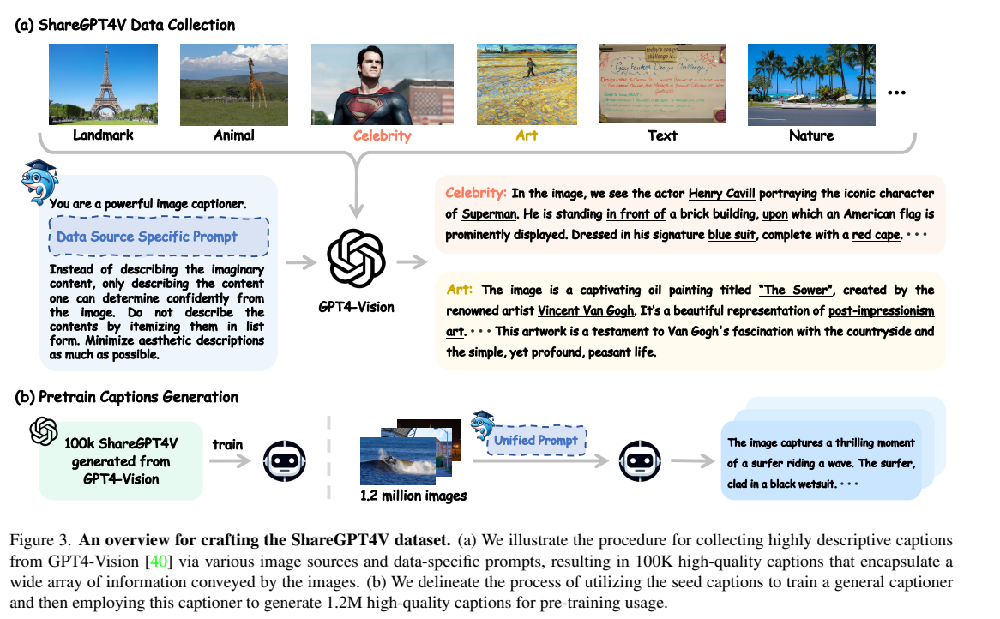
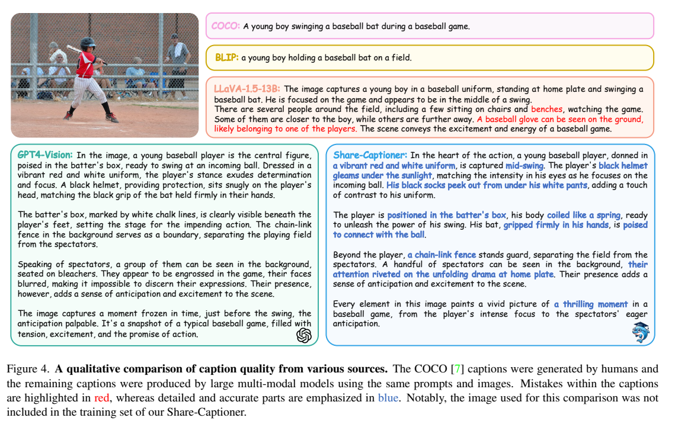
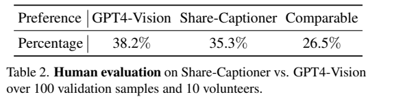
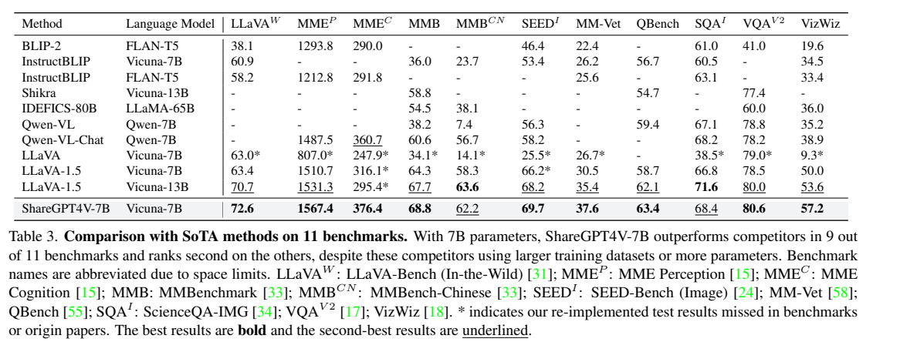
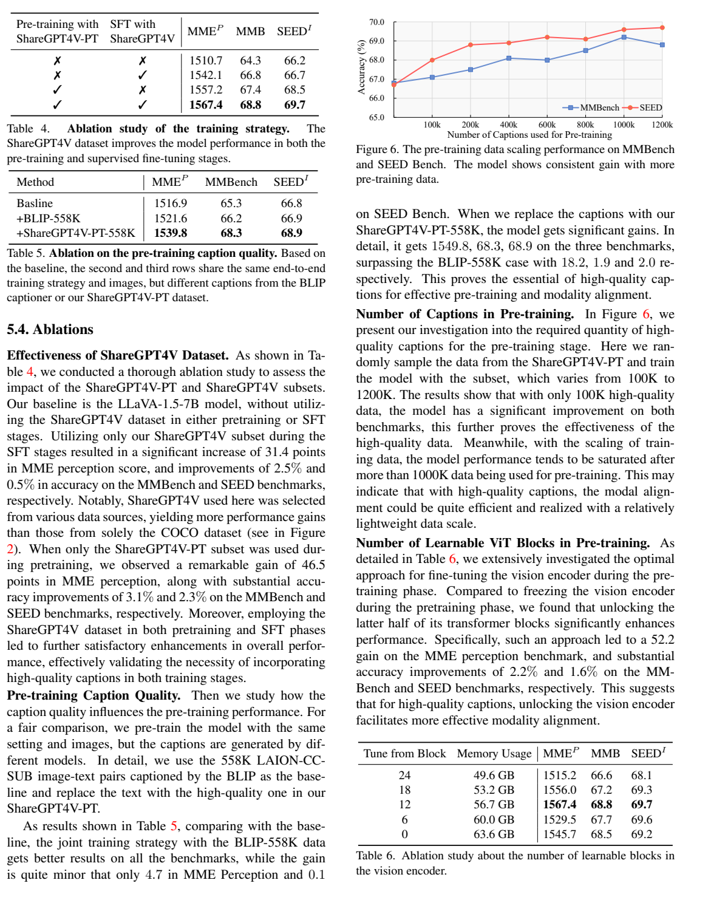

<!-- article-header:start -->
[项目首页](../../../README.md) › [模型系列](../../../reports/model-family-index.md) › [ShareGPT4V](../README.md)
<!-- article-header:end -->

# ShareGPT4V：用更充分的图像描述改善视觉语言对齐

<!-- article-toc:start -->

**本篇目录** · [论文定位](#paper-info) · [快速概览](#overview) · [整体架构](#architecture) · [核心原理](#principles) · [数据构建](#data) · [训练流程](#training) · [实验结果](#experiments)
<!-- article-toc:end -->

## 1. 论文信息与模型定位

| 项目 | 信息 |
|---|---|
| 论文 | *ShareGPT4V: Improving Large Multi-Modal Models with Better Captions* |
| 作者与机构 | Lin Chen、Jinsong Li、Xiaoyi Dong 等；中国科学技术大学、上海人工智能实验室 |
| 来源版本 | [arXiv:2311.12793v1](https://arxiv.org/pdf/2311.12793v1)，2023 年 11 月 |
| 官方资源 | [项目页](https://sharegpt4v.github.io)、[代码](https://github.com/InternLM/InternLM-XComposer/tree/main/projects/ShareGPT4V) |
| 定位 | 数据质量研究、描述生成模型和 7B 图像理解模型 |

ShareGPT4V 同时指数据集和最终模型。论文希望验证详细、准确的 caption 能否改善多模态对齐，主体架构沿用 LLaVA-1.5。它区别于语言教师仅阅读 caption 和框的路径：种子描述由能接收图像的 GPT4-Vision 生成。本介绍固定到 v1，论文中提及的补充材料并未附在这份 11 页 PDF 中。

## 2. 快速概览

| 产物 | 来源 | 用途 |
|---|---|---|
| ShareGPT4V，约 100K | GPT4-Vision 直接阅读图像 | 训练描述器、提供 SFT 描述 |
| Share-Captioner | 用种子描述训练的图像描述模型 | 扩展生成描述 |
| ShareGPT4V-PT | 描述器生成约 1.2M，Table 1 列 1,246K | 最终模型预训练 |
| ShareGPT4V-7B | CLIP-L、两层 MLP、Vicuna-v1.5-7B | 图像问答与对话 |

GPT4-Vision 种子描述平均为 942 **字符**，扩展描述为 826 字符，原文不是按词或 token 统计。最终 SFT 仍为 LLaVA-1.5 的 665K 样本，只替换其中 23K 详细描述；不能说最终模型在 SFT 阶段使用了全部 100K 种子描述。（Table 1、正文第 6 页）

## 3. 整体架构

*原文 Figure 3，PDF 第 4 页。上半部分按图像来源设计教师提示，下半部分以统一提示扩展数据。*

图像输入为 336×336，CLIP-L 的 patch size 为 14，因此有 $(336/14)^2=576$ 个视觉 token。两层 MLP 将视觉特征映射到 Vicuna-v1.5 的输入空间，再与语言指令拼接，由 7B 语言模型自回归回答。（第 6 页）

Share-Captioner 与最终的 ShareGPT4V-7B 应分别理解。前者先学习 GPT4-Vision 的详细描述能力，承担大规模数据生成；后者通过扩展描述预训练、混合任务 SFT 得到。所核验 v1 没有完整描述器训练配方，不能仅因名称相似就假定其训练配置完全一致。

## 4. 核心创新与数学原理

贡献集中在监督信息与训练策略，而不是新注意力模块。用一般条件语言建模形式解释对齐：

$$
\mathcal L_{\mathrm{caption}}=-\sum_t\log p_\theta(c_t\mid I,u,c_{<t}),
$$

$I$ 是图像，$u$ 是描述指令，$c$ 是描述。这个公式是既有自回归监督目标的解释，原文未提出新的损失。长描述将 OCR、对象属性、空间关系、地标知识等转成更多语言监督位置，可能促使视觉特征保留更多与回答相关的信息；同时，错误细节也可能被当作目标学习。

扩展链条可理解为 GPT4-Vision → Share-Captioner → 最终模型的数据蒸馏，但本文并没有匹配教师 logits 或引入专门的 KL 蒸馏项。描述器学习教师输出文本后，再为新图片生成目标描述。

第二个关键是预训练不再只训练连接层，而是让语言模型及视觉编码器后半部分共同适应详细描述。Table 6 显示解冻视觉层数并非越多越好，说明数据质量与更新范围需要共同选择。（第 6、8 页）

## 5. 数据构建与处理

种子图像覆盖检测、分割、含文字图片及艺术、地标、名人等网络图片。基础提示关注外观、属性和空间关系，来源专用提示进一步要求相关知识，例如地标名称与地理位置，部分图片加入审美描述。作者要求避免不确定内容，但该提示不能保证所有知识和视觉判断真实。（第 4 页）

描述器以统一指令为约 120 万张图片生成 caption，作者报告生成开销约 44 A100 GPU days。这是扩展描述生成成本，不是最终模型完整训练成本，也不包含由此可推算的全部 GPT4-Vision 费用。（第 5 页）

*原文 Figure 4，PDF 第 5 页。样例图片未出现在 Share-Captioner 训练集，红字标示作者认为错误的内容。*

*原文 Table 2，PDF 第 5 页，100 张验证图片、10 位志愿者。*

人工偏好结果为 GPT4-Vision 38.2%、Share-Captioner 35.3%、相当 26.5%。这表明在该小规模偏好比较中二者表现接近，不是描述事实准确率，也不是严格证明与教师等效。v1 没有完整的逐样本过滤、去重或视觉事实审核方法，不能把提示中的“不描述想象内容”写成实际验证通过率。

## 6. 训练流程与目标

| 阶段 | 数据 | 可训练部分 | 披露的设置 |
|---|---|---|---|
| 预训练 | ShareGPT4V-PT | MLP、语言模型、视觉编码器后半部分 | 学习率 2×10⁻⁵，batch 256，约 4,700 步 |
| SFT | 665K 混合指令；其中替换 23K 描述 | MLP、语言模型；冻结视觉编码器 | 学习率 2×10⁻⁵，batch 128，约 5,200 步 |

Table 6 中从第 12 个 block 开始解冻，即视觉网络后半部分，是所选主设置。预训练时视觉知识可以随详细文本监督调整，SFT 冻结视觉以提高效率并便于比较。（第 6、8 页）

另外，Figure 2 的“仅替换 SFT 描述”实验尽量保持图像来源一致，LLaVA-1.5 替换比例约 3.5%；最终模型则从多种来源随机抽取 23K 描述。它们不是完全相同的数据控制。Qwen-VL-Chat 的原始 SFT 前检查点与训练数据未公开，因此对照是在其最终检查点上用 LLaVA-1.5 的 665K 数据继续调优，不能当作严格复刻 Qwen 原厂训练流程。（第 2 页脚注、第 8 页）

## 7. 实验设置与主要结果

*原文 Table 3，PDF 第 6 页。星号表示作者补测的结果；基准各有不同评分尺度。*

| 基准 | ShareGPT4V-7B | LLaVA-1.5-7B |
|---|---:|---:|
| MME 感知 | 1567.4 | 1510.7 |
| MME 认知 | 376.4 | 316.1 |
| MMBench | 68.8 | 64.3 |
| SEED Image | 69.7 | 66.2 |
| MM-Vet | 37.6 | 30.5 |
| VizWiz | 57.2 | 50.0 |

MME 两部分合计为 1943.8，它是基准分数而非百分比准确率。Table 3 全部对照中模型在 11 项的 9 项最高；中文 MMBench 的 62.2 低于 LLaVA-1.5-13B 的 63.6，ScienceQA-IMG 的 68.4 低于其 71.6，不宜概括为所有规模、所有任务第一。

*PDF 第 8 页，包含 Table 4–6 和 Figure 6，同时保留正文以呈现原始解释。*

Table 4 中，原始、仅 SFT 替换、仅预训练使用新描述、两阶段均使用的 MMBench 为 64.3、66.8、67.4、68.8。Table 5 固定 558K 图像与端到端训练策略，BLIP 描述的 MME 感知为 1521.6，新描述为 **1539.8**；正文写作 1549.8，但所述差值 18.2 与表中 1539.8 一致，本介绍以表格为准。

Table 6 解冻后半视觉层取得 1567.4、68.8、69.7，优于全部解冻的 1545.7、68.5、69.2。Figure 6 的规模趋势在约 100 万条后接近饱和，曲线局部存在下降，不能写成每次增加数据都严格提升。整体证据支持详细描述和适当视觉微调的组合，但教师事实错误、不同对照数据设置和有限人工审核仍限制归因。

配图取自原论文；[来源清单](figures-manifest.json)。结果为作者报告，未进行模型复现。

<!-- article-footer:start -->
---

[← 上一篇：LION](../../lion/arxiv-2311.11860/README.md) · [按发表时间浏览](../../../reports/paper-reading-guide.md#year-2023) · [下一篇：ChartLlama →](../../chartllama/arxiv-2311.16483/README.md)

[返回本篇目录](#article-toc) · [返回模型系列](../README.md)
<!-- article-footer:end -->
