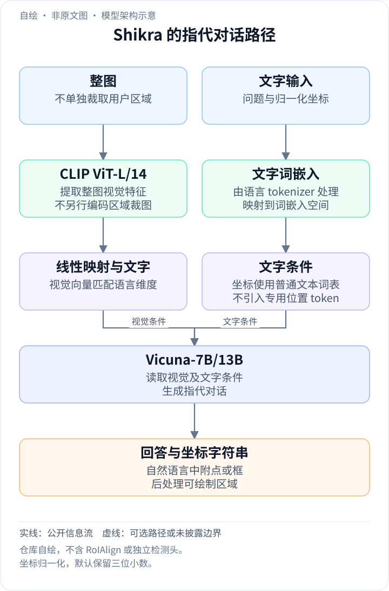
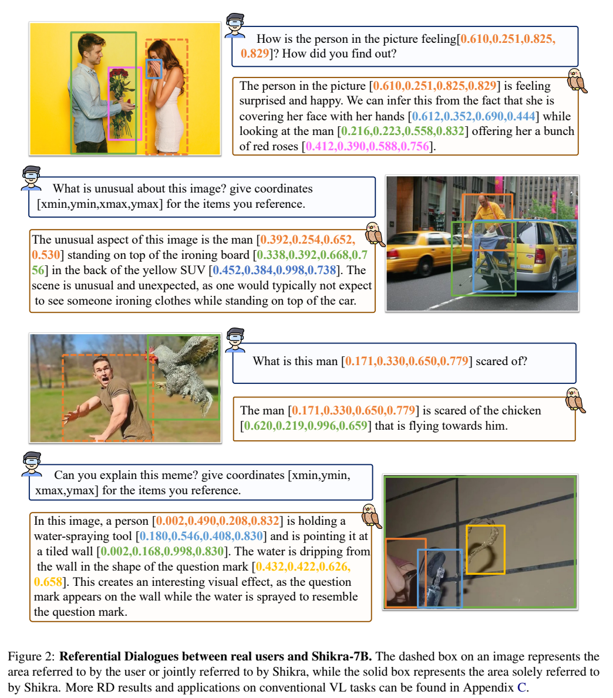
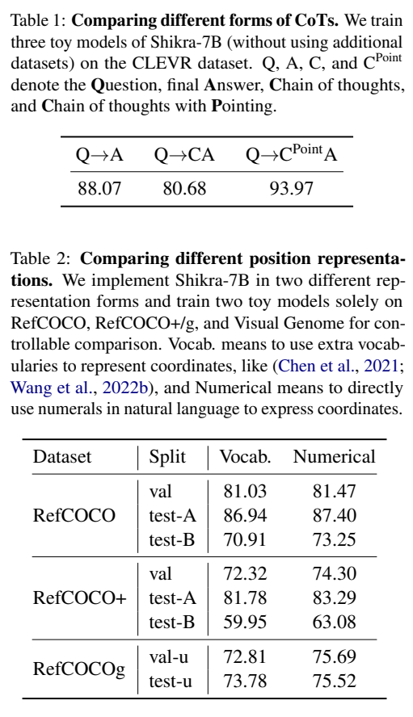
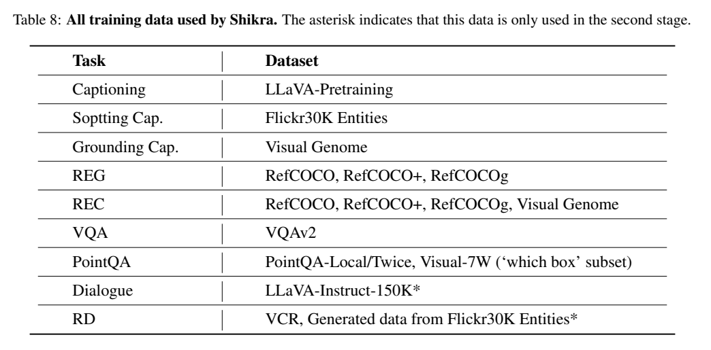
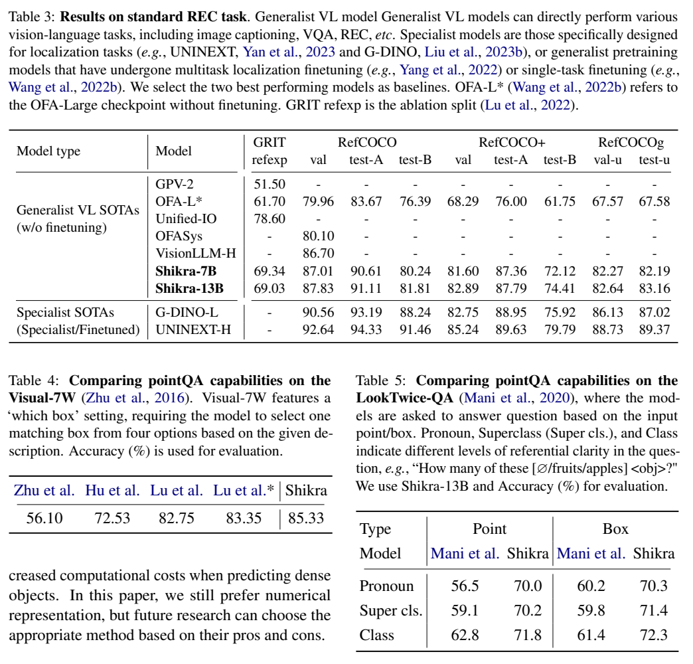
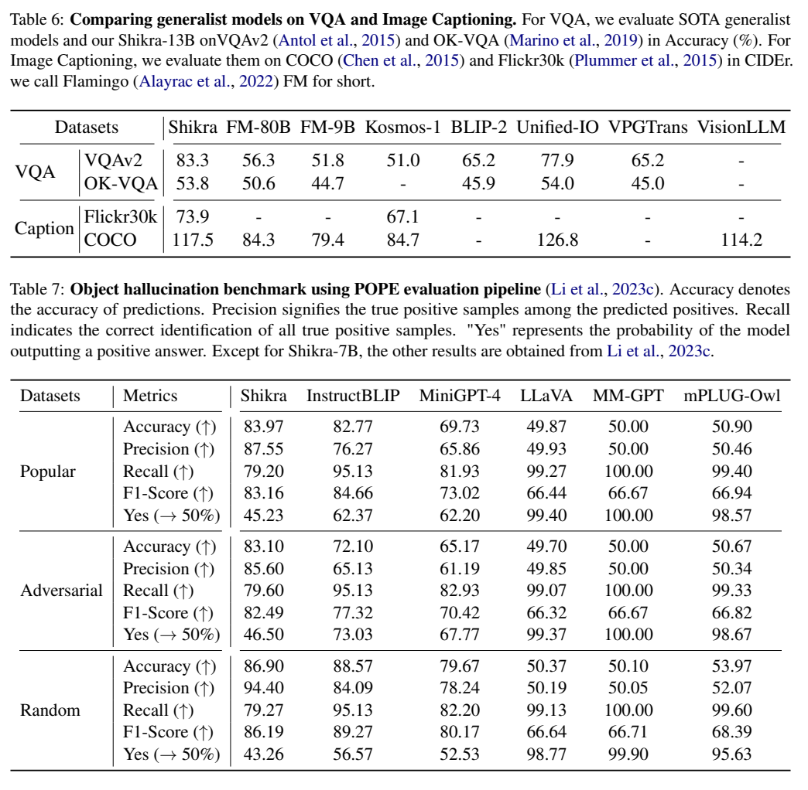

<!-- article-header:start -->
[项目首页](../../../README.md) › [模型系列](../../../reports/model-family-index.md) › [Shikra](../README.md)
<!-- article-header:end -->

# Shikra：把位置坐标写进视觉语言对话

<!-- article-toc:start -->
<a id="article-toc"></a>

**本篇目录** · [论文定位](#paper-info) · [快速概览](#overview) · [整体架构](#architecture) · [核心原理](#principles) · [数据构建](#data) · [训练流程](#training) · [实验结果](#experiments)
<!-- article-toc:end -->

<a id="paper-info"></a>

## 1. 论文信息与模型定位

| 项目 | 信息 |
|---|---|
| 论文 | *Shikra: Unleashing Multimodal LLM’s Referential Dialogue Magic* |
| 作者与机构 | Keqin Chen、Zhao Zhang、Weili Zeng、Richong Zhang、Feng Zhu、Rui Zhao；商汤、北京航空航天大学、上海交通大学 |
| 来源版本 | [arXiv:2306.15195v1](https://arxiv.org/pdf/2306.15195v1)，2023 年 6 月 |
| 官方资源 | [代码与模型](https://github.com/shikras/shikra) |
| 定位 | 接收或输出坐标的 7B/13B 图像对话模型，兼容指代定位、区域问答与一般视觉任务 |

Referential Dialogue（RD）指用户和模型在对话中指明图像区域：用户可以问某个框中的对象，模型回答时也可标注所提对象。Shikra 的坐标走普通文本通路，视觉内容走图像 embedding 通路，不需要额外检测器把回答再映射回位置。（正文第 1–2、5 页）

<a id="overview"></a>

## 2. 快速概览

| 部分 | 实现 |
|---|---|
| 视觉骨干 | CLIP ViT-L/14，256 个 patch 特征 |
| 连接 | 一层全连接，1024 维 → 语言输入维度 |
| 语言骨干 | Vicuna-7B / 13B，输入宽度 4096 / 5120 |
| 位置输入输出 | 归一化框或点，默认保留三位小数 |
| 参数更新 | 冻结视觉编码器，训练连接层与语言模型 |

论文没有添加 `<bin_i>` 坐标词表或独立坐标编码器。数字、标点和普通句子一起分词、生成。用户指定区域比较、带框解释等能力由对话案例展示，标准定位和问答能力则另有定量结果。

<a id="architecture"></a>

## 3. 整体架构

<!-- derived-architecture:start -->


*自绘模型架构示意（非原文图）。依据下述公开资料归纳；方框表示功能组件，不代表逐层实现。*

依据：[§5.1–5.2，PDF pp.4–5](https://arxiv.org/pdf/2306.15195v1)。
<!-- derived-architecture:end -->



*原文 Figure 2，PDF 第 3 页。虚线框来自用户或双方共同指代，实线框为模型输出位置。*

CLIP 输出 $`16\times16\times1024`$ 特征，经线性层形成 $`256\times D`$ 视觉输入。视觉 embedding 可以插在语言序列中；用户文本中带有框或点时，也不需要特殊区域模块先裁图编码。语言模型利用完整图像和文字坐标生成解释及所指对象位置。（第 4–5 页）

从对话示例可见，回答可以同时包含动作、属性、多个对象及坐标。图中彩色框是坐标可视化，不能把画框显示本身当作额外训练的检测网络。简单结构并不意味着没有定位监督：训练混合了大量带位置标注的任务。

坐标与图像特征通过不同入口接入同一语言序列：CLIP 产生的视觉向量经线性层投影；用户给出的点或框则直接写在文字中，和问题一起由 Vicuna-7B/13B 的 tokenizer 处理。框使用 `[xmin, ymin, xmax, ymax]`，点使用 `[xcenter, ycenter]`，按图像尺寸归一化，默认保留三位小数。生成时同样可在自然语言中输出这些数值，再据此绘制位置。模型依靠整图特征、坐标文字和当前语境建立对应关系，没有另行裁出该区域、做 RoIAlign，或引入专用位置词表。[原文 §5.1–5.2，PDF 第 4–5 页](https://arxiv.org/pdf/2306.15195v1#page=5)


<a id="principles"></a>

## 4. 核心创新与数学原理

框使用 $`[x_{min},y_{min},x_{max},y_{max}]`$，点使用 $`[x_{center},y_{center}]`$。例如横坐标 $`\hat x=x/W`$、纵坐标 $`\hat y=y/H`$，在图像尺度归一化后写成三位小数。它们像普通词一样出现在问题或回答任意位置。（第 5 页）

可用标准生成式训练解释这一机制：

```math
\mathcal L_{\mathrm{AR}}=-\sum_t\log p_\theta(y_t\mid I,q,y_{<t}).
```

当答案 $`y`$ 包含位置数字时，坐标字符串也成为预测目标。这个公式是对既有自回归监督的解释，原文没有提出额外坐标回归损失。数字精度可通过文本表达调整，不必重新定义坐标词表；代价是一个坐标通常消耗多个 token，密集目标输出成本较高。



*原文 Table 1、2，PDF 第 6 页，是单独训练的受控模型，不是主模型直接更换推理提示。*

CLEVR 上，直接回答、先输出纯文字推理、先输出含中心点推理的准确率分别为 88.07、80.68、93.97。含位置推理比直接回答高 5.90 个百分点，但纯文字推理反而下降。这支持该数据设置中的位置监督价值，不能证明任意任务的 CoT 或所有幻觉都得到改善。

另一消融只在 RefCOCO 系列与 Visual Genome 上训练，比较新增坐标词表和普通数字。RefCOCO test-B 为 70.91 对 73.25，RefCOCO+ test-B 为 59.95 对 63.08；证据支持数字在所测配置中可行，没有证明所有精度和任务上都优于离散词表。

<a id="data"></a>

## 5. 数据构建与处理



*原文 Table 8，PDF 第 12 页，星号为仅第二阶段使用的数据。*

训练任务涵盖 LLaVA 预训练描述、Flickr30K Entities 带位置描述、Visual Genome 区域描述、RefCOCO/+/g 的 REC 与 REG、VQAv2、PointQA-Local/Twice、Visual-7W 选择框问答，以及 VCR、LLaVA-Instruct-150K 和生成 RD 数据。正文声明排除测试和验证图像，控制不同文本任务间的图片泄漏。（第 5 页、附录 A）

生成 RD 用 Flickr30K Entities 的五条描述及物体框，让**纯语言 GPT-4**理解场景后生成可从已知信息回答的问题。教师没有看到图像，共生成约 6,400 个 QA。坐标可以在问题与答案两侧出现，因此既学习位置输入也学习位置输出。标注遗漏或冲突仍可能影响教师生成的内容。

作者为每种任务设计模板，再让 GPT-4 改写成数百种同义形式，训练随机抽取，避免固定句式限制用户表达。（附录 Table 9，第 12 页）这属于指令语言多样化，不是新增视觉标注的来源。

<a id="training"></a>

## 6. 训练流程与目标

第一阶段在重组视觉语言数据上训练 100,000 步，约 1.5 epoch；第二阶段提高 LLaVA-Instruct-150K 与生成 RD 数据的采样比重，原文描述为 50%。该段没有完整逐数据集比例，因此不扩展成各子集分别占多少。（第 6 页）

两阶段均冻结视觉编码器，更新连接层和整个语言模型。优化器 AdamW，余弦学习率，初始学习率 2×10⁻⁵，全局 batch 64，8 张 A100；作者报告第一阶段约 100 小时、第二阶段约 20 小时。没有在所核验版本中给出第二阶段准确步数或 A100 显存型号。

REC、VQA、PointQA 等数据参与联合训练。表中“无需微调”指模型在评估时无需再次做单任务微调，不能翻译成“从未训练相关任务”或“全部零样本”。独立消融模型的较小训练范围也应和这一完整模型区分。

<a id="experiments"></a>

## 7. 实验设置与主要结果



*原文 Table 3–5，PDF 第 7 页，通用模型与专项定位模型分组展示。*

| REC 划分 | Shikra-7B | Shikra-13B |
|---|---:|---:|
| RefCOCO val | 87.01 | 87.83 |
| RefCOCO test-A | 90.61 | 91.11 |
| RefCOCO+ test-B | 72.12 | 74.41 |
| RefCOCOg test-u | 82.19 | 83.16 |

模型在多个通用定位对照中有竞争力，但专项 UNINEXT-H 在上述划分仍更高，GRIT refexp 的 7B 69.34 也低于 Unified-IO 的 78.60。PointQA 的 Visual-7W “四框选一”准确率为 85.33；它和自由输出坐标、区域计数不是同一评估任务。LookTwice-QA 的 13B 在 Class 设置下 Point/Box 为 71.8/72.3。



*原文 Table 6、7，PDF 第 8 页；前者为 13B，POPE 为 7B，其他 POPE 结果引用已有论文。*

13B 的 VQAv2 为 83.3，OK-VQA 为 53.8，COCO CIDEr 为 117.5；后二者低于 Unified-IO 的 54.0、126.8，不是全任务最佳。7B POPE Popular/Adversarial/Random 准确率为 83.97/83.10/86.90；Random 低于 InstructBLIP 的 88.57，Popular 的 F1 也低于其 84.66。POPE 检查对象存在判断，不能代表全部回答幻觉率。

原文还用 2×2 棋盘测试展示早期 LLaVA-13B 对粗略位置理解不足（25.96%，近四选一随机），但这个单模型诊断不能外推到所有后续 MLLM。Shikra v1 仅支持英语，并明确不适于密集检测和分割；对话图是能力示例，尚未形成全面真实交互评估。（第 4、8 页）

配图均来自上述论文；[来源清单](figures-manifest.json)。未重新训练复现作者结果。

<!-- article-footer:start -->
---

[← 上一篇：MotionGPT](../../motiongpt/arxiv-2306.14795/README.md) · [按发表时间浏览](../../../reports/paper-reading-guide.md#year-2023) · [下一篇：LLaVAR →](../../llavar/arxiv-2306.17107/README.md)

[返回本篇目录](#article-toc) · [返回模型系列](../README.md)
<!-- article-footer:end -->
