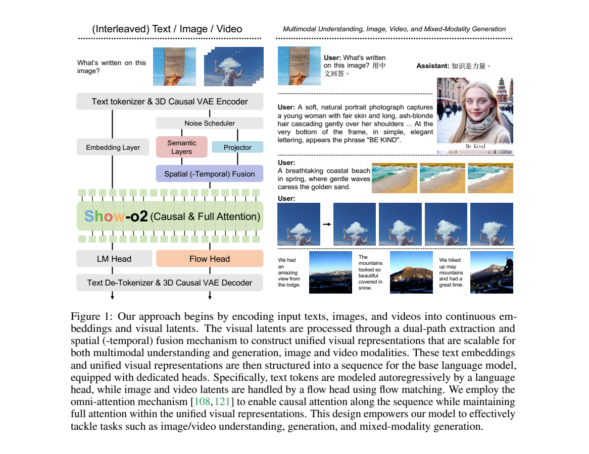
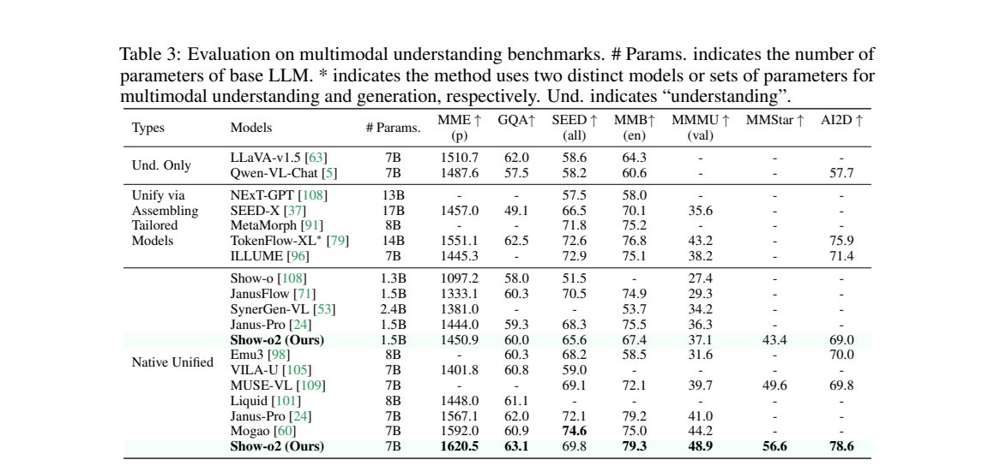
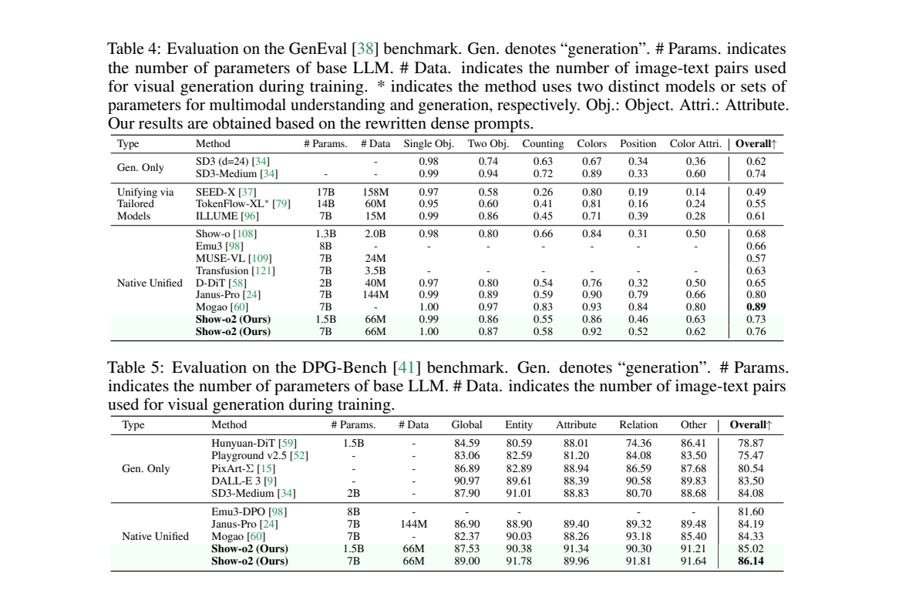
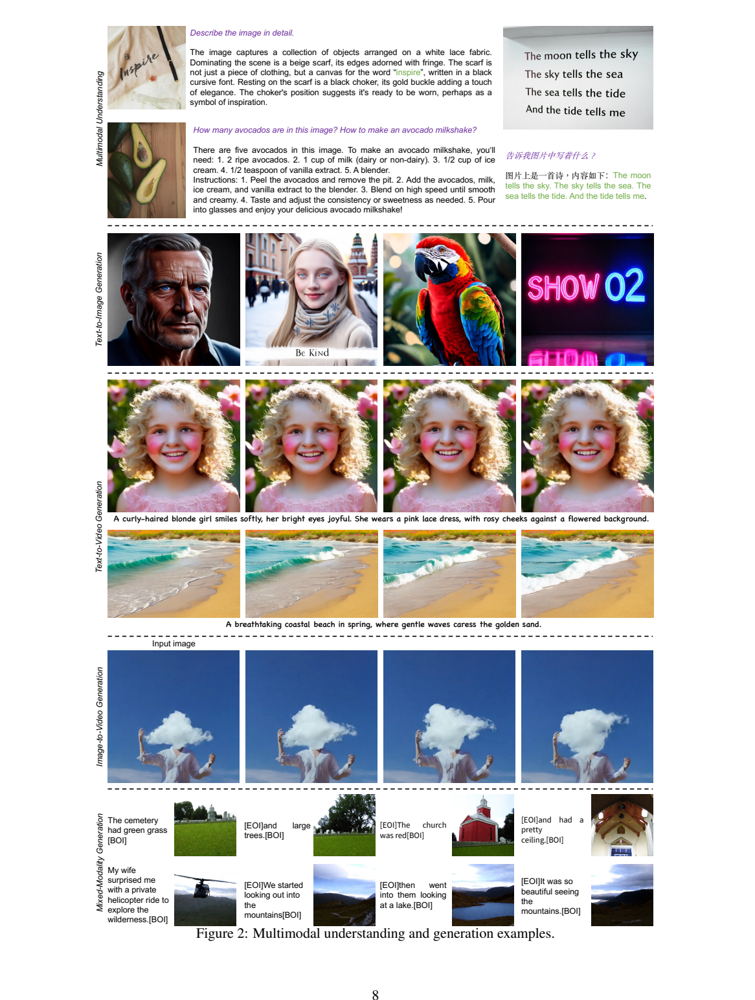

<!-- article-header:start -->
[项目首页](../../../README.md) › [模型系列](../../../reports/model-family-index.md) › [Show-o](../README.md)
<!-- article-header:end -->

# Show-o2：在连续视觉潜空间统一理解与生成

<!-- article-toc:start -->

**本篇目录** · [论文定位](#paper-info) · [快速概览](#overview) · [整体架构](#architecture) · [核心原理](#principles) · [数据构建](#data) · [训练流程](#training) · [实验结果](#experiments)
<!-- article-toc:end -->

## 1. 论文信息与模型定位

| 项目 | 信息 |
|---|---|
| 论文 | *Show-o2: Improved Native Unified Multimodal Models* |
| 作者与机构 | Jinheng Xie、Zhenheng Yang、Mike Zheng Shou；新加坡国立大学 Show Lab、字节跳动 |
| 来源 | [arXiv:2506.15564v1](https://arxiv.org/pdf/2506.15564v1)，2025 年 6 月，19 页 |
| 官方代码 | [showlab/Show-o](https://github.com/showlab/Show-o) |
| 模型定位 | 原生统一文本、图像与视频模型；文本自回归，视觉采用流匹配 |

Show-o2 将理解与生成的视觉表示都建在同一个 3D 因果 VAE 空间中，语言骨干与流预测头共同建模。本文的 1.5B、7B 通常指基础 LLM 参数量；视频表中 2B 指包含流头的总生成参数量。这些口径不能直接混用。

## 2. 快速概览

| 设计 | 解决的问题 |
|---|---|
| 3D 因果 VAE | 用同一连续潜空间容纳静态图像与时序视频 |
| 语义层与低层投影双路融合 | 同时保留识别所需语义与生成所需细节 |
| 语言头 + flow head | 文本预测离散 token，视觉预测连续速度场 |
| 两阶段训练 | 先训练生成接口，再联合优化，减少语言知识损失 |
| 小模型流头迁移到 7B | 复用生成能力并对齐隐藏维度 |

“架构可扩展到视频”与“所有检查点均训练了视频”需要区分：本文明确指出，7B 版本出于成本限制没有加入视频和交错数据；视频与图文交错生成主要由小规模版本展示。（第 6 页）

## 3. 整体架构

*Figure 1，PDF 第 4 页。文本经 tokenizer，图像和视频经 VAE；共享骨干配合不同输出头。*

Wan2.1 的 3D 因果 VAE 对空间压缩 8 倍、时间压缩 4 倍。视觉潜变量同时送入语义层 $S$ 与投影器 $P$。前者使用 SigLIP 的 Transformer blocks，改用 $2\times2$ patch embedding 并预先蒸馏；后者以 patch 投影保留低层结构。两路按对应空间及时间位置拼接，经 RMSNorm 与两层 MLP 融合。（第 4、6 页）

文本、图像、视频以 BOS/BOI/BOV/EOI/EOV 等边界符组成交错序列，基础模型为 Qwen2.5-1.5B-Instruct 或 Qwen2.5-7B-Instruct。序列整体使用因果注意力，视觉块内部使用全注意力。流头由带 adaLN-Zero 时间调制的 Transformer 层组成；生成的视觉潜变量由 VAE 解码，而非将语言模型输出交给另一个完整 Stable Diffusion 系统。

## 4. 核心创新与数学原理

原文式 1 定义噪声路径：

$$
x_t=t x_1+(1-t)x_0,\qquad x_0\sim\mathcal N(0,I),\quad t\in[0,1].
$$

$x_1$ 是干净视觉潜变量，$t=0$ 为噪声端、$t=1$ 为数据端。按这条线性路径求导，目标速度为 $x_1-x_0$；因此流头学习如何把噪声连续搬运到图像或视频潜空间。这个导数是对路径的解释，原文主文未展开一个单独的完整 LFM 积分公式。

融合表示为 $u=\mathrm{STF}(S(x_t),P(x_t))$，还加入时间步嵌入。理解干净图像时设 $t=1$。语义蒸馏令潜空间的语义层逼近原始 SigLIP patch 特征。原式 2 写成负对数余弦相似度求和，但普通余弦可为非正值，正文没有说明截断或正值变换，因此该式不足以单独作为可直接执行的实现定义。（第 4 页）

联合训练目标是原文式 4：

$$
\mathcal L=\alpha\mathcal L_{\mathrm{NTP}}+\mathcal L_{\mathrm{FM}}.
$$

NTP 对文本做下一 token 预测，FM 对视觉做速度预测。两种目标共享上下文，又通过不同输出头保留各自建模方式。双路融合消融将 MME-p 从 1164.7 提升到 1187.8、GQA 从 56.2 到 57.6、FID-5K 从 21.8 降到 20.5，但 POPE 均为 82.6；该消融采用 LLaMA-3.2-1B 和较小数据，不能直接归因成主模型的全部提升。（Table 8）

## 5. 数据构建与处理

第一阶段约 66M 图文对来自 CC12M、COYO、LAION-Aesthetic-12M 和 AI 合成数据，筛选宽高至少 512 像素的图片；除合成数据外使用 ShareGPT4V 重新描述。第二阶段的 16M 高质量生成样本由这 66M 筛选，不能简单相加成 82M 独立图文来源。约 9M 理解指令来自 DenseFusion-1M 和 LLaVA-OneVision。（第 5 页）

小模型的视频训练逐步引入 WebVid、Panda，后续加入 OpenVid-1M 与 1.5M 内部数据；交错数据使用 OmniCorpus，后续加入 VIST、CoMM。视频随机采样约 2 秒的 17 帧片段，帧间隔为 3，使用 480p 或 $432\times432$。该设置不是长视频生成训练。视觉故事生成训练以 0.3 概率给全部图像加噪，否则保留前部若干图像、只对后续图像加噪，学习基于已有图文续写。（第 6、9 页）

## 6. 训练流程与目标

| 阶段 | 更新范围与主要参数 |
|---|---|
| 语义层预蒸馏 | 200K iterations，batch 512，余弦学习率 $2\times10^{-5}$；最后 20K 以 0.3 概率加入噪声 |
| 小模型第一阶段 | 投影器、时空融合、流头；150K steps，AdamW、$10^{-4}$；再用 16M 高质量样本训练 40K |
| 小模型第二阶段 | 除 VAE 外完整模型；9M 理解 + 16M 生成数据，约 35K steps |
| 7B 扩展 | 继承小模型流头，先训练维度对齐接口 3K steps，再继续两阶段训练 |

第一阶段理解/生成 batch 分别为 128/384，$\alpha=0.2$，第二阶段提高到 1.0。图像描述以 0.1 概率丢弃以支持 CFG。单图序列长度 1,024，加入视频后为 7,006。小模型初始图像阶段约 64 张 H100、1.5 天，第二阶段约 15 小时；7B 整个报告流程约 128 张 H100、2.5 天。后续还引入 $512^2/1024^2$ 和 TextAtlas 子集改善文字与细节，不能把最初 $432^2$ 设定当成所有结果的唯一训练分辨率。（第 6 页）

## 7. 实验设置与主要结果

*Table 3，PDF 第 6 页。表中参数是语言骨干规模。*

7B 在 MME-p、GQA、MMMU-val、MMStar、AI2D 分别为 1620.5、63.1、48.9、56.6、78.6，较所列同规模原生统一模型有较强表现。但 SEED 69.8 低于 Mogao 74.6，1.5B 的 MMB 67.4 也低于 Janus-Pro-1.5B 的 75.5。“多项领先”并不意味着所有理解基准领先。

*Tables 4–5，PDF 第 7 页。GenEval 使用改写后的密集提示，比较时应保留这一协议。*

1.5B/7B 的 GenEval 为 0.73/0.76，DPG-Bench 为 85.02/86.14。DPG 在所列表中最高，但 GenEval 仍低于 Janus-Pro 的 0.80 和 Mogao 的 0.89。CFG 与采样步数存在质量、成本权衡：1.5B 在 CFG 7.5 下，25/50/100 步的 GenEval 为 0.71/0.71/0.73，DPG 为 84.6/84.8/84.7，并非增加步数就全面改善。（Tables 4、5、9）

*Figure 2，PDF 第 8 页。交错故事与问答为定性展示。*

视频 VBench 总分为 81.34，高于 Emu3 的 80.96，低于 CogVideoX 的 81.61；语义分 78.31 较高，但动态程度 40.83 远低于 Emu3 的 79.27。图生视频背景一致性 98.83 较强，其他维度并非均领先。正文承认文字渲染和小物体细节不足；高分支持统一建模的可行性，尚不能据此宣称视频生成或开放式交错输出已全面可靠。（第 9–10 页）

<!-- article-footer:start -->
---

[← 上一篇：Gemini 2.5](../../gemini/document-8c1dda86c921/README.md) · [按发表时间浏览](../../../reports/paper-reading-guide.md#year-2025) · [下一篇：MMSearch-R1 →](../../mmsearch-r1/arxiv-2506.20670/README.md)

[返回本篇目录](#article-toc) · [返回模型系列](../README.md)
<!-- article-footer:end -->
