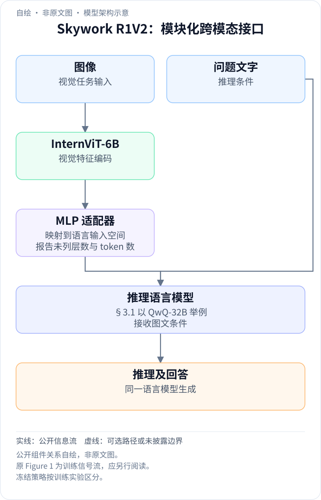
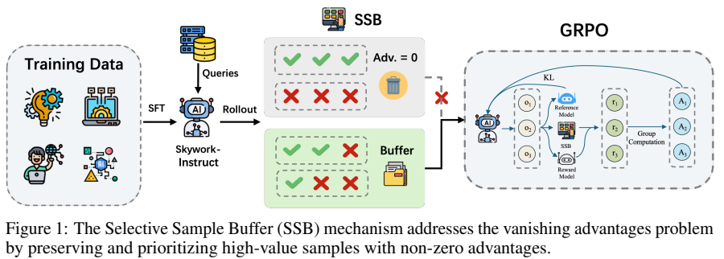
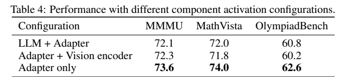
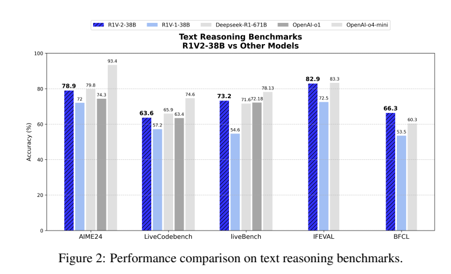
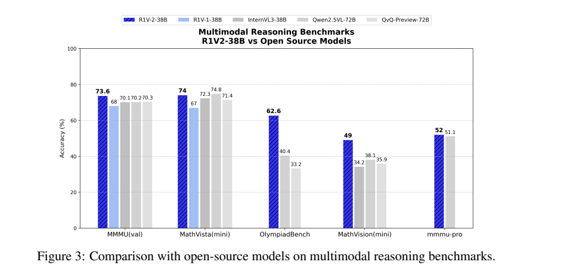
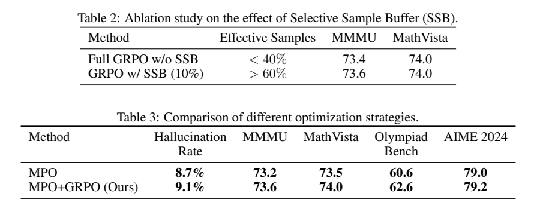

<!-- article-header:start -->
[项目首页](../../../README.md) › [模型系列](../../../reports/model-family-index.md) › [Skywork](../README.md)
<!-- article-header:end -->

# Skywork R1V2：用混合强化学习迁移多模态推理能力

<!-- article-toc:start -->
<a id="article-toc"></a>

**本篇目录** · [论文定位](#paper-info) · [快速概览](#overview) · [整体架构](#architecture) · [核心原理](#principles) · [数据构建](#data) · [训练流程](#training) · [实验结果](#experiments)
<!-- article-toc:end -->

<a id="paper-info"></a>

## 1. 论文信息与模型定位

| 项目 | 信息 |
|---|---|
| 论文 | Skywork R1V2: Multimodal Hybrid Reinforcement Learning for Reasoning |
| 团队 | Skywork AI / 昆仑万维；首版署名 Chris、Yichen Wei 等 |
| 日期与版本 | 2025-04-23；本文固定解读 arXiv:2504.16656v1，14 页 |
| 模型家族 | Skywork R1V；本篇对应 R1V2-38B |
| 定位 | 将已有文本推理能力迁移到视觉问题，重点是数学、科学和复杂推理 |
| 原始资料 | [论文 v1](https://arxiv.org/pdf/2504.16656v1)、[官方模型](https://huggingface.co/Skywork/Skywork-R1V2-38B)、[系列仓库](https://github.com/SkyworkAI/Skywork-R1V) |

这篇报告关注一个实际矛盾：强化视觉推理后，模型可能更擅长解题，却更容易对图像作出没有证据的推断。作者用 GRPO、混合偏好优化 MPO 和选择性样本缓冲 SSB，尝试兼顾推理、输出稳定性与视觉事实性。主要贡献位于后训练方法，视觉编码器和文本推理底座都来自已有模型。（PDF 第 1–4 页）

版本说明：本文忠实记录 v1 的表格与披露缺口。arXiv 后续已有 v4；其摘要修正了 MMMU 和 AIME 的分数。不同版本及首版内部不一致的数值不会拼成同一套实验结果。[版本历史](https://arxiv.org/abs/2504.16656)

<a id="overview"></a>

## 2. 快速概览

| 问题 | 方案 | 读者应关注的边界 |
|---|---|---|
| 重新训练视觉推理模型成本高 | 冻结 InternViT-6B，经 MLP 接入 QwQ-32B 级推理模型 | 依赖已经训练好的底座，不是从随机权重开始 |
| GRPO 中组内奖励相同，更新信号消失 | SSB 重用具有非零优势的样本 | 不等于所有历史样本都可以无条件重放 |
| 只追求推理奖励可能加重幻觉 | 奖励模型与规则信号混合优化 | 报告没有公开完整 MPO 目标及奖励细则 |
| 文本能力与视觉能力需要兼顾 | 优先改善适配与跨模态迁移 | 通用视觉任务并未全面领先 |

主结果表给出 MMMU 73.6、MathVista 74.0、OlympiadBench 62.6、AIME 2024 78.9。最明显的收益之一是相对 R1V1 的提升，而不是对每个商用模型、每个任务都领先。（Table 1，第 9 页）

<a id="architecture"></a>

## 3. 整体架构

<!-- derived-architecture:start -->


*自绘模型架构示意（非原文图）。依据下述公开资料归纳；方框表示功能组件，不代表逐层实现。*

依据：[2504.16656v1; §3.1 / Table 4](https://arxiv.org/pdf/2504.16656v1)。
<!-- derived-architecture:end -->

推理路径可以概括为：图像经 InternViT-6B 提取视觉特征，MLP 适配器将特征映射到语言模型可处理的空间，再与文本问题一起送入推理语言模型生成回答。§3.1 将 QwQ-32B 作为语言侧示例，官方发布模型为 38B。报告没有提供适配器层数、视觉 token 数及完整分辨率配置，因此不能据此写出可直接复现的结构参数表。



*原文 Figure 1，PDF 第 4 页。此图说明训练过程，不是部署时的网络结构图。图中的 SFT 标签与 §3.1“R1V2 省去 SFT”存在表述差异，应结合正文理解，不能直接把图画成 R1V2 的阶段清单。*

作者考察了只训练适配器、训练语言模型与适配器、训练视觉编码器与适配器三种方式。Table 4 中适配器单独训练最好，说明这组实验的收益主要来自跨模态适配。但这不构成“任意多模态推理任务都无需训练语言模型”的普遍结论。（第 11 页）

| 模块 | 输入与输出 | 公开机制 |
|---|---|---|
| 视觉编码器 | 图像 → 视觉特征 | 公开版本采用InternViT-6B；报告比较是否更新视觉参数 |
| 跨模态适配器 | 视觉特征 → 语言侧表示 | 连接视觉与QwQ-32B，adapter-only可保留推理骨干权重 |
| 推理骨干 | 视觉表示与问题 → 候选推理和答案 | 语言模型生成用于GRPO比较的组内候选 |
| 奖励与偏好信号 | 候选回答 → 奖励、规则与偏好 | R1V-RM及格式、事实、步骤规则用于训练评价，非在线必经模块 |
| SSB训练缓存 | 非零优势历史样本 → 重采样训练样本 | 按优势绝对值优先采样，缓解组内奖励趋同时的有效信号减少 |


<a id="principles"></a>

## 4. 核心创新与数学原理

### 4.1 SSB保存的是比较信号

对同一问题采样多个回答，通过奖励差异确定哪些输出值得提高概率。下面的式子用于解释标准组相对优势，并非报告逐项公开的实现公式：

```math
A_i=\frac{r_i-\mathrm{mean}(r_1,\ldots,r_G)}{\mathrm{std}(r_1,\ldots,r_G)+\epsilon}.
```

若一组回答奖励都相同，分子为零，这些回答不会提供区分好坏的优势信号。SSB 保存此前具有非零优势的样本，按优势绝对值优先加权抽取，再加入更新过程。作者观察到有效样本比例可能从训练初期约 60% 降到后期不足 10%，因此缓冲的目标是维持有信息的更新。（§3.3，第 4–5 页）

需要注意，保存旧样本之后如何重新计算奖励和优势、控制旧策略分布与新策略的偏差，报告没有充分交代。SSB 的机制描述和消融结果不能替代这些算法细节。

SSB关注的量是相对优势是否提供区分，而不是只保留正确答案。若同组全部正确或全部错误，奖励一致都会缺乏组内方向；反之错误回答也可能通过负优势提供抑制信号。因此按绝对优势优先重用，与简单的“成功轨迹回放”并不等价。历史样本来自旧策略，报告未完整说明重算优势、重要性校正或淘汰规则，不能据此承诺严格无偏更新。〔v1 §3.2–3.3，第4–5页〕

### 4.2 偏好和规则约束不同输出属性

R1V-RM 奖励模型用于提供偏好信息，规则覆盖格式、事实一致性和推理步骤完整性。报告又提到 DPO 式微调使输出更稳定，但没有给出奖励混合权重、损失各项系数、偏好对生成规则或完整优化顺序。因而这里不将其他论文里的 MPO 公式冒充本篇实现。（§3.2，第 4 页）

偏好模型可表达较难手写的回答质量，规则则检查明确的格式和事实/步骤要求。这两种信号可能相互冲突，例如格式完整却推理错误，因此“混合”本身不是数学上的正确性保证。本文只解释原文列出的信号职责，不用其他同名MPO算法的损失系数补齐缺项。〔§3.2，第4页〕

### 4.3 对齐更新与推理迁移的边界

作者用奖励阈值控制选择强度，并报告阈值 15 与阈值 7 在不同训练步数上的结果。然而比较同时改变阈值和训练迭代数，不能视为严格控制单一变量的结论。（§4.4，第 11 页）

第4页的冻结组件实验显示只更新视觉编码器收益有限，而adapter-only与LLM+adapter均有效。作者据此将跨模态对齐视为主要瓶颈；这是一组实验诊断，不能推广成视觉编码永远无需更新。SSB保持不同模态的学习信号也不等于直接检测幻觉，事实性仍需独立测量。〔§3.1末段、§3.3，第4–5页〕


<a id="data"></a>

## 5. 数据构建与处理

报告说明训练任务包含视觉感知、科学问题、抽象推理及通用任务，使用奖励模型与结构化规则反馈。它没有公开完整训练集来源、样本总量、图像与文本比例、清洗阈值、去重方式、污染检查和课程采样安排。（第 2、4–5 页）

能确认的处理环节集中在候选回答：同一问题生成回答组，进行奖励判定，识别非零优势样本，将其缓存以供后续更新。格式规则与事实规则的具体实现没有公开，因此不能把“涉及事实一致性”理解成已经具有可靠的图像事实验证器。

“不需要教师模型蒸馏”描述的是本篇多模态训练方法的选择；它不意味着上游视觉编码器、QwQ 或奖励模型的训练全部没有教师生成数据。数据来源缺口是本报告的主要复现限制之一。

<a id="training"></a>

## 6. 训练流程与目标

根据正文，R1V2 将已有视觉编码器与推理模型重新组装，省去作者认为会损害语言侧推理能力的多模态 SFT 阶段，通过 GRPO 和 MPO 优化适配与推理表现。视觉侧默认冻结；Table 4 对不同可训练模块进行了消融。（§3.1–3.2，第 3–4 页）

可确认的训练目标包括：提高具有较高相对奖励的回答概率；用 SSB 增加有效更新样本；用偏好与规则信号约束格式和事实性。学习率、优化器、批量、组内候选数、KL 系数、总步数、硬件和完整模块调度均未充分披露。正文对 DPO 式微调与“省去 SFT”的说法也不能被扩展成一套确定的三阶段训练配方。



*原文 Table 4，PDF 第 11 页。只训练适配器得到 MMMU 73.6 / MathVista 74.0 / OlympiadBench 62.6；同时训练 LLM 与适配器为 72.1 / 72.0 / 60.8。结果支持本实验中的选择，不直接证明跨任务迁移必然成立。*

<a id="experiments"></a>

## 7. 实验设置与主要结果

作者将最大生成长度设为 64K token，使用标为 OpenAI-o4 的 LLM Judge，对答案作语义与数学等价判断；没有给出该裁判的精确快照。回答要求最终答案置于 boxed 格式。报告称分数为五次独立运行平均的 pass@1，这与一次问题尝试五次、任一次成功就计分的 pass@5 不同。（§4.1，第 6 页）



*原文 Figure 2，PDF 第 7 页。AIME 78.9、LiveCodeBench 63.6、LiveBench 73.2、IFEval 82.9、BFCL 66.3。IFEval 是指令遵循评估，BFCL 是 Berkeley Function Calling Leaderboard；首版正文对这两项的展开和任务解释有误，本文依据[IFEval 原论文](https://arxiv.org/abs/2311.07911)及[BFCL 官方说明](https://gorilla.cs.berkeley.edu/blogs/8_berkeley_function_calling_leaderboard.html)校正。*



*原文 Figure 3，PDF 第 7 页。主表和图中 MMMU 为 73.6，不能直接沿用首版摘要的 74.0。*

| 基准 | R1V2 | 具有代表性的对比 | 含义 |
|---|---:|---|---|
| MMMU | 73.6 | R1V1 68.0；Qwen2.5-VL-72B 70.2 | 相对前代提升 5.6 个百分点 |
| MathVista | 74.0 | Qwen2.5-VL-72B 74.8 | 并未在该基准胜过所有开放模型 |
| OlympiadBench | 62.6 | Qwen2.5-VL-72B 40.4 | 在作者报告的该任务比较中优势较大 |
| MathVision | 49.0 | 原文 Figure 4 的 o4-mini 为 56.0 | 与商用模型仍有差距 |
| AIME 2024 | 78.9 | DeepSeek-R1 79.8；o4-mini 93.4 | 文本数学能力较强，但不是总体最高 |

数字来自第 7 页 Figures 2–4 和第 9 页 Table 1。这些是作者报告的比较结果，不代表本文重新用统一提示和推理预算复测了全部模型。通用视觉结果包括 AI2D 81.3、Video-MME 60.2、MVBench 61.5；作者也承认推理能力与通用视觉理解之间的取舍。（第 10 页）



*原文 Tables 2–3，PDF 第 11 页。表格保留了比正文更细的比较边界。*

SSB 消融表中有效样本比例从不足 40% 提高到超过 60%，MMMU 从 73.4 提升到 73.6，MathVista 两行均为 74.0。正文却称 MathVista 74.0 对 73.8，应按表记录冲突。“SSB（10%）”这一行标签也不足以单独推出完整缓冲容量或所有训练成本。

MPO 的幻觉率为 8.7%，MPO+GRPO 为 9.1%；增加 GRPO 后推理分数上升，同时幻觉率略回升。正文把完整方案的幻觉率写作 8.7%，与表格不一致。Table 3 的 AIME 为 79.0 / 79.2，主结果 Table 1 为 78.9，未交代差异来源。此外，幻觉率测试集与判定细则没有充分公开，不能把该百分比当作一般部署环境的保证。

该模型展示了通过适配器和混合后训练迁移已有推理能力的可行性，但首版中的方法披露和实验表述存在多处缺口。阅读时应重点区分表格中的具体证据、作者的解释与尚不能复现的实现细节。

<!-- article-footer:start -->
---

[← 上一篇：Eagle 2.5](../../eagle/arxiv-2504.15271/README.md) · [按发表时间浏览](../../../reports/paper-reading-guide.md#year-2025) · [下一篇：VITA-Audio →](../../vita/arxiv-2505.03739/README.md)

[返回本篇目录](#article-toc) · [返回模型系列](../README.md)
<!-- article-footer:end -->
