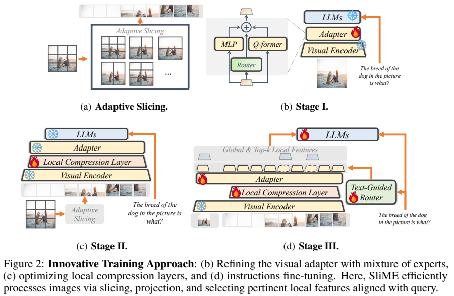
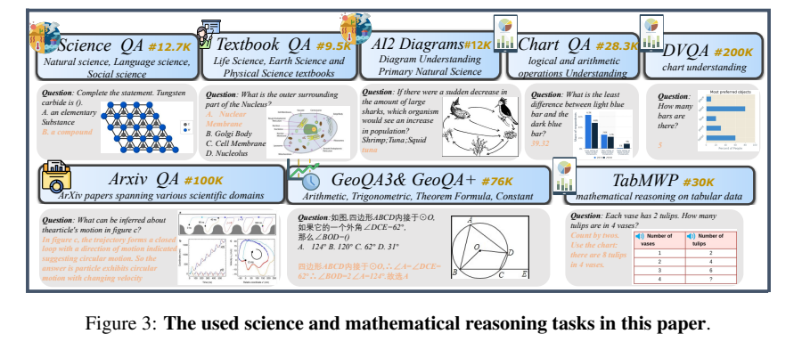
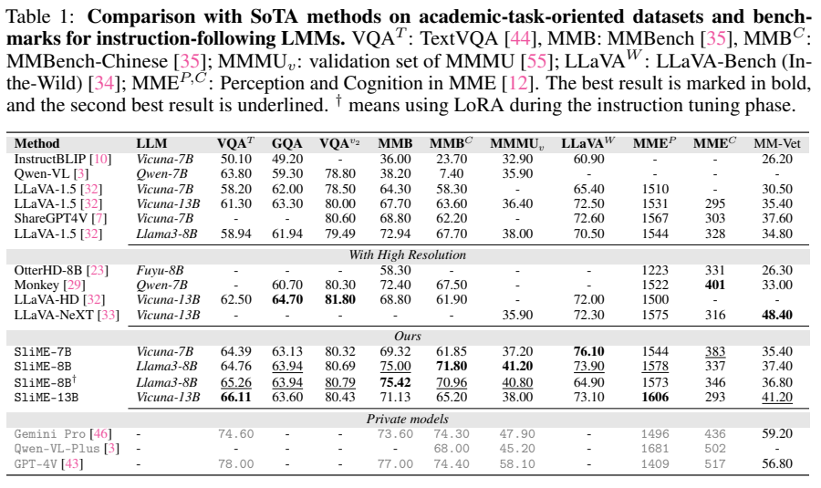
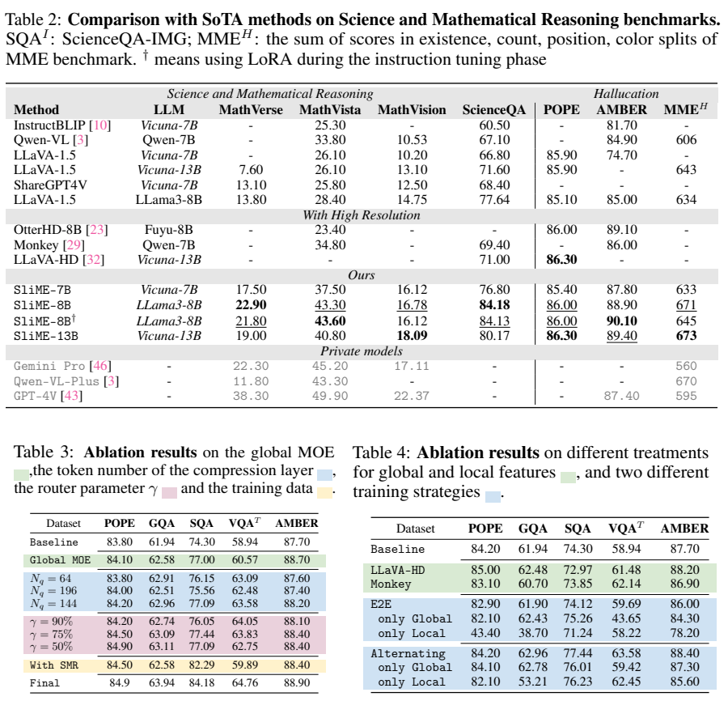

# SliME：保留全局上下文，压缩并按问题选择局部细节

## 1. 论文信息与模型定位

| 项目 | 内容 |
|---|---|
| 论文 | Beyond LLaVA-HD: Diving into High-Resolution Large Multimodal Models |
| 作者与机构 | Yi-Fan Zhang、Qingsong Wen、Chaoyou Fu 等；中科院自动化所、国科大、松鼠 AI、腾讯优图、阿里巴巴、Meta AI |
| 本文依据 | [arXiv v1，2024-06-12](https://arxiv.org/pdf/2406.08487v1)，22 页；固定版本，避免混用后续修改 |
| 官方实现 | [yfzhang114/SliME](https://github.com/yfzhang114/SliME) |
| 系列定位 | 基于 LLaVA 路线的高分辨率图像理解模型，主表包括 Vicuna-7B/13B、Llama3-8B |
| 输入与输出 | 图像与文本问题输入，文本回答输出；重点是 OCR、科学图示和视觉数学推理 |

论文关注高分辨率切片的两个问题：局部 token 容易淹没全局上下文；全局映射较容易学习，直接联合训练可能让模型忽略局部压缩模块。SliME 因此给两条分支安排不同表示方式和训练顺序。这里的“专家”是视觉适配器中的 MLP 与查询模块，并不是把语言模型改成稀疏 MoE。（§1–2）

## 2. 快速概览

| 设计 | 作用与代价 |
|---|---|
| 自适应切片 | 在 336 像素基本块上选择网格，兼顾有效分辨率和填充浪费 |
| 全局软混合适配器 | 不减少全局 token，混合直接映射与注意力提取的信息 |
| 局部查询压缩 | 每个局部块默认压缩为 144 个 token，随后依据文本相关性筛选 |
| 三阶段训练 | 先学全局，再单独学局部，最后联合指令微调；增加训练阶段成本 |
| SMR 数据 | 补充科学、数学与图表任务，使模型必须利用小字、标注和推理过程 |

Llama3-8B 版本在 Table 1 的 MMBench 得到 75.00，在 Table 2 的 MathVista 得到 43.30。表现支持“较少但相关的局部 token 有用”，并不意味着所有指标领先：MM-Vet、MMMU 与部分数学测试仍低于表中的商业模型。（PDF 第 7–8 页）

## 3. 整体架构

*来源：v1 Figure 2，PDF 第 5 页。火焰与雪花区分图中的可训练和冻结组件，三阶段使用的视觉分支不同。*

原图先生成一个填充、缩放后的 336×336 全局视图，再根据宽高选择局部网格。候选网格的两个方向最大到 6；每个局部块独立编码。全局特征分别经过 MLP 和基于可学习查询的注意力模块，由门控加权混合后进入 LLM。全局分支保留 token 数量，避免把场景关系全部压缩到少量摘要。（§2.1）

局部特征先经过查询 Transformer，再投影到语言空间。文本引导路由器根据当前问题选择相关局部 token；这些 token 与全局表示一起作为 LLM 的视觉输入。论文脚注明确：文中小写 qformer 表示通用查询机制，不等于使用 BLIP-2 的完整 Q-Former 方法或其初始化。（§2、脚注 1）

## 4. 核心创新与数学原理

**全局混合。** 对视觉特征 $x$，两个适配器输出按门控系数相加：

$$
h_g=G_0(x)f_m(x)+G_1(x)f_q(x),\qquad
G(x)=\operatorname{softmax}\!\left(xW_g+\epsilon\,\operatorname{softplus}(xW_n)\right).
$$

$\epsilon$ 为训练时的高斯噪声。其目的在于减轻门控过早偏向容易收敛的 MLP；两个输出都参与软混合，不是只激活一个专家的稀疏路由。（§2.1）

**按相关性而非固定数量选 token。** 局部表示 $z_v$ 与文本表示 $z_x$ 的相似度矩阵为 $S=z_vz_x^\top$。对文本位置平均，再对视觉位置 softmax，得到概率 $p_i$。将其降序排列，保留满足下式的最短前缀：

$$
k=\min\left\{r:\sum_{j=1}^{r}p_{(j)}>\gamma\right\}.
$$

$\gamma=75\%$ 表示累计相关性质量的阈值，不能解读为固定保留 75% 的 token。论文称其为 cosine 路由，但展示的乘积公式没有明确列出向量归一化；不能据此断言代码一定计算标准余弦。训练时还向选择分数加入 $\mathcal N(0,0.1)$ 噪声。（§2.2）

**交替学习的解释边界。** 作者用 $\frac12\|uv^\top-X\|_F^2$ 的秩一双线性近似说明两个模块的优化相互影响。固定一侧求解另一侧可形成类似幂迭代的更新。该简化分析不是完整 Transformer 的收敛证明：幂迭代还需要初始化含主特征方向、特征值幅值有间隔等条件，不能把论文的“保证收敛”直接推广到任意多模态网络。（§2.3、附录 C）

## 5. 数据构建与处理

*来源：v1 Figure 3，PDF 第 6 页。图中列出的来源规模不能直接当作实际训练混合的逐项使用量。*

SMR 汇集 Arxiv-QA、ScienceQA、TextBookQA、GeoQA、Geometry3K、TabMWP、DVQA、AI2D、ChartQA 等公开资源。部分任务提供中间推理步骤，例如 Arxiv-QA、几何题和表格数学题；这些步骤进入监督答案，让模型学习利用图中标注解释结果。正文还提到 MATH-Vision，因此必须结合训练划分判断评测独立性，不能默认所有数学评测都完全零样本。（§2.4、附录 B）

清理包括模糊图像、错乱文字、不相关图文和错误推理链；作者用 GPT-4V 重建部分错误推理过程。论文概述总体约 200 万训练数据，但未在该版本完整列出各阶段最终混合配比。图示 DVQA 200K、ChartQA 28.3K，与附录实际选取 DVQA 100K、ChartQA 人工问答 9.6K 不同，本文保留这一区别。作者声称检查了训练测试泄漏，但未给出足够细节供本文独立验证。（第 6、9、15 页）

## 6. 训练流程与目标

| 阶段 | 视觉输入和模块训练安排 | Table 7 主要配置 |
|---|---|---|
| I | 全局图像，学习视觉适配器，图中 LLM 冻结 | batch 256，学习率 $10^{-3}$ |
| II | 仅局部块；固定适配器，学习局部压缩层，LLM 仍冻结 | batch 256，学习率 $10^{-3}$ |
| III | 全局加筛选后的局部特征；联合训练适配器、压缩层、路由与 LLM | batch 128；Vicuna $2\times10^{-5}$，Llama3-8B $10^{-5}$ |

配置表给出 AdamW、BF16、weight decay 0、warmup 比例 0.03、余弦退火和 1 epoch；使用 8 张 A100 80GB。视觉编码器在 Figure 2 三阶段均标为冻结。13B 配置与 Vicuna-7B 类似；附录另列 70B LoRA 设置，不能据此宣称主结果表验证了 70B 的完整表现。（第 5、7、20 页）

文本答案的自回归监督可以解释为 $\mathcal L=-\sum_t\log p_\theta(y_t\mid y_{<t},I,q)$；这是对指令训练目标的通用说明，论文并未给出额外的独立路由奖励函数。三阶段在这里主要解决模块学习失衡；作者同时承认它延长训练时间，未提供可把 token 减少换算为固定端到端加速倍数的完整测速表。（§4）

## 7. 实验设置与主要结果

*来源：v1 Table 1，PDF 第 7 页。LLaVA-Bench 是相对 GPT-4 的得分比例；MME 是累计得分，均不是普通准确率。*

SliME-8B 相比同为 Llama3-8B 的 LLaVA-1.5，TextVQA 58.94→64.76、MMBench 72.94→75.00、MMMU 验证集 38.00→41.20。其 MMBench 75.00 高于表中 Gemini Pro 73.60，但 MMMU 41.20 低于 47.90，MM-Vet 37.40 也低于 59.20；不能概括成全面超过商业模型。

*来源：v1 Tables 2–4，PDF 第 8 页。POPE 使用 F1；AMBER 使用判别任务准确率，MME-H 汇总四个子项。*

Table 2 中 SliME-8B 的 ScienceQA-IMG 为 84.18，MathVista 43.30、MathVerse 22.90、MathVision 16.78；MathVerse 略高于 Gemini Pro 22.30，另外两项低于其 45.20 和 17.11。POPE 为 86.00，低于 LLaVA-HD 86.30；AMBER 88.90 也低于 OtterHD 89.10。

Table 4 的受控消融更直接支持训练设计：联合端到端方案 TextVQA 59.69，交替方案 63.58；仅使用局部特征时 GQA 从 38.70 升至 53.21，说明局部模块确实学到更多信息，但仍低于完整模型。Table 3 的 144 个局部查询在多项任务优于 196，阈值 50% 的 TextVQA 62.75 又低于 75% 的 63.83，体现压缩程度的权衡。

需要保留两处读表限制：Table 3 的 Final 行 POPE 是 84.9，与 Table 2 的 86.0 不一致，本文分别注明来源；LoRA 的 MathVista 43.60 略高于全量版本 43.30，却在 LLaVA-Bench 从 73.90 降到 64.90。附录展示其对短答案提示更敏感，这支持特定设置下的指令遵循问题，不能推导成 LoRA 普遍不可用。（第 7–9、19–21 页）

**来源说明：** 本文固定依据 v1。图表保留原始标注；数值、设置与限制均按正文和附录区分，未复现模型训练。来源与裁切坐标见 [图片清单](figures-manifest.json)。
