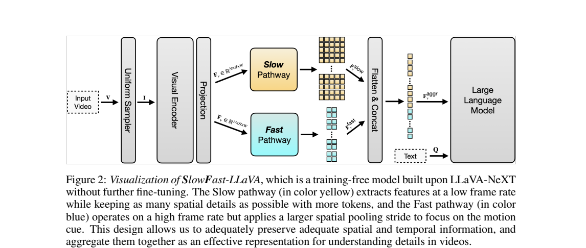
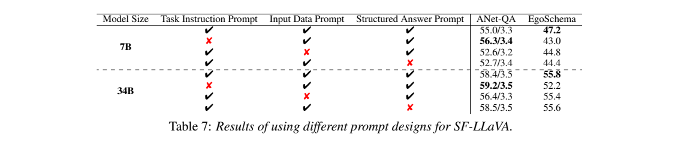
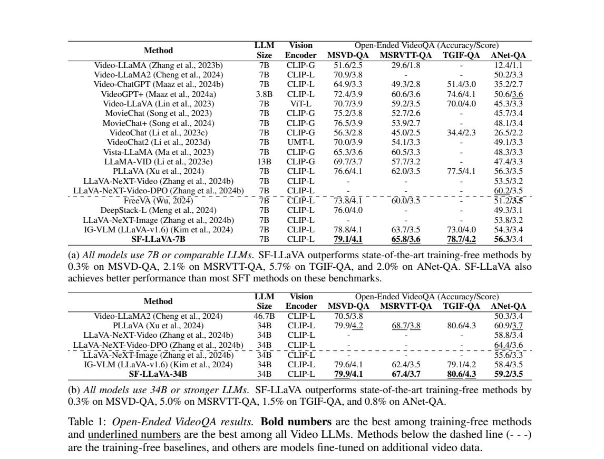
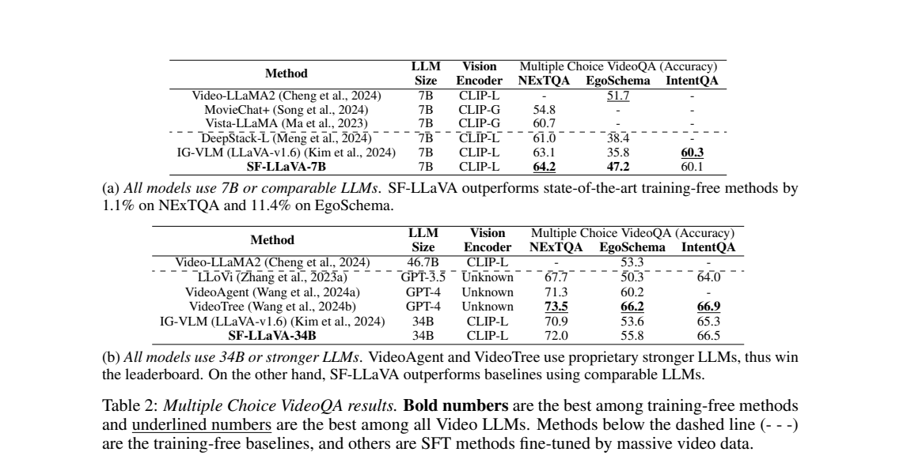
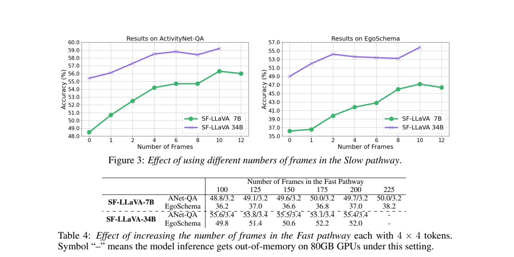

<!-- article-header:start -->
[项目首页](../../../README.md) › [模型系列](../../../reports/model-family-index.md) › [SlowFast-LLaVA](../README.md)
<!-- article-header:end -->

# SlowFast-LLaVA：在固定 token 预算内兼顾空间细节和时间覆盖

<!-- article-toc:start -->
<a id="article-toc"></a>

**本篇目录** · [论文定位](#paper-info) · [快速概览](#overview) · [整体架构](#architecture) · [核心原理](#principles) · [数据构建](#data) · [训练流程](#training) · [实验结果](#experiments)
<!-- article-toc:end -->

<a id="paper-info"></a>

## 1. 论文信息与模型定位

| 项目 | 信息 |
|---|---|
| 论文 | SlowFast-LLaVA: A Strong Training-Free Baseline for Video Large Language Models |
| 作者 | Mingze Xu、Mingfei Gao、Zhe Gan、Hong-You Chen、Zhengfeng Lai 等 |
| 团队 | Apple |
| 依据版本 | [arXiv 2407.15841v1](https://arxiv.org/pdf/2407.15841v1)，2024 年 7 月 |
| 基础模型 | 已训练的 LLaVA-NeXT 7B、34B |
| 文献类型 | 视频推理输入组织方法；没有额外训练新的基础模型 |

本工作将已有图像语言模型直接用于视频，主要改变抽帧、空间池化、token 排列及提示。它适合作为视频模型研究的低训练成本基线。原始上游条目没有列出代码仓库，因此此前归入方法补充材料，不能把缺失仓库等同于 GitHub 星数为零。（第 1–5 页）

<a id="overview"></a>

## 2. 快速概览

Slow 分支少取帧但保留细节，Fast 分支多取帧但强压缩空间网格。它们从同一批逐帧特征中构建，串接后输入冻结的 LLaVA-NeXT。

| 默认设置 | 数值 |
|---|---:|
| 原始均匀抽帧 | 50 帧 |
| 每帧输入分辨率 | 336×336 |
| CLIP 输出网格 | 24×24 |
| Slow 输出 | 10 帧，每帧 12×24 token |
| Fast 输出 | 50 帧，每帧 4×4 token |
| 总视觉 token | $`10\times12\times24+50\times4\times4=3680`$ |
| 上下文扩展 | RoPE scaling factor 2，扩至 8192 token |

“高/低分辨率”在这里指池化后的 token 网格，两个分支并不是使用不同的原始图像尺寸。默认设置受 34B 模型在 80GB GPU 上的显存约束影响。（第 3 页脚注、第 5–6 页）

<a id="architecture"></a>

## 3. 整体架构



*原文 Figure 2，第 4 页。黄色表示稀疏而保留细节的 Slow，蓝色表示密集而强池化的 Fast。*

模型先均匀抽取 50 帧，逐帧通过 CLIP-L/14 和已有视觉语言投影。除特别注明外，论文在投影后聚合特征。Slow 从中选出 10 帧，采用 1×2 空间池化获得 12×24 网格；Fast 保留全部 50 帧，用更大的池化步幅压缩成 4×4 网格。（第 2、4–6 页）

两个分支都按序展开为 token 并直接串接，不使用专门的分支分隔 token。视觉 token 和包含任务、视频输入说明及问题的文字共同输入语言模型。它没有新增运动编码器、光流分支或可训练时序注意力；更密集的帧序列提供时间线索，最终仍由已有语言模型进行理解。

<a id="principles"></a>

## 4. 核心创新与数学原理

**在空间和时间间分配预算。** 令逐帧投影特征为 $`F\in\mathbb R^{N\times H\times W\times D}`$。本文补写特征维度 $`D`$，原论文表达聚焦帧数及网格尺寸。Slow 和 Fast 操作可表示为：

```math
F_s=\mathrm{Pool}_{\sigma_h,\sigma_w}(\mathrm{Sample}_{N_s}(F)),\qquad
F_f=\mathrm{Pool}_{\gamma_h,\gamma_w}(F).
```

其中 $`N_s\ll N`$，且 $`\gamma`$ 大于 $`\sigma`$。原文式（2）–（4）将最终输入写作：

```math
A=\mathrm{LLM}(\mathrm{Prompt},[\mathrm{flat}(F_s);\mathrm{flat}(F_f)],Q).
```

视觉长度为：

```math
B_v=N_s\frac H{\sigma_h}\frac W{\sigma_w}+N\frac H{\gamma_h}\frac W{\gamma_w}.
```

相比把全部帧保留高空间分辨率，双路方法降低语言模型序列长度；相比把每帧都压得很小，又保留部分细节。这个设计改变表示组织，没有引入新的优化损失。（第 4–5 页）

**用可比较预算验证分支贡献。** 消融把 200 帧×4×4 的单 Fast（3200 token）与 8 帧×12×24 加 50 帧×4×4 的双路方案（3104 token）比较，后者在所测任务中更好。这支持收益并非仅来自更多 token；不过两者抽帧方式和信息保留方式也不同，不能把它理解为训练出的动态注意力机制。（第 8 页）

<a id="data"></a>

## 5. 数据构建与处理

该方法**没有新增训练数据集**。它复用已经训练好的 LLaVA-NeXT，实验中只处理待回答的视频，均匀抽帧后缩放到 336×336，再进行上述固定池化。模型已有的图像理解来自基础模型训练，不能将“training-free”扩展为所有组件均未训练。

| 评价类型 | 数据集 |
|---|---|
| 开放式 VideoQA | MSVD-QA、MSRVTT-QA、TGIF-QA、ActivityNet-QA |
| 选择式 VideoQA | NExTQA、EgoSchema、IntentQA |
| 生成质量 | VCGBench，评价正确性、细节、上下文、时间理解及一致性 |

50 帧默认是覆盖整段视频的固定数量，不是固定 FPS；视频越长，相邻采样点通常越远。增加 Fast 帧数或减少其网格可以延长覆盖，但会牺牲局部空间信息，论文对 10–20 分钟视频采用更强池化只提出设计建议，未给出普遍有效的保证。（第 5、9–10 页）

<a id="training"></a>

## 6. 训练流程与目标

本工作无需附加预训练或视频 SFT，CLIP、投影和语言模型权重均沿用已有 checkpoint。推理改变 RoPE scaling、视觉聚合及提示；没有需要记录的新学习率、epoch、训练 batch 或 RLHF 目标。实验机器配置为 8 张 A100 80GB，不能将其自动改写成每次推理都必须占用八卡。（第 5 页）



*原文 Table 7，第 10 页。任务提示、输入结构提示和答案格式提示的收益随任务变化。*

提示分三部分：任务指令告诉模型选择选项或准确回答；输入说明告诉它这些是视频关键帧序列；格式提示约束输出便于解析。选择题使用任务指令以及选项格式，开放式 QA 的最终设置去掉该任务指令，因为其在 ActivityNet-QA 消融中降低得分。其余提示仍保留。（第 10–11 页）

因此评估结果不仅取决于视觉池化，也取决于任务提示与答案解析。论文用实验选择这些设置，而不是优化一个新损失函数。语言模型仍以原有自回归机制生成答案，本文没有将其已有训练目标冒称为本方法贡献。

<a id="experiments"></a>

## 7. 实验设置与主要结果

开放式答案及 VCGBench 使用 GPT-3.5-Turbo-0125 评价，作者强调不同 GPT 版本会改变结果；开放式任务除 ActivityNet-QA 外按其说明采用验证集。选择题以选项准确率衡量。跨论文引用结果可能有评审版本和数据设置差异，不能直接合成统一排行榜。（第 5 页）



*原文 Table 1，第 6 页。虚线区分额外视频微调和免训练方案。*

| 模型 | MSVD | MSRVTT | TGIF | ActivityNet |
|---|---:|---:|---:|---:|
| SF-LLaVA-7B Accuracy | 79.1 | 65.8 | 78.7 | 56.3 |
| SF-LLaVA-34B Accuracy | 79.9 | 67.4 | 80.6 | 59.2 |

7B 相比 IG-VLM 的四项准确率提高 0.3、2.1、5.7、2.0 个百分点；34B 在 ActivityNet 仍低于 LLaVA-NeXT-Video-DPO 的 64.4。因此“超过多数视频微调方法”不能改写成超过全部方法。



*原文 Table 2，第 7 页。7B 在 IntentQA 的 60.1 低于 IG-VLM 的 60.3。*

SF-LLaVA-7B 的 NExTQA/EgoSchema/IntentQA 为 64.2/47.2/60.1，34B 为 72.0/55.8/66.5。EgoSchema 上 7B 比 IG-VLM 高 11.4 个百分点，但并非每项都领先。Table 3 中 7B 生成质量平均 3.04，也低于 LLaVA-NeXT-Image 的 3.07；34B 平均 3.32，高于对应 3.27，但低于 DPO 的 3.77。（第 7 页）



*原文第 8 页。高帧数的单 Fast 路径很快趋于饱和；双路在相近 token 数下保留更好的细节和时间覆盖。*

消融支持同时保留两条路径，且强池化并非越大越好。各消融表的默认 ActivityNet 分数与主表不完全一致，例如 7B 的 Table 5/6/7 行值不同，报告没有统一解释全部差异；本文分别引用，不把它们拼接成同一配置的精确提升。整体证据说明输入预算分配能显著改善现有图像模型的视频用途，但不能解决所有长视频细节与严格时序推理问题。

原图与原表截取记录见 [配图清单](figures-manifest.json)。

<!-- article-footer:start -->
---

[← 上一篇：EVLM](../../evlm/arxiv-2407.14177/README.md) · [按发表时间浏览](../../../reports/paper-reading-guide.md#year-2024) · [下一篇：VILA² →](../../vila/arxiv-2407.17453/README.md)

[返回本篇目录](#article-toc) · [返回模型系列](../README.md)
<!-- article-footer:end -->
