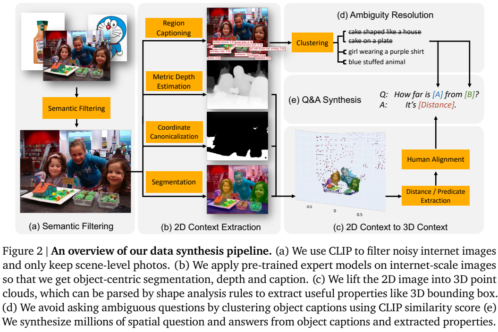
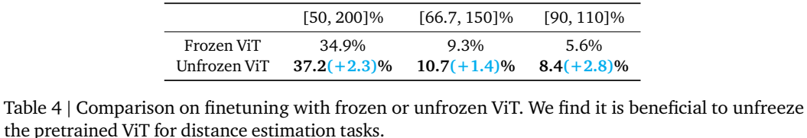
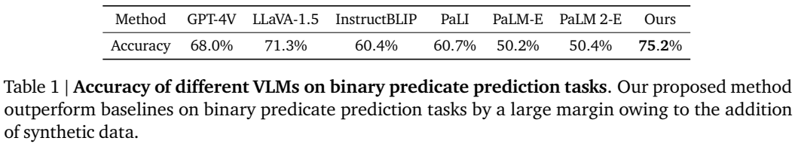
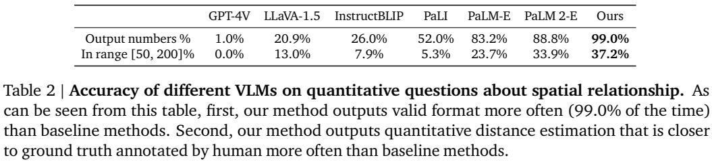
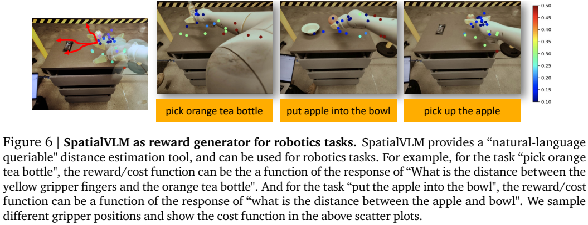

# SpatialVLM：用自动合成的三维空间问答增强视觉语言模型

## 1. 论文信息与模型定位

| 项目 | 内容 |
|---|---|
| 论文 | SpatialVLM: Endowing Vision-Language Models with Spatial Reasoning Capabilities |
| 作者与机构 | Boyuan Chen、Zhuo Xu、Sean Kirmani 等；Google DeepMind、Google Research（按 PDF 作者栏） |
| 本文依据 | [arXiv v1，2024-01-22](https://arxiv.org/pdf/2401.12168v1)，29 页；首页排版日期另写 2024-1-23 |
| 项目页 | [SpatialVLM](https://spatial-vlm.github.io/)；其中代码入口明确标记为第三方社区实现 |
| 模型定位 | 基于 PaLM-E 路线、采用 PaLM 2-S 语言骨干的空间理解 VLM |
| 输入与输出 | 直接推理时输入 RGB 图像与问题，输出关系、尺寸或距离的自然语言答案 |

本文的重点是用数据补足“哪个物体更高”“两物体相距几米”这类三维空间知识。它没有要求部署时输入深度图或显式场景图：这些几何信息主要用于离线合成训练监督。涉及多步推理的展示则另外调用 LLM 协调器，应与模型直接回答空间问题的能力区分。（§3）

## 2. 快速概览

| 项目 | 主要设计 |
|---|---|
| 数据规模 | 约 1000 万真实图像、20 亿合成问答；不是 20 亿独立图像，也不是全部都被训练消耗 |
| 空间问题 | 38 类问题，定性与定量各约 50%；主要涉及一至两个物体 |
| 数据来源机制 | 区域提议、分割、细粒度描述、米制单目深度与几何规则 |
| 学习方式 | 将空间问答混入 PaLM-E 原训练数据，继续自回归语言监督 |
| 核心结果 | 定性问答准确率 75.2%；定量输出数字比例 99.0%，估计值在真值 0.5–2 倍范围内的比例 37.2% |

它证明空间数据可以改善特定任务，而不是已经达到精密三维测量能力。数据的深度误差、视场估计、模板覆盖和人工估计参考值都会影响实验解释。（§4.1）

## 3. 整体架构

*来源：v1 Figure 2，PDF 第 4 页。图中的分割、深度和坐标标准化属于数据合成流程。*

**离线数据系统**先用 CLIP 去掉不适合空间推理的图片，再抽取各物体的区域、掩码和描述。ZoeDepth 预测米制深度，结合视场估计反投影得到点云；分割后的物体点云用于计算尺寸、距离和关系。模板把这些值转成自然语言问答。（§3.1、附录 A.2）

**直接回答模型**沿用 PaLM-E 的视觉语言架构与训练程序，把 PaLM 换为 PaLM 2-S。模型从图像编码与语言输入预测答案；论文没有在该版本明确给出完整参数数目或视觉编码器具体型号，不能把 PaLM-E-12B 基线的参数量直接套给 SpatialVLM。（§3.3、4）

**多步推理系统**由外部 LLM 把复杂问题拆成距离或尺寸子问题，逐次询问 SpatialVLM，再合并答案。§3.3 写协调器为 text-davinci-003，§4.5 则提及 GPT-4，版本表述不一致。该系统也不同于在一个模型内部训练出的端到端空间思维链。（第 7、11 页）

## 4. 核心创新与数学原理

**把二维像素提升到米制三维。** 用针孔模型解释，像素 $(u,v)$、预测深度 $d$ 与估计相机内参 $K$ 可形成：

$$
\mathbf p=dK^{-1}[u,v,1]^\top.
$$

这用于说明反投影原理，论文实现用深度与视场估计；它并不意味着获得了真实相机标定。点云需经过离群点清理与 DBSCAN 聚类，减少错误深度对物体尺寸的影响。（附录 A.2）

**统一坐标避免把图像“上方”误当作现实“更高”。** 系统检测地板或桌面等水平面，用 RANSAC 拟合平面，再构造旋转和平移。若平面证据不足，就不合成依赖高度标准化的问题。几何距离可以由点云或物体包围盒的相应函数计算；本文用 $\|\mathbf p_A-\mathbf p_B\|_2$ 示意欧氏距离，具体题型还可能是水平、深度或高度差，不能都解读成中心距离。（第 21–22 页）

**学习数字仍通过文字目标。** 训练可解释为 $-\sum_t\log p_\theta(a_t\mid a_{<t},I,q)$，距离数字与单位都作为答案 token；论文没有新增一个独立的连续数值回归头。模板、人类化舍入和不同单位让模型学到近似空间估计，也会限制精确测量。（§3.2、附录 A.2）

## 5. 数据构建与处理

CLIP 筛选偏向普通室内外照片，排除单物体白底产品、绘画、界面截图等；“iphone photo”前缀还用于筛掉异常宽视场与透视。区域提议加 NMS 生成物体候选，类无关分割生成掩码，FlexCap 为区域采样 1–6 词的细粒度描述，避免所有物体都被笼统叫作“蛋糕”。（第 20 页）

描述经 CLIP 相似度检查：一对相似对象可加位置描述，超过两个高度相似对象则删除以避免歧义；还移除天空等常见背景对象。38 类空间问题分别具有约 20 个问题模板、10 个答案模板，答案来自点云与几何规则。训练问答主体是直接空间关系，不是大规模人工多步推理标注。（第 6、22–26 页）

距离表达进行概率舍入，例如 0.86 米可能说成 1 米、90 厘米或 3 英尺；英制单位约以 20% 概率使用。这减轻过多小数带来的虚假精确感。作者在机器人实验中多次采样后平均，以缓解舍入误差；该处理不等于单次输出已经精确。（第 22–23 页）

## 6. 训练流程与目标

| 项目 | 原文设置 |
|---|---|
| 数据混合 | 正文写空间任务占约 5% token；附录原数据与空间数据采样比 174:2.5，二者口径不同 |
| 优化与批量 | ADAM，学习率 $2\times10^{-4}$，batch 512 |
| 第一段 | 冻结视觉编码器训练 110K steps |
| 第二段 | 分为冻结或解冻视觉编码器两条实验，各继续 70K steps |
| 数据消耗 | 作者明确表示生成数据超过训练实际消耗量 |

空间数据与 caption、VQA 数据可以使用相同语言监督目标；是否解冻视觉编码器影响其保留细粒度空间信息的能力。论文没有充分披露总设备配置、全部学习率调度与连接器参数，本文不填入假定的完整训练配方。（§3.3、4.3；第 23 页）

*来源：v1 Table 4，PDF 第 10 页。三个范围是相对于人工距离估计的倍率区间。*

解冻后，在 0.5–2 倍区间的比例从 34.9→37.2；在 0.9–1.1 倍区间从 5.6→8.4。这说明解冻对更细的估计有帮助，也显示严格的 ±10% 距离精度仍较低。

## 7. 实验设置与主要结果

评估使用人工标注的 331 条定性、215 条定量问答，参考答案来自观看图像后的自然语言估计，而非全面经过传感器标定的真值。作者称图像未用于训练；评价样本较少，且沿用合成流程涉及的空间问题模式。GPT-4V 基线固定访问于 2023 年 11 月，不能据此评价其后续版本。（§4.1、附录 A.1）

*来源：v1 Table 1，PDF 第 8 页。自由文本答案由人工判断正确与否。*

SpatialVLM 75.2 高于 LLaVA-1.5 71.3、GPT-4V 68.0 和同架构无空间数据的 PaLM 2-E 50.4；后者提供较直接的数据作用对照。但这不是所有三维任务的综合成绩。

*来源：v1 Table 2，PDF 第 9 页。数字输出率不等于距离准确率。*

模型数字输出率 99.0，PaLM 2-E 88.8；落在人工值 0.5–2 倍范围内为 37.2，对照为 33.9。正文把这一结果形容为“接近一半”，本文保留实际表值 37.2。GPT-4V 多数选择不提供缺乏标尺的精确估计，其低数字输出率同时受到回答策略影响。（第 9 页）

一般 VQA 的 Table 3 包含相应数据微调：VQA-v2 76.6→79.0，OKVQA 61.4→61.0，后者略有下降。机器人近距离实验加入不同水平高斯噪声后，宽容范围指标为 55.8–61.1，未呈现单调恶化；这只支持该实验中的适度噪声容忍。Table 5 将 MSE 单位标为 m，按平方误差定义应为平方单位，本文不把该标注当成精确单位规范。（第 10–11 页）

*来源：v1 Figure 6，PDF 第 11 页。距离可作为奖励或代价构造的输入，不代表已量化训练出完整机器人控制策略。*

奖励标注与多步空间问答主要是应用展示。原文没有报告由这些奖励训练出的 RL 策略成功率；模型还继承深度专家在较远场景的偏差，较可靠的范围集中在约 1–10 米。因此其结果更适合解释为空间常识与近似度量能力的增强。（§4.1、4.5、附录 Figure 11）

**来源说明：** 本文按 v1 固定原图、训练设置与实验口径；未复现模型，原图来源及裁切记录见 [图片清单](figures-manifest.json)。
