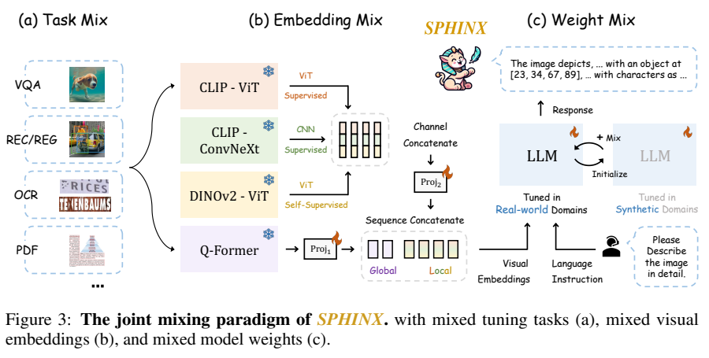
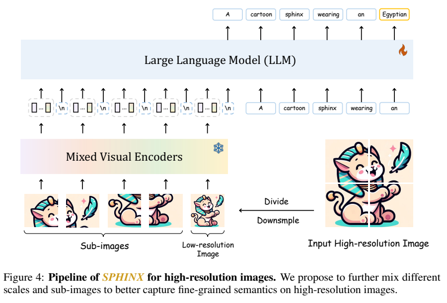
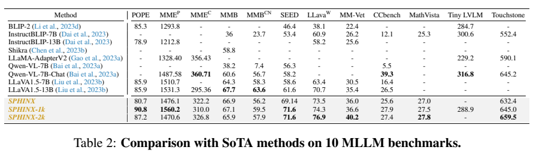
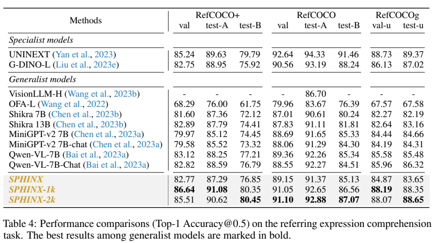

<!-- article-header:start -->
[项目首页](../../../README.md) › [模型系列](../../../reports/model-family-index.md) › [SPHINX](../README.md)
<!-- article-header:end -->

# SPHINX：联合混合模型权重、视觉表示和多任务指令

<!-- article-toc:start -->
<a id="article-toc"></a>

**本篇目录** · [论文定位](#paper-info) · [快速概览](#overview) · [整体架构](#architecture) · [核心原理](#principles) · [数据构建](#data) · [训练流程](#training) · [实验结果](#experiments)
<!-- article-toc:end -->

<a id="paper-info"></a>

## 1. 论文信息与模型定位

| 项目 | 信息 |
|---|---|
| 论文 | *SPHINX: The Joint Mixing of Weights, Tasks, and Visual Embeddings for Multi-modal Large Language Models* |
| 作者与机构 | Ziyi Lin、Chris Liu、Renrui Zhang、Peng Gao、Longtian Qiu 等；上海人工智能实验室、香港中文大学、上海科技大学 |
| 来源 | [arXiv:2311.07575v1](https://arxiv.org/pdf/2311.07575v1)，2023 年 11 月，24 页 |
| 官方代码 | [Alpha-VLLM/LLaMA2-Accessory](https://github.com/Alpha-VLLM/LLaMA2-Accessory) |
| 定位 | LLaMA-2 驱动的图像理解与结构化视觉输出模型 |

SPHINX 用一个语言模型生成问答、描述、框、关键点等输出，探索多种能力如何共同训练。本文固定介绍首版报告；SPHINX-X 等后续模型的参数和训练规模不应倒填到本版本。

<a id="overview"></a>

## 2. 快速概览

| 混合对象 | 具体做法 |
|---|---|
| 模型权重 | 真实图文预训练后用合成描述继续训练，再线性合并两个 LLM |
| 指令任务 | 问答、定位、OCR、检测、姿态、关系等共同训练 |
| 视觉表示 | CLIP-ViT、CLIP-ConvNeXt、DINOv2 与 Q-Former 组合 |
| 分辨率和尺度 | 低分辨率全图与高分辨率局部图共同作为长视觉序列 |

其分割和编辑示例分别调用 SAM、LaMa、Stable Diffusion。SPHINX 本身提供语义理解和框定位，这些系统扩展不等同于自身具有原生分割头或图像生成头。（第 8–9 页）

<a id="architecture"></a>

## 3. 整体架构



*Figure 3，PDF 第 6 页。视觉骨干冻结，语言骨干与投影层训练。*

CLIP 的 ViT/CNN 提供不同结构先验，DINOv2 提供自监督表征，Q-Former 汇聚查询表示。patch 级特征先按通道拼接，再经投影对齐语言维度；Q-Former 表示经另一个投影后，沿序列与 patch 表示拼接。这里是特征融合，不是对多个模型的回答做投票，也不是动态路由 MoE。（第 5–7 页）



*Figure 4，PDF 第 7 页。子图在视觉编码器中独立处理，跨图交互主要发生在 LLM。*

基础模型处理 $`224^2`$ 全图，得到 257 个 patch/全局相关 token 与 32 个 Q-Former token，共 289。1k 版本处理 $`448^2`$，包含一张下采样全图和四张子图，共 $`5\times289=1445`$ token。2k 版本共十组、2,890 token；原文写分辨率 $`762^2`$、九个子图，但没有充分解释它与 $`224^2`$ 网格裁切如何对应，本文保留源数值，不自行改为 672。（第 12 页）

| 模块 | 输入与输出 | 公开机制 |
|---|---|---|
| 多骨干视觉编码 | 同一图像 → CLIP-ViT、CLIP-ConvNeXt、DINOv2 patch特征 | 联合不同网络结构和预训练范式，patch特征按通道拼接 |
| Q-Former全局路径 | 全局视觉上下文 → 查询摘要token | 提供与patch特征不同的信息粒度，独立投影至LLM维度 |
| 双投影及序列合并 | patch拼接特征与查询摘要 → 统一视觉序列 | 先分别对齐通道，再沿序列方向连接两类表示 |
| 高分辨率子图 | 整图与局部裁片 → 多尺度视觉token | 增强细节观察，但送入LLM的序列随子图数增长 |
| 混合后LLM | 视觉序列与任务指令 → 文本及语言化空间输出 | 真实域与合成域检查点先权重合并，再进行多任务指令训练 |


<a id="principles"></a>

## 4. 核心创新与数学原理

### 4.1 相关检查点的权重插值

原文式 1 的权重合并为：

```math
\theta_{\mathrm{mix}}=\beta\theta_{\mathrm{real}}+(1-\beta)\theta_{\mathrm{syn}}.
```

真实域模型先在 LAION-400M 上训练，合成域模型从其初始化并在 LAION-COCO 上继续训练，再合并同架构、同起点关联的权重。该策略希望兼顾两种描述语义，并不能从式子本身推出对任意模型都无损合并。正文定义了 $`\beta`$，未完整披露最终选择系数及其独立消融，不宜默认取 0.5。（第 5–6 页）

两份参数来自连续训练链：先得到真实域基础模型，再从该检查点继续适应合成域，而非两个任意初始化网络直接相加。插值把语义折中固化到一套权重，推理时不需要同时运行两个LLM，也没有逐样本门控选择。系数控制折中方向，不能由线性参数式推出任务准确率也线性变化。〔v1 §3.1，第5–6页，式1〕

### 4.2 以指令消解任务冲突

各任务改写为语言序列，可用条件负对数似然解释训练：$`-\sum_t\log p(y_t\mid I,q,y_{\lt t})`$。框与关键点以坐标文字输出，仍通过语言目标学习，论文没有另外提出直接优化 IoU 或关键点距离的损失。任务提示帮助区分“定位对象”“描述区域”“检测文字”等不同输出格式。（Table 1）

检测、OCR与区域表达都生成语言序列，但任务提示明确指定目标，例如“检测所有对象”与“检测文字及框”。这种提示区分让共享生成头知道何时给类别、文字或空间坐标；共享输出接口不代表不同任务的评价尺度相同。〔§3.1 Mixed tuning tasks，第6页〕

### 4.3 编码器互补与高分辨率代价

高分辨率分块在每个视觉编码器内保留较短序列，降低直接扩大 ViT 输入的代价；但 LLM 接收 1,445/2,890 个视觉 token 后，注意力与缓存成本仍增长。“编码器较高效”不能直接推成整个系统恒定成本。子图之间的语义关系交给 LLM 建立。（第 7–8 页）

通道拼接保留同一patch位置来自不同骨干的信息，序列拼接则增加LLM可读的位置，两者增加的成本维度不同。Q-Former提供全局摘要并不取代所有patch，故不能把它的固定查询数当作整张图最终token总量。视觉骨干在第一阶段冻结，LLM与投影层解冻，使多路表示通过共同语言监督对齐。〔§3.1，第5–6页及Figure 3；高分辨率段保留原出处〕


<a id="data"></a>

## 5. 数据构建与处理

预训练使用 LAION-400M、LAION-COCO，并加入 RefinedWeb 纯文本以保护语言建模。数据集名字是来源规模标识，论文没有在此给出全部实际下载成功、去重后使用数量，不能把“400M”直接当成此次训练的唯一实际样本计数。（第 9–10 页）

指令微调包含 LLaVA、ShareGPT、VQAv2、GQA、OKVQA、A-OKVQA、OCRVQA、TextCaps、COCO、LVIS、RefCOCO、VG、Flickr30k 等，转换为多轮对话。不同数据按原始大小比例采样，因此不是逐任务等权平衡。定位与姿态等任务已有相关监督，主表结果不能全部解释为未见任务零样本。（第 10 页）

微调时将短边补齐成方形再缩放，减少宽高比极端时内容变形；高分辨率版本增加局部图。TextVQA 评测提示还包含参考 OCR token，读分数时应与不含 OCR 提示的方法区别。（Tables 1、3）

<a id="training"></a>

## 6. 训练流程与目标

| 阶段 | 更新与配置 |
|---|---|
| 真实域图文对齐 | 全量 LLM + 两个投影层；视觉骨干冻结 |
| 合成域适配与混合 | 从真实域模型继续适配合成描述，之后合并 LLM 权重 |
| 多任务指令微调 | 继续训练语言模型与投影，按任务文本预测输出 |

预训练 AdamW 的 $`\beta=(0.9,0.95)`$、weight decay 0.1，180K steps；学习率从 $`5\times10^{-5}`$ 余弦下降到 $`5\times10^{-6}`$，前 2K steps 线性预热。每批含 640 图文对和 65,536 RefinedWeb 文本 token，最初只使用 $`224^2`$ 单全图，不加语言任务提示。7B 报告约 32 张 A100、125 小时，13B 约两倍。（第 9–10 页）

指令阶段 batch 128，最高学习率 $`2\times10^{-5}`$、最低 0，预热 0.03 epoch；13B 约 16 张 A100、38 小时，最大训练序列 3,072。完整的合成域单独训练日程、各来源精确数量及混合系数没有充分披露。RefinedWeb 消融显示不加入纯文本时图文损失仍下降、纯文本损失上升，支持缓解遗忘，但这不是所有语言能力的系统无退化保证。（Figure 7）

<a id="experiments"></a>

## 7. 实验设置与主要结果



*Table 2，PDF 第 11 页。不同任务指标有不同量纲。*

| 指标 | SPHINX | 1k | 2k |
|---|---|---|---|
| POPE | 80.7 | 90.8 | 87.2 |
| MME perception | 1476.1 | 1560.2 | 1470.6 |
| MMBench | 66.9 | 67.1 | 65.9 |
| MM-Vet | 36.0 | 36.6 | 40.2 |
| LLaVA-Wild | 73.5 | 74.3 | 76.9 |

高分辨率改善若干细节与开放式理解指标，但 2k 的 POPE、MME、MMBench 低于 1k。VQAv2 78.1→80.2→80.7、TextVQA 51.63→58.78→61.19 有提升；OCR-VQA 却 66.0→70.0→67.8，均仍低于 Qwen-VL 的 75.7。模型并非分辨率越高所有任务越好。（Tables 2–3）



*Table 4，PDF 第 13 页。Top-1 Accuracy@0.5 使用定位重叠阈值，不是坐标 token 准确率。*

1k 的 RefCOCO+ val 为 86.64，较强；2k 的 RefCOCO testB 为 87.07，仍低于 G-DINO-L 88.24 与 UNINEXT 91.46。基础 SPHINX 在多个划分低于 Qwen-VL，因此正文“超过 Qwen 全部分割”的说法主要适用于高分辨率结果，不能泛化到基础版。

姿态、文档布局、异常检测及 SAM/扩散模型系统扩展主要展示案例，没有完整标准定量基准。ImageNet 70.8% 来自额外监督微调 1 epoch，其骨干本已预训练，不能与随机初始化视觉模型训练 300 epochs 直接作为公平效率比较。首版支持混合训练路线的可行性，对每一种混合组件的独立收益和系统可靠性仍有验证空间。（第 9、13–17 页）

<!-- article-footer:start -->
---

[← 上一篇：LVIS-Instruct4V](../../lvis-instruct4v/arxiv-2311.07574/README.md) · [按发表时间浏览](../../../reports/paper-reading-guide.md#year-2023) · [下一篇：Chat-UniVi →](../../chat-univi/arxiv-2311.08046/README.md)

[返回本篇目录](#article-toc) · [返回模型系列](../README.md)
<!-- article-footer:end -->
