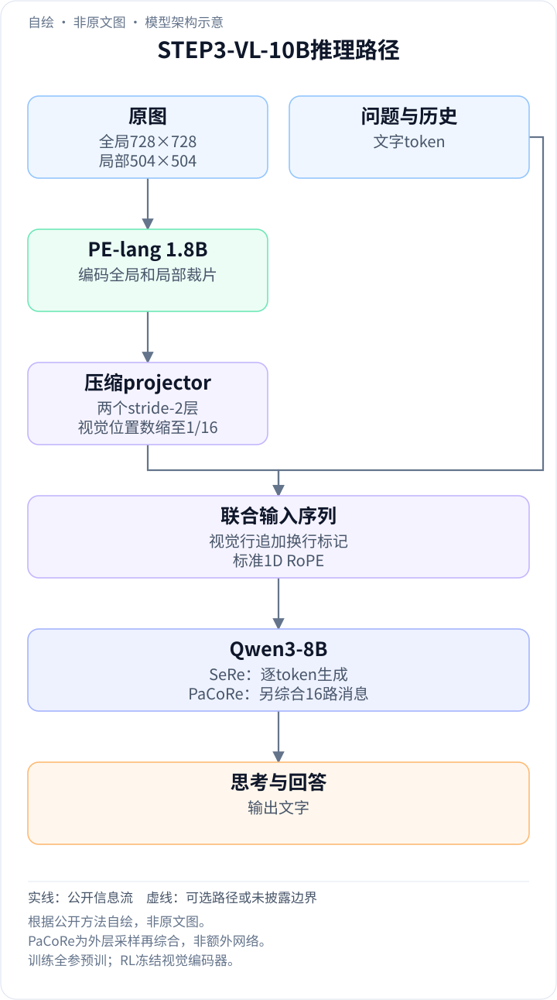
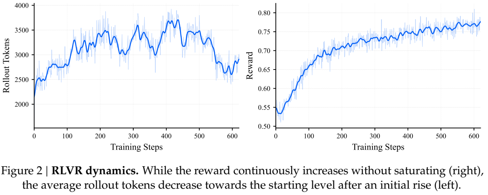
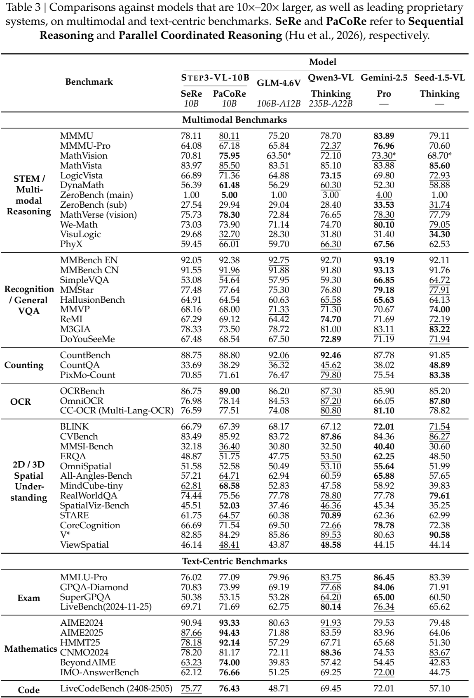

<!-- article-header:start -->
[项目首页](../../../README.md) › [模型系列](../../../reports/model-family-index.md) › [Step](../README.md)
<!-- article-header:end -->

# STEP3-VL-10B：紧凑视觉骨干与并行协调推理

<!-- article-toc:start -->
<a id="article-toc"></a>

**本篇目录** · [论文定位](#paper-info) · [快速概览](#overview) · [整体架构](#architecture) · [核心原理](#principles) · [数据构建](#data) · [训练流程](#training) · [实验结果](#experiments)
<!-- article-toc:end -->

<a id="paper-info"></a>

## 1. 论文信息与模型定位

| 项目 | 信息 |
|---|---|
| 原文 | **STEP3-VL-10B Technical Report** |
| 团队 | StepFun（阶跃星辰） |
| 发表日期 | **2026-01-14**，arXiv v1 |
| 固定版本 | [2601.09668v1 PDF](https://arxiv.org/pdf/2601.09668v1) |
| 代码与模型 | [官方仓库](https://github.com/stepfun-ai/Step3-VL-10B) · [官方模型卡](https://huggingface.co/stepfun-ai/Step3-VL-10B) |
| 定位 | 10B级图像文字理解与推理模型；发布Base、Chat及后续量化权重 |

这篇报告讨论如何用1.8B视觉前端和Qwen3-8B，在充分预训练、视觉强化学习及额外推理计算下提升紧凑模型。它不是名为Step-3的大型MoE模型本体，PaCoRe也是多次采样再综合的推理方式，不能把其最高成绩视为一次普通生成的结果。[§1–3，第1–10页](https://arxiv.org/pdf/2601.09668v1#page=4)

<a id="overview"></a>

## 2. 快速概览

| 重点 | 公开方案 | 成本与边界 |
|---|---|---|
| 视觉与语言对齐 | PE-lang 1.8B接Qwen3-8B | 选择语言预对齐前端，不从零训练视觉特征 |
| 视觉序列压缩 | 两个stride-2层，空间token数16×压缩 | 全局图与局部裁片共同保留细节 |
| 基础训练 | 1.2T token单阶段全参训练 | 单阶段内部仍有两段学习率与数据质量安排 |
| 视觉强化学习 | PPO+GAE，验证任务后接偏好对齐 | RL阶段冻结encoder、更新decoder |
| 推理扩展 | SeRe → 16路PaCoRe综合 | 最高128K上下文，增加采样和综合成本 |

标准SeRe的MMMU为78.11、MathVision为70.81；PaCoRe分别为80.11、75.95。原文MMBench“92.17/约92.2”是PaCoRe中英均值，Table3英文单项为92.38。[§4.1 / Table3，第12、15–16页](https://arxiv.org/pdf/2601.09668v1#page=15)

<a id="architecture"></a>

## 3. 整体架构

<!-- derived-architecture:start -->


*自绘模型架构示意（非原文图）。依据下述公开资料归纳；方框表示功能组件，不代表逐层实现。*

依据：[§2.1 p4；§3.2.4 p10；§4.1 p12](https://arxiv.org/pdf/2601.09668v1)。
<!-- derived-architecture:end -->

| 模块 | 输入与输出 | 公开机制 |
|---|---|---|
| 多裁片预处理 | 原图 → 全局图与局部图 | 全局728×728，局部504×504；利用batch维并行处理裁片 |
| PE-lang视觉编码器 | 各裁片patch → 语言对齐的视觉特征 | 1.8B language-optimized Perception Encoder，而非spatial-optimized版本 |
| 压缩projector | 视觉网格 → 压缩视觉嵌入 | 连续两个stride-2层，空间位置数总计减少16倍 |
| 序列组织 | 视觉行、问题与历史 → 联合输入 | patch行后追加newline token，使用标准1D RoPE |
| Qwen3-8B decoder | 联合输入 → 思考与答案 | 自回归生成文字；最终方案未加入DeepStack |
| PaCoRe外层 | 同一问题的16条SeRe轨迹 → 综合答案 | 把并行消息作为新上下文交给模型；不额外公开一个专用视觉网络 |

一次常规推理先获得整图语义与局部细节，经PE和projector形成较短视觉序列，按行插入换行标记后与问题一起进入Qwen3。标准1D位置编码与换行标记表达序列/行边界，并非二维RoPE。多裁片策略避免可变分辨率packing的工程复杂度，但局部裁片仍增加视觉编码计算，不能把16×压缩直接当成16×端到端提速。[§2.1，第4页](https://arxiv.org/pdf/2601.09668v1#page=4)

<a id="principles"></a>

## 4. 核心创新与数学原理

### 4.1 语言预对齐前端和压缩接口

PE-lang已将视觉特征向语言语义对齐，有利于与Qwen3衔接；两层stride-2空间压缩每层把网格长宽各减半，因此序列位置数为 $`N/4/4=N/16`$。这是解释下采样比例的计数，非原文新损失公式。全局图提供布局，局部裁片补小字/细节，压缩缓解下游注意力成本。§5.1以300M PE-lang和300M DINOv3做前端消融，不能把消融尺寸写成最终1.8B编码器；PE在OCRBench更好，但BLINK等并非全部更高。[§2.1 / Table4，第4、16页](https://arxiv.org/pdf/2601.09668v1#page=16)

### 4.2 PPO、价值估计与视觉任务奖励

原文Eq.(1)以GAE估计每个生成token的优势：

```math
\hat A_t=\sum_{l=0}^{T-t-1}(\gamma\lambda)^l\delta_{t+l},\qquad \delta_t=r_t+\gamma V_\varphi(s_{t+1})-V_\varphi(s_t).
```

$`s_t`$ 包含图像、问题及已生成文字；$`r_t`$ 为奖励，$`V_\varphi`$ 是critic。Eq.(2)用新旧策略概率比和裁剪限制单次更新。实际配方设 $`\gamma=\lambda=1`$，actor/critic学习率为 $`2\times10^{-6}/5\times10^{-6}`$；报告还区分省略标准重要性采样的变体与修正训练/推理差异的截断比率（阈值8），不宜简化为“完全没有概率修正”。

Grounding用IoU或距离衰减，视觉问答由GPT-OSS-120B验证语义等价及过程一致性；开放回答由成对GenRM参考更强教师评分，另加语言、引用真实性与不恰当确定性惩罚。裁判提升了格式鲁棒性，仍不是数学证明器。[§3.2.1–3.2.2，第7–9页](https://arxiv.org/pdf/2601.09668v1#page=8)

### 4.3 可检验、视觉相关、难度适中的RL样本

每个问题先经四次独立验证，仅保留裁判一致的样本；再检查图像与问题是否相关、图像是否有贡献；最后生成24次rollout，保留有成功也有失败的some-accept题。全对题缺乏区分奖励，全错题难提供成功策略参照，筛选在样本质量和可学习难度之间取舍。

600步RLVR使用24K最大长度、每步512题×16采样；接着300步RLHF针对没有确定答案的问题，以教师参考和偏好奖励对齐，长度32K、每题8采样。数据难度标签不是最终准确率，不可把过滤后可解比例当作泛化成绩。[§3.2.3，第9–10页](https://arxiv.org/pdf/2601.09668v1#page=9)

### 4.4 并行协调推理不是多数投票

PaCoRe先独立形成多个视觉/推理假设，再把轨迹放入综合上下文，由模型交叉检查后生成结论。训练复用24路难度筛选的消息池，每次抽16–24条模拟综合，并再次只留综合后仍some-accept的题，避免任务因附加答案而变得过易。之后进行500步严格on-policy PPO，64K训练长度、64题×16采样。

评测使用16条SeRe轨迹，再以128K上下文综合；SeRe上限64K。用说明性记号可写成先采样 $`z_1,\ldots,z_{16}\sim\pi_\theta(\cdot\mid I,q)`$，再生成 $`a\sim\pi_\theta(\cdot\mid I,q,z_1,\ldots,z_{16})`$。此式概括两步流程，不是论文原创概率目标，也不是按终答出现次数投票。额外轨迹增加成本，并可能传播共同的视觉误读。[§3.2.4 / §4.1，第10、12页](https://arxiv.org/pdf/2601.09668v1#page=10)

### 4.5 更长文字并非视觉RL收益的唯一来源



*Figure2，第18页；保留坐标、两条曲线与图注。*

平均rollout长度先升后回落，而奖励持续增加。作者解释为推理任务延长链条、确定性感知任务缩短冗余探索的抵消；“缺失感知过程轨迹”属于作者假说，曲线本身不能证明因果。由此PaCoRe尝试把多个感知假设显式呈现，而不是仅鼓励每次回答更长。最终训练仍采用AdamW：Muon和DeepStack虽有局部/收敛收益，但分别因初始化过渡与下游收益有限而未采用。[§5.1–5.2，第16–18页](https://arxiv.org/pdf/2601.09668v1#page=17)

<a id="data"></a>

## 5. 数据构建与处理

| 数据 | 原文规模与构建 |
|---|---|
| 知识图文 | Common Crawl、StepCrawl、关键词检索，CLIP概念聚类重采样，四图拼接增强 |
| 教育 | 约15M，覆盖K12、大学STEM及职业考试，混合授权材料与公开题集 |
| OCR | 10M真实图、30M合成图；约80M文档页；代码重建涵盖HTML/Markdown/LaTeX/TikZ |
| Grounding/Counting | 约400M，检测标注转点/框定位与计数任务 |
| VQA | 约10M通用VQA、约20M OCR VQA |
| GUI | 约23M主体样本，含轨迹、布局问答与19M+定位；另述网页OCR抓取渠道 |

上述类别的统计单位和重叠关系不同，不应直接相加成唯一图像数。网页清洗删除图片下载失败率超过90%、二维码及极端比例图片。SFT由内部教师蒸馏，规则清理重复，再用精确和64-gram匹配去基准污染；这不保证所有语义近重复都被排除。[§2.2 / §3.1，第4–7页](https://arxiv.org/pdf/2601.09668v1#page=5)

<a id="training"></a>

## 6. 训练流程与目标

| 阶段 | 配方 | 更新范围与作用 |
|---|---|---|
| 全参预训练 | 1.2T token，370K步，batch8,192，长度4,096 | 视觉和语言联合更新；前900B学习率5e-5→1e-5，后300B高质量冷却至6e-6 |
| SFT第一阶段 | 文字:多模态9:1，约190B token | 建立推理基础；batch32、128K序列 |
| SFT第二阶段 | 文字:多模态1:1，约36B token | 加强视觉与交错输入；两阶段200步warmup、峰值1e-4 |
| 顺序RL | RLVR600步、RLHF300步 | 冻结encoder、训练decoder；验证奖励后接开放任务偏好 |
| PaCoRe RL | on-policy PPO500步 | 学习综合并行消息，使用64K训练序列 |

总RL按阶段数为1,400步；训练上下文与评测最高长度不相同。报告给出关键超参，但没有列出可复建全部内部教师、数据和计算成本的完整材料，本仓库不补造耗时。[§2.3 / §3，第6–10页](https://arxiv.org/pdf/2601.09668v1#page=6)

<a id="experiments"></a>

## 7. 实验设置与主要结果



*Table3，第15页；只裁表格和表注，保留模式、参数量及来源星号。*

| 指标 | SeRe | PaCoRe |
|---|---:|---:|
| MMMU / MMMU-Pro | 78.11 / 64.08 | 80.11 / 67.18 |
| MathVision / MathVista | 70.81 / 83.97 | 75.95 / 85.50 |
| MMBench英文 / 中文 | 92.05 / 91.55 | 92.38 / 91.96 |
| OCRBench | 86.75 | 89.00 |
| HallusionBench | 64.91 | 64.54 |
| AIME2025（纯文本） | 87.66 | 94.43 |

统一报告temperature=1、top-p=1、top-k=0；Table1含部分原论文星号成绩，Table3大模型对比也并非每项都重新测量。PaCoRe在MathVision提升5.14点，在HallusionBench略降，不能称所有任务持续提升；OSWorld-G的59.02是定位评测，不能写成完整OSWorld代理成功率。[§4.1 / Tables1–3，第12–15页](https://arxiv.org/pdf/2601.09668v1#page=12)

官方模型卡另发勘误：Qwen3-VL-8B的AIME、HMMT、LiveCodeBench等比较曾错误设置32K max_tokens，正在重测。本文保留固定v1的STEP自身数值，但不据受影响对照行断言对Qwen3-VL-8B的文本推理优势；后续使用应查看更新报告。[官方News & Updates，核对于2026-10-13](https://huggingface.co/stepfun-ai/Step3-VL-10B)。这些是作者报告值，本仓库未复现训练或推理评测。

<!-- article-footer:start -->
---

[← 上一篇：Seed1.8](../../seed/document-6cb43357175b/README.md) · [按发表时间浏览](../../../reports/paper-reading-guide.md#year-2026) · [下一篇：Molmo2 →](../../molmo/arxiv-2601.10611/README.md)

[返回本篇目录](#article-toc) · [返回模型系列](../README.md)
<!-- article-footer:end -->
