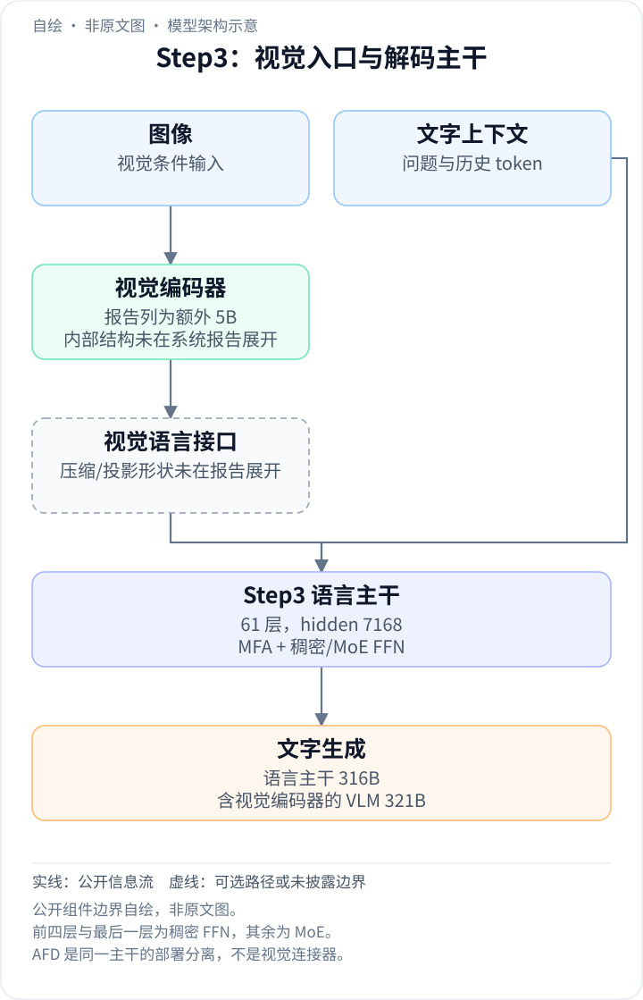
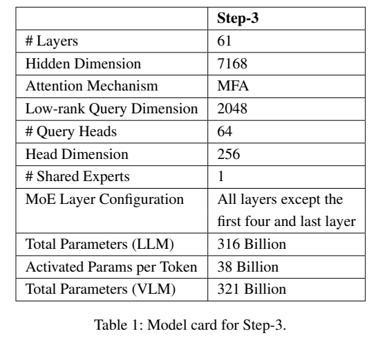
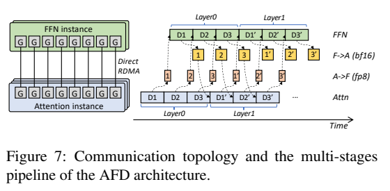
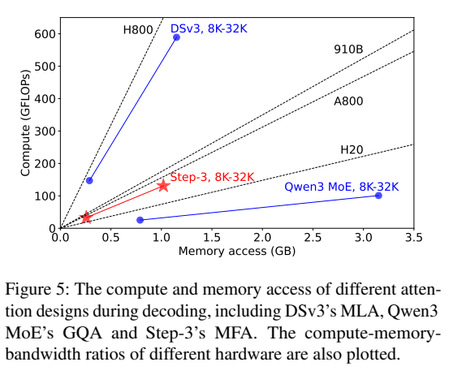
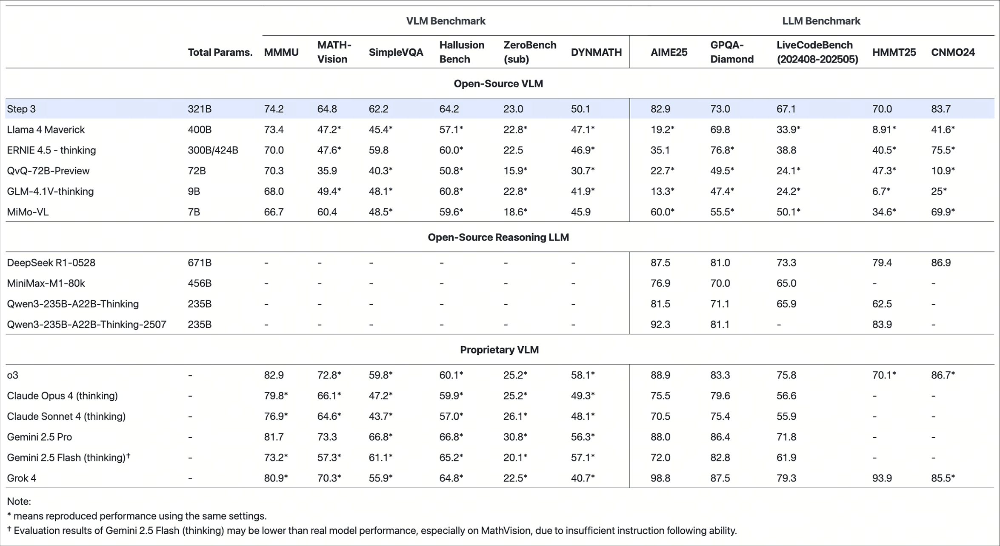
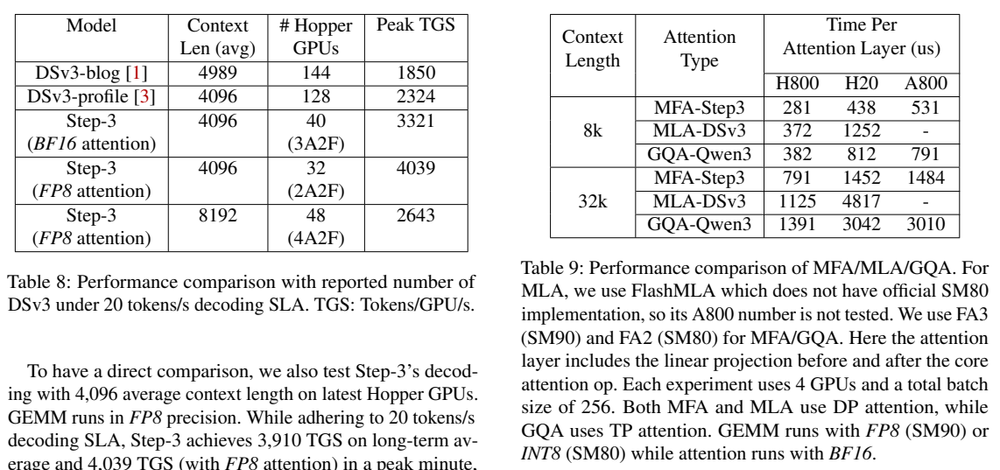

<!-- article-header:start -->
[项目首页](../../../README.md) › [模型系列](../../../reports/model-family-index.md) › [Step](../README.md)
<!-- article-header:end -->

# Step3：通过模型与系统协同设计降低解码成本

<!-- article-toc:start -->

**本篇目录** · [论文定位](#paper-info) · [快速概览](#overview) · [整体架构](#architecture) · [核心原理](#principles) · [数据构建](#data) · [训练流程](#training) · [实验结果](#experiments)
<!-- article-toc:end -->

## 1. 论文信息与模型定位

| 项目 | 信息 |
|---|---|
| 原清单条目 | *Step3: Cost-Effective Multimodal Intelligence*，2025-07-31 发布介绍 |
| 当前主要技术来源 | [*Step-3 is Large yet Affordable: Model-system Co-design for Cost-effective Decoding*](https://arxiv.org/pdf/2507.19427v1)，2025-07-25，arXiv 2507.19427v1 |
| 团队与代码 | StepFun；[官方 Step3 仓库](https://github.com/stepfun-ai/Step3)及其明确链接的系统报告 |
| 参数 | 总 VLM 321B，其中语言模型 316B、视觉编码器约 5B；每个文字 token 激活约 38B |
| 定位 | 多模态推理模型，本文重点是低成本文字解码与分布式服务 |
| 来源边界 | 原博客地址已重定向到通用平台首页；不把当前首页的 Step5 信息写入 Step3 |

本介绍综合官方仓库模型配置与原始评测图片、同仓库明确链接的开放系统论文。后者主动说明不讨论视觉编码器细节，因此它不是完整的数据与多模态训练报告。下文区分模型能力图、系统实测、理论费用估计与尚未披露的训练信息。

## 2. 快速概览

| 关键问题 | Step3 的处理 |
|---|---|
| 解码阶段 KV 读写多，计算利用率不高 | MFA 降低 KV 与计算开销，并匹配硬件算力/带宽比 |
| attention 和 MoE FFN 的瓶颈不同 | AFD 将两者部署到独立 GPU 组，分别批处理和并行 |
| 分离之后产生网络往返 | StepMesh、RDMA 和多微批流水线重叠计算与通信 |
| 过稀疏 MoE 难以形成高效批量 | 把网络、访存与计算能力纳入专家激活比例设计 |
| 结果表达 | 4K、FP8、无 MTP、20 token/s 单请求 SLA 下报告每 GPU 解码吞吐 |

值得关注的结论是：激活参数少并不直接等于解码便宜。成本还受 KV 大小、注意力计算强度、批量、网络通信与实际 GPU 利用率影响。报告针对生成阶段研究这些因素；它没有证明同等比例的整段多模态请求端到端费用下降。（PDF 第 1–5 页）

## 3. 整体架构

<!-- derived-architecture:start -->

*自绘模型架构示意（非原文图）。依据下述公开资料归纳；方框表示功能组件，不代表逐层实现。*

依据：[2507.19427v1; §2 / Table 1 / §3 AFD](https://arxiv.org/pdf/2507.19427v1)。
<!-- derived-architecture:end -->

*来源：系统报告 PDF 第 3 页。*

语言模型由 61 个 Transformer block 构成，hidden size 7168；前四层与最后一层采用 dense FFN，其余采用 MoE。MFA 使用 64 个 query head、各 256 维，共享一个 key head 和一个 value head；query 先投射到 2048 维、归一化，再展开到 64×256。官方仓库另外给出 48 个专家、每 token 选 3 个、另有一个 shared expert，最大上下文 65536、DeepSeek-V3 tokenizer。这些补充来自仓库配置，不是系统表 1 自身全部列出的字段。

*来源：PDF 第 12 页。*

AFD 的 attention 实例保存 KV 并计算注意力，FFN 实例保存专家权重并执行前馈计算；两者在每层通过网络传 hidden states。attention→FFN 使用 FP8 表示，FFN→attention 返回 BF16，以保留较高残差精度。它是同一模型计算的部署分离，并非把注意力和 FFN 训练成两个不同模型；也可与 TP、EP 配合。

多模态输入端还包括一个 **5B 视觉编码器**：系统报告把它与 316B 语言主干分列，总 VLM 为 321B。报告明确因关注解码系统而不展开视觉编码器，因此此处只画“图像 → 视觉编码 → 未展开的视觉语言接口 → 语言主干”这一边界，不补造 patch 大小、特征压缩、连接器形状或 token 数。图文条件到达语言侧后，后续 token 才沿上述 MFA/FFN 层序列解码；AFD 是这段计算的部署拆分。原文 §2、Table 1，PDF 第 2–3 页。

## 4. 核心创新与数学原理

### 4.1 MFA 与硬件计算强度

根据正文第 2 节，query 计算可用解释性记号表示为：

$$
q= W_{\mathrm{up}}\mathrm{Norm}(W_{\mathrm{down}}h),
\qquad 7168\rightarrow2048\rightarrow64\times256.
$$

这是报告配置的示意，完整 MFA 推导由其引用的另一篇 MFA 论文展开，本介绍不冒称这里给出了全部矩阵分解公式。64 个 query head 与共享 K/V 的设计，在减少缓存的同时保留较多 query 表达方向。系统论文将其 attention effective rank 记为 16384；这一分析指标不能直接当作视觉理解效果分数。

*来源：PDF 第 8 页。*

定义算术强度 $`I=\mathrm{FLOPs}/\mathrm{bytes}`$，硬件的计算带宽比 $`R=F_{\max}/B_{\max}`$。如果 $`I`$ 远高于 $`R`$，计算可能成为瓶颈；远低则更受访存限制。报告在 8-bit KV 假设下给 MFA/MLA/GQA 的强度分别约 128/512/32，分析 MFA 为何在 H20、A800 等平台更均衡。此处依赖具体精度与算子实现，不能视为所有注意力变体的固定常数。

### 4.2 用成本模型拆解瓶颈

原文以单位运算费用 $`u_F`$ 和单位访存费用 $`u_B`$ 估计 attention 与 FFN：

$$
C_A=\max(F_Au_F,B_{KV}u_B)+F_{\mathrm{linear}}u_F,
\qquad C_F=F_{\mathrm{FFN}}u_F.
$$

attention 主算子取计算与访存费用的较大值，线性投射另计；FFN 在足够大 batch、接近计算上限的假设下以 FLOPs 计费。AFD 再允许给两部分选择不同硬件。作者假设通信可被完全重叠，并忽略占比小于约 5% 的 embedding / LM head。费用表还用 2025 年报告中的估计云卡价格，910B 价格并非公开报价；因此不是当前 API 价格，也不是完整生产账单。（PDF 第 4–7 页）

### 4.3 专家稀疏度与批量、网络的约束

若 $`S`$ 是激活专家权重占比，原文用 roofline 推出：

$$
B_{\mathrm{MoE}}\ge\frac{F_{\max}}{2S B_{\max}}.
$$

更稀疏意味着每专家更难积累足够 token，需要更大总 batch 来摊薄权重读取。每层网络量约 $`3HB_{\mathrm{MoE}}`$，来自 8-bit dispatch 与 16-bit combine；它又必须满足流水线通信预算。因此专家数和 top-k 应同时考虑网络能力，不能只看每 token 激活量。该模型分析采用理想调度，真实负载不均衡和网络抖动会影响结论。（PDF 第 9–11 页）

## 5. 数据构建与处理

系统报告未公布 Step3 多模态预训练语料规模、图像/视频分布、OCR 标注流程、去重规则或 SFT 数据配比，仓库模型卡也未提供完整数据清单。它明确称视觉编码器约 5B，并暂不讨论其细节。这里不能据“cost-effective”推导模型只用了少量图文数据，或据 tokenizer 名称认定训练数据来自 DeepSeek。

报告可核对的是服务端输入处理：decode batch 按微批编排；attention 实例保留上下文 KV；FFN 收到量化 hidden states、尺度因子及专家分布元数据。StepMesh 预注册 GPU tensor，避免反复序列化或复制，并将接收数据直接放到连续内存切片。这属于推理数据流优化，与训练语料清洗是两个不同层面。（PDF 第 12–13 页）

## 6. 训练流程与目标

首版系统论文没有完整给出预训练、视觉接入、SFT、强化学习的阶段安排、GPU 总量或优化器设置。正文提及推理加速可以降低 RL 训练成本，但不是披露了一套可以直接复现的 RL 目标。自回归生成本身可用下式解释：

$$
p_\theta(y\mid V,q)=\prod_t p_\theta(y_t\mid y_{<t},V,q).
$$

它表达文本在视觉和提示条件下生成，不足以据此补全原文未公开的训练损失、偏好目标或任务权重。本条目的重点可复查流程是部署：attention、FFN、通信三阶段预算各约 16.6ms，总目标 TPOT 50ms；三组微批错开运行，用 direct RDMA 重叠通信与计算。4K FP8 实测配置使用 2A2F、32 张 GPU、总 batch 6144、三个 2048 微批。

MTP 在此报告中是后续优化方向，作者只给估计收益；已报告 4039 的配置明确没有 MTP。将预计 MTP 加速再乘到实测吞吐，并写为完成验证的结果，会超出原文证据。（PDF 第 14–15 页）

## 7. 实验设置与主要结果

*来源：[Step3 官方 README](https://github.com/stepfun-ai/Step3)，原始 `step3_bmk.jpeg`；这是发布评测图，和系统报告的性能表分开。*

发布图给出 Step3 MMMU 74.2、MATH-Vision 64.8、HallusionBench 64.2、ZeroBench 子集 23.0，以及 AIME25 82.9、GPQA-Diamond 73.0。这里保留图中 split 不完整的限制，不把 MMMU 自动指定成某个未注明的测试集；星号表示在同设置下复现的外部成绩。其 MMMU 低于图中 o3 的 82.9，GPQA 也低于 DeepSeek-R1-0528 的 81.0，不能概括为多模态与语言任务全部领先。

*来源：系统报告 PDF 第 14 页。*

| 系统配置 | 平均上下文 | GPU 数 | 峰值 token/GPU/s |
|---|---:|---:|---:|
| DeepSeek-V3 profile | 4096 | 128 Hopper | 2324 |
| Step3，BF16 attention | 4096 | 40 Hopper | 3321 |
| Step3，FP8 attention | 4096 | 32 Hopper | 4039 |
| Step3，FP8 attention | 8192 | 48 Hopper | 2643 |

双方均按 20 token/s 单请求解码 SLA 比较；Step3 报告长期平均为 3910，4039 是峰值一分钟，不能当作每个独立请求的生成速度。4039/2324−1≈73.8% 是图表配置下每 GPU 吞吐改善；报告称 Step3 使用较新的 Hopper GPU，基线来自公开 profiling，作者也承认基线仍有优化空间，故不是完全相同芯片及软件栈的独立复现实验。

单 attention 层实验另用 4 张 GPU、总 batch 256、BF16 attention：32K 时 H20 上 MFA 1452μs、MLA 4817μs、GQA 3042μs。MLA 在 A800 的值未测试，不能把破折号解释为零延迟。更长上下文和超过 600B upcycling 的部分数字是外推/分析；例如 8K 外推约 2693 和表内实测 2643 应分开。

理论费用分析支持 MFA＋AFD 在既定假设下较低的解码成本，系统测量提供了工程证据；它们不能替代视觉模型结构、训练数据与训练目标的完整披露。

<!-- article-footer:start -->
---

[← 上一篇：GLM-4.1V-Thinking](../../glm/arxiv-2507.01006/README.md) · [按发表时间浏览](../../../reports/paper-reading-guide.md#year-2025) · [下一篇：dots.vlm1 →](../../dots/document-bdf40c9e7783/README.md)

[返回本篇目录](#article-toc) · [返回模型系列](../README.md)
<!-- article-footer:end -->
