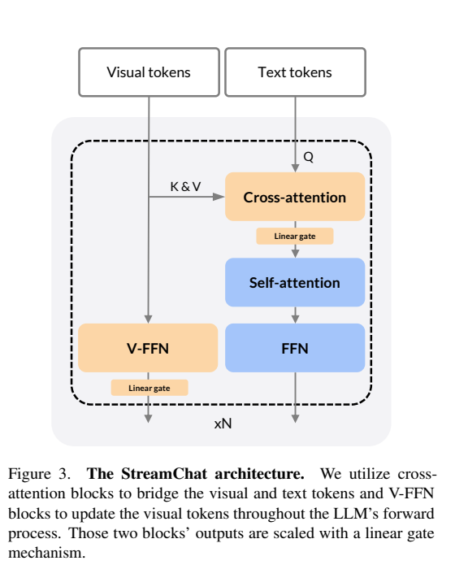
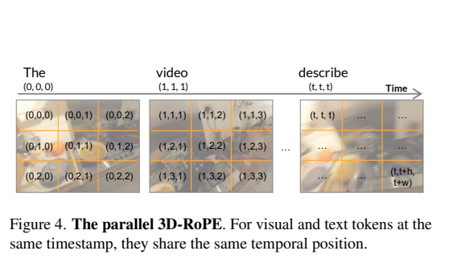
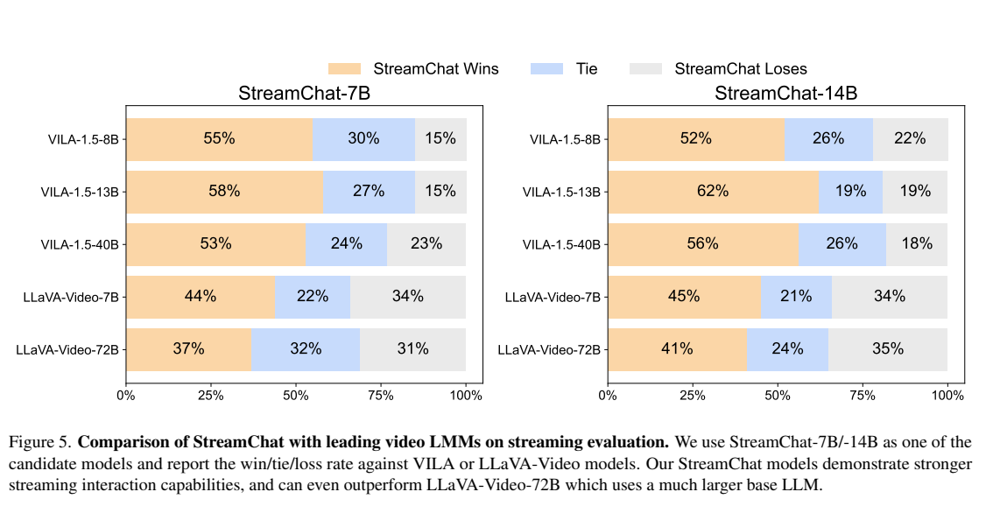
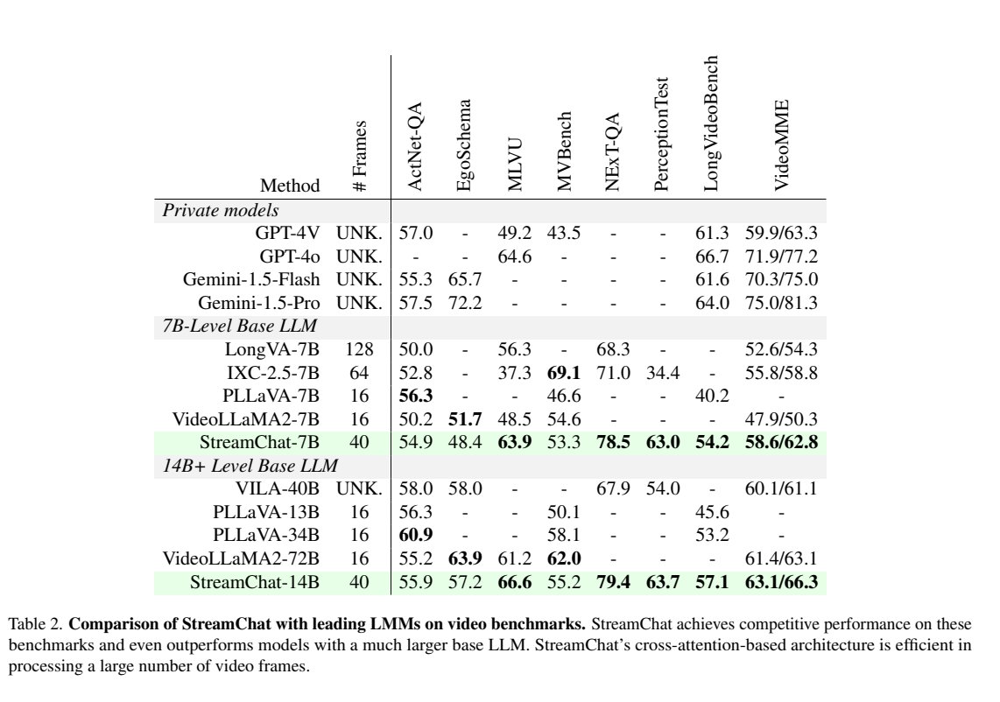
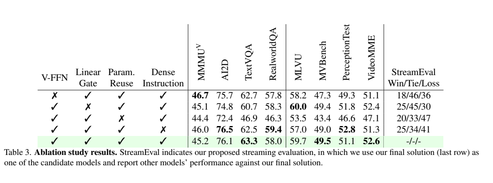

<!-- article-header:start -->
[项目首页](../../../README.md) › [模型系列](../../../reports/model-family-index.md) › [StreamChat](../README.md)
<!-- article-header:end -->

# StreamChat：回答生成过程中持续更新视频上下文

<!-- article-toc:start -->

**本篇目录** · [论文定位](#paper-info) · [快速概览](#overview) · [整体架构](#architecture) · [核心原理](#principles) · [数据构建](#data) · [训练流程](#training) · [实验结果](#experiments)
<!-- article-toc:end -->

## 1. 论文信息与模型定位

| 项目 | 信息 |
|---|---|
| 论文 | StreamChat: Chatting with Streaming Video |
| 作者 | Jihao Liu、Zhiding Yu、Shiyi Lan、Shihao Wang、Rongyao Fang、Jan Kautz、Hongsheng Li、Jose M. Alvarez |
| 团队 | 香港中文大学 MMLab、NVIDIA、上海人工智能实验室等 |
| 依据版本 | [arXiv 2412.08646v1](https://arxiv.org/pdf/2412.08646v1)，2024 年 12 月 |
| 语言骨干 | Qwen2.5 7B / 14B |
| 定位 | 动态流式视频对话，同时支持图像和离线视频理解 |

该模型针对一个具体延迟问题：用户提出问题后，生成回答可能持续数秒，期间画面继续变化；若模型只读取提问时已经缓存的画面，后续文字就可能脱离当前场景。StreamChat 让每个解码步骤都可读取最新视觉 token，从而在回答过程中继续感知。（第 1–4 页）

## 2. 快速概览

| 设计 | 作用 |
|---|---|
| 动态视觉交叉注意力 | 文字 query 读取可以持续更新的视觉 key/value |
| V-FFN | 在 LLM 层间更新视觉表示，而非每层读取完全相同的特征 |
| 线性门控 | 小初始残差幅度，减轻 tanh 门控饱和问题 |
| 并行 3D-RoPE | 同时间的文字与画面共享时间位置 |
| 密集指令 | 用字词时间与注意力 mask 模拟边看边答 |
| 推理缓存 | 单独线程提取画面 token，FIFO 队列提供最新视觉窗口 |

已生成的文字仍是历史输出，模型并不会自动追溯修改。方法提高后续解码对新画面的感知，是否主动开始回答、如何中断或重写回答并不是本文主要解决的机制。

## 3. 整体架构

*原文 Figure 3，第 3 页。文字自注意力保持语言序列处理，交叉注意力接入视觉流，V-FFN 继续更新视觉表示。*

视觉编码采用以 PaliGemma 权重初始化的 SigLIP，MLP 适配器对齐视觉与 Qwen2.5 的隐藏维度。图像基准报告每图使用 256 个视觉 token；为兼顾流式效率，系统未加入多视觉编码器或高分辨率切块。（第 4、6–7 页）

文字 token 作为 query，视觉 token 作为 key/value；新帧加入后，交叉注意力可读取更新的画面窗口。交叉注意力复用 LLM 自注意力参数，V-FFN 从语言 FFN 初始化，帮助预训练语言知识与新增视觉处理对接。两个模块的输出均通过线性门控控制残差幅度。（第 3 页）

推理时视觉读取线程不断处理视频，把结果放入 FIFO 队列；文字生成每一步取得当前队列内容。该设计控制保留的视觉窗口，并不意味着模型无限保存所有历史画面。（第 4 页）

## 4. 核心创新与数学原理

**在解码步更新视觉条件。** 用 $V_{\le\tau_k}$ 表示第 $k$ 个回答 token 生成时已到达的视觉窗口，可将生成过程解释为：

$$
p(y_k\mid y_{<k},Q,V_{\le\tau_k}),\qquad
\tau_{k+1}\ge\tau_k.
$$

与固定提问时刻的 $V_{\le\tau_0}$ 相比，后续 token 可以依据新画面改变内容。该式是对原文机制的数学展开，报告没有单独提出上述概率公式或保证每个 token 必然读到一张新帧。

**交叉注意力避免完整视觉自注意力矩阵。** 对 $L$ 个文字 token 和 $M$ 个视觉 token，文字自注意力与文字到视觉注意力的主要矩阵规模约为 $L^2$ 和 $LM$，而拼接两者全自注意力约为 $(L+M)^2$。这解释了大量视觉 token 下的结构优势；V-FFN、视觉编码、缓存和实际实现仍有成本，不能据此直接得出端到端 FPS 或固定倍数加速。

**并行位置与时间因果 mask。**

*原文 Figure 4，第 3 页。相同时刻的视觉与文字共享时间索引。*

图中同时间文字用 $(t,t,t)$，视觉位置用 $(t,t+h,t+w)$ 组织三个 RoPE 分量，使时间与空间共同编码。与把帧和文字逐段交错排列相比，连续回答的相邻文字位置不会仅因插入大量视觉 token 而拉开巨大间隔。（第 3 页）

训练还对文字 $i$ 和视频帧 $j$ 施加时间 mask：若帧时间晚于文字的参考时间，注意力 logit 被屏蔽。可解释为 $M_{ij}=-\infty$ 当 $t_j>\tau_i$，其余允许位置为 0。这禁止训练时偷看未来帧。参考时间用于组织位置及 mask，原文明确它不作为绝对时间字符串直接输入模型。

## 5. 数据构建与处理

密集流式指令来源于 Ego4D 和 Vript 的带区间 caption。语言模型（如 Gemini-1.5-Pro）依据某个区间的描述，生成在指定时间提出的问题和回答。作者先生成 5K 对、聚类去除过于相似的指令，人工检查后作为后续生成的示例，最终得到 51K 例。（第 4 页）

已有标注只给区间，作者用启发式方法为答案逐词分配时间：问题出现在区间开始，答案各词分布在区间内。文字中的时间标记只是构建说明，不直接输入。它不是人工精确标注的真实说话时刻，也不是测得的实际解码 token 速度。（第 4、9 页）

| 数据用途 | 来源/规模 |
|---|---|
| 预训练 | LLaVA-NeXT ReCap、部分 InternVL 预训练数据、MMC4、密集描述数据等；报告使用 5.1M 样本 |
| 指令训练 | Eagle-1.8M 为主，加入上述密集指令及 LLaVA-Video；合计 2.9M 样本 |
| 流式评价 | 100 例，80 来自 Vript、20 来自 Ego4D，生成后人工核对与改写 |

预训练密集视频按 1 FPS、最多 40 帧处理，其他视频均匀抽 40 帧；指令阶段分别为 1 FPS/最多 32 帧或均匀 32 帧。数据数量按论文使用量记录，不能将每次采样都视作互不重复的独立视频。训练与自建评价来自相同的大数据来源，报告没有充分披露全部去重细节，不能自行声称完全跨来源泛化。

## 6. 训练流程与目标

| 阶段 | 训练范围 | 配置 |
|---|---|---|
| 预训练 1 | MLP 适配器 | 5,000 steps，batch 512，最大学习率 $5\times10^{-4}$ |
| 预训练 2 | 进一步解冻视觉编码器与 V-FFN | 5,000 steps，batch 512，最大学习率 $2\times10^{-5}$ |
| 指令训练 | 全部参数 | 1 epoch，batch 768，最大学习率 $2\times10^{-5}$ |

预训练采取逐步解冻以稳定新接口，指令阶段用图像、离线视频及流式样本共同优化。流式样本的时间 mask 确保每个答案位置只能读取已到达的帧。通常可用答案自回归交叉熵解释监督，但本文未单独给出新的对比损失、未来预测损失或 RLHF 阶段。（第 4–5 页）

线性门控以较小初始幅度接入新模块；与 tanh 门控相比，线性缩放没有 tanh 饱和区间带来的梯度衰减。消融支持最终效果，但没有证明所有训练设置中均会更快收敛。报告未充分披露完整训练耗时、部署硬件及端到端实测延迟，本文不补造“实时”帧率数字。

## 7. 实验设置与主要结果

*原文 Figure 5，第 5 页。评审模型为 Gemini-1.5-Pro，判定指令遵循、帮助程度、相关性和准确性。*

自建流式评价使用 5 FPS；StreamChat 和 LLaVA-Video 保留 32 帧，VILA 因上下文限制使用 16 帧。7B 对 LLaVA-Video-72B 的胜/平/负为 **37/32/31**，14B 为 **41/24/35**。胜率超过负率支持该评审下的优势，但 69% 的“胜或平”不能写作 69% 胜率，更不能推成标准正确率。7B 对 VILA-40B 为 53/24/23，正文 77% 是胜加平。（第 5–6 页）

*原文 Table 2，第 7 页。StreamChat 使用 40 帧；与流式评价的帧窗口和指标不同。*

| 指标 | 7B | 14B |
|---|---:|---:|
| MLVU | 63.9 | 66.6 |
| NExT-QA | 78.5 | 79.4 |
| EgoSchema | 48.4 | 57.2 |
| MVBench | 53.3 | 55.2 |
| VideoMME 表中两设置 | 58.6 / 62.8 | 63.1 / 66.3 |

14B 在 MLVU、NExT-QA 等指标较强，但 EgoSchema 低于 VideoLLaMA2-72B 的 63.9，MVBench 低于其 62.0；7B ActivityNet-QA 也低于 PLLaVA 的 56.3。原表 VideoMME 用斜线列两种设置而未在表注明确展开，本文保留原样，不擅自标成统一流式成绩。

*原文 Table 3，第 8 页。预训练缩短到 2,000 steps，指令数据也采用更小组合，不能与主表逐项直接相减。*

消融显示复用参数可改善稳定性，V-FFN 和线性门控对总体结果有帮助，但并非每个离线指标都提高。无密集指令一行相对最终方案的胜/平/负为 25/34/41：最终方案严格胜率是 41%，加平为 75%，应分别说明。逐词时间由启发式分配产生，是论文明确的局限，复杂事件中的时间误配仍可能影响训练和评价。（第 8–9 页）

原图的完整出处、页码和裁剪见 [配图清单](figures-manifest.json)。

<!-- article-footer:start -->
---

[← 上一篇：InternVL 2.5](../../internvl/arxiv-2412.05271/README.md) · [按发表时间浏览](../../../reports/paper-reading-guide.md#year-2024) · [下一篇：InternLM-XComposer2.5-OmniLive →](../../internlm-xcomposer/arxiv-2412.09596/README.md)

[返回本篇目录](#article-toc) · [返回模型系列](../README.md)
<!-- article-footer:end -->
