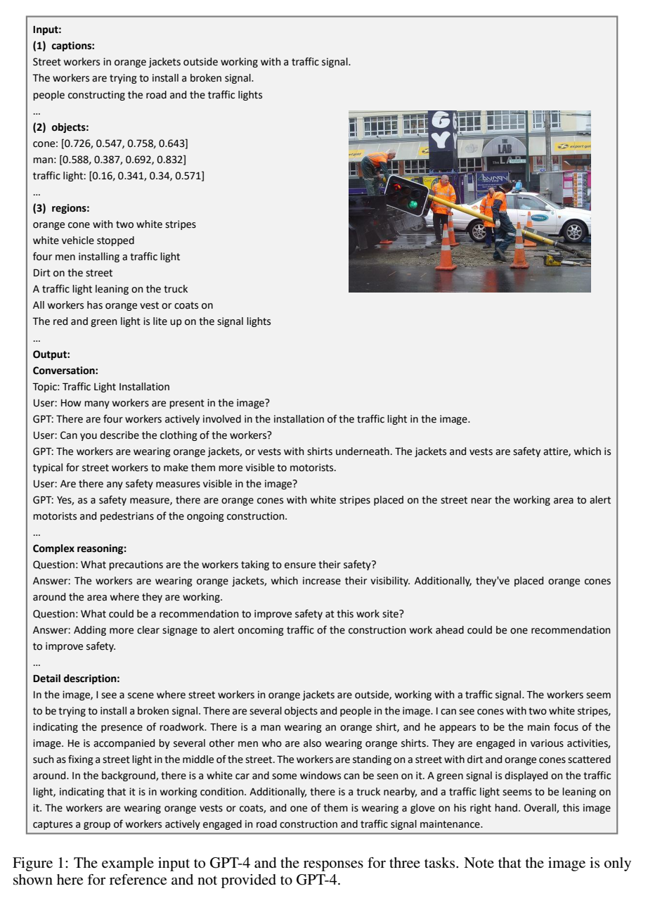
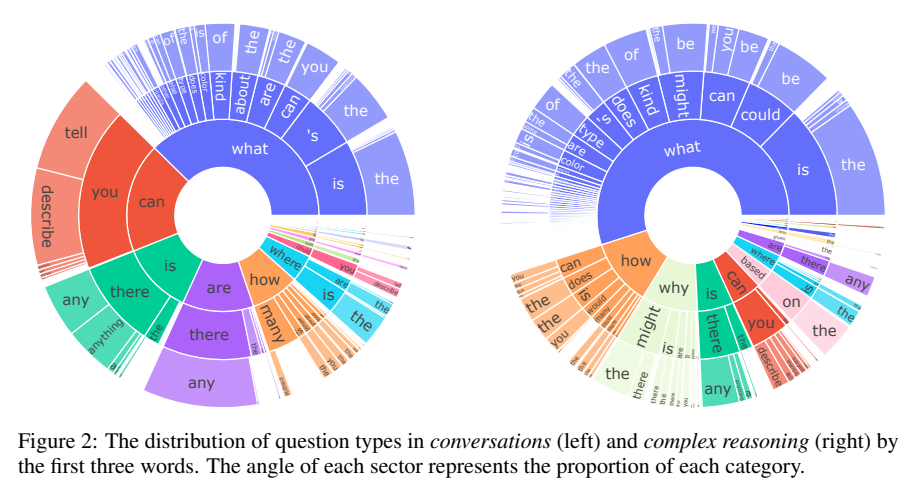
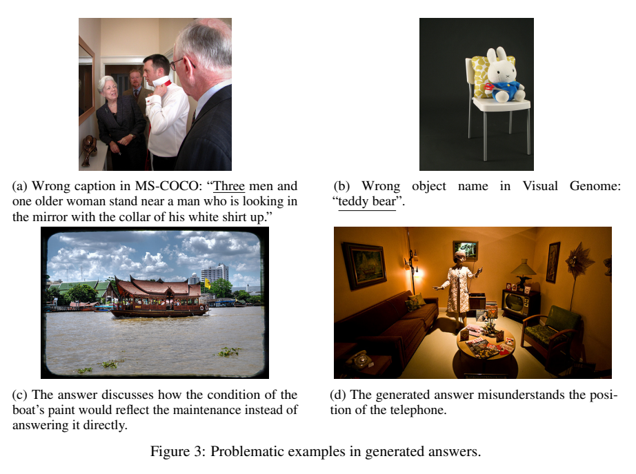
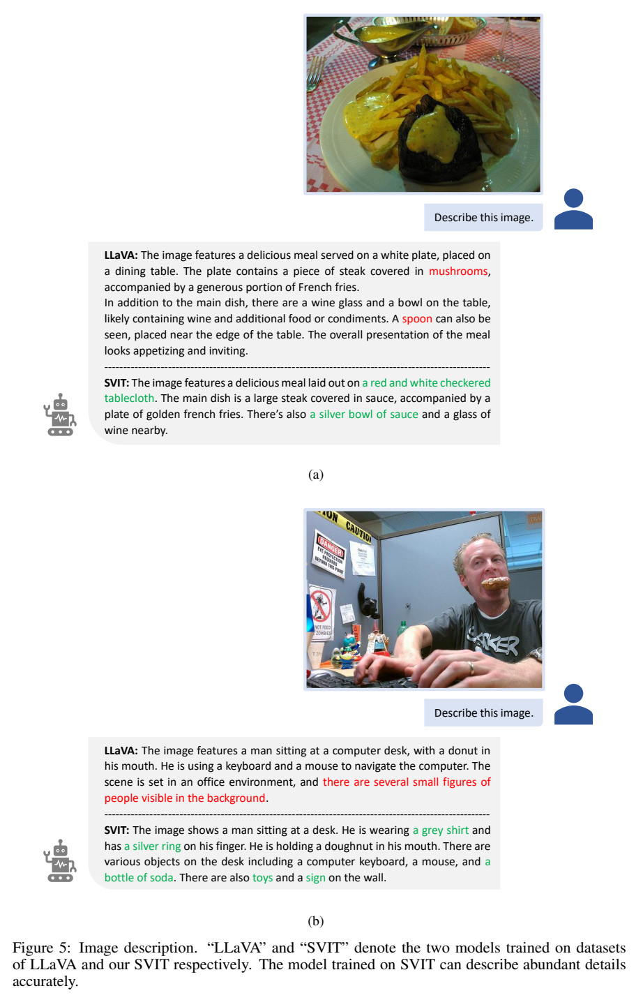

# SVIT：用密集人工标注扩展视觉指令数据

## 1. 论文信息与模型定位

| 项目 | 信息 |
|---|---|
| 论文 | *SVIT: Scaling up Visual Instruction Tuning* |
| 作者与机构 | Bo Zhao、Boya Wu、Tiejun Huang；北京智源人工智能研究院 |
| 来源版本 | [arXiv:2307.04087v1](https://arxiv.org/pdf/2307.04087v1)，2023 年 7 月 |
| 官方资源 | [Visual-Instruction-Tuning](https://github.com/BAAI-DCAI/Visual-Instruction-Tuning) |
| 定位 | 视觉指令数据构建工作，以 MiniGPT-4 和 LLaVA 验证数据用途 |

SVIT 的主要产物是约 320 万条指令数据。它利用 Visual Genome 的物体和区域标注，让纯语言 GPT-4 生成对话、复杂推理与详细描述。文中的“SVIT 模型”指使用这套数据微调的已有模型，没有发布一种独立的新视觉语言骨干架构。本介绍固定到 v1，不混入后续版本的实验。

## 2. 快速概览

| 子集 | 最终数量 | 计数单位 |
|---|---:|---|
| Conversation | 1,565,797 | 多轮对话中的问答对 |
| Complex reasoning | 1,556,902 | 带推理内容的问答对 |
| Detail description | 106,295 | 详细描述 |
| 合计 | 3,228,994 | 上述三种指令记录之和 |

“320 万”不是 320 万张不同图片，也不是 320 万段完整多轮对话。源图像为 108,077 张，通常一张图像派生许多指令。数据规模相较 LLaVA-Instruct-150K 明显扩大，新增的关键输入是密集区域描述。（正文第 2–3 页）

v1 展示了更充分的描述和较少的某些幻觉案例，但没有提供覆盖标准视觉基准的定量性能表。因此，数据规模和示例效果可直接核验，模型综合能力提高多少则不能由本版本量化。

## 3. 整体架构

*原文 Figure 1，PDF 第 4 页。图中的照片仅供论文读者参考，没有输入给 GPT-4。*

数据管线先汇总三类文本：图像级 caption、物体名称与边界框、区域描述。教师收到文本后，分别按三类任务模板生成问答或长描述；格式与关键词过滤后，将这些答案重新和原图像配对，作为视觉模型的训练样本。

边界框表示为归一化的 $[x_1,y_1,x_2,y_2]$。区域描述的边界框没有放入提示，作者说明这是为了控制 GPT-4 上下文长度。教师虽被提示以“正在看图”的口吻回答，实际上仅依赖人工标注和自身常识。（附录 A、Figure F8，第 13–14 页）

训练端沿用 MiniGPT-4、LLaVA 的视觉编码器、连接模块与 Vicuna 语言模型。本文实验变量主要是指令数据来源，不能把这些既有架构模块列为 SVIT 的新设计。

## 4. 核心创新与数学原理

核心贡献是把密集图像标注转为更长、更丰富的生成监督。可用下式解释其数据生成过程：

$$
(q,a)\sim p_{\mathrm{GPT4}}(q,a\mid C_i,O_i,R_i,\tau),
$$

其中 $C_i$ 是 caption，$O_i$ 是物体名称和坐标，$R_i$ 是区域描述，$\tau$ 是任务提示。这是本文流程的解释性记号，原文没有提出对应的新概率模型或优化公式。它说明教师答案受标注信息约束：缺失或错误的标注可能使错误传播到训练目标。

Conversation 每张图要求三个逻辑相关的五轮问答；Complex reasoning 要求十五对问答，并在答案中展示逐步思考；Detail description 要求只描述可以确定的内容。提示没有给少样本示例，以鼓励表达多样性。（第 3 页）

“复杂推理”由问题类型和提示要求定义，没有可执行推理验证器。答案包含推理文字也不能自动证明推理正确。长度增大提高了监督内容密度，但回答更长与视觉事实更准确是不同性质，原文用长度支撑质量的判断应谨慎解释。

## 5. 数据构建与处理

源数据包含 COCO 的 257,633 条 caption，以及 Visual Genome 的 3,802,374 个物体名称/框、5,406,592 条区域描述。Visual Genome 部分图像来自 COCO，因此能将两者标注汇集到同一图片。（第 3 页）

后处理识别答案中不希望出现的框坐标、对 caption/description 来源的说明，以及对话或推理问答数量不足的问题，再调用 GPT-4 重新生成。它主要修复格式、表达和数量，不是逐条视觉事实审核。详细描述的用户指令从另一组 GPT-4 生成的同义提示中随机采样。（第 3 页、附录 B）

*原文 Figure 2，PDF 第 5 页，按问题前三个词统计类型。*

对话问题以 what 开头的比例为 38%，推理问题为 55%；推理子集中 why、how 分别约 9%、11%，how 中仅 11% 是 how many。对话问答平均长 9.6/27.9 词，推理问答为 12.6/26.6 词，详细描述平均 361.5 词，而 COCO caption 平均 11.3 词。分布统计显示提示改变了表达和问题覆盖，但不是任务难度的严格测量。

*原文 Figure 3，PDF 第 6 页：人数标注错误、物体名称冲突、笼统答案和电话位置误判。*

作者随机检查 20 张图片及对应数据，认为约 5% 的问题可以得到更准确或更令人满意的答案。这是小样本人工观察，不能改写为“整个数据集经过验证、准确率 95%”。错误包括源标注出错、回答通用常识却没有直接回答图中问题，以及教师生成事实错误。（第 5–6 页）

## 6. 训练流程与目标

随机保留 10% 的图像用于测试；划分单位是图片，不是把同一图片的问答随机分到两侧。MiniGPT-4 实验采用 Vicuna-v0-13B，只使用详细描述子集，和原有约 3,500 条指令训练设置比较。LLaVA 实验采用 Vicuna-7B 以加快训练。（第 6 页）

作者声明沿用两种模型各自的训练、测试协议和超参数。v1 没有独立列出完整学习率、batch size、epoch、硬件或精确参数冻结表，也没有明确披露 LLaVA 每个子集实际使用多少条。这里不将“总数据集 320 万条”直接等同于每个对照模型训练样本量。

从指令微调的一般形式看，监督是以图片、用户问题和历史对话为条件预测回答 token，即最小化 $-\sum_t\log p_\theta(a_t\mid I,q,a_{<t})$；这用于解释训练目标，属于既有视觉指令调优机制，并非 SVIT 新增损失。源图片与既有预训练数据之间可能有重叠，10% 图片保留也不能证明完全独立于骨干预训练语料。

## 7. 实验设置与主要结果

*原文 Figure 5，PDF 第 8 页。两组输出来自相同模型系列、不同指令数据的训练。*

MiniGPT-4 示例中，原始数据训练的模型想象了生日场景中的气球和装饰；SVIT 训练版本更直接地描述蛋糕。在 LLaVA 的食物图片中，SVIT 输出正确提及格纹桌布和酱汁碗，原对照输出出现蘑菇、勺子等缺乏图像证据的细节。原文还展示披萨下一步规划与雪中车辆计数、驾驶建议的多轮案例。（Figure 4–7，第 7–10 页）

这些案例说明丰富标注生成的数据可能改善细节描述和回答组织，但 v1 没有系统性准确率、统计显著性或大样本幻觉评估，也没有把数据规模、推理子集和区域标注贡献分别消融。不能据此宣称在全部感知、推理和规划基准领先。

本工作的可迁移价值在于数据生产方法：用已有密集标注为语言教师提供更充分的事实依据。其局限也来自同一路径，包括标注噪声、语言教师无法核对像素、部分常识推断过度，以及评估证据以挑选案例为主。

配图取自上述原论文；[来源清单](figures-manifest.json)。本仓库解释作者报告，未重新训练复现。
