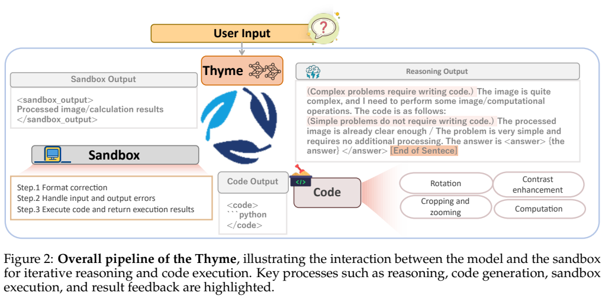
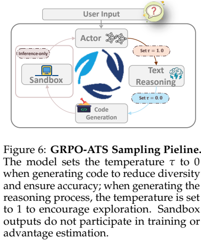
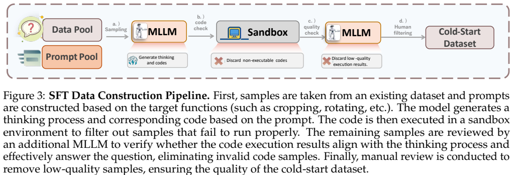
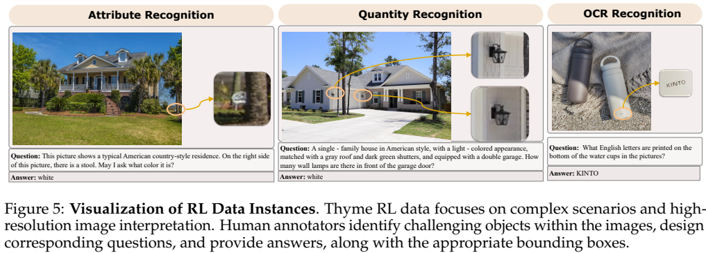
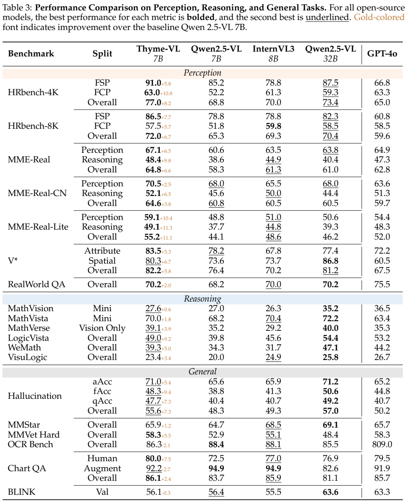
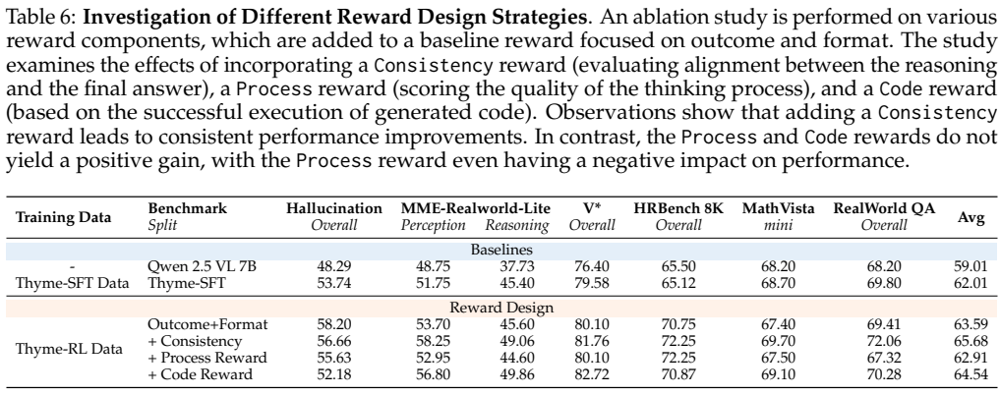

<!-- article-header:start -->
[项目首页](../../../README.md) › [模型系列](../../../reports/model-family-index.md) › [Thyme](../README.md)
<!-- article-header:end -->

# Thyme：通过可执行代码操作图像并辅助多模态推理

<!-- article-toc:start -->
<a id="article-toc"></a>

**本篇目录** · [论文定位](#paper-info) · [快速概览](#overview) · [整体架构](#architecture) · [核心原理](#principles) · [数据构建](#data) · [训练流程](#training) · [实验结果](#experiments)
<!-- article-toc:end -->

<a id="paper-info"></a>

## 1. 论文信息与模型定位

| 项目 | 信息 |
|---|---|
| 原文 | *Thyme: Think Beyond Images* |
| 作者与机构 | Yi-Fan Zhang、Xingyu Lu、Shukang Yin、Chaoyou Fu 等；快手 Keye、CASIA、南京大学、清华大学、USTC |
| 版本 | [arXiv:2508.11630v1](https://arxiv.org/abs/2508.11630v1)，2025-08-15 提交；PDF 扉页日期为 2025-08-18 |
| 资料 | [原文](https://arxiv.org/pdf/2508.11630v1)、[代码](https://github.com/yfzhang114/Thyme)、[项目页](https://thyme-vl.github.io/) |
| 定位 | 基于 Qwen2.5-VL-7B 的工具交互训练方法与模型，不是重新预训练视觉骨干的基础模型 |

Thyme 将图像裁剪、旋转、对比度增强与数值计算统一为 Python 代码执行。模型学习判断何时需要这些操作，再利用真实执行结果继续回答。其改进主要面向高分辨率细节感知与计算辅助推理。（原文第 3–5 页）

<a id="overview"></a>

## 2. 快速概览

| 要点 | 内容 |
|---|---|
| 输入与输出 | 图像、问题与历史工具结果，输出文本答案或待执行代码 |
| 系统组成 | 7B 多模态模型、外部 Python 沙箱、多轮反馈协议 |
| 训练路线 | 约 500K 样本 SFT，数学代码退火，随后 GRPO-ATS RL |
| 关键设计 | 沙箱输出不作为预测目标；文本温度 1.0、代码采用贪心生成 |
| 主要收益 | HRBench-4K Overall 68.8→77.0；MME-Real Overall 58.3→64.8 |
| 能力边界 | 定位错误、无效代码和不必要调用仍存在；部分基准下降 |

这里的“操作图像”指从原图加工出可供再次观察的图像，而非训练一个新的图像生成模型。代码执行由外部环境完成，语言模型自身不承担 Python 运算。

<a id="architecture"></a>

## 3. 整体架构



*Figure 2，第 3 页，模型判断是否写代码，沙箱执行，再把图像或计算结果交回模型。*

系统沿用 Qwen2.5-VL-7B 的图文输入能力，通过约定的代码与结果标签组织多轮交互。模型可直接回答，也可生成一项或多项图像处理操作；裁剪坐标、旋转角度、缩放倍率等由模型决定。加工图像以视觉输入返回，数值结果以文本返回，然后模型继续生成或再调用工具。

沙箱用 AST 与 autopep8 处理部分代码格式问题，预设图像路径及常用模块；对名称含 box/coord 的坐标参数尝试修正越界，保留跨轮变量以支持连续操作。每段执行限制为 10 秒，并检查危险操作名称。autopep8 是外部包，并非 Python 标准库；这些工程机制也不能等同于已证明的完备系统隔离。（第 4–5 页）

因此，“代码可执行”的成功率同时受模型生成与沙箱修正影响，不能直接解释成模型独立生成无错误程序的比例。

<a id="principles"></a>

## 4. 核心创新与数学原理

第一项关键是区分模型动作与环境观察。把交互轨迹写成 $`\tau=[T_0,C_0,S_0,\ldots,T_t,a]`$，其中 $`T`$ 为推理文本、$`C`$ 为代码、$`S`$ 为执行结果。SFT 可用以下**解释性形式**表达：

```math
\mathcal L_{\mathrm{SFT}}=-\sum_j m_j\log p_\theta(y_j\mid y_{\lt j},I,Q).
```

沙箱标签与结果位置的 $`m_j=0`$；多轮图像操作数据进一步只监督最终轮响应。否则模型可能学会编造工具输出，或刻意先做错再纠正。数学代码退火阶段则联合学习各轮，因为其轮间依赖较弱。（第 7–9 页）



*Figure 6，第 10 页，温度按生成内容类型切换。*

GRPO-ATS 在文本生成阶段采用温度 1.0，代码阶段采用温度 0，即实现贪心选择；这不是训练一个连续自适应温度控制器，也不保证代码一定正确。文本探索仍能产生不同上下文与代码选择。

组内轨迹的优势使用原文式 (2)：

```math
A_{i,j}=\frac{r_i-\mathrm{mean}(r_1,\ldots,r_G)}{\mathrm{std}(r_1,\ldots,r_G)}.
```

同一轨迹的模型生成 token 共用最终奖励优势，环境结果不计入生成长度和优势求和。原文给出的 GRPO 目标表达式省略了常见的策略概率项，不能单凭该式推导完整梯度实现；本文不补写为论文已公开的标准裁剪目标。

最终奖励为 $`r=R_{\mathrm{result}}(1+0.5R_{\mathrm{consistency}})+0.5R_{\mathrm{format}}`$。一致性奖励只有答案正确才生效；格式奖励仍可独立取得。答案先规则匹配，失败后用 Qwen2.5-VL-72B 判断语义等价；一致性判断使用末尾 500 字符与最终答案，不能视为对全部推理正确性的验证。（第 10–15 页）

<a id="data"></a>

## 5. 数据构建与处理



*Figure 3，第 5 页：生成、运行检查、视觉模型审核与人工筛选。*

原始池超过 4M 样本，来自 LLaVA-OV-Image、MM-RLHF、SMR、V*、MM-Eureka、arXivQA 与 Retool 等。原文称最终 SFT 约 500K；分项明确给出：无需代码 100K、真实复杂操作 50K、裁剪 28K、旋转 14K、增强 10K、计算代码 15K，另有多轮纠错数据。已给出的分项合计 217K，未充分说明其与 500K 的对应关系，不能自行补齐其余样本来源。

Qwen2.5-VL-72B 生成/筛选图像操作数据；旋转角度由真值提供，范围 30°–335°。数学解题先由 Gemini 2.5 Pro 生成，再由 GPT-4o 改为简洁代码。多轮样本人为提供过大或错误的第一轮框，让后续轮学习精确裁剪和纠错。（第 6–7 页）



*Figure 5，第 9 页，包含属性、数量和 OCR 识别示例。原图数量问答示例出现答案“white”的类别错配，不能视为该样本标注正确的证明。*

RL 既采用公开任务，也由 15 名标注员构建高分辨率小目标问题：图像至少一边超过 2048 像素，目标面积不超过 5%，标注问题、答案和边界框，经交叉检查与三名专家验收。引言写 10K 人工数据，详细流程写收集 30K 图像，未明确最终筛选比例。V* 同时出现在训练来源和评测中，文中未完整交代这里的划分与去重过程，不能据此宣称评测完全无污染。（第 9、28 页）

<a id="training"></a>

## 6. 训练流程与目标

| 阶段 | 配置与目的 |
|---|---|
| 图像操作 SFT | 学习率 $`10^{-5}`$，batch 128，3 epochs，warmup 比例 0.05；学习工具协议与操作 |
| 数学退火 | 学习率 $`10^{-6}`$；提高稀少计算代码的学习权重，数学多轮全部参与监督 |
| GRPO-ATS RL | 学习率 $`5\times10^{-7}`$，batch 256，1 epoch，每题 4 rollouts，KL 系数 0.001，重复惩罚 1.05 |

训练使用 32 张 NVIDIA H800。§5.1 同一段先写训练“总计约 224 GPU 小时”，又写数学退火约 8 GPU 小时、RL 超过 1200 GPU 小时；引言另称 SFT 约 200 GPU 小时。存在明显算力口径冲突，不能把 224 当作全部训练成本，亦不能自行断定其中某个数字为笔误。

采样时用滚动哈希检测重复片段：重复累计长度超过输出的 50% 即提前停止，并设置多轮上限控制时间与上下文。正文未给出统一的最大轮数、输入视觉 token 预算和完整推理时延表。（第 11 页）

<a id="experiments"></a>

## 7. 实验设置与主要结果



*Table 3，第 13 页，使用 VLMEvalKit，对比同骨干基线、InternVL3-8B、Qwen2.5-VL-32B 与 GPT-4o。*

| 指标 | Qwen2.5-VL-7B | Thyme-7B |
|---|---:|---:|
| HRBench-4K Overall | 68.8 | 77.0 |
| HRBench-8K Overall | 65.3 | 72.0 |
| MME-Real Overall | 58.3 | 64.8 |
| MathVista Mini | 68.2 | 70.0 |
| LogicVista | 39.8 | 49.0 |
| OCR Bench | 88.4 | 86.3 |
| BLINK Val | 56.4 | 56.1 |

提升以百分点理解，例如 HRBench-4K 增加 8.2 个百分点。并非所有指标提高：OCR、BLINK 与 ChartQA Augment 均下降。Thyme 在部分高分辨率感知超过 32B 基线，但数学推理多数仍低于 32B，不能概括为全面胜过更大模型。OCR 行 GPT-4o 写 809.0、其余列约 86–88，疑似不同尺度混用；不直接据该行排名。



*Table 6，第 14 页，不同奖励组合的七项指标平均值。*

Outcome+Format 的平均为 63.59，加一致性奖励为 65.68，Process reward 为 62.91，Code reward 为 64.54。相对相同基础奖励，Code reward 的均值实际提高 0.95，虽不及一致性方案；原文“没有正增益”的概括与这项均值并不完全一致。SFT 消融也显示直接混合训练会使幻觉指标 48.29→42.20，掩码后 50.20，说明数据协议对行为很关键。

失败案例包括复杂图像未调用工具、把简单运算外包但误读几何变量、裁剪无关区域却碰巧答对。后者说明最终答案正确不能证明工具真正提供了有效证据。旋转和低对比度操作主要靠案例展示，原文也承认缺少专门的强量化评测。以上结果均来自原文，未复现训练或运行其沙箱。（第 14、22–24 页）

<!-- article-footer:start -->
---

[← 上一篇：GPT-5](../../gpt/document-d0807662cb93/README.md) · [按发表时间浏览](../../../reports/paper-reading-guide.md#year-2025) · [下一篇：MiniCPM-V 4.5 →](../../minicpm/document-5679fdac7d01/README.md)

[返回本篇目录](#article-toc) · [返回模型系列](../README.md)
<!-- article-footer:end -->
