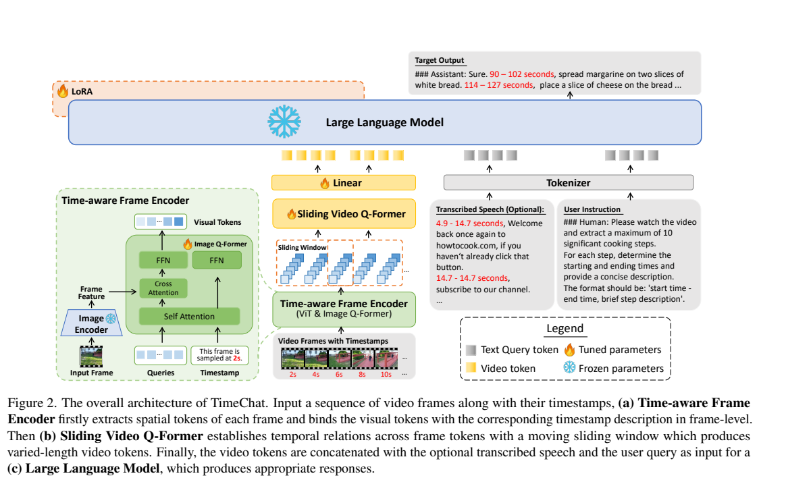
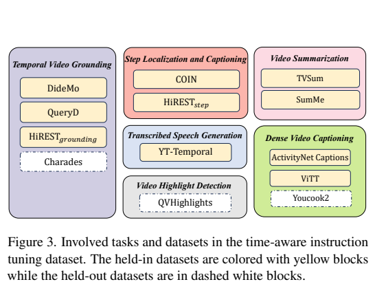
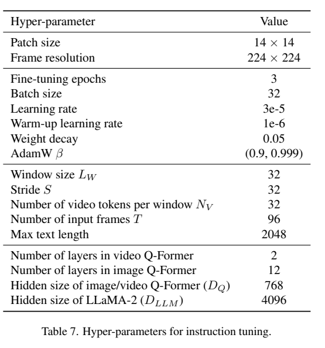
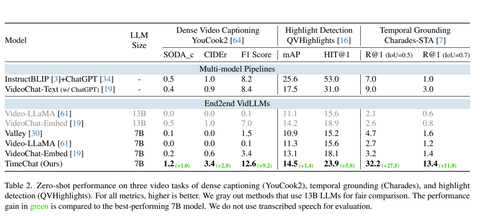
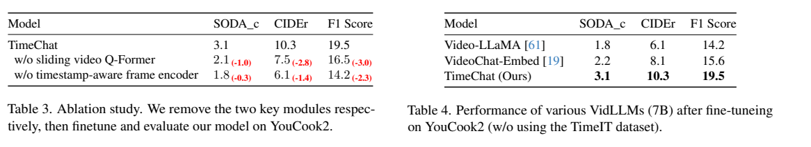
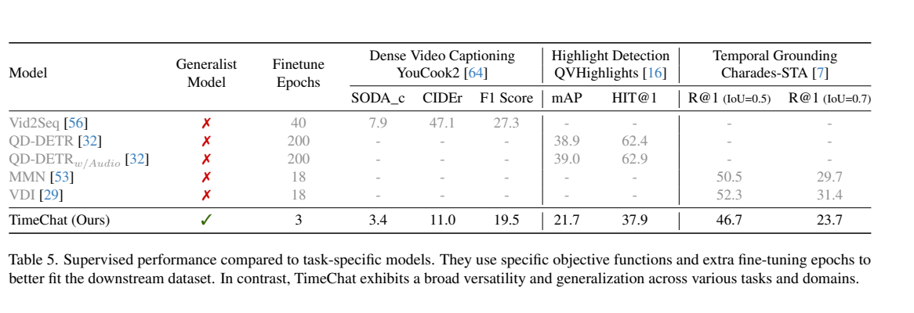

<!-- article-header:start -->
[项目首页](../../../README.md) › [模型系列](../../../reports/model-family-index.md) › [TimeChat](../README.md)
<!-- article-header:end -->

# TimeChat：让视频内容与时间戳在视觉编码阶段结合

<!-- article-toc:start -->
<a id="article-toc"></a>

**本篇目录** · [论文定位](#paper-info) · [快速概览](#overview) · [整体架构](#architecture) · [核心原理](#principles) · [数据构建](#data) · [训练流程](#training) · [实验结果](#experiments)
<!-- article-toc:end -->

<a id="paper-info"></a>

## 1. 论文信息与模型定位

| 项目 | 信息 |
|---|---|
| 论文 | TimeChat: A Time-sensitive Multimodal Large Language Model for Long Video Understanding |
| 作者 | Shuhuai Ren、Linli Yao、Shicheng Li、Xu Sun、Lu Hou |
| 团队 | 北京大学、华为诺亚方舟实验室 |
| 本文版本 | [arXiv 2312.02051v1](https://arxiv.org/pdf/2312.02051v1)，2023 年 12 月，17 页 |
| 官方仓库 | [RenShuhuai-Andy/TimeChat](https://github.com/RenShuhuai-Andy/TimeChat) |
| 定位 | 以 LLaMA-2 7B 为语言骨干的时间敏感视频理解模型 |

TimeChat 输出带起止时间的事件描述、文本查询对应的视频区间，或高光帧的时间与显著性评分。它重点解决“什么时候发生”，让视频内容和时间信息直接进入视觉表示，并通过滑窗避免把所有帧都强制压成固定数量 token。（第 1–4 页）

<a id="overview"></a>

## 2. 快速概览

| 要素 | 设计 |
|---|---|
| 逐帧编码 | EVA-CLIP ViT-G/14 + 时间戳条件化的 image Q-Former |
| 时序压缩 | Sliding video Q-Former，每个窗口分别产生视频 token |
| 语言骨干 | LLaMA-2 7B，使用 rank 32 的 LoRA |
| 默认视频输入 | 96 帧，224×224 |
| 默认滑窗 | 长度 32 帧、步幅 32，每窗输出 32 token |
| 默认最终视频 token | 3 个窗口，共 96 token |
| 指令数据 | TimeIT，报告规模 125K，六类时间相关任务 |

模型复用已对齐的公开 checkpoint，只进行指令训练。原图提供可选语音转写文字输入，但主实验**没有使用转写语音**。它也没有直接处理原始声音的音频编码分支。（第 4–6 页）

<a id="architecture"></a>

## 3. 整体架构



*原文 Figure 2，第 3 页。雪花表示基础参数冻结，火焰表示训练 image/video Q-Former、线性层及语言 LoRA。*

EVA-CLIP 逐帧提取 patch 特征。image Q-Former 在查询与帧特征交互时，同时读取该帧的时间戳文字，如“该帧采样于 2 秒”，因此得到的视觉 token 已带时间条件。它复用 InstructBLIP 的条件化 Q-Former 结构，但条件从用户任务换成帧时间。（第 4 页）

随后 video Q-Former 在一个滑动窗口内读取多帧 token，学习时间关系并产生一组压缩 token；窗口移动后重复处理，拼接所有窗口输出。线性层把 768 维 Q-Former 表示映射到 LLaMA-2 的 4096 维空间，再与问题及可选转写文字一起输入语言模型。（第 4、14 页）

“可变长度”由输入帧数和滑窗步幅决定。论文默认始终使用 96 帧，不代表系统仅凭视频秒数就自动增加输入 token；更长视频若仍只抽 96 帧，时间采样也会更稀疏。

<a id="principles"></a>

## 4. 核心创新与数学原理

**在视觉提取时绑定时间戳。** 原先的方法可将时间列表只写进语言提示，视觉内容和时间仍需由 LLM 配对。TimeChat 把各帧时间文本输入 image Q-Former，使帧级视觉摘要条件化于该时间。模型学习的是语义与时间关联，而不是手写确定性时间定位器。

**让压缩率随滑窗配置保持稳定。** 若 $`T`$ 帧各有 $`N_P`$ 个原始 patch，整段只输出 $`N_V`$ 个视频 token，原文式（1）给出：

```math
R=\frac{T N_P}{N_V}.
```

输入帧越多，信息压缩越强。滑窗按步幅 $`S`$ 产生约 $`T/S`$ 个窗口，每窗输出 $`N_V`$ 个 token，原文式（2）变为：

```math
R'=\frac{T N_P}{(T/S)N_V}=\frac{S N_P}{N_V}.
```

该推导假设帧数与步幅可以按公式分组；任意长度的边界取整及补齐需要实现处理。默认 $`T=96,S=N_V=32`$，输出 96 token；若采用每帧 224/14 的 16×16 patch 网格，原始 24,576 patch 对 96 输出 token，压缩率为 256。这个数字是按配置计算，实际训练还经过逐帧 Q-Former。（第 4、14 页）

**统一时间任务为语言输出。** 事件区间、事件描述和显著性评分都序列化为文字，不为每个任务新增回归头。语言建模统一了接口，但精确时间和连续评分仍需要解析，文本生成也可能出现格式或数值错误。

<a id="data"></a>

## 5. 数据构建与处理



*原文 Figure 3，第 5 页。黄色为 held-in 数据；虚线白色的 YouCook2、Charades 和 QVHighlights 为零样本评价保留数据。*

TimeIT 汇集六种任务、12 个数据集，报告 125K 实例及平均 190.8 秒的视频长度。覆盖时间定位、密集描述、视频摘要、高光检测、步骤定位与描述，以及基于视频的转写文本生成。这里的任务/数据清单同时展示训练来源和保留评价来源，不能将白色数据集也列作零样本主模型的训练集。（第 5、12 页）

| 任务 | 原文涉及的数据集 |
|---|---|
| 时间定位 | DiDeMo、QuerYD、HiREST grounding；保留 Charades-STA |
| 密集描述 | ActivityNet Captions、ViTT；保留 YouCook2 |
| 视频摘要 | TVSum、SumMe |
| 高光检测 | 保留 QVHighlights，该任务用于迁移评价 |
| 步骤定位/描述 | COIN、HiREST step |
| 转写文本生成 | YT-Temporal，抽取 31.6K 视频 |

构建时先人工编写任务指令，再让 GPT-4 扩展表达，最后人工筛选，每个任务保留六种指令。答案主要从原有标注转为自然语言格式，GPT-4 并非重新观看和标注全部视频。转写任务用 Whisper-timestamped 生成目标文本及时间，属于视觉到转写的弱监督；它不能证明仅凭画面能准确识别全部语音。（第 5、12–13 页）

<a id="training"></a>

## 6. 训练流程与目标

模型使用 EVA-CLIP 视觉编码器、InstructBLIP image Q-Former、Video-LLaMA video Q-Former 的公开初始化，并接入 LLaMA-2 7B。基础 ViT 与 LLM 权重冻结，两个 Q-Former、线性层及 LoRA 参与训练；“LLM 冻结”指基础参数，不代表语言分支没有适配更新。（第 5 页）



*原文 Table 7，第 14 页。video Q-Former 为 2 层，image Q-Former 为 12 层。*

TimeIT 指令训练为 3 epochs、batch 32，在单台八张 V100 32GB 机器进行。学习率 $`3\times10^{-5}`$，warmup 学习率 $`10^{-6}`$，AdamW 的 $`\beta=(0.9,0.999)`$，weight decay 0.05；最大文本长度 2048，LoRA rank 32。原文没有报告完整训练耗时，不另行推算为作者公布成本。

原文式（3）的目标为回答的条件语言建模：

```math
\mathcal L=-\sum_{i=1}^{L_T}\log P_\theta(x_i\mid X_v,X_q,X_{a,<i}).
```

$`X_v`$ 是视频 token，$`X_q`$ 是用户指令及可选文字，$`X_{a,\lt i}`$ 是先前答案。时间戳数字也作为答案 token 学习，没有为定位任务另加 IoU 损失。下游监督微调和正文的零样本主实验是不同训练设置，结果须分别阅读。

<a id="experiments"></a>

## 7. 实验设置与主要结果



*原文 Table 2，第 6 页。绿色提升相对最佳 7B 端到端比较模型，各任务参照对象可能不同。*

| 任务/指标 | TimeChat 零样本结果 |
|---|---:|
| YouCook2 SODA_c / CIDEr / F1 | 1.2 / 3.4 / 12.6 |
| QVHighlights mAP / HIT@1 | 14.5 / 23.9 |
| Charades-STA R@1, IoU 0.5 / 0.7 | 32.2 / 13.4 |

F1 衡量事件定位，按 IoU 0.3/0.5/0.7/0.9 汇总；CIDEr 衡量描述质量，SODA_c 评价事件序列；R@1 衡量文本查询的首个定位是否满足 IoU。它们不能统一称为“准确率”。模型输出先经过启发式规则提取时间和分数，再计算指标。YouCook2 使用 457 个验证视频，Charades-STA 使用 3,720 个测试对。（第 5、12 页）

TimeChat 在定位上比表内早期端到端模型显著提高，但高光检测仍低于 InstructBLIP+ChatGPT 管线的 25.6 mAP、53.0 HIT@1，不能说所有比较方法及任务均领先。



*原文第 6 页。该处为在 YouCook2 训练后的实验，不是上述零样本结果。*

移除滑窗后，SODA_c/CIDEr/F1 从 3.1/10.3/19.5 降至 2.1/7.5/16.5。第三行移除时间条件后为 1.8/6.1/14.2，其红色下降量按上一行计算，而图注写“分别移除”；配置关系不够明确。本文保留各行原值，不把 2.3 写成相对完整模型的 F1 下降。固定使用 YouCook2、不使用 TimeIT 的比较中，TimeChat 高于重新训练的 VideoChat-Embed，支持结构本身也有贡献。



*原文 Table 5，第 8 页。三类任务使用各自下游监督训练后比较。*

微调后 TimeChat 的 YouCook2 F1 为 19.5、QVHighlights HIT@1 为 37.9、Charades IoU0.5 的 R@1 为 46.7，仍低于对应任务专用模型。Table 5 的 YouCook2 CIDEr 11.0 与 Table 3/4 的 10.3 属于不同表中报告值，不自行合并。它展示了统一语言接口的实用方向，也保留了与专用系统之间的性能差距。

原文配图出处、页码及裁剪范围见 [配图清单](figures-manifest.json)。

<!-- article-footer:start -->
---

[← 上一篇：ViP-LLaVA](../../vip-llava/arxiv-2312.00784/README.md) · [按发表时间浏览](../../../reports/paper-reading-guide.md#year-2023) · [下一篇：VaQuitA →](../../vaquita/arxiv-2312.02310/README.md)

[返回本篇目录](#article-toc) · [返回模型系列](../README.md)
<!-- article-footer:end -->
