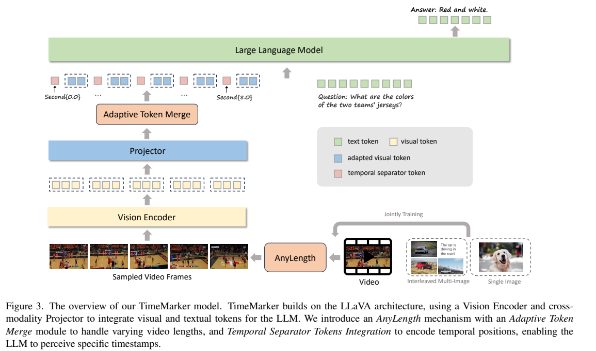
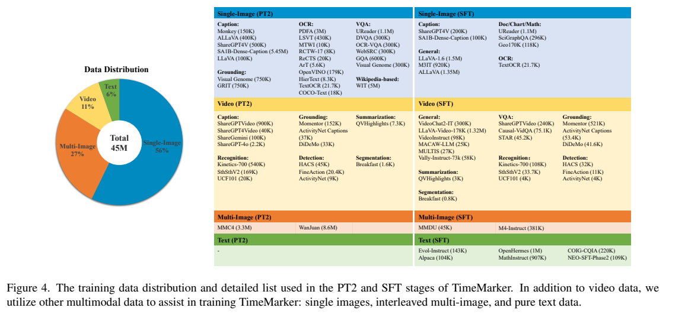
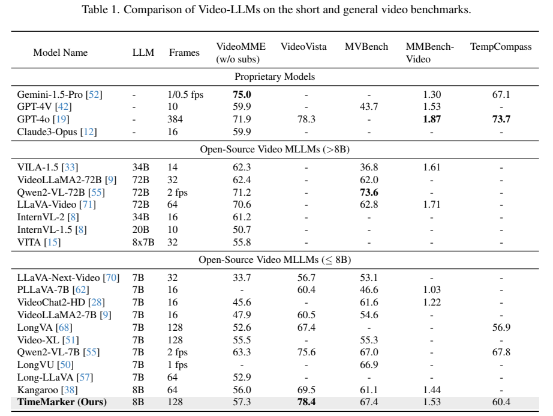
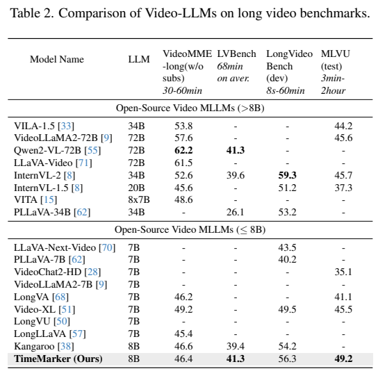
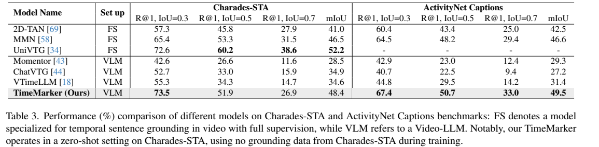
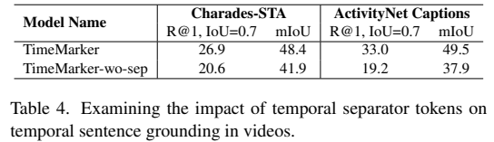

# TimeMarker：用文字时间戳与自适应压缩统一长短视频理解

## 1. 论文信息与模型定位

| 项目 | 内容 |
|---|---|
| 论文 | TimeMarker: A Versatile Video-LLM for Long and Short Video Understanding with Superior Temporal Localization Ability |
| 作者与机构 | Shimin Chen、Xiaohan Lan、Yitian Yuan、Zequn Jie、Lin Ma；美团 |
| 本文依据 | [arXiv v1，2024-11-27](https://arxiv.org/pdf/2411.18211v1)，11 页 |
| 官方项目 | [TimeMarker-LLM/TimeMarker](https://github.com/TimeMarker-LLM/TimeMarker) |
| 骨干 | CLIP-ViT-L、两层 MLP、Llama3-8B |
| 定位 | 视频问答、事件理解和自然语言时间区间定位；输出为文本与时间戳 |

模型把帧的真实采样时间写成文字，与视觉 token 交错输入。通过动态抽帧和空间池化，它调整长短视频的信息密度；这种设计支持处理较长输入，但名称 AnyLength 不表示无限上下文或任意精度的事件边界恢复。（§3）

## 2. 快速概览

| 设计 | 作用 |
|---|---|
| `Second{t}` 分隔文本 | 为每帧显式提供相对于视频起点的秒数 |
| 动态帧率 | 很短视频采得更密，较长视频受最大帧数约束 |
| Adaptive Token Merge | 对投影后的帧特征空间池化，随帧数提高压缩率 |
| 多源时间监督 | 将检测、分割、摘要和句子定位标注转成视频 QA |
| 图像与交错多图训练 | 提供 OCR、语义、推理等辅助知识 |

主表 VideoVista 78.4、MVBench 67.4、MLVU test 49.2；Charades-STA 的 R@1、IoU=0.5 为 51.9。模型在部分测试领先同级模型，但 VideoMME 57.3、TempCompass 60.4 低于 Qwen2-VL-7B 的 63.3、67.8，应按基准分别理解。（Tables 1–3）

## 3. 整体架构

*来源：v1 Figure 3，PDF 第 3 页。视频、单图与交错多图共同参与训练。*

每个 336×336 视频帧由 CLIP-ViT-L 编码，再经过带 GELU 的两层 MLP 对齐到 Llama3-8B。Adaptive Token Merge 在投影后执行平均池化。视觉块前插入时间文字，随后与用户问题一起输入 LLM；响应可以描述事件，也可以直接输出开始和结束时间。（§3.1、4.1）

输入形如 `Second{0.0} + 帧特征 + Second{8.0} + 帧特征`。分隔符使用已有的文本编码能力，论文没有说为所有时间值创建新的专用词表项；训练答案中的时间表达也转成相同格式，使输入与输出共享时间表示。（§3.2）

## 4. 核心创新与数学原理

**把时间值与帧绑定。** 序列可表示为 $[\mathrm{Tok}(t_1),V_1,\ldots,\mathrm{Tok}(t_N),V_N,q]$，其中 $t_i$ 为实际采样秒数。即使抽帧间隔变化，模型仍有明确的绝对时间参考；这与只依靠 token 顺序判断事件先后不同。但相邻采样帧之间的短动作仍可能遗漏，时间文字本身不能恢复未看到的细节。（§3.2–3.3）

**动态抽帧。** 设视频长度为 $D$ 秒，最大帧数为 $M$，原文规则为：

$$
f(D)=\begin{cases}2,&D<8,\\
1/\lceil D/M\rceil,&D\ge8.\end{cases}
$$

长视频的帧率由时长与容量决定，而不是固定每个视频输入相同数目。PT2 设 $M=64$，SFT 设 $M=128$。（第 4、6 页）

**帧数越多，每帧保留的空间 token 越少。** 对投影特征 $F\in\mathbb R^{h\times w\times d}$，Algorithm 1 使用以下池化核：

$$
(k_h,k_w)=\begin{cases}(2,2),&N\le M/4,\\
(4,2),&M/4<N\le M/2,\\
(4,4),&N>M/2.\end{cases}
$$

以 24×24 patch 网格说明，三档每帧约 144、72、36 token，视觉总量约受 $36M$ 限制，SFT 时约 4608。该数是由网格和池化规则推导的解释，不包含文字时间戳与问题开销，也不是原文实测延迟。更强池化会损失小字与细小动作的空间信息。（§3.3）

## 5. 数据构建与处理

*来源：v1 Figure 4，PDF 第 5 页。45M 指 PT2 与 SFT 的混合数据，并非全部是视频。*

PT1 使用约 60M 图文对，来自 LAION、Zero、CapsFusion、COYO、CC12M、CC3M，比例分别为 28.5%、25%、24%、20%、1.5%、1%；用 InternVL2 重新描述图片。PT2 与 SFT 的混合分布为单图 56%、多图 27%、视频 11%、纯文本 6%；论文概述全流程约 85M 图像、12M 交错多图、5M 视频文本对。（第 2、5 页）

时间数据包括 Momentor、ActivityNet Captions、DiDeMo、HACS、FineAction、QVHighlights、Breakfast 等。动作识别转换成选择题；检测、分割、摘要和句子定位标注按规则转换成有时间答案的 QA。SFT 再由 GPT-4o 增加问题复杂性，并统一转换时间表达为 `Second{t}`。（§3.4）

视频训练时长分布并不均衡：88.49% 小于 3 分钟，6.6% 为 3–10 分钟，4.9% 为 10–30 分钟，仅 0.01% 超过 30 分钟，最长 126 分钟。因此“训练包含两小时视频”不能解读为大量长视频预训练。各来源条目属于训练记录，不能都看作互不重复的视频文件。（第 5 页）

## 6. 训练流程与目标

| 阶段 | 更新参数与训练内容 | 基础学习率 / ViT 学习率 |
|---|---|---|
| PT1 | 冻结 LLM，更新视觉编码器与 MLP，进行图文对齐 | $10^{-4}$ / $10^{-5}$ |
| PT2 | 全参数训练，高质量视觉、视频、多图知识 | $2\times10^{-5}$ / $2\times10^{-6}$ |
| SFT | 继续全参数训练，学习复杂指令与时间任务 | $10^{-5}$ / $2\times10^{-6}$ |

ViT 使用逐层学习率衰减，因子 0.9。实现段另写 PT1 的视频输入均匀采 16 帧，但数据段只列 60M 图像对，没有说明 PT1 视频混合来源；本文保留此处信息缺口，不补造额外视频规模。报告也没有给出完整 batch、总 steps、设备与精度配置。（第 5–6 页）

文本答案训练可解释为自回归交叉熵 $-\sum_t\log p_\theta(y_t\mid y_{<t},V,q)$，时间数字同样是文字 token。论文没有为时间区间另加一个明确的连续坐标回归目标或时序 IoU 优化项，因此评测 IoU 不能当成训练损失。（§3.4）

## 7. 实验设置与主要结果

*来源：v1 Table 1，PDF 第 6 页。模型采用不同帧数和帧率，MMBench-Video 分数也不是百分比准确率。VideoMME 为无字幕设置。*

TimeMarker 的 VideoVista 78.4 略高于 GPT-4o 78.3，MVBench 67.4 高于 Qwen2-VL-7B 67.0；但 VideoMME 57.3 低于后者 63.3，MMBench-Video 1.53 低于 GPT-4o 1.87，TempCompass 60.4 低于 73.7。不能将其中一项相近的分数扩展为全面达到 GPT-4o。

*来源：v1 Table 2，PDF 第 6 页。LongVideoBench 为 dev、MLVU 为 test，各基准时长分布不同。*

LVBench 41.3 与 Qwen2-VL-72B 相同；LongVideoBench 56.3 高于 Kangaroo 54.2，低于 InternVL-2-34B 59.3；MLVU test 49.2 是表中最高。VideoMME 长视频部分 46.4 低于 Video-XL-7B 49.2、Kangaroo-8B 46.6，也显著低于 Qwen2-VL-72B 62.2。（Table 2）

*来源：v1 Table 3，PDF 第 7 页。R@1、IoU 阈值指首个预测区间与参考区间的交并比要求；mIoU 是平均区间重叠。*

Charades-STA 未使用该数据集的定位标注训练，R@1@0.3/0.5/0.7 为 73.5/51.9/26.9；虽然宽阈值高于 UniVTG 72.6，后两项低于其 60.2/38.6。ActivityNet Captions 为 67.4/50.7/33.0、mIoU 49.5，优于表中比较方法，但训练使用了其训练标注，不能把该列也称作相同口径的零样本测试。（§3.4、Table 3）

*来源：v1 Table 4，PDF 第 7 页。对照在训练与测试都去掉分隔文本。*

移除后 Charades 的 mIoU 48.4→41.9，ActivityNet 49.5→37.9，支持显式时间表示的贡献。但本文未将全部综合成绩都归因于该单项设计：模型同时受益于时间标注、图像和多图训练，AnyLength 的独立消融及端到端测速在本报告中不足。案例中的小数秒输出也不能直接证明达到相应毫秒精度。（§4.4–4.5）

**来源说明：** 本文按 v1 区分训练阶段、测试划分与比较条件，未复现训练；原图出处和裁切记录见 [图片清单](figures-manifest.json)。
