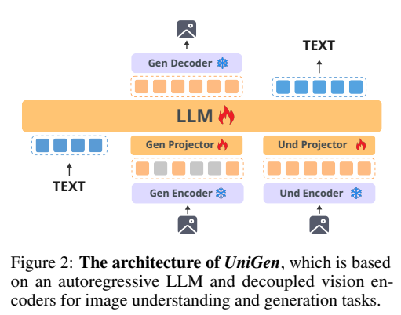
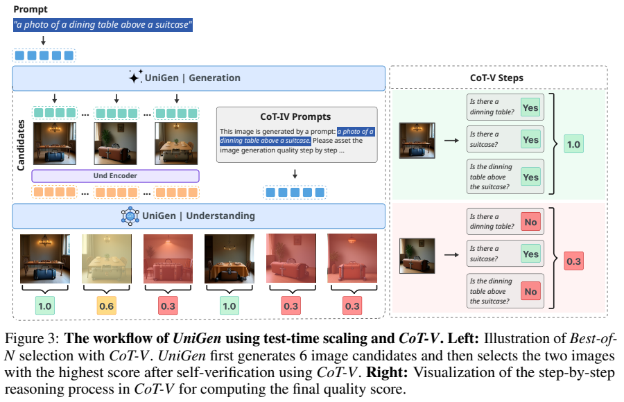
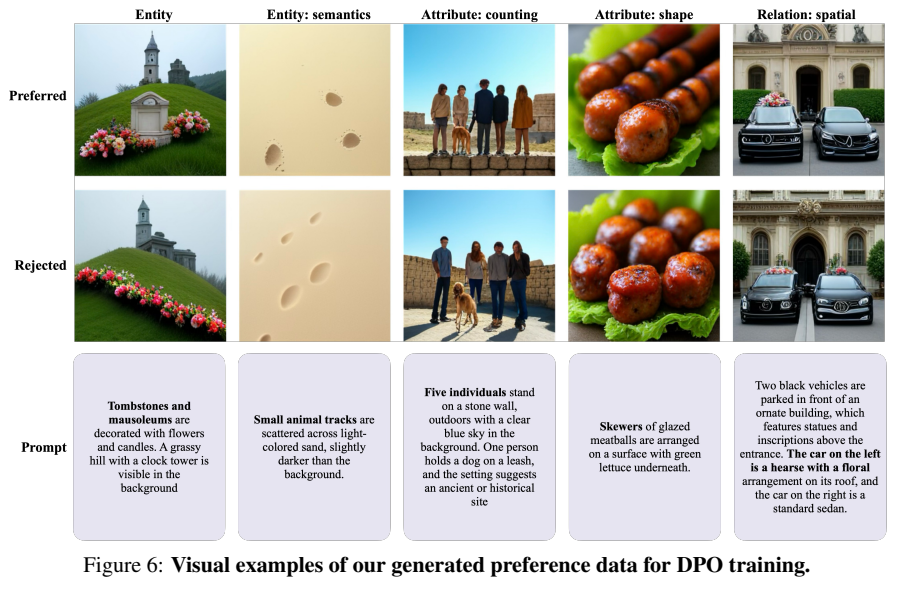
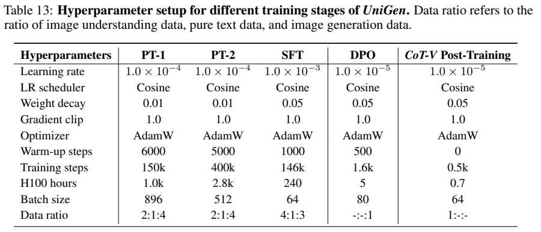
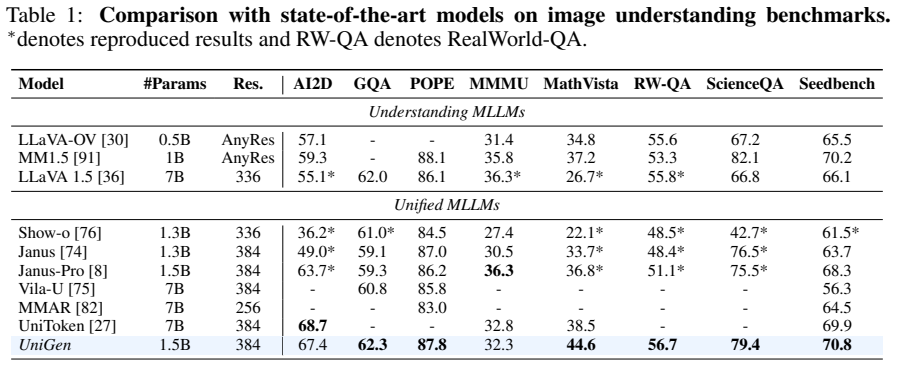
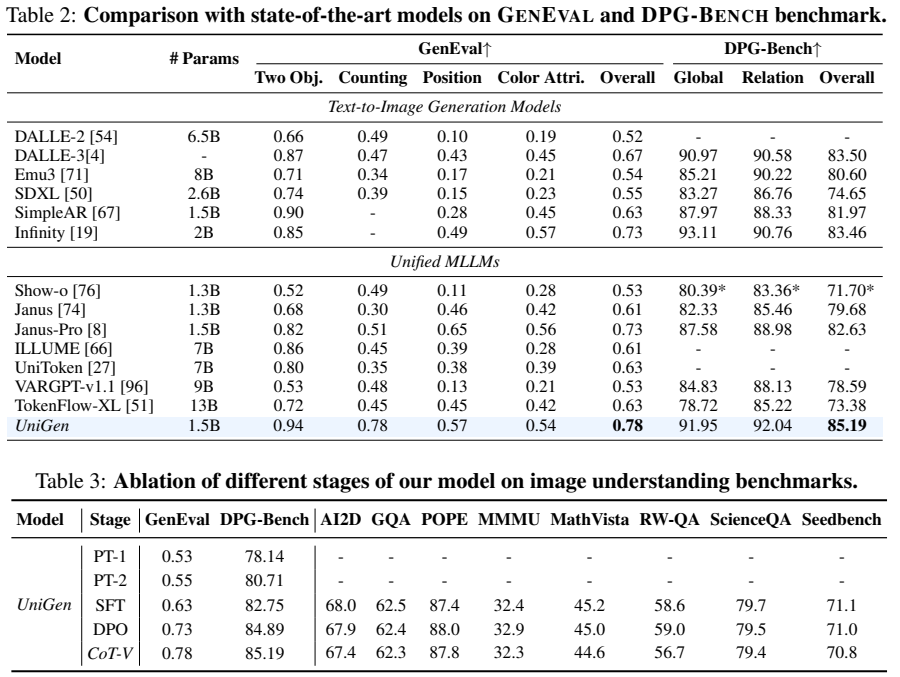

<!-- article-header:start -->
[项目首页](../../../README.md) › [模型系列](../../../reports/model-family-index.md) › [UniGen](../README.md)
<!-- article-header:end -->

# UniGen：统一图像理解与生成，并通过自验证筛选候选图像

<!-- article-toc:start -->
<a id="article-toc"></a>

**本篇目录** · [论文定位](#paper-info) · [快速概览](#overview) · [整体架构](#architecture) · [核心原理](#principles) · [数据构建](#data) · [训练流程](#training) · [实验结果](#experiments)
<!-- article-toc:end -->

<a id="paper-info"></a>

## 1. 论文信息与模型定位

| 项目 | 信息 |
|---|---|
| 原文 | *UniGen: Enhanced Training & Test-Time Strategies for Unified Multimodal Understanding and Generation* |
| 作者与机构 | Rui Tian、Mingfei Gao、Mingze Xu 等；Apple、复旦大学 |
| 版本 | [arXiv:2505.14682v1](https://arxiv.org/abs/2505.14682v1)，2025-05-20 |
| 原文 | [固定版本 PDF](https://arxiv.org/pdf/2505.14682v1) |
| 定位 | 以 Qwen2.5-1.5B 为主体的图文统一模型；重点研究数据配方、偏好训练与推理时自验证 |

UniGen 可以看图回答，也能根据文本生成图像。理解与生成共享语言模型，却采用不同视觉表示；论文进一步让理解分支评价生成候选，建立两种能力之间的协作。本文归入 UniGen 独立系列，不因使用 Qwen 骨干而视为 Qwen 官方模型。（原文第 1–3 页）

<a id="overview"></a>

## 2. 快速概览

| 要点 | 内容 |
|---|---|
| 语言主体 | Qwen2.5-1.5B；1.5B 是语言主体规模，非所有外部编码器总参数 |
| 理解路径 | SigLIP 连续视觉特征，384 输入分辨率 |
| 生成路径 | MAGVIT-v2 离散编码与解码，256×256 输出；迭代掩码预测 |
| 训练 | 两阶段预训练、联合 SFT、DPO、轻量 CoT-V 微调 |
| 推理增强 | 生成 20 张候选，自验证后保留 4 张用于评测 |
| 主要结果 | GenEval 0.78，DPG-Bench 85.19；数学与高分辨率能力仍有限 |

论文的“统一”发生在共享主体与协作流程中，并不表示视觉理解和生成必须使用同一套编码器。

<a id="architecture"></a>

## 3. 整体架构



*Figure 2，第 3 页。生成编码器/解码器和理解编码器独立，连接到同一语言模型。*

理解分支使用 SigLIP 提取连续特征，通过理解投影器输入 LLM，按自回归方式预测文本。生成分支先由 MAGVIT-v2 将图像变为离散 token，经生成投影器进入共享 LLM；训练时遮盖一部分图像 token，学习恢复它们。推理从全部遮盖开始，分 50 轮逐渐填充，再由视觉解码器还原图像。

注意力不是全序列统一因果：图像 token 内采用双向注意力，文本内部及跨模态关系保留规定的因果结构；纯文本任务使用因果注意力。虽然主体来自自回归 LLM，图像生成本身是并行的掩码迭代预测，而非逐像素自回归生成。（第 3、6–7 页）

预训练阶段有一个重要例外：图像到文本也使用生成编码器，以加强离散视觉与文本对齐；SFT 后才使用 SigLIP 理解路径，不能把双编码器配置无区别地套用于所有阶段。

<a id="principles"></a>

## 4. 核心创新与数学原理

第一项重点是数据与阶段设计。令离散图像序列为 $`z`$、随机掩码为 $`m`$，理解性地写出生成训练目标：

```math
\mathcal L_{\mathrm{mask}}=-\sum_{i:m_i=1}\log p_\theta(z_i\mid z_{\mathrm{visible}},c,m).
```

这里 $`c`$ 为文本条件，只有遮盖位置参与恢复目标；该式是对 §3.1 的解释性表达。图像掩码比例随机采样，推理则按余弦日程迭代恢复。语言/理解任务继续使用下一 token 预测，任务混合比例由各阶段数据配方控制。

偏好训练采用原文式 (1) 的 DPO：

```math
\mathcal L_{\mathrm{DPO}}=-\mathbb E\log\sigma\!\left[\beta\log\frac{\pi_\theta(y_w\mid x)}{\pi_{\mathrm{SFT}}(y_w\mid x)}-\beta\log\frac{\pi_\theta(y_l\mid x)}{\pi_{\mathrm{SFT}}(y_l\mid x)}\right].
```

$`y_w,y_l`$ 是优选与劣选图像，参考策略固定为 SFT 模型。该式描述相对偏好目标；正文没有充分说明迭代掩码生成的整图概率如何具体估计，也未给出 $`\beta`$ 数值，不自行补为标准自回归似然实现。



*Figure 3，第 4 页。图中以 6 选 2 示意；正式评测使用 20 选 4。*

CoT-V 将提示分解为物体、数量、颜色、关系等原子问题，逐项回答并计算：

```math
S(c,I)=\frac1n\sum_{j=1}^n\mathbf1[A_j=\mathrm{yes}].
```

再按 $`S`$ 排序选图。比整体 Yes/No 判断，这种方式能区分部分符合的候选；比固定规则分解，它适应更自由的提示。但若分解遗漏条件或视觉判断产生幻觉，分数也会错误。它没有对图片进行再次编辑，不应描述成“生成后修复所有错误”。（第 5–6 页）

<a id="data"></a>

## 5. 数据构建与处理

预训练重标注 ImageNet、CC-3M、CC-12M 与 SAM-11M，用 Qwen2.5-VL-7B 生成细粒度描述，正文称图文池约 40M。PT-1 的图像生成主要使用 ImageNet 描述，PT-2 扩展到其他来源；纯文本来自 RefinedWeb。SFT 理解使用 SlowFast-LLaVA-1.5 的 4.67M 图像问答混合，生成使用 JourneyDB 与 text-to-image-2M。（第 3–4 页、Table 14）



*Figure 6，第 15 页，展示物体、计数、形状与空间关系对应的优选/劣选样本。*

DPO 每个提示先生成 20 张图：短提示来自 PARM，用 GenEval 规则选最高/最低分；中提示从 T2I-Comp 训练集采样 6K，长提示从重标注 SA-1B 采样 6K，借助 Qwen 文本分解和视觉问答评分。三类各约 6K，构成约 18K 偏好对，属于自动/规则伪标注，不能写成 18K 人类逐对偏好。

CoT-V 复用 PARM 与 T2I-Comp，抽取 20K 图像—问答样本。长描述 SA-1B 因分解覆盖较差被排除。原文强调训练图像数据来自公开来源，但预训练骨干与标注模型仍是既有资产，不能据此称整个链路都从零使用公开训练配方重现。（第 4–6、13–15 页）

<a id="training"></a>

## 6. 训练流程与目标



*Table 13，第 13 页。数据比例顺序为理解：纯文本：生成。*

| 阶段 | 更新模块 | 表 13 配置 |
|---|---|---|
| PT-1 / PT-2 | 生成投影器与 LLM，其他冻结 | LR $`10^{-4}`$；150K/400K steps；batch 896/512；数据 2:1:4 |
| SFT | 两个投影器与 LLM；视觉编码器冻结 | LR $`10^{-3}`$；146K steps；batch 64；数据 4:1:3 |
| DPO | 生成相关路径，理解编码器/投影器冻结 | LR $`10^{-5}`$；1.6K steps；表中 batch 80 |
| CoT-V | 理解投影器与 LLM | LR $`10^{-5}`$；500 steps；batch 64 |

均用 AdamW 与余弦调度、梯度裁剪 1.0。DPO 正文 §3.4 写一 epoch、batch 64，附录 Table 13 则写 80，保留该差异。预训练用 32 张 H100-80G，其他阶段用 8 张；表中的 H100 hours 依次为 1.0K、2.8K、240、5、0.7，未进一步说明其是否按设备累计，不将其静默换算成统一成本。

推理用 classifier-free guidance，尺度 5.0；50 次掩码迭代产生一张候选图，再进行多候选生成与验证。最高分数因此包含额外推理预算。（第 6–7、13 页）

<a id="experiments"></a>

## 7. 实验设置与主要结果



*Table 1，第 7 页。星号为作者复测的基线，其他数字部分引用已有结果。*

UniGen 的 AI2D 67.4、GQA 62.3、POPE 87.8、MMMU 32.3、MathVista 44.6、RealWorld-QA 56.7。相对 Janus-Pro-1.5B，MathVista 提高 7.8 个百分点、RealWorld-QA 提高 5.6，但 MMMU 低于其 36.3；POPE 也低于 MM1.5 的 88.1。不能用表中“最佳统一模型”的总体措辞替代逐项比较。



*第 8 页。最终生成分数使用 20 张候选、自验证选择 4 张的协议；理解任务由 lmms-eval 评测。*

GenEval 最终 0.78、DPG-Bench 85.19。GenEval 中计数 0.78 高于 Janus-Pro 0.51，但位置 0.57 低于 0.65，颜色属性 0.54 低于 0.56。256×256 的语义一致性分数不等于高分辨率画质优势。

Table 3 的 PT-1→PT-2→SFT→DPO→CoT-V，GenEval 为 0.53→0.55→0.63→0.73→0.78。DPO 后 CoT-V 的收益同时含验证微调与候选选择，不能全部归因于更好的单次生成。验证消融中整体二元判断 0.74、规则验证 0.75、CoT 验证 0.78；DPO 的 GenEval 在 Table 3 为 0.73、Table 6 为 0.74，基线口径存在小幅差异。

CoT-V 后理解指标也有回落：RealWorld-QA 从 DPO 的 59.0 降到 56.7，MathVista 45.0→44.6，AI2D 67.9→67.4，说明“保持理解能力”并非所有数值不变。文中没有给出置信区间、候选筛选的时延表或等预算全模型比较；复杂长提示的遗漏问句与自验证幻觉见 Figure 9。以上为原文报告，未复现训练与生成。（第 8–9、16 页）

<!-- article-footer:start -->
---

[← 上一篇：BLIP3-o](../../blip3-o/arxiv-2505.09568/README.md) · [按发表时间浏览](../../../reports/paper-reading-guide.md#year-2025) · [下一篇：MMaDA →](../../mmada/arxiv-2505.15809/README.md)

[返回本篇目录](#article-toc) · [返回模型系列](../README.md)
<!-- article-footer:end -->
