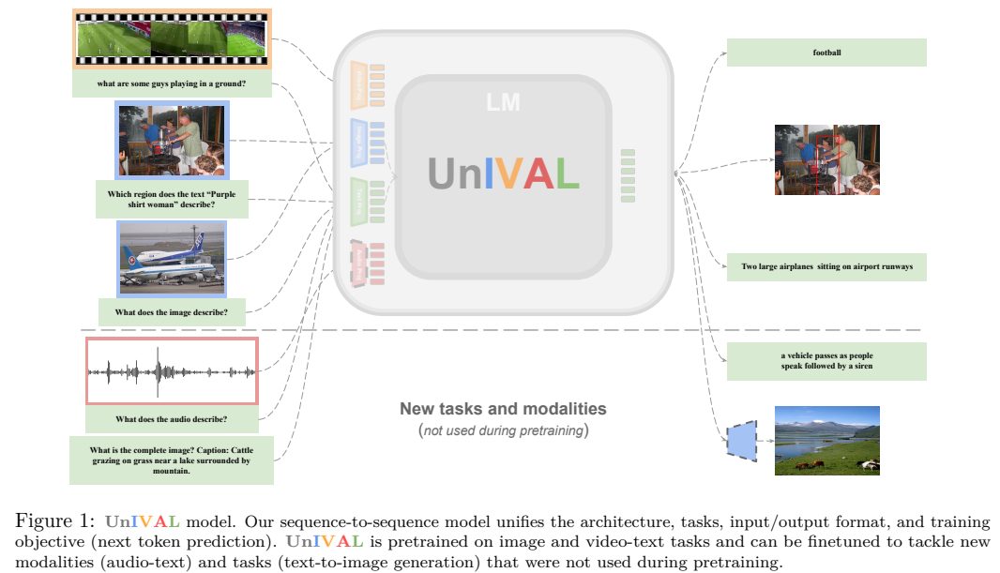
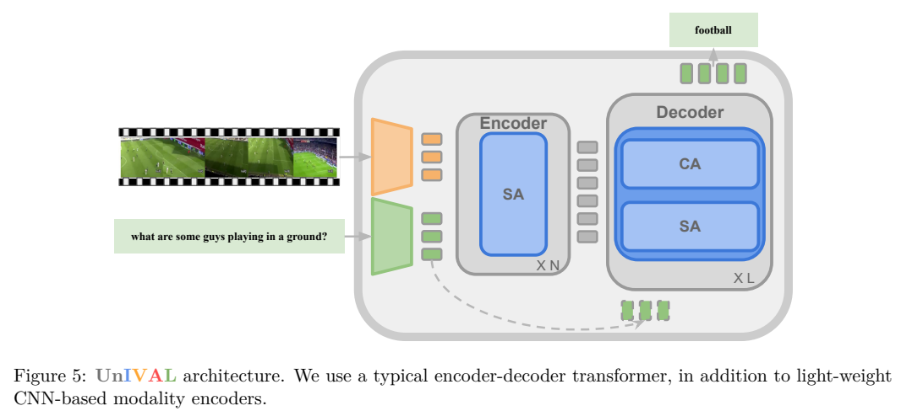
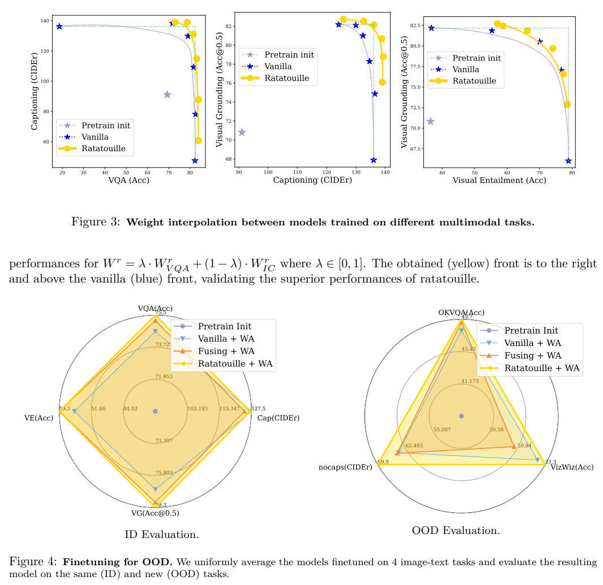
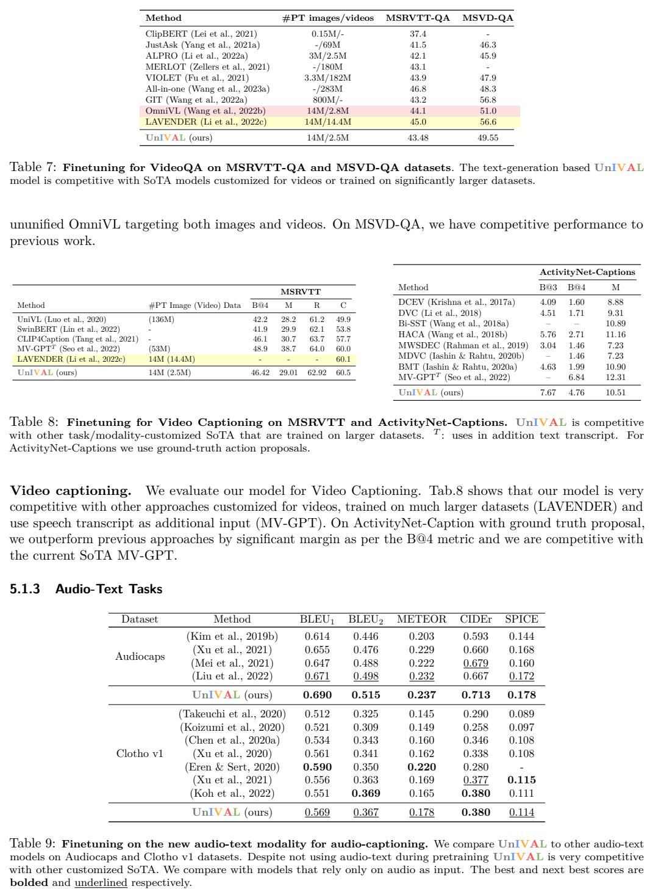

# UnIVAL：以统一序列任务连接图像、视频、音频与语言

## 1. 论文信息与模型定位

| 项目 | 信息 |
|---|---|
| 论文 | *UnIVAL: Unified Model for Image, Video, Audio and Language Tasks* |
| 作者与机构 | Mustafa Shukor、Corentin Dancette、Alexandre Rame、Matthieu Cord；Sorbonne University、Valeo.ai |
| 来源 | [arXiv:2307.16184v1](https://arxiv.org/pdf/2307.16184v1)，2023 年 7 月，40 页 |
| 官方资源 | [mshukor/UnIVAL](https://github.com/mshukor/UnIVAL) |
| 定位 | 约 0.25B 的编码器—解码器统一多模态基础模型 |

UnIVAL 将描述、问答、定位和匹配等任务统一成序列生成，并研究渐进加入模态、任务平衡与微调模型权重合并。它属于小规模统一模型路线，不能仅因目录收录就称为一个数十亿参数的通用聊天大模型。

## 2. 快速概览

| 统一轴 | 具体做法 |
|---|---|
| 输入输出 | 文本、位置、离散图像 token 共享词表；非文本特征映射到输入序列 |
| 模型 | 共享 BART 编码器—解码器，不为每个任务增加输出头 |
| 任务 | 文本提示指定描述、问答、区域定位等任务 |
| 目标 | 条件下一 token 预测，交叉熵训练 |

模型先进行图文、视频文本预训练，**音频描述与文生图是在后续任务微调中加入**。音频微调还使用经过 AudioSet 分类预训练的编码器，所以不能把音频结果解释为无需音频学习的零样本能力。不同任务的定量结果通常来自各自微调模型，权重合并实验另行研究把这些能力组合起来。（第 1、8、11–13 页）

## 3. 整体架构

*Figure 1，PDF 第 3 页。虚线以下的音频与文生图属于后续适配。*

*Figure 5，PDF 第 19 页。解码器通过交叉注意力读取编码器输出。*

共享 Transformer 从 BART-base 初始化。图像使用 ImageNet 预训练 ResNet-101，视频使用 Kinetics-400 预训练 3D ResNeXt-101，音频使用 PANN-CNN14。CNN 特征展开为序列，经线性层映射到语言维度，加入模态及位置嵌入，与任务文本拼接。作者保留 CNN 最后一个 block，以减少送入语言模型的 token 数。（第 7、19–20 页）

编码器在输入序列上做双向交互，解码器自回归生成结果，其交叉注意力以解码状态为 query、编码结果为 key/value。框定位输出四个离散位置 token；文生图适配采用 VQ-GAN 离散表示。共享输出格式并不意味着输入端完全没有模态专用模块。

## 4. 核心创新与数学原理

统一交叉熵可以写成：

$$
\mathcal L_{\mathrm{CE}}=-\sum_t\log p_\theta(y_t\mid x,q,y_{<t}),
$$

其中 $x$ 是模态输入，$q$ 是任务提示，$y$ 可以是回答、描述、坐标或图像码序列。这是对正文条件预测目标的展开说明。匹配任务也生成 Yes/No，而非增加另一个分类头；定位训练仍是 token 分类损失，并非直接优化 IoU。

课程学习先训练图文，再加入视频，同时保留图文任务以减轻遗忘。任务平衡让每个 batch 中各任务样本数接近，避免 CC12M 等大数据源支配更新。原文并未用一个新的解析损失替代交叉熵，关键变化在采样与训练顺序。（第 6–8 页）

另一个贡献是对同一预训练初始化产生的微调模型进行权重插值：

$$
W=\lambda W_1+(1-\lambda)W_2,\qquad 0\le\lambda\le1.
$$

合并后只运行一个模型，因而不增加集成推理开销；但这不保证任意不同架构或不同初始化都可以直接平均。Ratatouille 策略先在辅助任务上微调，再分别适配目标任务，最后平均，额外训练成本高于简单微调。它与先平均辅助权重作为初始化的 Fusing 策略不同。（第 12–13 页）

*Figures 3–4，PDF 第 13 页。插值呈现任务间权衡，域外优势也依赖具体合并流程。*

## 5. 数据构建与处理

预训练采用公开训练集：图像描述来自 COCO、Visual Genome、SBU、CC3M、CC12M；问答来自 VQAv2、GQA、VG；定位来自 RefCOCO 系列；视频描述与问答来自 WebVid2M、WebVidQA。区域描述、图文/视频文本匹配也被改写为生成任务，匹配负例用随机不对应描述构建。（第 6、20 页）

原表 1 的 21.4M 图像任务样本、5M 视频任务样本，与其他表中的 14M 图像、2.5M 视频属于不同样本统计表达；表 4 另有 21.6M 图像任务配置。本文不把这些数字相加为去重的图像数或全部下载文件数。CC12M 仅用于前一阶段，加入视频时移除它。（第 4、7–8 页）

下游音频描述使用 AudioCaps、Clotho v1；文生图使用 COCO。所有输入输出保持同一序列约定，但下游任务的微调数据、分辨率和约束解码各不相同。

## 6. 训练流程与目标

| 阶段 | 配置 |
|---|---|
| 图文预训练 | 150K steps，batch 3,200，图像分辨率 384 |
| 加入视频 | 90K steps，batch 4,000，两种模态各 2,000；视频最初 $224^2$、8 帧 |
| 最后高分辨率 epoch | 图像 480；视频 $384^2$、16 帧 |
| 下游微调 | 按任务分别训练，不能将这些配置当成统一聊天 SFT |

预训练更新全部模型参数，使用 Adam、weight decay 0.01，学习率从 $2\times10^{-4}$ 线性下降。VQA 微调 5 epochs、batch 256、$10^{-4}$；定位 8 epochs、$5\times10^{-5}$；视频问答在 MSRVTT/MSVD 分别训练 25/40 epochs。多个微调设置冻结词嵌入，采用 0.1 label smoothing。VQA 用 Trie 限制为常见 3.1K 回答，视频问答也限制答案集合，结果不是完全自由回答的准确率。（第 7、21–22 页）

AudioCaps/Clotho 微调 10 epochs、batch 128，采用 64 mel bins。文生图先做 50K steps 交叉熵，再做 5K steps CLIP 分数优化；评测从 24 个生成图像中按 CLIP 选最好者，因此并非单次无筛选生成。（第 22 页）

## 7. 实验设置与主要结果

课程学习的消融在同样 GPU 数上，将每 epoch 时间从 2h04m 减为 1h42m，约快 18%，报告显存约减 25%；成绩接近，RefCOCO+ 70.89→70.19、MSRVTT-QA 42.38→42.27 有小幅下降。它主要支持训练效率改善，不能说所有指标提高。（Table 2）

定位微调的 RefCOCO testB 为 85.16，高于 OFA-base 的 83.30；RefCOCO+ testA 86.92 则低于 OFA 的 87.15。VQAv2 test-std 77.1 与复现 OFA 相同，COCO CIDEr 137.0 低于 OFA 的 138.1。Table 10 是见过训练任务的数据集上不再微调的评测，Table 11 才侧重未见数据集；两者不应都称为严格数据集零样本。（第 8–11 页）

*Tables 7–9，PDF 第 10 页。均为下游任务微调；ActivityNet 使用真实动作提议。*

视频问答准确率为 43.48/49.55，仍低于 LAVENDER 的 45.0/56.6；MSRVTT 描述 CIDEr 60.5 较有竞争力。ActivityNet B@4 为 4.76，低于含转录输入 MV-GPT 的 6.84，原文“显著超过既有方法”必须结合具体对照理解。AudioCaps CIDEr 0.713 高于表中基线，Clotho 0.380 与最好结果持平，其他音频指标并非全领先。文生图 FID 15.4 仍弱于 OFA 的 13.9。（Tables 7–9、19）

权重插值的个别配置将描述 CIDEr 136.52 提升到 138.51，Ratatouille 的域外泛化较强，但不存在所有任务无损合并的保证。正文也记录对象幻觉、细小物体、数字识别和复杂指令困难；统一框架的主要价值在共享训练与迁移方法，不能据此认定模型已经覆盖所有模态和全部任务。（第 12–14 页）
