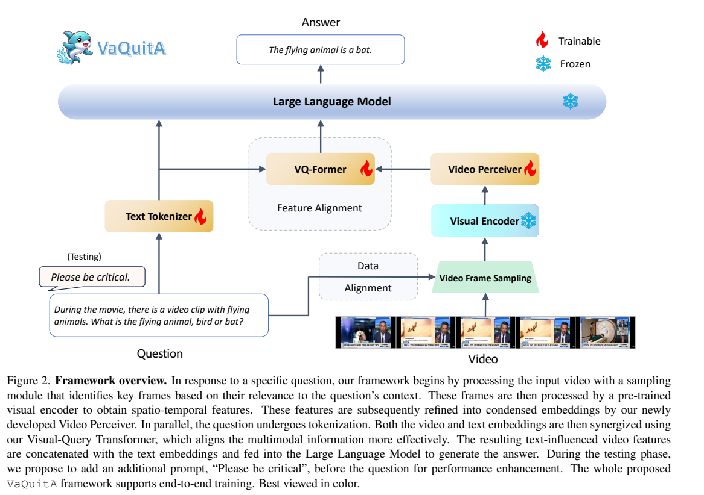
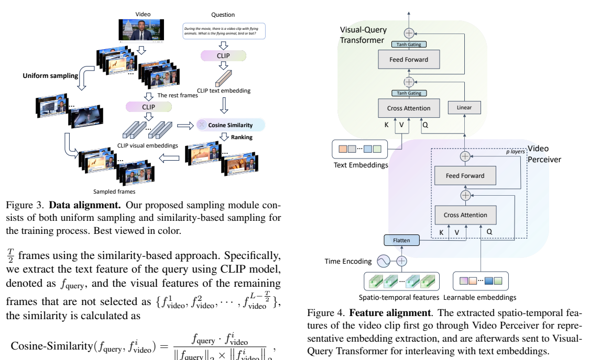
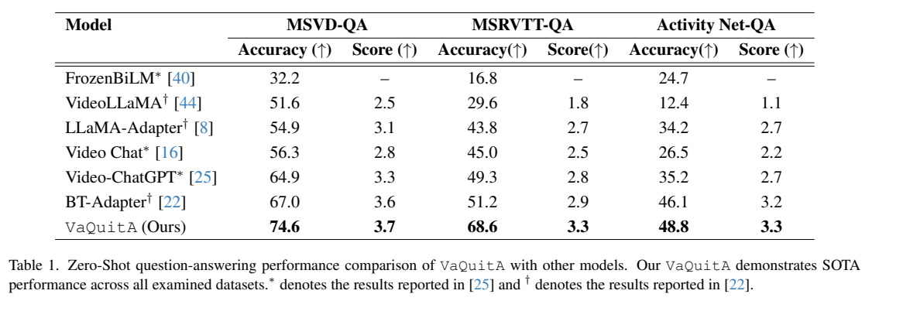
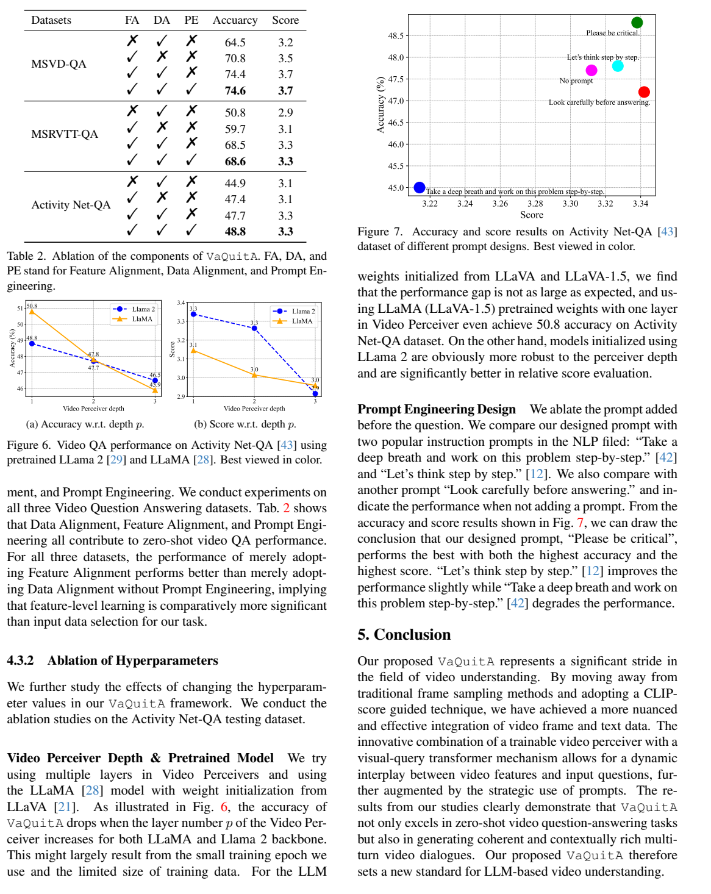

<!-- article-header:start -->
[项目首页](../../../README.md) › [模型系列](../../../reports/model-family-index.md) › [VaQuitA](../README.md)
<!-- article-header:end -->

# VaQuitA：在抽帧与特征融合两处对齐视频和问题

<!-- article-toc:start -->
<a id="article-toc"></a>

**本篇目录** · [论文定位](#paper-info) · [快速概览](#overview) · [整体架构](#architecture) · [核心原理](#principles) · [数据构建](#data) · [训练流程](#training) · [实验结果](#experiments)
<!-- article-toc:end -->

<a id="paper-info"></a>

## 1. 论文信息与模型定位

| 项目 | 信息 |
|---|---|
| 论文 | *VaQuitA: Enhancing Alignment in LLM-Assisted Video Understanding* |
| 作者与机构 | Yizhou Wang、Ruiyi Zhang、Haoliang Wang、Uttaran Bhattacharya、Yun Fu、Gang Wu；Northeastern University、Adobe Research |
| 来源版本 | [arXiv:2312.02310v1](https://arxiv.org/pdf/2312.02310v1)，2023 年 12 月 |
| 定位 | 冻结视觉与语言骨干，训练视频重采样及问题条件连接模块的视频问答模型 |

VaQuitA 针对“视频特征经过简单投影就交给语言模型”的方案，加入问题相关抽帧与特征交互。它处理完整视频上的问答和多轮对话，并非持续接收摄像头输入的流式系统。上游没有列出代码地址，不能用“没有代码链接”推断仓库 star 为零。

<a id="overview"></a>

## 2. 快速概览

三个组成是：训练时混合均匀抽帧与 CLIP 相关性抽帧；Video Perceiver 把大量视频 patch 压缩为固定数量的 latent；VQ-Former 利用问题文本调制压缩特征。推理另在问题前加 `Please be critical`。（正文第 3–6 页）

| 设置 | 论文配置 |
|---|---|
| 语言骨干 | 7B Llama 2，来自 LLaVA-1.5 权重 |
| 视频特征 | CLIP ViT-L/14 倒数第二层，维度 1024 |
| 输入与压缩 | 100 帧，每帧 256 patch → 356 个 latent |
| 训练数据 | VideoInstruct-100K |
| 测试抽帧 | 均匀抽帧；主要结果没有逐题在线检索关键帧 |

100×256=25,600 个 patch 被重采样到 356 个 latent，降低语言模型输入开销。但 CLIP 编码和重采样仍需要计算，原文未提供端到端速度或吞吐测量，压缩比不能直接当作加速倍数。

<a id="architecture"></a>

## 3. 整体架构



*原文 Figure 2，PDF 第 3 页。可训练模块连接冻结的 CLIP 与语言模型。*

Video Perceiver 给逐帧特征加时间编码，然后展平为 $`Tn\times d`$。随机初始化的 $`m\times d`$ latent 作为 query，视频特征与 latent 的组合提供 key/value，经交叉注意力、前馈和残差得到固定数量表示。主配置 $`m=356`$、depth=1。（第 4–6 页）

问题经可训练的 Text Tokenizer 组件形成 embedding，再与视频 latent 进入 VQ-Former。其输出投到语言维度 4096，和问题 embedding 一起送入冻结的语言模型。这里的“端到端训练”表示梯度能够通过连接模块学习回答，不等于更新所有骨干参数。（第 5 页）



*原文 Figure 3、4，PDF 第 4 页；同时保留相邻抽帧公式。*

以实验默认配置追踪一次推理：先**均匀采样 100 帧**，CLIP ViT-L/14 的倒数第二层为每帧输出 256 个、宽度 1024 的 patch 特征；加时间编码并展平后，单层 Video Perceiver 将这些位置压成 356 个 latent。VQ-Former 再让这些 latent 读取问题表示，形成语言宽度 4096 的问题相关视频表示，与原问题嵌入一起交给冻结的语言主干。采样阶段用于相似度检索的 768 维 CLIP 向量与这里的 1024 维 patch 表示用途不同。（§3.2、§4，PDF 第4–6页）

Figure 2 的问题相关选帧对应训练策略，默认测试为提高效率改用均匀采样；推理时的问题条件仍通过 VQ-Former 进入。实验原文把语言端写作“Llama 2 (7B)，以 LLaVA-1.5 权重初始化”，本文按该表述记录，不据此推断一个另行披露的纯文本检查点。（§3.1、§4，PDF 第4、6页）

| 模块 | 输入与输出 | 公开机制 |
|---|---|---|
| 训练选帧/测试采样 | 视频、问题 → 帧集合 | 训练半均匀半CLIP相似度；默认测试均匀100帧，不保留训练检索成本 |
| 冻结CLIP ViT-L/14 | 各帧 → 256×1024 patch特征 | 倒数第二层供视频编码；检索768维向量是另一用途 |
| Video Perceiver | 时间编码patch、学习latent → 356个latent | 单层，query来自latent、KV来自视频与latent拼接 |
| 可训练文字嵌入与VQ-Former | 视频latent、问题表示 → 问题相关视频表示 | 依式2–5视频作Q、文字作KV；tanh标量门控制残差增量 |
| 冻结语言主干 | 4096维视频表示、原问题 → 回答 | 原文称Llama2-7B且以LLaVA-1.5初始化；训练新接口而不更新骨干 |


<a id="principles"></a>

## 4. 核心创新与数学原理

### 4.1 覆盖与相关性在训练采样中共同保留

完全按相似度选帧可能忽略问题所需的过程背景，完全均匀又可能错过关键短片段，因此训练将两者混合。CLIP相似度是冻结模型给出的检索信号，并非下游回答损失优化出来的选帧策略。默认测试退回均匀采样，所以最终回答仍需靠VQ-Former形成问题相关表征。[原文 §3.1、Figure 3](https://arxiv.org/pdf/2312.02310v1#page=4)

数据对齐用问题的 CLIP 文本向量 $`f_q`$ 与候选帧向量 $`f_i`$ 的余弦相似度：

```math
s_i=\frac{f_q^\top f_i}{\Vert f_q\Vert _2\Vert f_i\Vert _2}.
```

先均匀选择 $`T/2`$ 帧，再从剩余帧选相似度最大的 $`T/2`$ 帧，以同时保留时间覆盖与问题相关内容。选帧并不是一个通过梯度优化的离散检索器；CLIP 本身冻结。（原文式 (1)，第 4 页）

### 4.2 先压缩视频再由视频位置读取问题

Perceiver用固定latent读取大量时空patch，建立可用语言预算；VQ-Former随后以视频latent查询问题文字，为每个视频位置补充当前问题条件。这个方向与“问题query从视频检索答案”不同，原文前段方向矛盾已在下文保留证据。固定latent不减少此前CLIP逐帧编码成本，也不保证所有瞬时动作被保留。[原文 §3.2.1–3.2.2、式 (2)–(5)](https://arxiv.org/pdf/2312.02310v1#page=5)

特征对齐的原文式 (2)–(5) 为：

```math
Q^{(h)}=\frac{MW_Q^{(h)}}{s_q},\quad K^{(h)}=XW_K^{(h)},\quad V^{(h)}=XW_V^{(h)},
\quad O_a^{(h)}=\mathrm{softmax}(Q^{(h)}K^{(h)\top})V^{(h)}W_O^{(h)}.
```

即视频 latent $`M`$ 提供 query，问题文本 $`X`$ 提供 key/value，视频各位置从问题读取信息。正文前一段把方向写反，但公式、Figure 4 及后文明确说明均支持这里的方向。每头维度 64、$`s_q=8`$，等价于将注意力缩放量设为 $`\sqrt{64}`$。

### 4.3 门控残差调节新条件的注入量

tanh把可学习标量映射到有界区间，再缩放交叉注意力和前馈增量；残差中的线性变换负责视频宽度到语言宽度的对齐。其目的在于稳定新接口的学习，而非离散选择是否看视频。语言与视觉骨干冻结，端到端表示损失仍能经固定骨干计算约束新模块，但多头合并维度须保持原文披露边界。[原文 §3.2.2–3.3、式 (7)–(10)](https://arxiv.org/pdf/2312.02310v1#page=5)

注意力和前馈输出由两个可学习标量的 tanh 门控后加入残差：$`M'=O_a\tanh(g_{attn})+MW_M`$，$`M''=\mathrm{FFN}(M')\tanh(g_{ff})+M'`$。原文式 (6) 写逐头输出拼接，同时为每头 $`W_O`$ 标注输出维度 $`d_{text}`$；按字面会与残差宽度不一致，完整多头合并投影的维度说明不足。这里保留其机制，不将该符号记法当作可直接运行的实现。（第 5 页）

<a id="data"></a>

## 5. 数据构建与处理

论文使用已有的约 10 万条视频指令数据 [VideoInstruct-100K](https://huggingface.co/datasets/MBZUAI/VideoInstruct-100K)，没有贡献另一套新的视频标注集。其创新性数据处理主要是问题条件的训练抽帧：同一视频遇到不同问题，可以选出不同的高相关帧。（第 6 页）

训练中 CLIP 最后一层 768 维的文本/帧向量用于相似度排名，倒数第二层 1024 维 patch 用于模型输入，二者不能混为同一种特征。均匀的一半与检索的一半不重复，后者从尚未选中的帧选取。（第 4、6 页）

正文明确因推理效率改用均匀抽帧，所以“训练时看关键帧”与“测试每次都检索关键帧”是不同设置。文中提及的额外测试检索示例没有包含在所核验 v1 PDF 中，不能据此补写整体检索推理收益或延迟。

<a id="training"></a>

## 6. 训练流程与目标

可训练参数为 Text Tokenizer、Video Perceiver 与 VQ-Former；视觉编码器、语言骨干、抽帧 CLIP 冻结。作者采用带平滑的负对数似然，让连接模块学习为冻结语言模型提供可用的视频与问题上下文。（第 5 页）

训练 3 个 epoch，学习率 2×10⁻⁵，总 batch 32，使用 8 张 A100 80GB。注意力采用 8 头、每头维度 64，Video Perceiver 为一层。作者报告推理单卡约 15GB 显存即可，但没有给出该陈述对应的完整延迟条件。（第 6 页）

原文未披露 label smoothing 系数、完整优化器调度或额外对齐预训练配方，因此这里不从相近模型推测。`Please be critical` 在测试阶段加入，没有引入新训练损失，也不是自我反思循环或多轮答案修订算法。

<a id="experiments"></a>

## 7. 实验设置与主要结果



*原文 Table 1，PDF 第 6 页。基线数值分别引用既有论文，非全部在本文统一重新训练。*

| 数据集 | VaQuitA Accuracy / Score | BT-Adapter Accuracy / Score |
|---|---|---|
| MSVD-QA | 74.6 / 3.7 | 67.0 / 3.6 |
| MSRVTT-QA | 68.6 / 3.3 | 51.2 / 2.9 |
| ActivityNet-QA | 48.8 / 3.3 | 46.1 / 3.2 |

答案由 Azure GPT-3.5-turbo 的 March 版本评审，给出正确判断与 1–5 分质量分。Accuracy 因此是该教师评估协议下的比例，不是固定精确字符串匹配。零样本表示没有用相应 QA 基准任务标签微调，模型仍经过视频指令训练，也继承视觉语言预训练。（第 6 页）



*PDF 第 8 页的 Table 2 与 Figure 6、7，保留原文解释以便对照。*

MSRVTT-QA 仅特征对齐时为 59.7，加入训练抽帧达到 68.5，再加提示达到 68.6；ActivityNet-QA 对应 47.4、47.7、48.8。提示收益因数据集而异，MSVD-QA 仅提高 0.2 个百分点，不能描述为普遍大幅提升。

在该训练规模下，增加 Perceiver 深度降低了准确率；Figure 6 的另一初始化分支也出现 50.8 的单层结果，不能把主表 48.8 描述为所有消融配置中的最大值。多轮能力由 Figure 5 的两个案例展示，没有大样本多轮指标。证据支持对齐模块的价值，但尚不足以证明普遍的长视频、在线速度或交互可靠性。

所有配图来自上述原论文；[来源清单](figures-manifest.json)。未在本仓库重新训练复现。

<!-- article-footer:start -->
---

[← 上一篇：TimeChat](../../timechat/arxiv-2312.02051/README.md) · [按发表时间浏览](../../../reports/paper-reading-guide.md#year-2023) · [下一篇：Gemini 初代 →](../../gemini/document-044099a491e0/README.md)

[返回本篇目录](#article-toc) · [返回模型系列](../README.md)
<!-- article-footer:end -->
