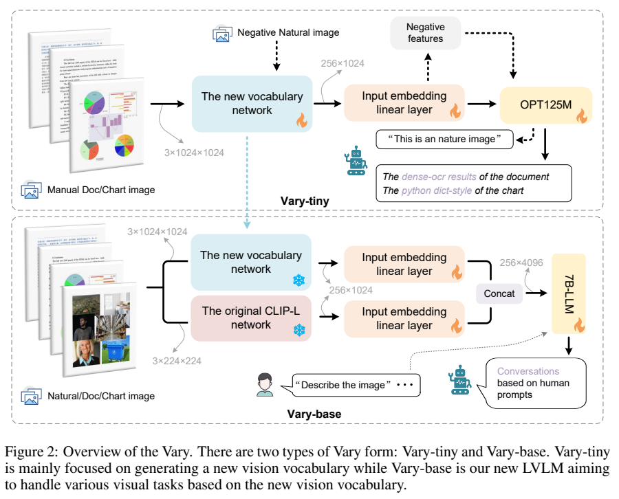
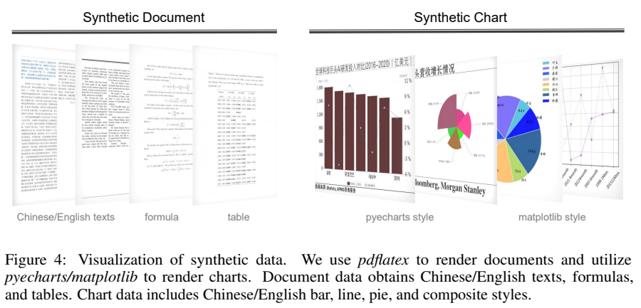
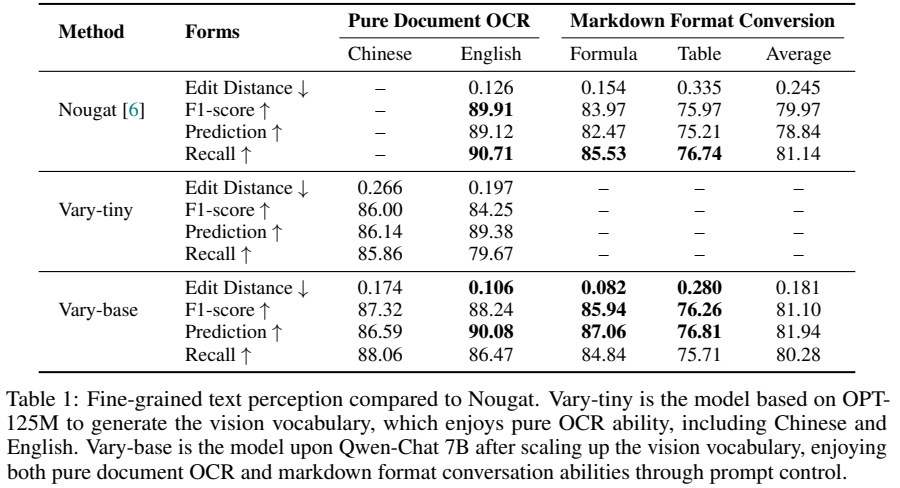
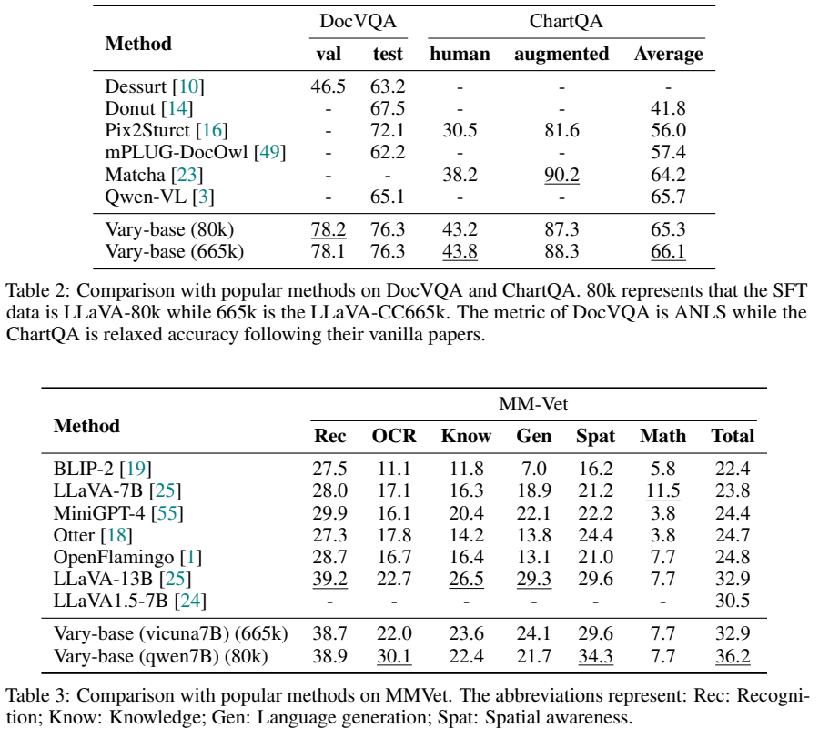
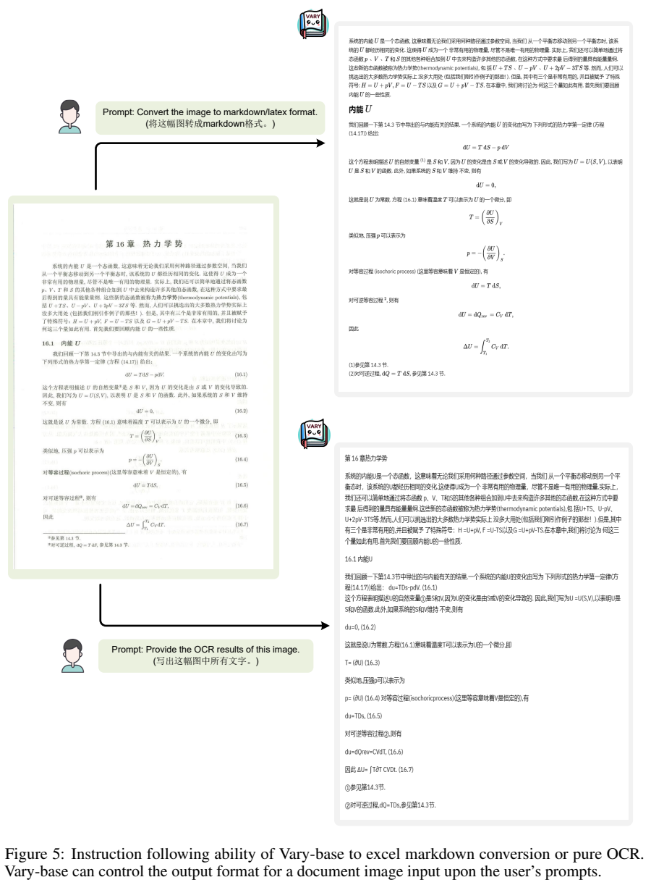

<!-- article-header:start -->
[项目首页](../../../README.md) › [模型系列](../../../reports/model-family-index.md) › [Vary](../README.md)
<!-- article-header:end -->

# Vary：增加细粒度视觉编码分支，改善文档与图表理解

<!-- article-toc:start -->
<a id="article-toc"></a>

**本篇目录** · [论文定位](#paper-info) · [快速概览](#overview) · [整体架构](#architecture) · [核心原理](#principles) · [数据构建](#data) · [训练流程](#training) · [实验结果](#experiments)
<!-- article-toc:end -->

<a id="paper-info"></a>

## 1. 论文信息与模型定位

| 项目 | 内容 |
|---|---|
| 论文 | Vary: Scaling up the Vision Vocabulary for Large Vision-Language Models |
| 作者与机构 | Haoran Wei、Lingyu Kong 等；旷视、国科大、华中科技大学 |
| 本文依据 | [arXiv v1，2023-12-11](https://arxiv.org/pdf/2312.06109v1)，15 页 |
| 官方项目 | [主页](https://varybase.github.io/) · [代码](https://github.com/Ucas-HaoranWei/Vary) |
| 模型定位 | 面向中文/英文密集 OCR、Markdown 转换、文档及图表问答的视觉语言模型 |
| 主要版本 | Vary-tiny：训练新视觉编码器；Vary-base：融合 CLIP 分支并接入 Qwen/Vicuna-7B |

论文把视觉编码器输出的特征比作“视觉词表”：CLIP 擅长常见自然图像，但对密集文字、公式和中文图表可能压缩不足。Vary 增加一个专门训练的高分辨率分支。这里的词表是连续视觉表示的比喻，论文没有构建离散 VQ 码本，也没有通过这一方法直接扩充文本 tokenizer。（§1–3）

<a id="overview"></a>

## 2. 快速概览

| 设计 | 作用 |
|---|---|
| 小语言模型先训练视觉分支 | 使用 OPT-125M 学习 OCR 与图表还原，生成可迁移视觉特征 |
| 新分支输入 1024×1024 | 由 SAM 初始化图像编码器，经过两层卷积压缩到 256 token |
| 保留 CLIP-L 分支 | 原自然图像表示与新文档表示共同输入 7B 语言模型 |
| 通道融合 | 两分支各投影为 256×2048，通道拼接为 256×4096 |
| 自回归监督 | 从图像生成 OCR、图表字典、Markdown 和问答文本 |

Vary-base 在 Table 2 的 DocVQA 验证集为 78.2 ANLS、测试集为 76.3；Qwen-7B、80K 指令数据版本在 MMVet 为 36.2。不同实验涉及不同 LLM 和指令集，不能把所有最优值都归给一个没有版本区别的模型。（第 7–8 页）

<a id="architecture"></a>

## 3. 整体架构



*来源：v1 Figure 2，PDF 第 4 页。火焰表示训练、雪花表示冻结；Vary-base 冻结两个视觉编码器，更新投影与 LLM。*

Vary-tiny 使用 SAM-base 预训练图像编码器初始化，1024×1024 图像输出 64×64×256 特征。两层卷积依次变成 32×32×512 和 16×16×1024，再展开成 256×1024；线性层对齐 OPT-125M。该阶段没有用于对话的文本输入分支，主要生成图像对应文本。（§3.1–3.2）

Vary-base 对同一图像分别准备 1024×1024 的新分支输入和 224×224 的 CLIP-L 输入。两个编码器各输出 256×1024，独立线性层映射到 2048 维后沿通道拼接，得到 256×4096 的 LLM 输入。序列仍是 256 个视觉 token，并没有因为两分支而变成 512 个 token。LLM 可以选 Qwen-7B 或 Vicuna-7B，中文主要使用前者。（§3.3）

<a id="principles"></a>

## 4. 核心创新与数学原理

**在连续表示上增加视觉容量。** 融合可用以下维度明确的解释式表示：

```math
H=\mathrm{Concat}_{\rm channel}\big(F_{\rm CLIP}W_c+b_c,
F_{\rm new}W_n+b_n\big),\quad H\in\mathbb R^{256\times4096}.
```

每个 $`F`$ 是 256×1024，两个投影各输出 2048 维。其目标是兼顾自然图像语义与细粒度文字信息，而不是要求语言模型把两份不同长度的视觉序列自行对齐。（第 5 页）

**用生成目标学习密集内容。** 新分支通过预测 OCR 全文和图表结构，学习把较长、较密的内容压进固定 token 数。可概括为：

```math
\mathcal L_{\rm AR}=-\sum_t\log p_\theta(y_t\mid y_{<t},H).
```

这是对原文自回归训练的数学说明，论文没有额外定义一种“词表扩展损失”。文档里的文字或图表数据作为监督目标；图表字典与 Markdown 让监督包含数字、结构和公式。（§3.2–3.3）

**自然图像“负例”不是对比学习负例。** Vary-tiny 对自然图片学习生成“这是自然图像”等通用句子，让新分支在该类图像上不过度输出密集 OCR 内容；文中称其为 negative samples，但不是 CLIP 式图文对比负样本。实际减少多少融合干扰没有单独的因果消融。（§3.2.2）

<a id="data"></a>

## 5. 数据构建与处理



*来源：v1 Figure 4，PDF 第 6 页。渲染时即可获得文字和结构参考答案。*

新分支训练使用约 1M 中文、1M 英文文档页面：英文来自开放论文与网页 PDF，中文来自网络电子书；提取 PDF 文字，并将同页渲染成图片。图表由 matplotlib、pyecharts 渲染，标注为 Python 字典。原文分别写 250K 与 500K 中英文图表，但“both”口径不能清晰确定是否按语言分别计数，本文不强行翻倍为精确总量。自然图像约 120K COCO 图片配通用描述。（第 5 页）

Vary-base 补充带公式、表格格式的合成文档：从 arXiv TeX 源抽取内容，采用十余种模板重渲染，生成约 0.5M 英文、0.4M 中文页面，输出统一为 Mathpix Markdown 风格。为避免随机图表标题、坐标内容缺少语义关联，再用 GPT-4 生成相关语料，渲染额外 200K 图表。（第 6 页）

一般预训练数据另取约 4M LAION-COCO 图文；SFT 使用 LLaVA-80K 或 LLaVA-CC665K，及 DocVQA、ChartQA 训练划分。这里的问答成绩包含对应任务训练，不能称为未见过该任务的零样本能力。各阶段数据有不同用途和可能重叠，不简单相加为独立样本总量。（§3.3.2）

<a id="training"></a>

## 6. 训练流程与目标

| 阶段 | 更新与冻结 | 配置 |
|---|---|---|
| Vary-tiny | 更新视觉编码器、卷积、投影和 OPT 全部参数 | batch 512，3 epochs，学习率 $`5\times10^{-5}`$ |
| Vary-base 预训练 | 冻结新分支与 CLIP；更新两投影和 7B LLM | batch 256，1 epoch，学习率 $`5\times10^{-5}`$ |
| Vary-base SFT | 继续冻结视觉编码器，学习指令与问答输出 | batch 256，1 epoch，学习率 $`10^{-5}`$ |

优化器 AdamW、余弦退火；Vary-tiny 把 OPT 上下文插值到 4096 token。图像 token 用 ``、`</img>` 标记；Vicuna 与 Qwen 采用相应的对话格式。（§3.2.3、3.3.3、4.2）

SAM 在第一阶段只是初始化，随后参与更新，不能把新分支当作原封不动的 SAM 分割服务。Vary-base 的冻结策略避免继续改写两个视觉编码器，但仍全量训练 LLM。报告没有设备数量、完整资源耗时或同等数据下的端到端测速，不能据“小 OPT”推导固定训练加速倍数。（§3–4）

<a id="experiments"></a>

## 7. 实验设置与主要结果



*来源：v1 Table 1，PDF 第 7 页。Edit Distance 越低越好；Average 仅为公式与表格两项平均。表中 Prediction 实际对应正文所述 precision 指标。*

自建纯 OCR 测试包含中英文各 100 页，格式转换包含 100 页公式与 100 页表格。Vary-base 的中文/英文编辑距离为 0.174/0.106，优于 tiny 的 0.266/0.197；英文编辑距离低于 Nougat 0.126，但 F1 88.24 低于 Nougat 89.91，不能说所有 OCR 指标均更好。公式与表格平均编辑距离 0.181、F1 81.10，分别优于 Nougat 0.245、79.97。（§4.1、Table 1）



*来源：v1 Tables 2–3，PDF 第 8 页。DocVQA 使用 ANLS，ChartQA 使用 relaxed accuracy；MMVet 是基准综合分。*

Table 2 的 80K 版本 DocVQA 为 **val 78.2、test 76.3**；正文同页把 val/test 颠倒，本文按表头记录。665K 版本为 val 78.1、test 76.3，没有显著提升。ChartQA 的人工题/增强题为 43.8/88.3、平均 66.1：略高于 Qwen-VL 65.7，但人工题与增强题差距明显；Matcha 的增强题 90.2 仍更高。

MMVet 中 Vicuna-7B、665K 版本为 32.9，高于同系列 LLaVA-1.5-7B 的 30.5；Qwen-7B、80K 版本为 36.2。但后者知识 22.4、生成 21.7 低于前者 23.6、24.1，数学同为 7.7。不能从总分提升推导每类能力都无损，也不能把骨干与指令数据同时改变的比较完全归因于新视觉分支。（Table 3）



*来源：v1 Figure 5，PDF 第 9 页。OCR 与 Markdown 案例显示格式控制，不能替代完整页面级结构恢复评测。*

报告未单独分离高分辨率、额外文档数据、视觉初始化与融合结构的贡献；泛化到扫描噪声、复杂排版和任意图表的程度也未全面量化。应把结果理解为这套数据与双分支训练组合对已评测任务的改善。（§4、附录）

**来源说明：** 本文固定依据 v1，未复现训练；原图出处和裁切坐标见 [图片清单](figures-manifest.json)。

<!-- article-footer:start -->
---

[← 上一篇：Honeybee](../../honeybee/arxiv-2312.06742/README.md) · [按发表时间浏览](../../../reports/paper-reading-guide.md#year-2023) · [下一篇：SESAME →](../../see-say-and-segment-teaching-lmms-to-overcome-false-premises/arxiv-2312.08366/README.md)

[返回本篇目录](#article-toc) · [返回模型系列](../README.md)
<!-- article-footer:end -->
