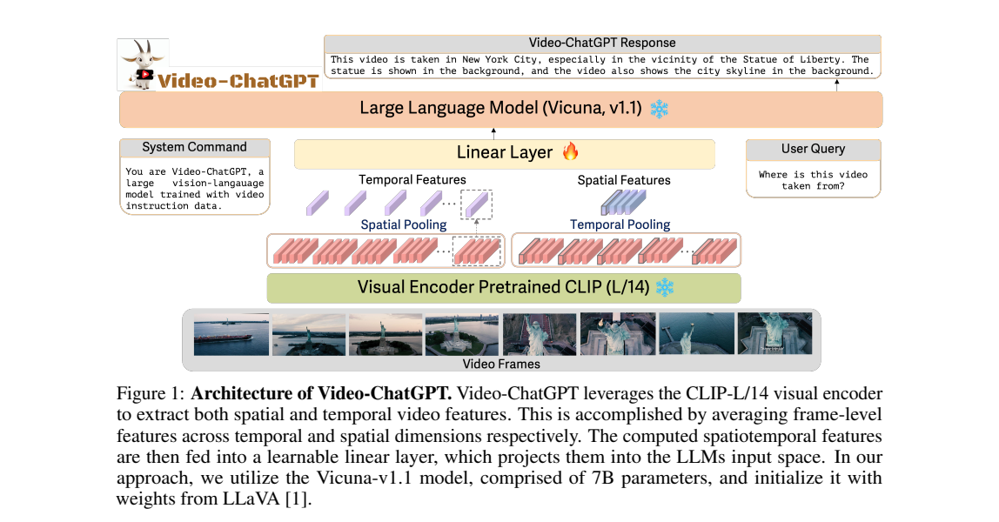
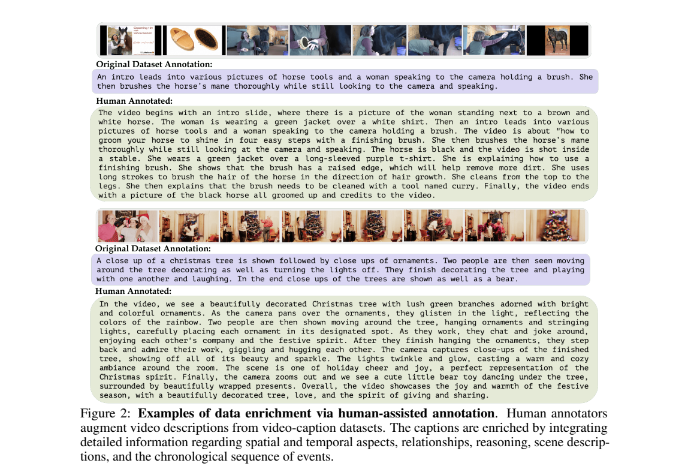
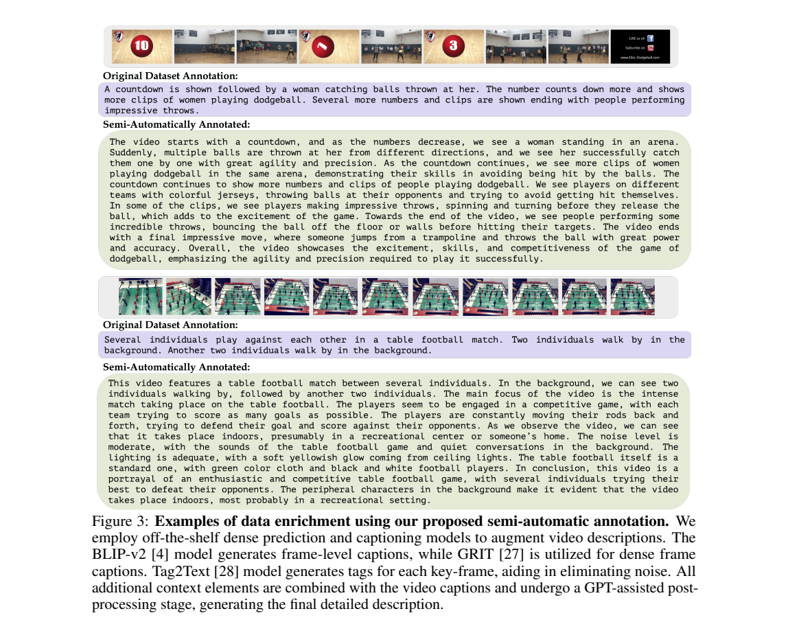
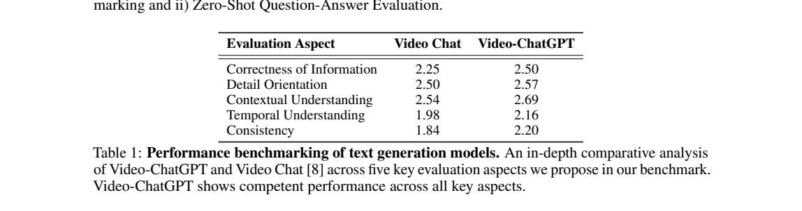
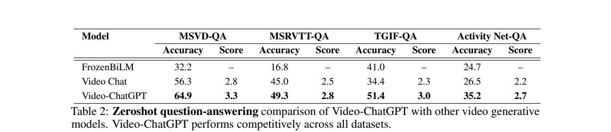

<!-- article-header:start -->
[项目首页](../../../README.md) › [模型系列](../../../reports/model-family-index.md) › [Video-ChatGPT](../README.md)
<!-- article-header:end -->

# Video-ChatGPT：时空池化、视频指令数据与对话评价

<!-- article-toc:start -->
<a id="article-toc"></a>

**本篇目录** · [论文定位](#paper-info) · [快速概览](#overview) · [整体架构](#architecture) · [核心原理](#principles) · [数据构建](#data) · [训练流程](#training) · [实验结果](#experiments)
<!-- article-toc:end -->

<a id="paper-info"></a>

## 1. 论文信息与模型定位

| 项目 | 信息 |
|---|---|
| 论文 | Video-ChatGPT: Towards Detailed Video Understanding via Large Vision and Language Models |
| 作者 | Muhammad Maaz、Hanoona Rasheed、Salman Khan、Fahad Shahbaz Khan |
| 团队 | Mohamed bin Zayed University of Artificial Intelligence（MBZUAI） |
| 阅读版本 | [arXiv 2306.05424v1](https://arxiv.org/pdf/2306.05424v1)，2023 年 6 月 |
| 官方仓库 | [mbzuai-oryx/Video-ChatGPT](https://github.com/mbzuai-oryx/Video-ChatGPT) |
| 模型定位 | 在图像指令模型基础上，用轻量投影和视频指令监督实现视频文字对话 |

Video-ChatGPT 接收视频和问题，输出描述或回答。其名字包含 ChatGPT，但模型使用 CLIP 和 Vicuna-7B；GPT-3.5 用于数据整理及评价。它与 OpenGVLab 的 VideoChat 是不同工作，论文还以 VideoChat 作为比较对象。（原文第 1、3、6–8 页）

<a id="overview"></a>

## 2. 快速概览

核心方案是逐帧编码后沿时间、空间两个方向分别平均池化，得到紧凑的视频 token，再通过线性层接入冻结的语言模型。模型复用 LLaVA 初始化，使用 100K 视频指令对训练，并提出五方面的生成式对话评价。

| 组成 | 设置或作用 |
|---|---|
| 视觉编码器 | CLIP ViT-L/14，逐帧提取 patch 特征 |
| 语言模型 | Vicuna-v1.1 7B，以 LLaVA 权重初始化 |
| 视频压缩 | 原始 $`TN`$ 个 patch token 变为 $`T+N`$ 个汇总 token |
| 可训练参数 | 视觉到语言的线性投影层 |
| 数据构建 | 人工丰富描述与半自动丰富描述，再生成问答 |
| 评价 | GPT-3.5 判断答案正确性并对生成质量打分 |

优点在于结构及训练成本较低；代价是池化会抹去一部分局部运动和位置随时间变化的细节。报告明确指出细微时间关系及小物体理解仍困难。（第 8 页）

<a id="architecture"></a>

## 3. 整体架构



*原文 Figure 1，PDF 第 3 页（正文页码 iii）。视觉及语言骨干冻结，线性层可训练。*

视频帧先作为一批图像输入 CLIP，得到每帧的二维 patch 网格。模型保留两种汇总：对同一 patch 位置跨帧平均，保留总体空间布局；对同一帧内 patch 平均，保留每帧的全局语义。两者串接后，经共享线性层转成 Vicuna 输入维度，与问题 token 一起生成回答。（第 3–4 页）

图中“Temporal Features”来自空间池化，“Spatial Features”来自时间池化。正文也按池化维度为变量命名，容易混淆；阅读时应以张量形状理解：$`N`$ 个 token 保留空间位置，$`T`$ 个 token 保留帧索引。系统没有额外音频编码器或视频生成解码器。

<a id="principles"></a>

## 4. 核心创新与数学原理

**用分解池化压缩视频。** 将逐帧特征记为 $`X\in\mathbb R^{T\times N\times D}`$。原文式（1）中的两组表示可展开为：

```math
t_n=\frac1T\sum_{i=1}^{T}X_{i,n,:},\qquad
z_i=\frac1N\sum_{n=1}^{N}X_{i,n,:},\qquad
v=[t;z]\in\mathbb R^{(N+T)\times D}.
```

再按式（2）映射到语言维度 $`K`$：

```math
Q_v=g(v)\in\mathbb R^{(N+T)\times K}.
```

该方法减少长序列输入，且无需训练新的大视频骨干。但跨时间平均本身对帧置换不敏感；保留时间理解主要依赖按帧排列的 $`z_i`$ 分支及已有语言模型。不能把“temporal pooling”直接等同于完整建模每个物体的运动轨迹。（第 3–4 页）

**用视频指令监督接口。** 数据给出问题及答案，训练只调整投影，让视频表示适应已有图像指令语言模型。模型容量的大部分来源于冻结骨干，数据的内容、正确性及覆盖面因此尤为关键。

**将开放式评价拆成五方面。** 论文用信息正确性、细节、上下文、时间理解和一致性描述生成质量，并以参考描述/问答辅助 GPT-3.5 评分。这提高了评价的可操作性，但分数仍依赖评审模型及提示，不是直接测量所有视频事实的人工正确率。（第 7 页）

<a id="data"></a>

## 5. 数据构建与处理



*原文 Figure 2，第 5 页。人工补充外观、关系、位置及事件顺序，让短 caption 变成更具体的训练材料。*

人工路线以 ActivityNet-200 的部分视频及已有简短描述为基础，标注员观看内容并添加空间、时间和上下文信息。论文没有分别公布人工与半自动路线的最终问答数量，因此不能把全部 100K 指令都写成人工标注。



*原文 Figure 3，第 6 页。示例将原始 caption 与逐帧感知结果合并，形成丰富的视频描述。*

半自动路线用 Katna 提取关键帧，BLIP-2 生成帧描述，GRiT 生成区域描述，Tag2Text 生成标签。首先设置较高预测阈值；随后将 caption 中落在 Tag2Text 词表的词与该帧标签对照，过滤不匹配的描述；最后由 GPT-3.5 合并帧信息、去除跨帧冲突并丰富原始视频 caption。（第 5–7 页）

GPT-3.5 再依据丰富描述生成详细描述、摘要、问答、创意任务及对话，汇成 100,000 个视频指令对。教师读取感知结果和文字标注，报告未说明其直接看视频。标签过滤有助于减少噪声，但标签模型漏检可能误删正确细节，文字整理也不能保证所有生成问题都有可靠视觉依据。

<a id="training"></a>

## 6. 训练流程与目标

训练以 LLaVA 初始化，在 100K 视频指令对上微调三轮，只更新视频特征到语言空间的线性层。CLIP 与 Vicuna 均保持冻结。虽然引言使用了较宽泛的“fine-tune model”表述，方法及实现小节明确给出这一范围。（第 4、7 页）

| 设置 | 原文值 |
|---|---|
| 学习率 | $`2\times10^{-5}`$ |
| 总批量 | 32 |
| Epoch | 3 |
| 训练资源 | 8 张 A100 40GB，7B 模型约 3 小时 |
| 推理精度 | FP16 |
| Tag2Text 标注配置 | Swin-B，384×384，置信阈值 0.7 |
| GRiT 标注配置 | ViT-B 与 CenterNet2 |

目标为最大化回答 token 的自回归似然，可写为：

```math
\mathcal L=-\sum_{k\in\mathcal A}\log p_\theta(y_k\mid Q_v,Q_t,y_{\lt k}).
```

这里 $`\theta`$ 是可训练投影参数，$`\mathcal A`$ 是答案位置。这是对原文训练描述的展开，模型没有提出独立的池化损失、对比学习目标或 RLHF 阶段。正文也未完整列出抽帧数等全部配置，不能自行补成统一的复现方案。

<a id="experiments"></a>

## 7. 实验设置与主要结果



*原文 Table 1，第 7 页。GPT-3.5 按 1–5 分评价 ActivityNet-200 构建的测试材料。*

Video-ChatGPT 的正确性、细节、上下文、时间理解及一致性分别为 2.50、2.57、2.69、2.16、2.20；比较对象 VideoChat 分别为 2.25、2.50、2.54、1.98、1.84。五项均有改善，但绝对得分仍有限，不能称作已经解决视频事实与时序理解。



*原文 Table 2，第 8 页。Accuracy 与 1–5 分 Score 均来自 GPT 辅助评价，缺失项用横线表示。*

| 数据集 | VideoChat Accuracy | Video-ChatGPT Accuracy | Video-ChatGPT Score |
|---|---:|---:|---:|
| MSVD-QA | 56.3 | 64.9 | 3.3 |
| MSRVTT-QA | 45.0 | 49.3 | 2.8 |
| TGIF-QA FrameQA | 34.4 | 51.4 | 3.0 |
| ActivityNet-QA | 26.5 | 35.2 | 2.7 |

“零样本”指不在这些测试任务上专门微调，而模型已接受视频指令监督，不能解释成完全没有视频训练。本文固定使用 v1 表格，且这些结果对应当时的评审流程和比较对象。原文另展示推理、创意、动作和空间问答案例，但缺少严格的数据路线/池化模块消融，不能从总体提升单独归因某个模块。

配图直接截取上述原始 PDF，出处及裁剪范围见 [配图清单](figures-manifest.json)。

<!-- article-footer:start -->
---

[← 上一篇：MIMIC-IT](../../otter-398569/arxiv-2306.05425/README.md) · [按发表时间浏览](../../../reports/paper-reading-guide.md#year-2023) · [下一篇：LAMM →](../../lamm/arxiv-2306.06687/README.md)

[返回本篇目录](#article-toc) · [返回模型系列](../README.md)
<!-- article-footer:end -->
