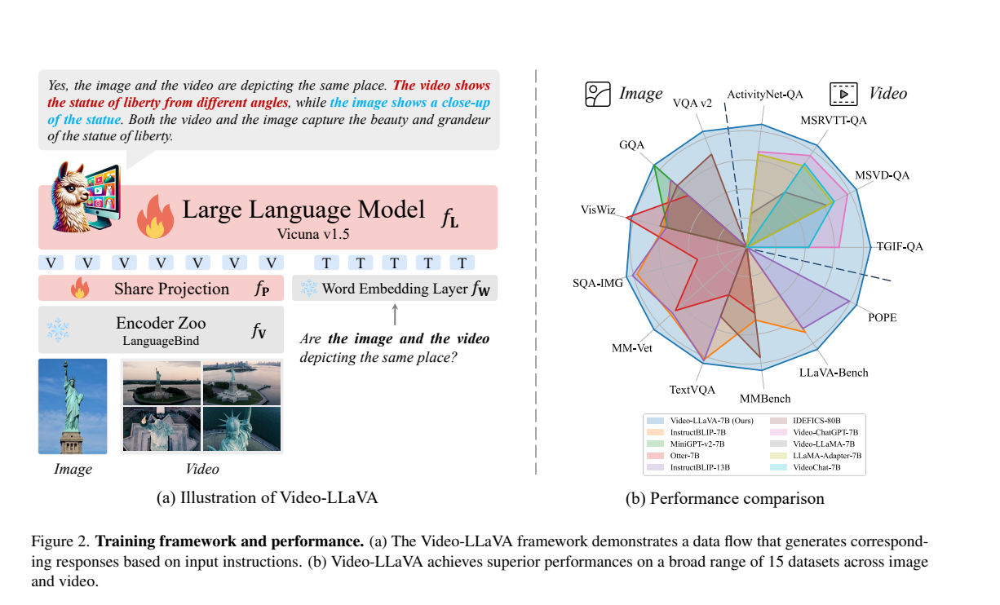
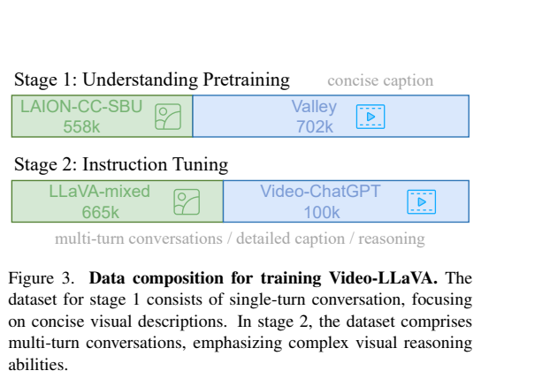
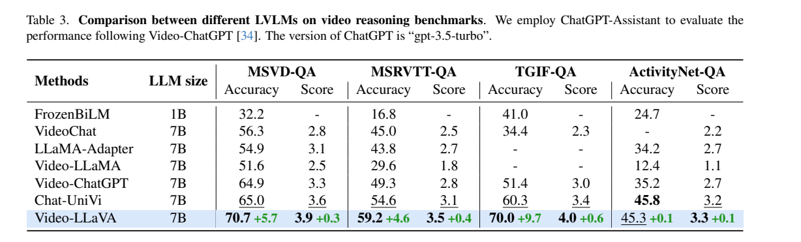
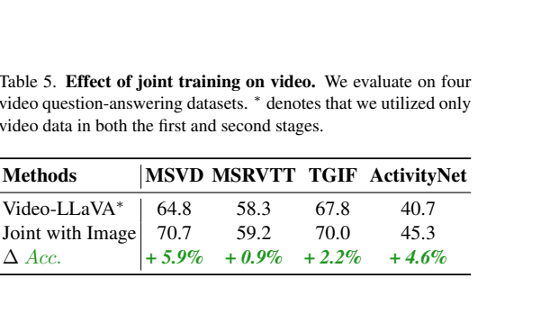

# Video-LLaVA：先对齐视觉表示，再联合学习图像与视频

## 1. 论文信息与模型定位

| 项目 | 信息 |
|---|---|
| 论文 | Video-LLaVA: Learning United Visual Representation by Alignment Before Projection |
| 作者 | Bin Lin、Yang Ye、Bin Zhu、Munang Nin、Peng Jin、Li Yuan |
| 团队 | 北京大学、鹏城实验室、中山大学等 |
| 阅读版本 | [arXiv 2311.10122v1](https://arxiv.org/pdf/2311.10122v1)，2023 年 11 月 |
| 官方仓库 | [PKU-YuanGroup/Video-LLaVA](https://github.com/PKU-YuanGroup/Video-LLaVA) |
| 定位 | 使用共享视觉接口的 7B 图像与视频理解模型 |

Video-LLaVA 关注一个接口问题：如果图像和视频编码器输出的特征空间差异很大，后面的浅层投影及语言模型还要额外学习两种表示之间的关系。它采用已通过 LanguageBind 对齐的编码器，再共同训练图像和视频样本，使语言模型更容易利用两种视觉信息。（第 1–4 页）

## 2. 快速概览

模型用 LanguageBind 图像、视频编码器提取表示，经过两层共享投影进入 Vicuna-7B v1.5。每个批次同时包含图像和视频样本；先学习描述，再学习复杂问答。单图、视频和图像视频混合输入均可输出文字。

| 关键选择 | 具体作用 |
|---|---|
| 投影前对齐 | 复用映射到共同文本相关空间的 LanguageBind 表示 |
| 共享投影 | 两层全连接层统一处理视觉输出 |
| 联合训练 | 同一批次混合图像及视频，使两种监督相互补充 |
| 视觉输入 | 224×224；视频均匀抽取 8 帧 |
| 两阶段数据 | 描述对齐约 1.26M 对，指令阶段约 765K 条 |

“统一表示”指特征空间及后续接口统一，不等于图像和视频必须共用完全相同的编码器权重，也不等于增加了音频理解或图像生成能力。

## 3. 整体架构

*原文 Figure 2，第 3 页。左侧展示输入流和可训练模块，右侧为原论文性能概览。*

图像与视频分别由 LanguageBind 的对应编码器处理，编码器初始化基于 ViT-L/14，其预先训练的表示已利用文本空间完成跨模态绑定。两层共享投影把视觉 token 转成语言模型可读取的嵌入；问题经过 LLaMA 系列 tokenizer 和词嵌入层，与视觉 token 一同进入 Vicuna-7B v1.5。（第 3–4 页）

该设计复用了 LanguageBind 的预对齐能力，Video-LLaVA 自身训练时冻结视觉编码器。第一阶段训练投影，第二阶段投影与语言模型参与训练。与先把视频检索为相似图像表示再交给语言模型的间接方案相比，这里语言模型直接接受真实视频编码结果。（第 2–4 页）

## 4. 核心创新与数学原理

**把两类视觉信号接到共同接口。** 原文式（1）写为：

$$
Z_T=f_T(X_T),\qquad Z_V=f_P(f_V(X_V)).
$$

$f_V$ 根据输入调用图像或视频编码器，$f_P$ 是共享投影，$f_T$ 是文本嵌入。关键在于 $f_V$ 的输出事先已对齐，而不是要求 $f_P$ 从任意两个不相干的特征空间同时学起。本文没有引入新的特征距离损失；预对齐来自所复用的 LanguageBind。（第 3–4 页）

**用同一生成目标学习描述和指令。** 论文式（2）使用条件生成的乘积形式。按标准自回归含义展开，可表示为：

$$
p_\theta(Y\mid Z_V,Z_T)=\prod_{i=1}^{|Y|}p_\theta(y_i\mid Z_V,Z_T,y_{<i}),\qquad
\mathcal L=-\sum_i\log p_\theta(y_i\mid Z_V,Z_T,y_{<i}).
$$

以上写法用于说明回答生成中视觉条件、问题和已生成答案的关系。多轮指令进一步加入前面的问题与回答；原文式（3）是对会话串接的描述，文字明确说包含所有此前轮次。（第 4 页）

**图像与视频监督互补。** 图像指令提供物体、文字及复杂空间问答，视频提供跨帧动作和时间上下文。Table 5 通过视频单独训练和联合图像训练进行比较，支持该组合在所测视频任务中的收益；这仍是该数据与训练设置下的实验证据，不意味着任意图像视频配比都必然有效。

## 5. 数据构建与处理

*原文 Figure 3，第 4 页。两个阶段都含图像与视频数据，指令阶段强调多轮对话、详细描述及推理。*

| 阶段 | 图像数据 | 视频数据 | 已公开数量合计 |
|---|---|---|---:|
| 理解预训练 | 558K LAION-CC-SBU/CC3M 子集，使用 BLIP 描述并沿用 LLaVA 过滤 | Valley 提供的 WebVid 子集，可获得 702K 对 | 1,260K 对 |
| 指令微调 | LLaVA v1.5 mixed，665K | Video-ChatGPT，100K | 765K 条 |

Valley 原数据约 703K，作者实际取得 702K，本文按使用量记录。报告主要复用已有公开数据，不应将它描述为重新人工标注全部 765K 指令。第二阶段正文有“three sources”表述，但对应小节明确列出上述两类数据集，本文不自行添加第三个来源。（第 4 页）

图像经过缩放和裁剪到 224×224；视频均匀抽取 8 帧，逐帧使用图像预处理。同一批次随机组合图像和视频样本，报告没有完整公布两者采样权重。保持相同输入规格有助于共享接口，但低分辨率和稀疏抽帧仍可能遗漏小字及短暂事件。

## 6. 训练流程与目标

第一阶段使用简短描述监督，让共享投影把预对齐的视觉特征接入语言模型；其他模块冻结。第二阶段使用多轮对话、详细描述和推理指令，语言模型也参与训练，视觉编码器保持冻结。两阶段使用相同的自回归生成目标。（第 4 页及 Figure 2）

| 设置 | 理解预训练 | 指令微调 |
|---|---|---|
| 可训练模块 | 共享投影 | 共享投影及 LLM |
| Batch size | 256 | 128 |
| 优化器/调度 | AdamW、余弦学习率 | 沿用两阶段训练说明 |
| 初始学习率 | 正文写 $10^{-3}$ | 正文同样写 $10^{-3}$ |
| Warmup ratio | 0.03 | 0.03 |

正文明确第一阶段训练一个 epoch，并整体强调一次遍历的训练效率；v1 没有提供所声称的进一步超参数附录，第二阶段 epoch 也未在实现段单独列值。本文保留正文原始学习率，而没有用其他 LLaVA 版本的配置替换。训练 FLOPs、完整算力和耗时未充分披露，不能仅凭样本规模推算成作者报告成本。

## 7. 实验设置与主要结果

图像实验包括 VQAv2、GQA、VizWiz、ScienceQA-IMG、TextVQA、POPE、MMBench、LLaVA-Bench 和 MM-Vet。Table 2 的部分 VQAv2/GQA 结果标注存在训练重叠，不能统一称为严格零样本。Video-LLaVA 的 MMBench 为 60.9，MM-Vet 为 32.0；POPE 84.4 和 VizWiz 48.1 并非表内最高值，因此不照搬“8/9 最优”的概述。（第 5 页）

*原文 Table 3，第 6 页。视频答案用 gpt-3.5-turbo 辅助判断，Accuracy 与 1–5 分 Score 分开报告。*

| 数据集 | Video-ChatGPT Accuracy | Video-LLaVA Accuracy | 按表计算提升 |
|---|---:|---:|---:|
| MSVD-QA | 64.9 | 70.7 | +5.8 个百分点 |
| MSRVTT-QA | 49.3 | 59.2 | +9.9 个百分点 |
| TGIF-QA | 51.4 | 70.0 | +18.6 个百分点 |
| ActivityNet-QA | 35.2 | 45.3 | +10.1 个百分点 |

摘要及部分正文将 MSVD/MSRVTT 的提升次序写反，本文按表中原始数值配对。Table 3 中的绿色增量使用另一比较对象；其中 ActivityNet 的“+0.1”也与 Chat-UniVi 的 45.8 不一致，45.3 实际低 0.5 个百分点。不能据此声称所有视频基准均超过 Chat-UniVi。

*原文 Table 5，第 8 页。“仅视频”在两个阶段都不使用图像数据，联合训练在四个视频基准上提高。*

联合图像训练使 MSVD/MSRVTT/TGIF/ActivityNet 从 64.8/58.3/67.8/40.7 提高至 70.7/59.2/70.0/45.3。预对齐消融则将 LanguageBind 图像编码器换成同规模 MAE，观察到性能下降；该对比同时改变了编码器的预训练特征，不能视作完全控制编码器质量的单因素“对齐损失”实验。（第 7–8 页）

所有原图取自上述 v1，页码及裁剪范围见 [配图清单](figures-manifest.json)。
