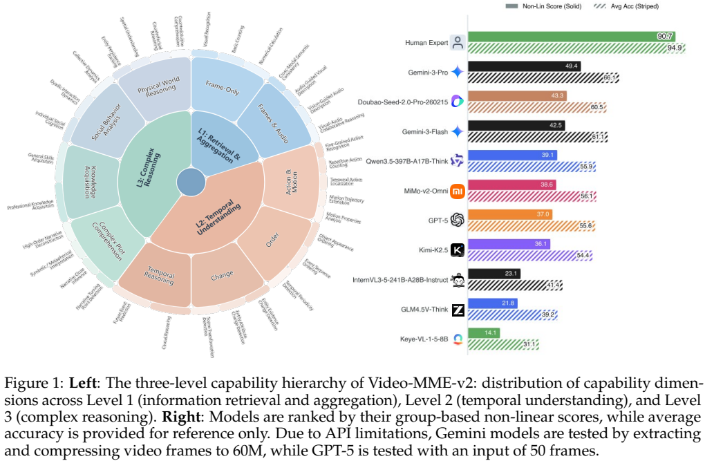
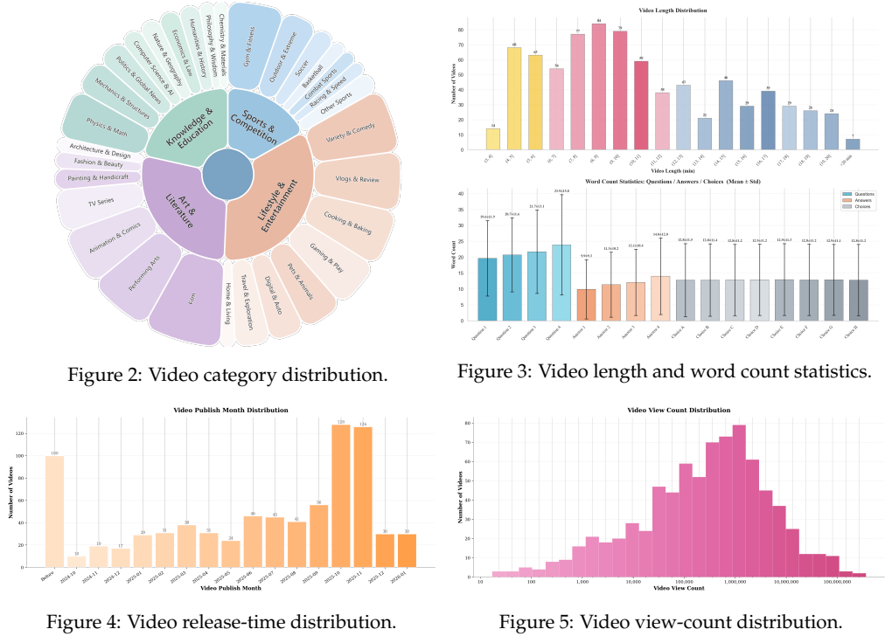
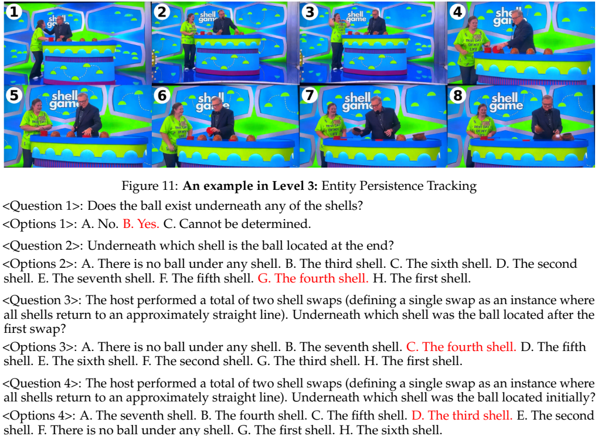
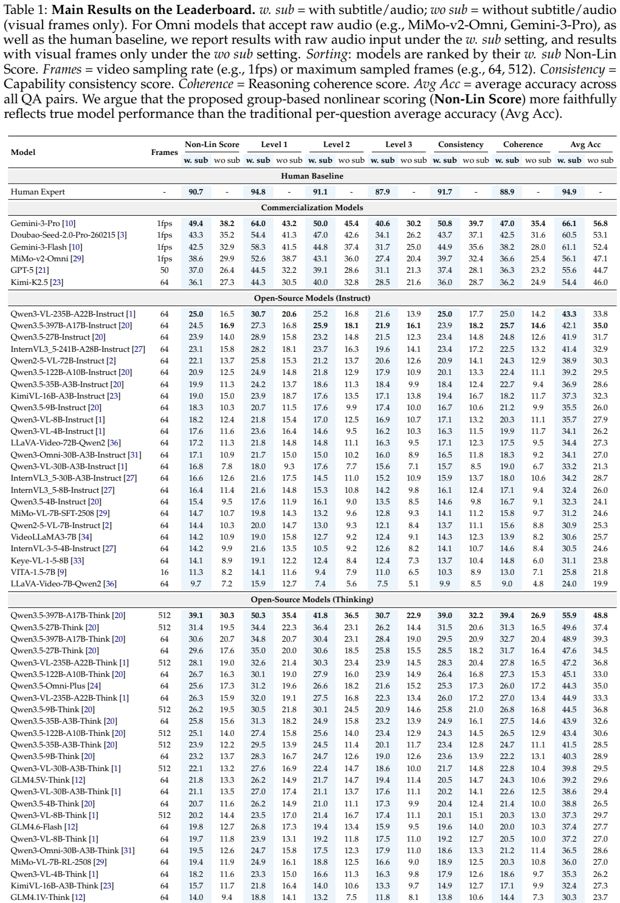
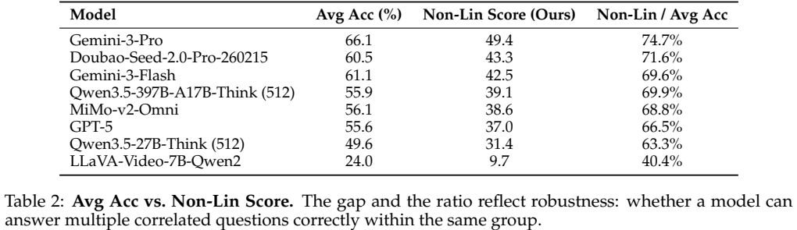
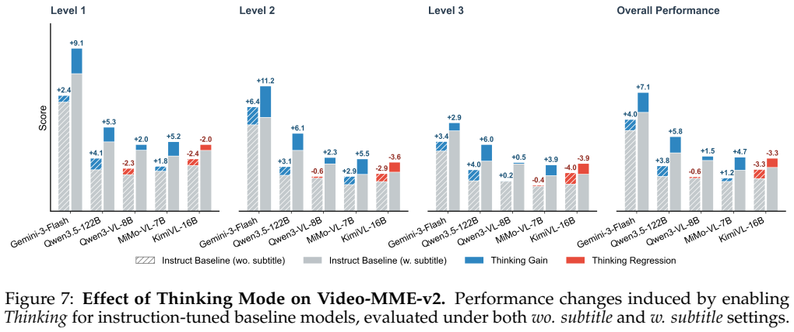

<!-- article-header:start -->
[项目首页](../../../README.md) › [模型系列](../../../reports/model-family-index.md) › [Video-MME](../README.md)
<!-- article-header:end -->

# Video-MME-v2：用问题组检验视频理解的一致性与推理连贯性

<!-- article-toc:start -->

**本篇目录** · [论文定位](#paper-info) · [快速概览](#overview) · [整体架构](#architecture) · [核心原理](#principles) · [数据构建](#data) · [训练流程](#training) · [实验结果](#experiments)
<!-- article-toc:end -->

## 1. 论文信息与模型定位

| 项目 | 信息 |
|---|---|
| 原文 | *Video-MME-v2: Towards the Next Stage in Benchmarks for Comprehensive Video Understanding* |
| 团队 | Video-MME Team；Chaoyou Fu、Haozhi Yuan、Yuhao Dong、Yi-Fan Zhang 等 |
| 版本 | [arXiv:2604.05015v1](https://arxiv.org/abs/2604.05015v1)，2026-04-06 |
| 资料 | [原文 PDF](https://arxiv.org/pdf/2604.05015v1)、[官方项目](https://video-mme-v2.netlify.app/)、[评测仓库](https://github.com/MME-Benchmarks/Video-MME-v2) |
| 定位 | 视频多模态评测基准，属于 Video-MME 系列支持材料；没有发布新的生成模型 |

该报告针对“孤立问题能答对，但相关问题答得不稳定”的情况，设计由四个问题组成的组，并改变评分方式。其核心贡献是评测结构与数据，而非视觉编码器或模型训练架构。（原文第 1–5 页）

## 2. 快速概览

| 要点 | 内容 |
|---|---|
| 数据 | 800 段视频、3200 个问题，每视频四题 |
| 三个层级 | 视觉信息聚合、时序动态、复杂推理 |
| 问题组 | 能力一致性组与推理连贯性组 |
| 评分 | 逐题准确率作参考，非线性组分数作为主指标 |
| 构建投入 | 12 名标注员、50 名独立审核员，约 3300 人时 |
| 原文主要结果 | 人类组分数 90.7，Gemini-3-Pro 49.4；不同帧数与模态条件须分开比较 |

这些结果固定于论文版本的实验，不代表当前在线榜单。组分数与逐题准确率是不同量，不能把 49.4 称为“仅答对 49.4% 的问题”。

## 3. 整体架构

*Figure 1，第 3 页，左侧为能力分类，右侧同时展示组分数与逐题准确率。*

评测结构依次覆盖三个层级：Level 1 聚合对象、属性、OCR、计数与跨模态线索；Level 2 要求辨识动作、顺序、变化与因果；Level 3 关注叙事、社会互动与物理世界推断。细分任务与证据类型在附录 Table 4 定义。

一致性组在同一能力内改变问题角度或粒度，例如全局运动顺序与局部动作顺序。连贯性组围绕线索识别、异常判断、目的解释和最终结论建立依赖结构。模型逐题作答，评测程序再按组聚合；这里没有专门的“评测神经网络”。

实验又分纯视觉 `wo sub` 与视觉加字幕/ASR/音频 `w. sub`。支持原生音频的模型接收音轨，其他模型接收文字补充，因此 `w. sub` 并不是所有模型完全相同的输入格式。（第 3–7 页）

## 4. 核心创新与数学原理

原文式 (1) 为逐题准确率：

$$
\mathrm{AvgAcc}=\frac1{\vert Q\vert }\sum_{q\in Q}\mathbf1[\hat y_q=y_q].
$$

主指标则按组平均，$`\mathrm{Overall}=\vert G\vert ^{-1}\sum_g S(g)`$。一致性组四题中答对 $`N`$ 题，使用 $`S(g)=(N/4)^2`$；答对两题的逐题准确率是 50%，组得分只有 25%，答对三题则为 56.25%。平方项奖励成组正确，降低零散正确的收益。

连贯性组采用首错截断：先前必要步骤答错，后续正确不能全部取得信用。**官方实现补充**：[评测脚本](https://github.com/MME-Benchmarks/Video-MME-v2/blob/main/evaluation/test_video_mme_v2.py) 的 2026-10-08 快照中，串行结构 `[1,2,3,4]` 对连续正确前缀长度 $`k`$ 使用 $`(k/4)^2`$。例如正确模式 `[1,1,0,1]` 的一致性得分 56.25%，串行连贯性得分 25%。

脚本还处理并列依赖：`[1,[2,3],4]` 使用分数序列 $`[0,1,4,7,12]/12`$，`[[1,2],3,4]` 使用 $`[0,1,2,5,10]/10`$，并允许相应并列节点补充信用。该说明来自后续公开代码，不能当成 v1 正文已经逐项公开的公式；实际复评应固定代码版本与数据的 `group_structure`。

评分检验的是一组可观察答案是否符合设计的依赖关系，并不能直接证明模型内部推理真实忠实。分数比普通准确率低也部分源于指标定义更严格，不单独证明某模型“丧失了多少能力”。（第 4–5 页；官方代码第 289–315 行）

## 5. 数据构建与处理

*第 6 页，展示内容类别、时长、发布时间与播放量。*

视频来自四类内容域、31 个细分类别，平均 10.4 分钟，99% 少于 20 分钟，53% 少于 10 分钟。超过 80% 在 2025 年或以后发布，接近 40% 在 2025 年 10 月后发布；人工排除经典影视和知名内容以减轻记忆效应。新近性与人工排除可以降低风险，但不能证明没有进入任何模型的训练集。

每题设计高混淆选项，并要求至少一项利用局部证据形成误导。Gemini-3-Pro 用于对抗测试、发现模糊前提与纯文本捷径；文本可解问题被筛除。每视频至少两名独立人员审核，问题进行多轮交叉验证，修改后再次测试，总流程最多五轮。（第 5–7 页）

*Figure 11，第 20 页，从球是否存在、最终位置、第一次交换后位置与初始位置建立相关问题组。*

正文称每题八选一、随机猜中率 12.5%，但该附录示例的第一题只有三个选项。因而不能不检查实际数据就给所有问题套用八选一随机基线；组评分也并非彻底消除了猜测可能。

官方数据发布包含视频、带时间戳的字幕和问题表；这里仅整理报告及图表，未复制整个基准数据集。该基准的筛选使用了前沿模型，因此模型辅助筛选与人工专家审核应同时写明，不能归为完全不受模型先验影响。（原文第 5–7 页；[官方数据说明](https://github.com/MME-Benchmarks/Video-MME-v2#-dataset)）

## 6. 训练流程与目标

本工作没有训练新模型，也没有预训练/SFT/RL 损失或训练 GPU 成本。相关流程是：选取近期视频，构建问题组和干扰项，模型辅助审核，人工盲测，闭环修改，再对多个现成模型评测。

统一目标是提高评测的多模态依赖、问题清晰度与分组区分度。官方评测提示要求回答 A–H 的选项字母，思考模式则要求推理后输出可解析的最终字母；答案解析失败按未正确作答计入最终评分。该差异属于推理协议，不是本基准新进行的强化学习。

输入预算按模型能力设置：多数开源模型 64 或 512 帧，部分商业模型约 1 fps；GPT-5 限 50 帧。Figure 1 另说明 Gemini 因 API 限制将帧提取并压缩到“60M”，未清楚说明该单位，不自行解释为 60M token。结果是各模型推荐设置下的比较，并非严格相同帧数、token 或推理成本的对照。（第 3、7–8 页；官方评测协议）

## 7. 实验设置与主要结果

*Table 1，第 8 页，按有字幕/音频的非线性组分数排序；同一模型的帧预算也单列。*

| 设置 | 组分数 `w. sub` | 组分数 `wo sub` | 逐题准确率 `w. sub` |
|---|---:|---:|---:|
| 人类专家 | 90.7 | 未报 | 94.9 |
| Gemini-3-Pro，1 fps | 49.4 | 38.2 | 66.1 |
| Seed-2.0-Pro，1 fps | 43.3 | 35.2 | 60.5 |
| Qwen3.5-397B Think，512 帧 | 39.1 | 30.3 | 55.9 |
| 同上，64 帧 | 30.6 | 20.7 | 48.9 |

人类与 Gemini 的组分数相差 41.3 分；但人类是专家审核员、模型输入经过采样，差距不能仅归结为语言模型推理模块。增加帧数对 Qwen3.5-397B 提升 8.5 分，却也并非所有模型受益：122B Think 的 512 帧为 25.1，低于 64 帧的 26.7；35B Think 也从 25.8 降至 23.9。

*Table 2，第 9 页，Non-Lin / Avg Acc 是描述组内表现的比值，不是概率校准指标。*

Gemini 的 49.4/66.1≈74.7%，LLaVA-Video-7B 为 9.7/24.0≈40.4%。这些比较显示同等逐题分数之外，相关问题的联合正确模式也影响评分。

*Figure 7，第 11 页，对比启用思考模式前后的变化；Gemini Flash 对比最小与标准思考模式。*

思考在有文字线索时往往收益更大，但 KimiVL-16B 有/无字幕均下降 3.3 分，Qwen3-VL-8B 无字幕下降 0.6。原生音频使 Gemini 38.2→49.4，但这不包含同模型“原生音频 vs 完整 ASR”的消融，不能直接证明音频路线必然优于字幕路线。

论文没有完整报告统计区间、所有 API 精确快照与等预算实验；能力标签和排行榜关联也不足以建立因果机制。以上为作者评测与公开代码解读，未运行全部模型重新计算榜单。（第 9–12 页）

<!-- article-footer:start -->
---

[← 上一篇：VITA-QinYu](../../vita/document-3a7f77dffb3b/README.md) · [按发表时间浏览](../../../reports/paper-reading-guide.md#year-2026) · [下一篇：Muse Spark →](../../muse/document-52928aca6048/README.md)

[返回本篇目录](#article-toc) · [返回模型系列](../README.md)
<!-- article-footer:end -->
