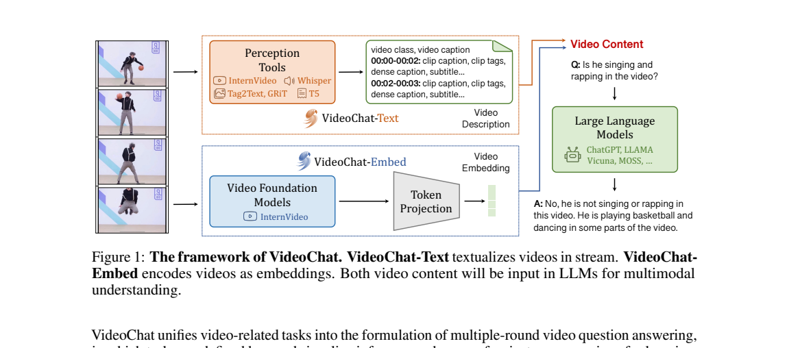
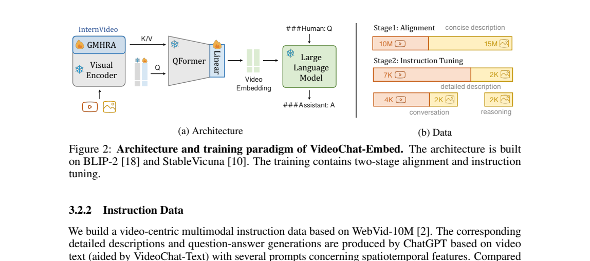
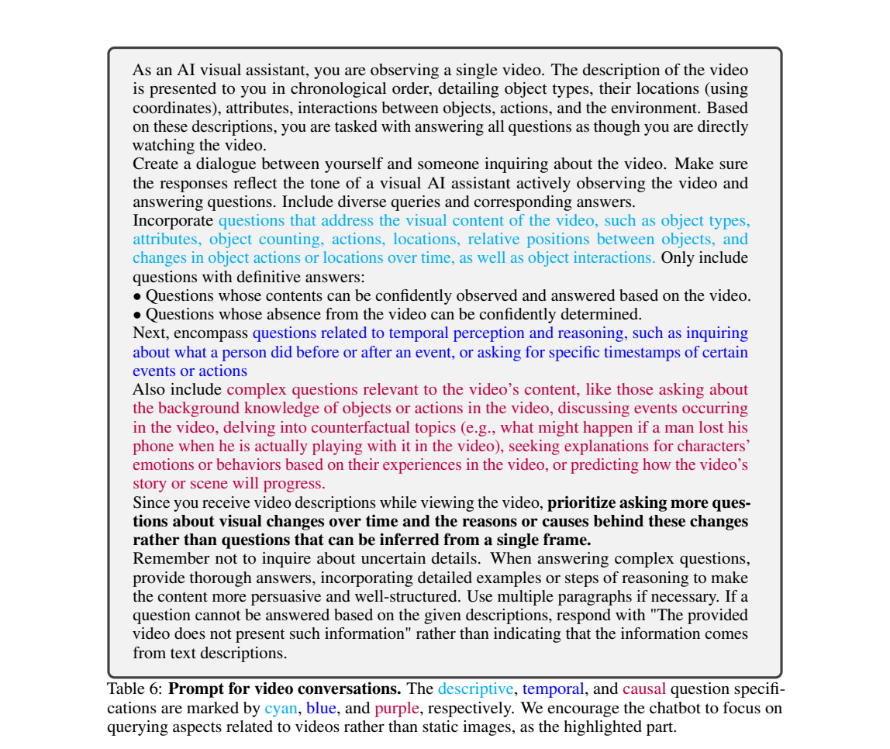
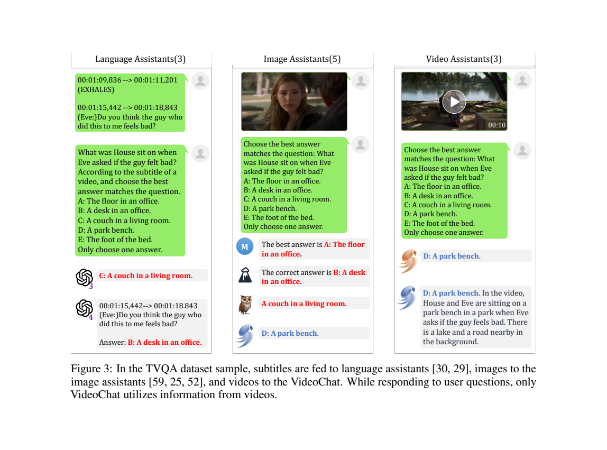

<!-- article-header:start -->
[项目首页](../../../README.md) › [模型系列](../../../reports/model-family-index.md) › [VideoChat](../README.md)
<!-- article-header:end -->

# VideoChat：从视频文本化到视频嵌入的早期多轮对话系统

<!-- article-toc:start -->

**本篇目录** · [论文定位](#paper-info) · [快速概览](#overview) · [整体架构](#architecture) · [核心原理](#principles) · [数据构建](#data) · [训练流程](#training) · [实验结果](#experiments)
<!-- article-toc:end -->

## 1. 论文信息与模型定位

| 项目 | 信息 |
|---|---|
| 论文 | VideoChat: Chat-Centric Video Understanding |
| 作者与团队 | Kunchang Li、Yinan He、Yi Wang 等；上海人工智能实验室、南京大学、香港大学与中国科学院深圳先进技术研究院 |
| 本文依据 | [arXiv 2305.06355v1](https://arxiv.org/pdf/2305.06355v1)，2023 年 5 月，17 页 |
| 官方实现 | [OpenGVLab/Ask-Anything](https://github.com/OpenGVLab/Ask-Anything) |
| 系列定位 | VideoChat 初代，探索将视频任务统一为自然语言多轮问答 |
| 输入与输出 | 视频或图像及用户问题，输出文字回答；Text 路径还可利用视频中的语音转写 |

这是一份早期系统报告。论文同时实现工具串联的 VideoChat-Text 和可训练视觉接口的 VideoChat-Embed，研究大语言模型如何利用动作、物体、时间顺序等信息完成视频对话。其证据主要是定性案例，不能将展示中的成功直接解释为标准视频基准上的领先性能。（原文第 3–4、7–9 页）

## 2. 快速概览

VideoChat-Text 先由多个感知模型把视频转成带时间戳的文字，再交给语言模型回答；VideoChat-Embed 则保留连续视觉特征，通过视频编码器与 Q-Former 接口把视频送入 StableVicuna。后一条路径用 25M 视觉文本对进行对齐，再用正文所述的 18K 指令数据学习对话。

| 要点 | 具体设计 |
|---|---|
| 视频信息接口 | 可读描述，或压缩后的连续视觉 token |
| 时序建模 | Embed 在 ViT-G 中增加 GMHRA 时间模块 |
| 对话数据 | 详细描述、描述性问答、时间问答及因果问答 |
| 更新范围 | 新增 GMHRA、查询 token 与线性投影，主要骨干冻结 |
| 明确限制 | 超过或等于一分钟的视频处理困难，时间与因果推理仍较初步 |

Text 路径在 NVIDIA A10 上将 10 秒视频以 1 FPS 文本化约需 2 秒；这是感知与文本化处理的报告值，论文没有将其定义为包含语言模型生成的完整对话延迟。（第 4 页）

## 3. 整体架构

*原文 Figure 1，第 3 页。橙色路径通过文字传递视频内容，蓝色路径通过视频嵌入传递内容。*

**Text 路径。** ffmpeg 提取低帧率画面及音频；InternVideo 等模型识别动作，Tag2Text 提供标签与描述，GRiT 提供区域描述及坐标，Whisper 转录语音，T5 整理感知输出。系统按时间顺序组织片段描述、物体信息和字幕，再用提示要求 ChatGPT 等语言模型依据这些上下文回答。语言模型实际读取的是感知模型生成的文字，因此上游漏检或误描述会传播到回答中。（第 4–5 页）

**Embed 路径。** 视觉部分以 BLIP-2 的预训练 ViT-G 为基础，增加来自 InternVideo/UniFormerV2 的 Global Multi-Head Relation Aggregator，学习跨帧关系。预训练 Q-Former 加上额外查询 token，以交叉注意力压缩视频特征；线性层将结果映射到语言模型所需的嵌入空间。压缩结果、用户问题和历史对话一起输入 StableVicuna。（第 4 页）

*原文 Figure 2，第 6 页。雪花表示冻结，火焰表示可训练。图中图像详细描述标为 2K，正文第 7 页写为 3K；18K 总量采用正文口径。*

## 4. 核心创新与数学原理

**将视频任务统一为条件对话。** 原文式（1）允许第 $j$ 个图像模型从帧 $I_i$ 提取表示，也允许视频模型直接处理整个序列 $V=[I_1,\ldots,I_T]$：

$$
[E]^j_i=f^j_{\mathrm{img}}(I_i),\qquad E^j=f^j_{\mathrm{vid}}(V).
$$

$E$ 可代表文本描述或连续嵌入，体现两条系统路径共用的任务接口。原文式（2）将第 $t$ 轮回答写为：

$$
W_t^a=f_{\mathrm{llm}}(E\mid W^q_{\le t},W^a_{<t}).
$$

这里的 $t$ 是**对话轮次**，不是生成 token 的索引；模型依据截至当前的问题及历史回答解释视频。文字化接口便于组合已有工具，嵌入接口则可保留感知模型尚未用文字表达的细节。（第 3 页）

**用查询机制控制视频 token 数。** Q-Former 的查询向量读取跨帧视觉特征，再经线性层形成语言模型输入。其交叉注意力可用标准形式 $\mathrm{softmax}(QK^\top/\sqrt d)V$ 理解：查询数控制输出长度，视觉特征作为键和值。这个表达用于解释接口原理，原文没有另给新的注意力损失或完整查询数配置。

**把时序要求放入监督。** 对话生成提示主动询问事件前后、时间点、行为原因与可能后续，指令输入还明确列出抽帧时间。这样既从视觉编码器引入时间关系，也让语言监督要求模型利用时间信息；仅加入时间戳不构成严格因果识别的保证。（第 6–8 页）

## 5. 数据构建与处理

| 用途 | 来源与数量 | 处理方式 |
|---|---|---|
| 第一阶段视频对齐 | WebVid-10M，10M 视频文本对 | 使用简短描述指令，学习视频与语言接口 |
| 第一阶段图像对齐 | COCO Caption、Visual Genome、SBU、CC3M、CC12M，合计 15M 对 | 与视频共同训练，保留空间与物体知识 |
| 第二阶段视频详细描述 | 7K | 感知工具文本化视频，再由语言模型整理为叙述 |
| 第二阶段视频对话 | 4K 视频生成多轮对话 | 覆盖描述、时间和因果问题 |
| 第二阶段图像指令 | 正文为 3K 详细描述、2K 对话、2K 推理 | 分别取自 MiniGPT-4 和 LLaVA 的指令数据 |

详细视频描述提示要求按事件推进顺序写出约 150–200 词，并通过后处理去除重复、乱码及不完整句子。论文先概述 ChatGPT 辅助构建，在详细描述小节具体写使用 GPT-4；这些文本教师接收的是感知工具提供的**文字描述**，该流程没有说明教师直接观看视频。（第 6 页）

*原文 Table 6，第 8 页。提示要求重点询问随时间变化的内容，并对无法从上下文确定的问题给出信息不足的回答。*

7K 和 4K 是两种视频指令生成规模，不能据此断定有 11K 个互不重叠的视频。文字过滤主要改善格式和重复问题，也不能自动纠正最初的物体识别错误。本文保留 Figure 2 与正文图像描述数量不一致的事实，未自行合并成新的数据版本。

## 6. 训练流程与目标

第一阶段使用 25M 视觉文本对训练一个 epoch。图像与视频分别通过对应标记把嵌入接入对话模板，语言模型学习产生简短描述，使新增时间模块及投影接口适应冻结的视觉和语言骨干。（第 7 页）

第二阶段使用正文所述的 18K 指令数据训练三个 epoch，学习详细描述与多轮问答。视频指令额外包含采样帧数和具体时间点，以帮助模型回答时间相关问题。原文第 4 页明确大部分参数冻结，仅训练新增 GMHRA、查询及线性投影；没有给出第二阶段全面解冻语言模型的依据。

回答生成可以用常见的条件语言建模目标解释：

$$
\mathcal L_{\mathrm{LM}}=-\sum_{k\in\mathcal A}\log p_\theta(y_k\mid E,\mathrm{instruction},y_{<k}),
$$

其中 $\mathcal A$ 表示回答位置。这是对描述/回答监督的数学说明；报告没有独立列出新的损失公式、详细 mask 实现、学习率、批量大小或完整训练算力，不能据此还原全部复现实验配置。Text 路径主要依靠已有感知工具和提示组装，不应与 Embed 的上述对齐训练混为一谈。

## 7. 实验设置与主要结果

实验采用短视频及图像多轮对话案例，考察空间识别、时间判断及事件解释。论文与当时 LLaVA、MiniGPT-4、mPLUG-Owl 的在线演示进行定性比较，并展示 TVQA 中的一个场景问答。（第 7–11 页）

*原文 Figure 3，第 10 页。文字助手获得字幕，图像助手获得单帧，VideoChat 获得视频；输入证据不同，应按案例展示理解。*

| 展示内容 | 原文观察 | 可支持的结论 |
|---|---|---|
| TVQA 场景样例 | VideoChat 回答人物坐在公园长椅上，若干其他演示给出室内地点 | 多帧信息能在这个样例中补充单帧或字幕上下文 |
| 篮球/舞蹈视频 | 回答动作、地点、舞蹈开始时间和镜头是否移动 | 展示时间问答及跨帧描述的初步能力 |
| 搞笑与事故视频 | 给出行为解释及相关建议 | 展示视觉内容与语言知识结合，但缺少系统性的正确率证据 |

v1 没有完整定量基准成绩表，也没有严格消融统计证明每个新增模块的独立贡献。因此不能把 TVQA 样例写成 TVQA 测试集准确率，更不能从这些对话推出稳定的因果推理能力。作者明确指出一分钟以上视频、细致时间/因果推理以及对实时性要求高的场景仍存在困难。（第 9、12 页）

配图均截取自上述原始 PDF，页码、裁剪范围及文件哈希见 [配图清单](figures-manifest.json)。

<!-- article-footer:start -->
---

[← 上一篇：MultiModal-GPT](../../multimodal-gpt/arxiv-2305.04790/README.md) · [按发表时间浏览](../../../reports/paper-reading-guide.md#year-2023) · [下一篇：InstructBLIP →](../../blip/arxiv-2305.06500/README.md)

[返回本篇目录](#article-toc) · [返回模型系列](../README.md)
<!-- article-footer:end -->
