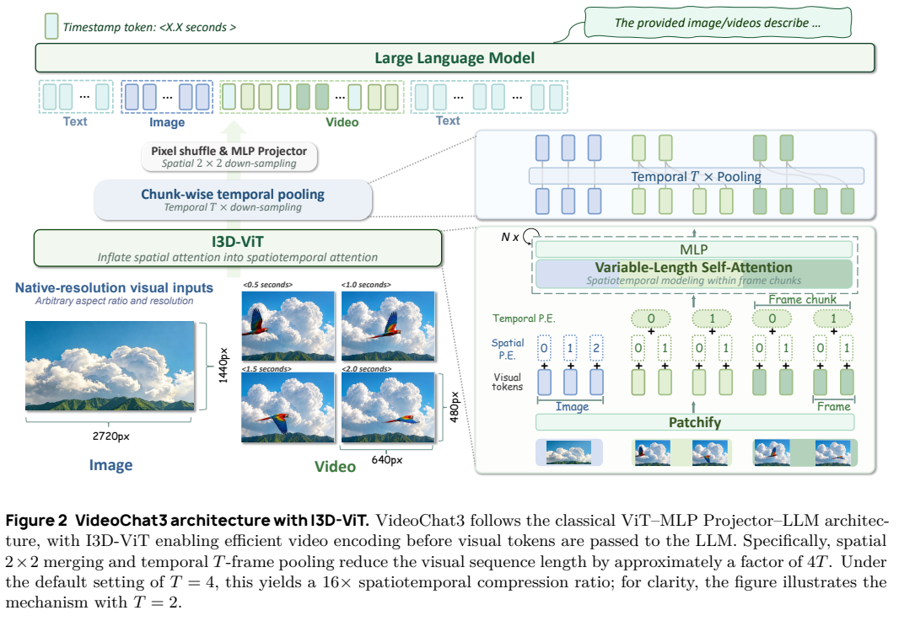
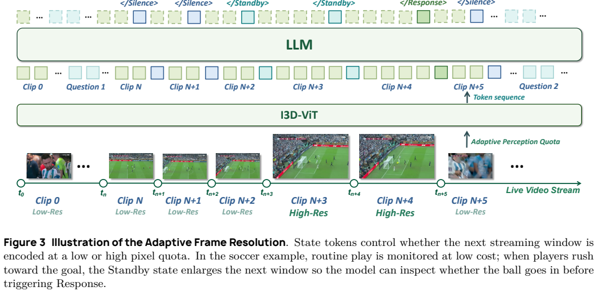
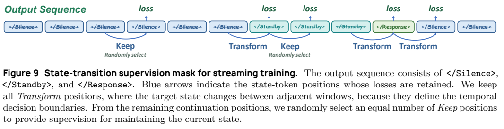
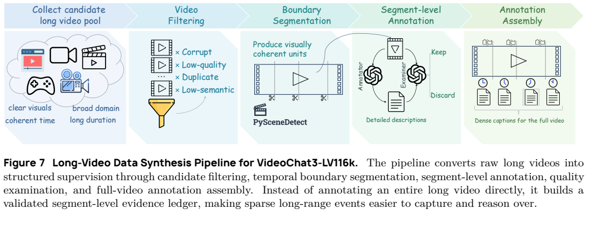
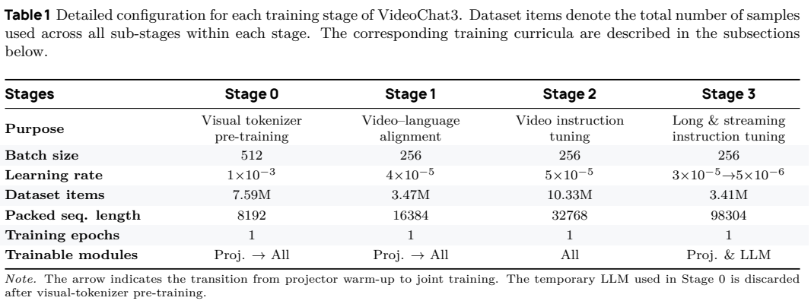
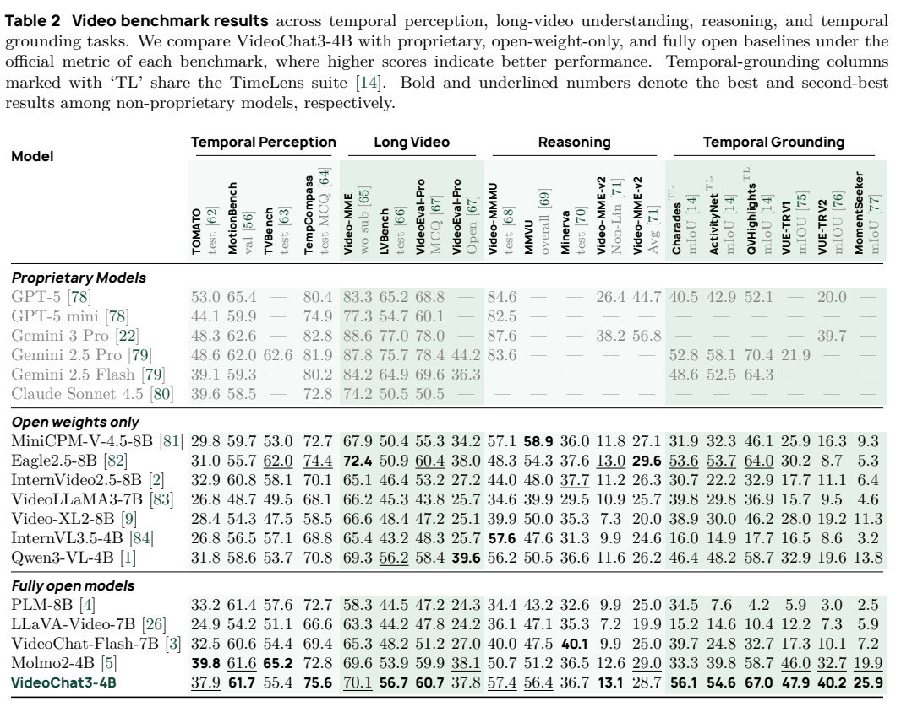
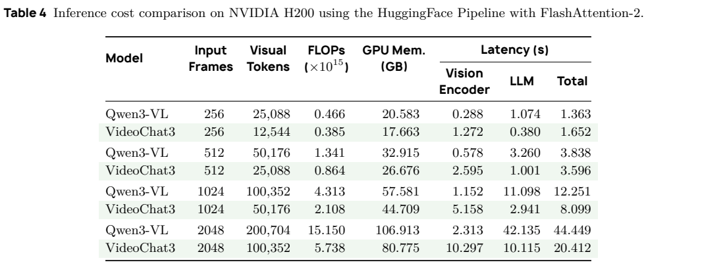
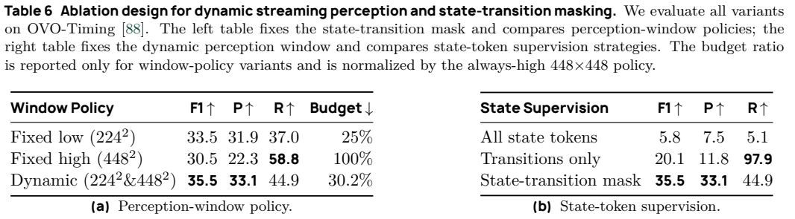

<!-- article-header:start -->
[项目首页](../../../README.md) › [模型系列](../../../reports/model-family-index.md) › [VideoChat](../README.md)
<!-- article-header:end -->

# VideoChat3：从视觉编码端建模时间，兼顾离线与流式视频理解

<!-- article-toc:start -->

**本篇目录** · [论文定位](#paper-info) · [快速概览](#overview) · [整体架构](#architecture) · [核心原理](#principles) · [数据构建](#data) · [训练流程](#training) · [实验结果](#experiments)
<!-- article-toc:end -->

## 1. 论文信息与模型定位

| 项目 | 内容 |
|---|---|
| 论文 | *VideoChat3: Fully Open Video MLLM for Efficient and Generalist Video Understanding* |
| 作者与机构 | Xinhao Li、Yuhan Zhu、Xiangyu Zeng、Yuhao Dong、Haoning Wu、Zhiqiu Zhang 等；南京大学、上海人工智能实验室、南洋理工大学、北京大学 |
| 版本 | 本文依据 [arXiv v1，2026-07-16](https://arxiv.org/abs/2607.14935v1)，共 32 页 |
| 系列定位 | VideoChat 系列的 4B 视频理解模型，支持图像、离线视频、时间定位与在线主动响应 |
| 官方资源 | [项目主页](https://mcg-nju.github.io/VideoChat3)、[代码](https://github.com/MCG-NJU/VideoChat3)、[模型与数据](https://huggingface.co/collections/MCG-NJU/videochat3) |

论文针对两个相互牵制的问题：视频细节需要更多帧，更多帧又会挤占语言模型的上下文与算力。方案把局部运动建模和冗余压缩前移到视觉编码器，并通过数据课程同时学习短视频、长视频和流式回答。作者声称完整开放权重、训练代码、策略和数据；这里介绍报告中的方案，没有独立复现整套训练或审计每个数据来源的再分发条件。

## 2. 快速概览

| 组成 | 作用 | 阅读时应区分的口径 |
|---|---|---|
| I3D-ViT | 连续帧先做局部时空注意力，再沿时间池化 | 默认相对未压缩 patch 序列减少约 16 倍；相对 Qwen3-VL 的实测视觉 token 是约一半 |
| 自适应分辨率 | 待观察状态触发下一窗口增加像素预算 | 控制下一段输入，不是事后恢复已经丢弃的细节 |
| 三类专用数据 | 学术标签增强、长视频合成、流式状态监督 | 数据集行数、训练有效样本数和 QA 轮数不同 |
| 四阶段训练 | 先训练视觉 tokenizer，再对齐、指令微调、长流式适配 | 最后一阶段冻结视觉编码器 |

主要收益集中在时间定位和响应时机。模型仍有离线问答、部分流式任务落后于对照的情况；压缩也会增加视觉编码延迟，短输入未必更快。

## 3. 整体架构

*原论文 Figure 2，PDF 第 4 页。图用 T=2 示意，正文默认 T=4。*

整体仍是视觉编码器—MLP 投影—语言模型。I3D-ViT 从 MoonViT 初始化，保留空间位置编码，增加块内帧索引的可学习时间位置编码。最多 T 个连续帧组成一块，所有空间 token 在块内做联合注意力，因此池化前已经交互过运动信息。时间池化与 2×2 空间合并随后缩短进入 LLM 的序列，时间戳文本辅助描述或定位事件。局部编码器本身不负责跨整部视频的全局注意力，较长依赖仍需 LLM 聚合。

*原论文 Figure 3，PDF 第 5 页。Standby 提高后续窗口预算，Response 触发文本回答。*

流式路径交替输入视频窗口和状态 token。Silence 表示当前无相关证据，Standby 表示出现线索但仍需观察，Response 表示可以生成答案。原始宽高比下等比例缩放到指定像素预算，因此“224²”不是强制把所有帧拉伸成正方形。

## 4. 核心创新与数学原理

若 F 帧每帧含 P 个未压缩 patch，整块池化与空间合并后的近似 token 数为：

$$
N_{\mathrm{visual}}\approx\frac{FP}{4T}.
$$

这是解释论文压缩比例的近似式，忽略末块不足 T 帧和时间戳等开销。压缩发生在时空交互之后，保留局部动态的机会优于直接稀疏抽帧，但不保证所有细节无损。

下一窗口预算由当前状态确定：

$$
b_{t+1}=\begin{cases}448^2,&s_t=\mathrm{Standby},\\224^2,&s_t\in\{\mathrm{Silence},\mathrm{Response}\}.\end{cases}
$$

该控制器是确定规则，不是独立学习的连续预算优化器。若低预算窗口没有识别出关键线索，就可能无法及时进入高预算状态。

*原论文 Figure 9，PDF 第 14 页。保留全部状态转换，以及等量随机抽样的状态延续位置。*

直接训练全部状态 token 会被大量 Silence 主导，只训练转换又容易学到状态模式捷径。论文令转换集合为 $\mathcal T$，从延续集合抽取 $\widetilde{\mathcal C}$，满足 $|\widetilde{\mathcal C}|=|\mathcal T|$，采用：

$$
\mathcal L_{\mathrm{state}}=-\frac{1}{\sum_t m_t}\sum_t m_t\log p_\theta(s_t\mid V_{\le t},y_{<t}),\qquad m_t=\mathbf1[t\in\mathcal T\cup\widetilde{\mathcal C}].
$$

答案文本另用下一 token 预测损失。文中的 Silence:Standby:Response≈2:2:1 是典型循环的有效监督比例，不是任意视频的固定标签分布。训练预算由上一真实状态控制，推理预算由预测状态控制，错误状态仍可能造成偏差累积。

## 5. 数据构建与处理

Academic2M 包含约 2.27M caption/QA 实例，主要来自 LLaVA-Video、Spoken-MIT、Vript。Qwen3-VL-235B-A22B 将短答案改写为包含可见证据的回答，再判断与原标签是否一致。同一模型生成并验证可提高一致性，却不是独立的人类事实核验；更长解释也不天然更可靠。

*原论文 Figure 7，PDF 第 9 页。先分段验证，再用带时间戳的证据记录合成整段监督。*

LV116K 含约 116.2K 行。候选视频先去除损坏、低质量、重复和语义贫乏内容，PySceneDetect 与时长约束切出片段；Qwen3-VL 标注，辅助多模态模型过滤，最后汇总时间线、跨段 QA、单区间或多区间定位。定位还通过专家模型细化区间并做语义过滤。片段证据中的遗漏会传播到最终监督，论文未给出完整人工误差率。

OL617K 含 617,183 实例，来自 StreamForest、Streamo、Seeker 等。模型找出回答所需线索区间，裁剪后检查能否单独推断答案；线索窗口监督 Standby，线索结束监督 Response 与答案，其余窗口监督 Silence。构造边界强调“什么时候回答”，并非自然交互中的全部模糊情境。

三类发布数据合计约 3M，不等于完整训练语料。Stage 2 还含 Honey-Data 的图像监督、Dolci 的纯文本指令及其他视频数据，计 10.33M 有效样本、23.62M QA；Stage 3 中 OL 部分是 191K 视频记录、4.69M 可训练轮次，也不能直接与 617K 原始实例互换。

## 6. 训练流程与目标

*原论文 Table 1，PDF 第 11 页。Proj.→All 表示先投影器热身，再联合训练。*

| 阶段 | 监督与更新模块 | 样本 / 序列长度 | 学习率 / batch |
|---|---|---|---|
| 0 | 图文、视频描述；先投影器后全参数 | 7.59M / 8192 | 1e-3 / 512 |
| 1 | 最终视觉语言接口的 caption 对齐；先投影器后全参数 | 3.47M / 16384 | 4e-5 / 256 |
| 2 | 图像、视频 QA 与文本指令；全参数 | 10.33M / 32768 | 5e-5 / 256 |
| 3 | 长视频和因果流式监督；投影器与 LLM | 3.41M / 98304 | 3e-5→5e-6 / 256 |

每阶段标记 1 epoch。Stage 0 用 Qwen3-4B 作为临时文本解码器，完成后丢弃临时解码器，保留视觉编码权重进入最终模型流程；不能据此把整个过程理解成只微调同一套固定模型。Stage 2 和 3 分别约处理 50B、10B token。常规回答目标是自回归语言建模，流式阶段增加上述状态掩码；报告没有为这套状态学习引入强化学习目标。表中序列长度是训练 packing 设置，不能直接当作每个评测视频的视觉 token 上限。

## 7. 实验设置与主要结果

*原论文 Table 2，PDF 第 16 页。不同列有不同任务指标，不能直接跨列比较绝对大小。*

| 指标 | Qwen3-VL-4B | VideoChat3-4B |
|---|---:|---:|
| MotionBench | 58.6 | 61.7 |
| Video-MME，无字幕 | 69.3 | 70.1 |
| VideoEval-Pro，开放回答 | 39.6 | 37.8 |
| MMVU | 50.5 | 56.4 |
| TimeLens Charades，mIoU | 46.4 | 56.1 |
| VUE-TR v2，mIoU | 19.6 | 40.2 |

相对 Qwen 对照，19 个离线指标中提升 18 个；对 Molmo2 也并非全面领先，例如 TVBench 55.4 低于 65.2。在线 ODVBench 为 72.3，OVO-Timing F1 为 35.5，对照 Qwen 为 57.4、8.1；但 ProactiveVQA 的 EGO 子集 28.1 低于 Qwen 的 34.8，四个子集均低于专用 MMDuet-2。

*原论文 Table 4，PDF 第 18 页；H200、HuggingFace Pipeline、FlashAttention-2。*

同等每帧 patch 数下，256 帧总延迟是 1.652s，对照 1.363s，反而更慢；512 帧是 3.596s 对 3.838s，2048 帧是 20.412s 对 44.449s，约加速 2.18 倍，显存 80.775GB 对 106.913GB。因此 16 倍 token 压缩不能写成 16 倍端到端速度。局部块注意力在固定块尺寸下随块数增长，与 LLM 长序列注意力的代价不同；具体加速仍受实现和输出长度影响。

*原论文 Table 6，PDF 第 19 页。Budget 相对始终高分辨率策略归一化。*

动态预算 F1=35.5，固定低、高预算分别 33.5、30.5；动态策略只用高预算基准的 30.2% 像素预算，这不是 GPU 时间比例。全部状态监督、仅转换监督、平衡掩码分别得到 F1=5.8、20.1、35.5，说明损失取样影响很大。学术标注增强也有例外：Table 7 的 LVBench 从 48.7 降到 45.0、MMVU 从 53.0 降到 51.8。

附录按基准设置帧率和预算：Video-MME 为 2FPS、最多 1024 帧、80K 视觉 token；时间定位可用 128K；OVO-Timing 为 4FPS、最多 128 帧，Standby 后提高预算的窗口为 3 帧。离线对照不支持配置时回退官方默认，其他在线模型多数引用原报告结果，不能视为完全等预算复测。报告也未给出统一随机种子方差、整套训练成本或长时间真实部署的延迟分布。

<!-- article-footer:start -->
---

[← 上一篇：Seed2.0](../../seed/arxiv-2607.00248/README.md) · [按发表时间浏览](../../../reports/paper-reading-guide.md#year-2026) · [下一篇：Kimi K3 →](../../kimi/document-eb106a710a29/README.md)

[返回本篇目录](#article-toc) · [返回模型系列](../README.md)
<!-- article-footer:end -->
