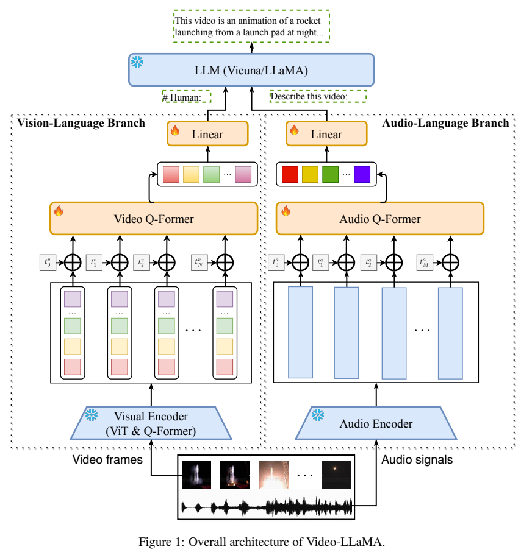
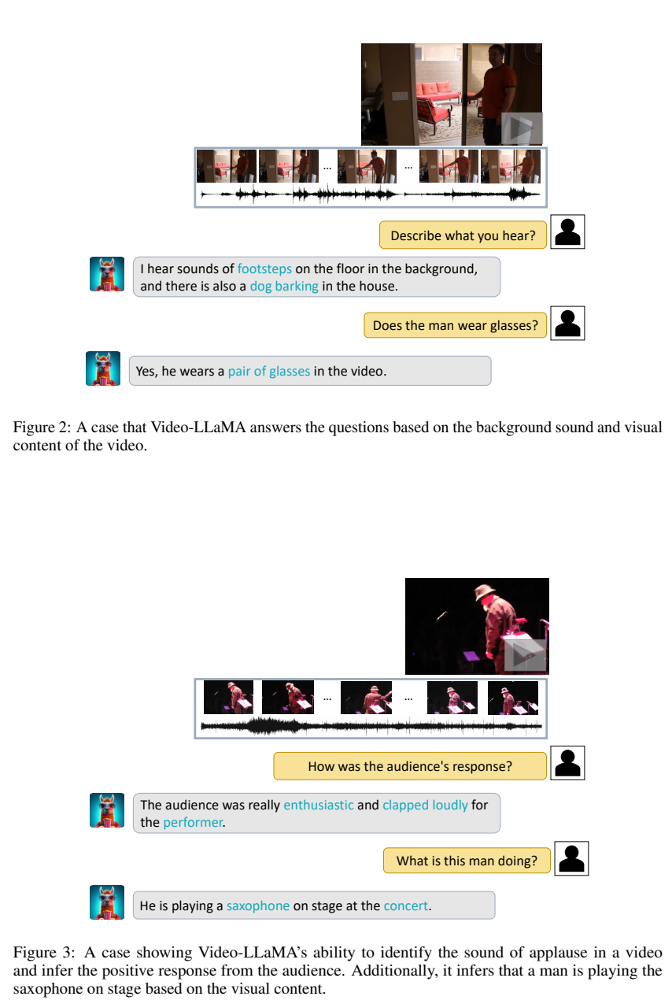
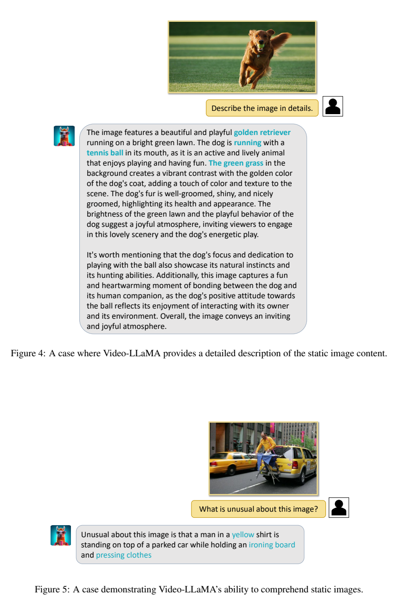

<!-- article-header:start -->
[项目首页](../../../README.md) › [模型系列](../../../reports/model-family-index.md) › [VideoLLaMA](../README.md)
<!-- article-header:end -->

# Video-LLaMA：用双分支适配器连接视频、音频与语言模型

<!-- article-toc:start -->
<a id="article-toc"></a>

**本篇目录** · [论文定位](#paper-info) · [快速概览](#overview) · [整体架构](#architecture) · [核心原理](#principles) · [数据构建](#data) · [训练流程](#training) · [实验结果](#experiments)
<!-- article-toc:end -->

<a id="paper-info"></a>

## 1. 论文信息与模型定位

| 项目 | 信息 |
|---|---|
| 论文 | *Video-LLaMA: An Instruction-tuned Audio-Visual Language Model for Video Understanding* |
| 作者与团队 | Hang Zhang、Xin Li、Lidong Bing；阿里巴巴 DAMO Academy |
| 来源版本 | [arXiv 2306.02858v1](https://arxiv.org/pdf/2306.02858v1)，2023-06-05 |
| 代码 | [DAMO-NLP-SG/Video-LLaMA](https://github.com/DAMO-NLP-SG/Video-LLaMA) |
| 定位 | 视频与声音条件下的自然语言对话原型，支持静态图像输入 |
| 语言骨干 | 架构图标注 Vicuna / LLaMA；首版正文没有完整逐配置参数表 |

这项工作把图像语言适配延伸到视频：既需要辨别连续帧中的变化，也需要回答画面之外的声音问题。Video-LLaMA 采用冻结感知模型与冻结语言模型，只学习跨模态接口。音频分支借用 ImageBind 的共同嵌入空间，用视觉—文本监督学习接口，再将音频表示送入同一接口推理。

<a id="overview"></a>

## 2. 快速概览

| 关键点 | 实际做法 |
|---|---|
| 视频表示 | BLIP-2 逐帧编码，加入时间位置，再由 Video Q-Former 聚合 |
| 音频表示 | ImageBind 编码短音频片段，Audio Q-Former 汇聚可变长度输入 |
| 连接方式 | 两个线性层将查询输出投射到 LLM 词嵌入维度，作为软提示 |
| 训练路径 | 两个分支分别进行描述生成预训练和指令微调 |
| 主要证据 | 音视频、图像与时间变化的定性案例；首版未给系统定量基准 |

阅读时应区分“音频接口没有直接用音频数据训练”与“整套系统完全没有音频训练”。前者是本文接口学习的特点，后者不成立：它使用已经训练好的 ImageBind 音频编码器。报告是早期原型，不能由成功案例直接推导出平均问答准确率。（PDF 第 1–6 页）

<a id="architecture"></a>

## 3. 整体架构



*来源：Figure 1，PDF 第 3 页；火焰表示训练模块，雪花表示冻结模块。*

视觉分支中的“图像编码器”包含 EVA-CLIP ViT-G/14 和 BLIP-2 预训练 Q-Former，二者冻结。Video Q-Former 是其上另加的可训练模块，并不是将同一个冻结 Q-Former改名。各帧图像查询表示先加时间位置嵌入，再送入 Video Q-Former，固定数目的查询从整个视频提取信息。

音频分支先均匀采样若干 2 秒片段，转换为 128 mel-bin 的谱图；冻结 ImageBind 音频编码器将每段映射到向量。随后加入可学习位置表示，经 Audio Q-Former 汇聚、线性投射，得到 LLM 可接收的软提示。输入文字和两类软提示共同条件化文本生成，模型没有直接生成音频或视频的解码器。（PDF 第 4 页）

视觉分支包含两次不同粒度的汇聚：冻结的 BLIP-2 图像 Q-Former 先把每帧转成一组视觉向量；加入帧位置后，Video Q-Former 才从整段帧表示提取定长视频表示。音频分支则先把多个 2 秒片段分别编码成向量，再由带位置条件的 Audio Q-Former 汇聚。两条线性层各自匹配语言嵌入维度，视觉和听觉表示作为连续条件，与文字指令交给冻结的 LLM 生成回答。两支共享语言出口，但并不表示它们在编码器内部已逐帧精确同步；论文也没有给出足以复原所有查询数的配置。[原文 §2.1.1–2.1.2，PDF 第 3–4 页](https://arxiv.org/pdf/2306.02858v1#page=4)


<a id="principles"></a>

## 4. 核心创新与数学原理

### 4.1 从逐帧特征到固定长度视频提示

原文以 $`v_i\in\mathbb R^{K_f\times d_f}`$ 表示第 $`i`$ 帧的 $`K_f`$ 个图像向量，以 $`\hat v\in\mathbb R^{k_V\times d_v}`$ 表示视频查询输出。下面补充计算路径便于理解，其中 $`Q_V`$ 为可学习查询，$`e_i`$ 为时间位置；这是对架构的解释性写法：

```math
Z_V=\mathrm{QFormer}_V\bigl(Q_V,[v_1+e_1;\ldots;v_N+e_N]\bigr),
\qquad P_V=Z_VW_V.
```

如果只把帧特征无序汇总，模型难以知道动作先后。时间位置为查询聚合提供顺序线索；固定查询数则控制送入 LLM 的视频提示长度。但压缩也可能遗漏短暂事件，不能把固定长度查询理解为无损保存任意长视频。

### 4.2 音频输入与视觉监督之间的迁移

同理，若 $`a_j`$ 为音频片段向量，则可概括为：

```math
P_A=\mathrm{QFormer}_A(Q_A,[a_1+u_1;\ldots;a_M+u_M])W_A.
```

关键假设是 ImageBind 将视觉和音频映射到可以迁移的共同空间。因此接口训练时可用视觉表示和描述建立“共享表示→语言嵌入”的映射，推理时改输入音频表示。共享空间具有跨模态相似性，不代表任意音频与任意图片的表示完全相等，也不代表接口拥有准确逐字语音识别能力。这里不需要外部语音识别器先把声音转换为文字。

### 4.3 两分支的结合边界

两条分支最终在语言模型输入层共同提供条件，原文没有描述一个专门音画同步损失或双分支交叉注意力融合网络。可以将它理解为 LLM 对两类查询提示进行条件整合。分别训练接口的做法较节省更新成本，但没有单独证明它已充分学习细粒度音画事件对齐。

<a id="data"></a>

## 5. 数据构建与处理

视觉预训练使用 WebVid-2M 的短视频—描述数据，并混入由 CC3M 筛选的 CC595k 图像描述数据。图像被作为单帧视频处理，因此两类监督共享生成接口。作者明确承认，不少视频描述不能完整覆盖内容，视觉语义和文字语义仍有落差。（PDF 第 4–5 页）

指令阶段整合 MiniGPT-4 的高质量图像细节描述、LLaVA 图像指令、VideoChat 视频指令数据。首版没有完整列出各来源实际下载后数量、采样比例与去重统计；这里不把来源名称中的规模当作最终独立训练样本总量。

音频分支采用同样的视觉—文本数据与训练过程，实现共享嵌入接口迁移。引言中曾出现“audio caption dataset / audio-to-text”的概括，但随后及方法第 2.2.2 节明确说明由于音频文本稀缺，实际接口用视觉文本训练、未直接使用音频数据。本介绍按具体方法节表述，并保留这个行文差异。

<a id="training"></a>

## 6. 训练流程与目标

| 阶段 | 训练内容 | 更新范围 |
|---|---|---|
| 描述生成预训练 | 给视频或图像提示，生成对应描述；两个分支分开训练 | 分支位置嵌入、各自 Q-Former、各自线性投射 |
| 指令微调 | 学习基于视觉内容的描述、问答和对话格式 | 对应可学习分支模块 |
| 音视频推理 | 提取帧与声音表示，在 LLM 中共同条件化回答 | 无参数更新 |

描述与答案生成可以用常规条件语言建模目标解释：

```math
\mathcal L_{\mathrm{gen}}=-\sum_t\log p_{\theta}(y_t\mid y_{<t},P,q).
```

该式用于说明生成式监督，首版并未列出显式训练损失公式、所有 token 掩码与权重。感知骨干和 LLM 冻结，梯度仍可通过冻结 LLM 传回提示接口；“冻结”指不更新其权重，不能理解为无需经过该模型计算。作者指出预训练后指令遵循能力下降，因此用高质量指令微调恢复交互能力。论文没有充分披露 batch size、训练轮数、GPU 总量、学习率与所有查询数；这些缺失参数不从后代模型补入。（PDF 第 4–5 页）

<a id="experiments"></a>

## 7. 实验设置与主要结果



*来源：PDF 第 7 页。示例包括背景声音、人物眼镜、观众掌声与萨克斯表演。*



*来源：PDF 第 8 页。*

报告第 5 节按能力展示案例：Figure 2–3 用声音和画面分别提问，说明两个分支可以向同一次对话提供信息；Figure 4–5 展示静态图像描述与异常场景；Figure 6–7 展示地标或角色知识；Figure 8 展示动作及时间变化。它们证明接口具备可行性，但没有随机样本集、统一评价规则、置信区间或与基线的定量表，因而不能说其准确率达到某个值或全面超过同类模型。

原文案例还提供了值得关注的边界：详细图像描述包含“健康、主人互动”等并非仅由画面就能确认的推断。此类语言补充与视觉事实应区分。作者在第 4 节承认数据质量与规模限制、长视频处理能力不足，以及继承冻结 LLM 的幻觉问题。本文的价值主要是证明冻结模型加双分支接口的音视频对话路线；长视频时序精度、语音转写与音画同步可靠性仍需额外实证。

<!-- article-footer:start -->
---

[← 上一篇：LLaVA-Med](../../llava-med/arxiv-2306.00890/README.md) · [按发表时间浏览](../../../reports/paper-reading-guide.md#year-2023) · [下一篇：M3IT 与 Ying-VLM →](../../m3it/arxiv-2306.04387/README.md)

[返回本篇目录](#article-toc) · [返回模型系列](../README.md)
<!-- article-footer:end -->
