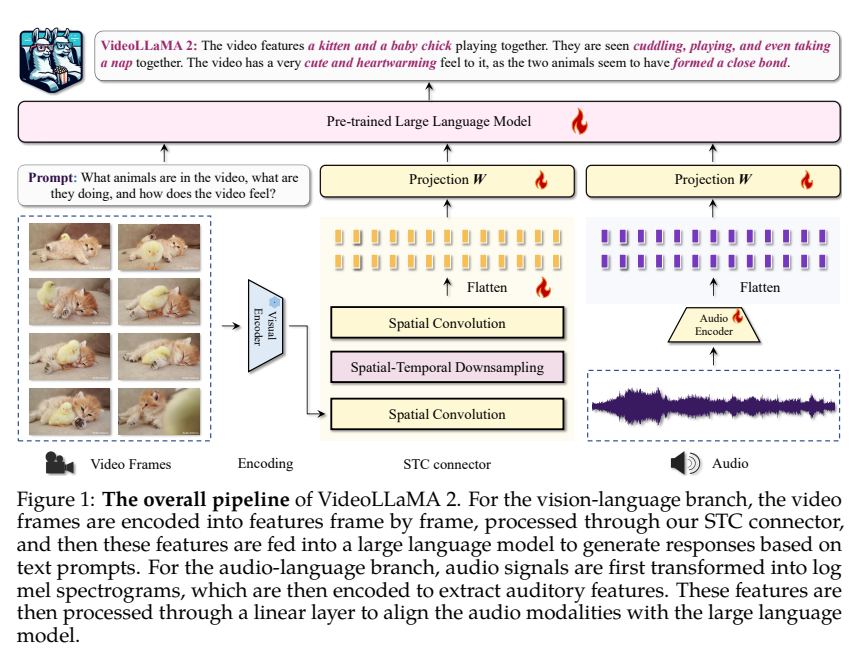
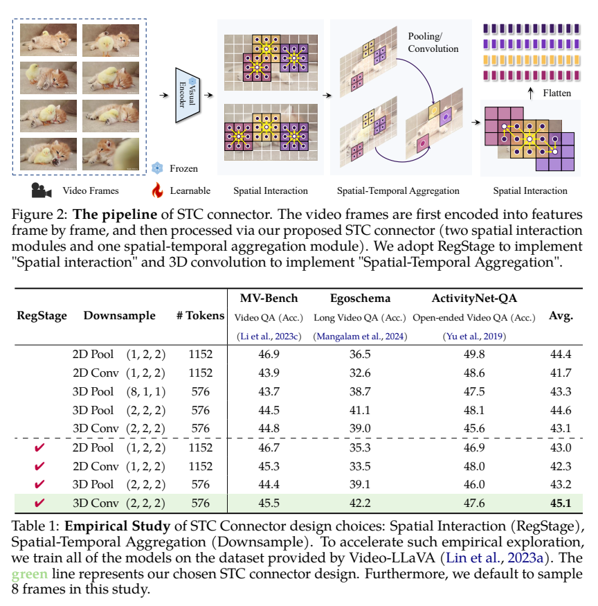
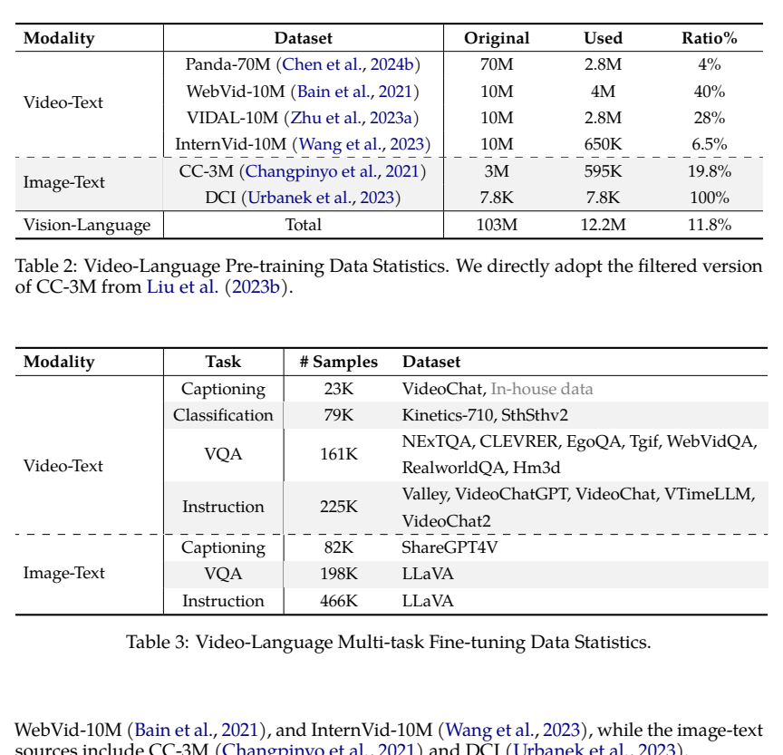
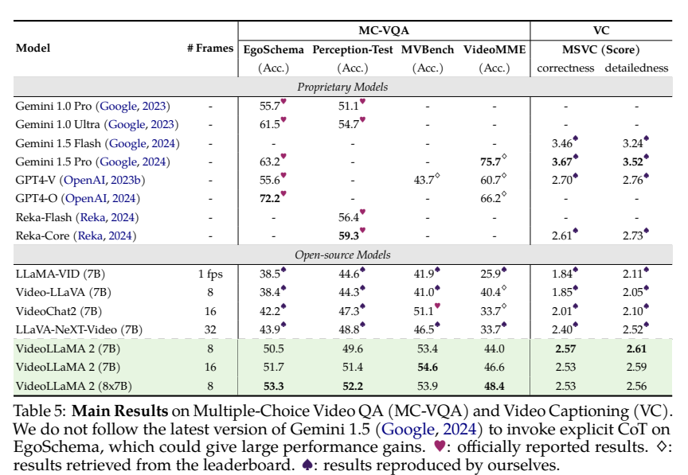
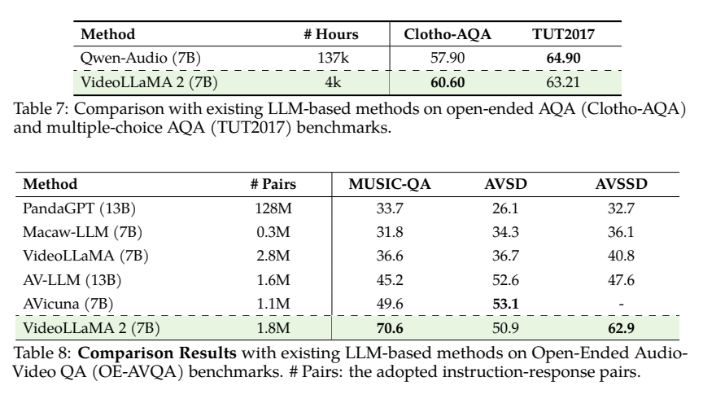

<!-- article-header:start -->
[项目首页](../../../README.md) › [模型系列](../../../reports/model-family-index.md) › [VideoLLaMA](../README.md)
<!-- article-header:end -->

# VideoLLaMA 2：用时空卷积连接器与联合训练改善视频和声音理解

<!-- article-toc:start -->

**本篇目录** · [论文定位](#paper-info) · [快速概览](#overview) · [整体架构](#architecture) · [核心原理](#principles) · [数据构建](#data) · [训练流程](#training) · [实验结果](#experiments)
<!-- article-toc:end -->

## 1. 论文信息与模型定位

| 项目 | 信息 |
|---|---|
| 论文 | *VideoLLaMA 2: Advancing Spatial-Temporal Modeling and Audio Understanding in Video-LLMs* |
| 团队 | Zesen Cheng、Sicong Leng、Hang Zhang、Yifei Xin、Xin Li 等；阿里巴巴 DAMO Academy |
| 来源 | [arXiv 2406.07476v1](https://arxiv.org/pdf/2406.07476v1)，2024-06-11 |
| 代码 | [DAMO-NLP-SG/VideoLLaMA2](https://github.com/DAMO-NLP-SG/VideoLLaMA2) |
| 模型配置 | Mistral-Instruct 7B 与 Mixtral-Instruct 8×7B；视频视觉骨干为 CLIP ViT-L/14 |
| 定位 | 视频问答、描述以及音频和音视频问答；输出为文本 |

与第一代通过 Q-Former 查询汇聚视频相比，第二代重点研究保持时空网格顺序的连接器。它引入 Spatial-Temporal Convolution（STC），在 LLM 前完成局部空间交互和时间融合。同时将音频编码器换为 BEATs，直接用音频文本训练，并增加音视频联合训练，不再只依赖第一代的 ImageBind 共享空间迁移。

## 2. 快速概览

| 部分 | 关键设计 |
|---|---|
| 视频预处理 | 固定帧数采样；每帧 padding 后缩放到 336×336 |
| 视觉连接器 | RegStage → 3D 卷积降采样 → RegStage → 投射 |
| 音频输入 | 128 频率 bin 的 fbank / log-mel 表示，BEATs 提取特征 |
| 训练 | 视频两阶段、音频两阶段，再联合训练 |
| 评测 | 选择题正确率、GPT 辅助开放问答与视频描述，以及音频/音视频问答 |

在同一 7B 模型的选择题结果中，增加到 16 帧改善 EgoSchema、Perception-Test、MVBench 和 Video-MME。但开放问答 MSVD 与描述分数并非同步提升，说明更多帧主要改变可见时序证据，并不会保证所有生成质量指标增长。（PDF 第 9–11 页）

## 3. 整体架构

*来源：PDF 第 3 页，Figure 1。图中的可训练标记需结合各训练阶段阅读。*

视频逐帧经 CLIP 提取空间网格。STC 在降采样前后各放一个 RegStage 卷积模块，增强邻近空间特征交互；中间的 3D 卷积联合处理时间和空间，再将输出展平、投射到语言维度。它保留一个有序网格的表示路径，不通过无固定空间对应关系的学习查询重新采样。

声音先由 BEATs 编码，经线性层映射到 LLM 输入空间。视觉与音频表示同提示一起输入语言解码器。音频分支并非复用上一代 Audio Q-Former；原文此处采用简单线性投射。论文支持的是音频理解和文字回答，没有相应音频生成器。（PDF 第 3–5 页）

## 4. 核心创新与数学原理

### 4.1 在送入语言模型前融合时空信息

令视频网格 $X\in\mathbb R^{T\times H\times W\times C}$，可将正文的 STC 路径解释为：

$$
Z=\operatorname{Proj}\left(\operatorname{RegStage}_2\left(
\operatorname{Conv3D}_{\downarrow}\left(\operatorname{RegStage}_1(X)\right)\right)\right).
$$

这是架构说明记号，原文 Algorithm 1 给出简化伪代码。三维卷积可以在局部同时整合相邻帧和图像区域；前后空间交互模块缓解直接压缩的信息损失。保持时空顺序并不是直接保证正确推理，而是让训练与推理的 token 顺序保持一致。

在表 1 的 8 帧、24×24 patch 网格设置下，原始网格有 $8\times24\times24=4608$ 个位置；时间与两维空间均二倍降采样后为 $4\times12\times12=576$ 个 token。2D 空间二倍降采样保持 8 帧，则为 1152。这一计算解释表内 token 数，不应用于任意不同帧数的版本。

*来源：PDF 第 4 页；此消融使用 Video-LLaVA 数据，和最终大数据训练结果分开。*

选定的 RegStage＋3D 卷积平均分 45.1，高于不加 RegStage 的同类 3D 卷积 43.1，也高于 2D pooling 的 44.4。但单项 MVBench 45.5 低于 2D pooling 的 46.9、ActivityNet 47.6 低于 49.8；因此“平均更优”不能改写为逐任务全面更优。

### 4.2 音频学习与联合学习

相较第一代的共享空间迁移，本代通过真实音频文本监督学习 BEATs 特征到语言的映射。联合阶段用同步裁切的音画片段，让生成答案可以依赖两种证据；无声音的视频用全零波形补齐。这种处理统一了接口输入形式，但全零输入不等于自然环境的背景静音，也没有单独的音画时间对比损失在正文中被明确提出。

## 5. 数据构建与处理

*来源：PDF 第 6 页。*

视觉预训练列出 Panda-70M 取 2.8M、WebVid-10M 取 4M、VIDAL-10M 取 2.8M、InternVid-10M 取 650K、CC3M 筛选版 595K、DCI 7.8K。这里必须保留一个原文不一致：Table 2 总行写 12.2M，而所列 Used 行相加约 10.853M；论文没有解释差额，本介绍同时记录，不自行增加一个来源使其凑齐。

视觉多任务阶段按表 3 分为视频描述 23K、分类 79K、VQA 161K、指令 225K，以及图像描述 82K、VQA 198K、指令 466K，行项合计约 1.234M。来源包括 VideoChat、Kinetics、SthSthv2、NExT-QA、CLEVRER、VideoChatGPT、VTimeLLM、ShareGPT4V 和 LLaVA 等；源数据规模不等于取用后规模。

音频预训练使用 WavCaps 约 400K；音频指令集合约 702K，涵盖音频描述、问题回答、音乐和声音事件分类；音视频联合阶段约 692K，包括 AVQA、音乐 AVQA、AVSD、VGGSound、VideoInstruct-100K 及 WebVid 子集。三阶段表内数量约 1.794M，四舍五入为 1.8M；重复使用来源意味着不能视为互不相交的独立音频数。（PDF 第 7–8 页）

## 6. 训练流程与目标

| 顺序 | 更新模块 | 冻结模块 |
|---|---|---|
| 视频描述预训练 | STC 连接器 | CLIP、LLM |
| 视频多任务微调 | STC、LLM | CLIP |
| 音频预训练 | 音频投射层 | BEATs、已完成视频微调的 LLM |
| 音频多任务微调 | BEATs、音频投射层 | LLM |
| 音视频联合训练 | 音视频投射/连接器、LLM | 视觉编码器、音频编码器 |

正文将目标描述为文字响应的 next-token / cross-entropy，解释性写法为：

$$
\mathcal L_{\mathrm{text}}=-\sum_{t\in\mathcal R}
\log p_\theta(y_t\mid y_{<t},P_V,P_A,q).
$$

不同阶段按可用模态提供条件，$\mathcal R$ 表示参与监督的文字响应。论文没有逐阶段完整披露学习率、GPU 数、所有 batch 与采样权重；本介绍不从其他论文借用训练参数。尤其要注意音频第二阶段解冻 BEATs、但不解冻 LLM，不能套用视频第二阶段的更新范围。

联合训练从视频抽取匹配音轨，再裁切或补齐到音频训练的时长。其数据包含 GPT 生成的指令回答；这属于合成文字监督，并非论文实施了 DPO 或 RLHF。（PDF 第 6–8 页）

## 7. 实验设置与主要结果

*来源：PDF 第 9 页。表中的心形、菱形、黑桃分别区分官方结果、榜单结果和作者复现。*

| 配置 | EgoSchema | Perception-Test | MVBench | Video-MME 无字幕 |
|---|---:|---:|---:|---:|
| 7B，8 帧 | 50.5 | 49.6 | 53.4 | 44.0 |
| 7B，16 帧 | 51.7 | 51.4 | 54.6 | 46.6 |
| Mixtral 8×7B，8 帧 | 53.3 | 52.2 | 53.9 | 48.4 |

本表没有使用字幕，作者称原因是获取字幕存在问题；也未对 EgoSchema 调用显式 CoT。正文第 10 页将 7B 的 MVBench 写为 53.9，而 Table 5 的 7B 两行是 53.4、54.6，53.9 属于 8×7B；本介绍依据明确表格列值保留版本对应关系。

选择题使用 top-1 正确率；开放问答依赖 GPT-3.5 的语义判断和 0–5 打分。大多数任务贪心解码，视频描述 MSVC 使用 temperature 0.2。MSVC 从 MSVD、MSRVTT、VATEX 采 500 个带人工描述的视频，再由 GPT-3.5-turbo-0613 评正确性和细节度，不能把这些分数称作人工评审平均分。（PDF 第 8–10 页、附录 A）

开放问答表 6 中 7B/8 帧 MSVD 为 71.7% / 3.9，ActivityNet 为 49.9% / 3.3；后者正确率低于 LLaVA-NeXT-Video 的 53.5%。附录 B 还给出 DPO 版本的对比，主表没有将其作为统一基线，因此不能仅根据主表宣称胜过全部优化版本。

*来源：PDF 第 12 页。*

纯音频 Clotho-AQA 为 60.60，对比 Qwen-Audio 57.90 是提高 2.70 个百分点；TUT2017 为 63.21，低于对方 64.90。音视频 MUSIC-QA 70.6、AVSSD 62.9，但 AVSD 50.9 低于 AVicuna 53.1。AVSD、AVSSD 因 GPT 评测成本随机取八分之一子集；训练数据表与基线的小时数、图文对数也不构成同条件受控效率实验。结果支持 STC 和直接音频监督的有效性，同时显示任务之间仍有明显强弱差异。

<!-- article-footer:start -->
---

[← 上一篇：Ovis](../../ovis/arxiv-2405.20797/README.md) · [按发表时间浏览](../../../reports/paper-reading-guide.md#year-2024) · [下一篇：SliME →](../../slime/arxiv-2406.08487/README.md)

[返回本篇目录](#article-toc) · [返回模型系列](../README.md)
<!-- article-footer:end -->
