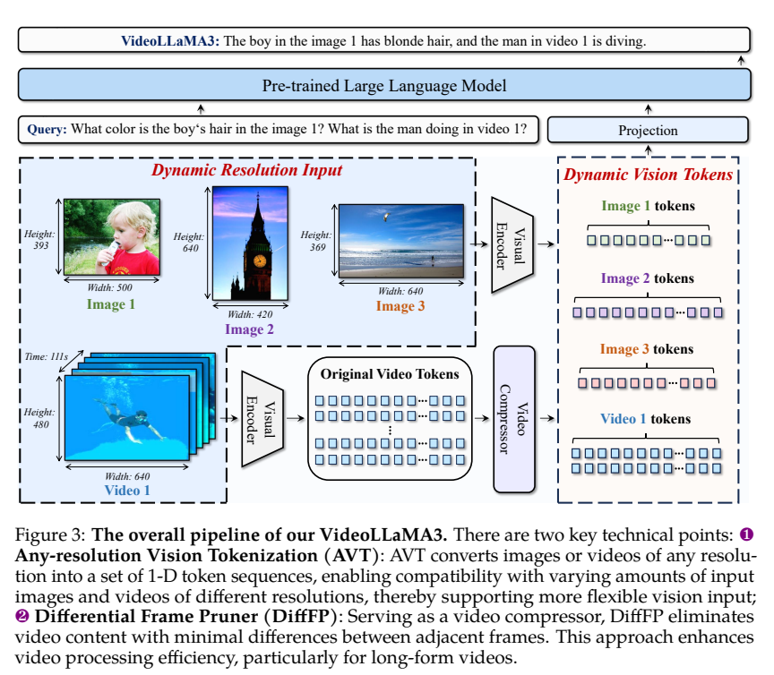
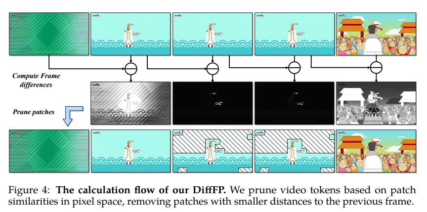
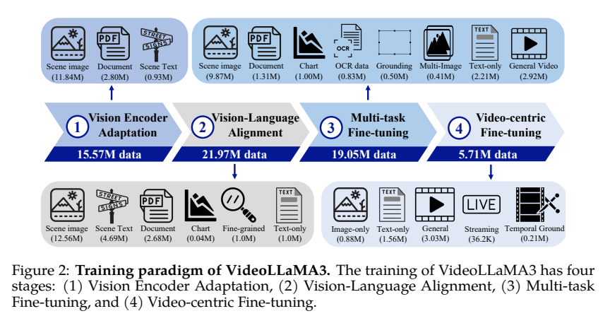
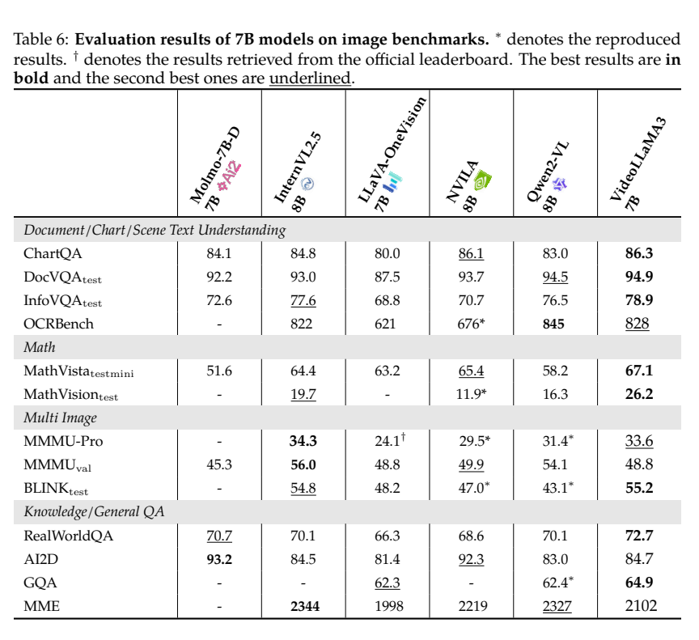
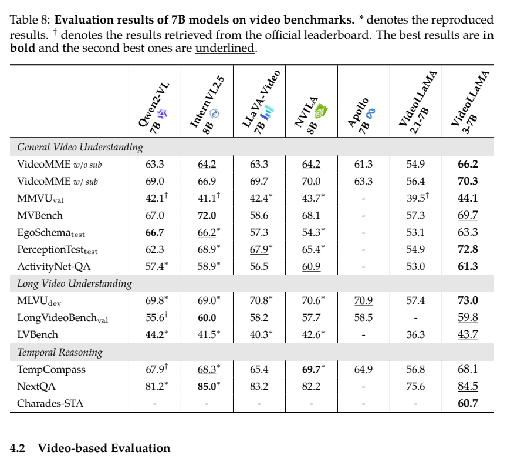

<!-- article-header:start -->
[项目首页](../../../README.md) › [模型系列](../../../reports/model-family-index.md) › [VideoLLaMA](../README.md)
<!-- article-header:end -->

# VideoLLaMA 3：以图像能力为基础的视频理解模型

<!-- article-toc:start -->
<a id="article-toc"></a>

**本篇目录** · [论文定位](#paper-info) · [快速概览](#overview) · [整体架构](#architecture) · [核心原理](#principles) · [数据构建](#data) · [训练流程](#training) · [实验结果](#experiments)
<!-- article-toc:end -->

<a id="paper-info"></a>

## 1. 论文信息与模型定位

| 项目 | 信息 |
|---|---|
| 论文 | *VideoLLaMA 3: Frontier Multimodal Foundation Models for Image and Video Understanding* |
| 团队 | Boqiang Zhang、Kehan Li、Zesen Cheng、Zhiqiang Hu、Yuqian Yuan 等；阿里巴巴 DAMO Academy |
| 来源 | [arXiv 2501.13106v1](https://arxiv.org/pdf/2501.13106v1)，2025-01-22 |
| 代码 | [DAMO-NLP-SG/VideoLLaMA3](https://github.com/DAMO-NLP-SG/VideoLLaMA3) |
| 骨干 | SigLIP 视觉编码器、两层 GELU MLP、Qwen2.5；报告评测 2B 与 7B |
| 定位 | 图像、文档、图表、视频与时间定位；视觉输入条件下生成文本 |

本代采用“vision-centric”路线：优先建立高质量图像理解能力，再引入视频任务。它以原生可变分辨率编码代替固定方形输入，以像素变化剪枝减少视频冗余。虽然家族上一代有 BEATs 音频分支，这篇报告的框架和实验证据针对图像与视频，不能自动继承第二代的音频配置或成绩。

<a id="overview"></a>

## 2. 快速概览

| 设计 | 内容 |
|---|---|
| Any-resolution Vision Tokenization（AVT） | 用二维 RoPE 改造 SigLIP，让不同形状对应不同数量的视觉 token |
| Differential Frame Pruner（DiffFP） | 比较相邻帧同位置 patch 的像素差，移除变化较小的后续 patch |
| VL3-Syn7M | 从 COYO 清洗并用 InternVL2 生成简短和详细描述 |
| 四阶段配方 | 编码器适配、多模态对齐、多任务微调、视频专项微调 |
| 图像优势 | 图表、文档和视觉数学成绩较强 |
| 视频证据 | 一般理解、长视频和时间定位均有基准；并非全部任务领先 |

最核心的想法是先增强感知，再让视频输入更紧凑。最终跨模型结果同时包含视觉骨干、数据与训练方案的变化，论文没有提供足以把全部增益单独归因给 DiffFP 的完整受控消融。（PDF 第 3–16 页）

<a id="architecture"></a>

## 3. 整体架构



*来源：PDF 第 4 页。*

视觉编码器以预训练 SigLIP 初始化，图像直接按可变分辨率进行 patch 编码，不先拆成多个彼此独立的固定尺寸图块。预训练视觉编码器中的绝对位置嵌入被二维旋转位置编码替换，并在第一阶段重新适配。MLP 将视觉表示转换为 Qwen2.5 输入。

视频帧也进入该编码器；编码后采用每帧空间二倍下采样，再根据相邻帧变化压缩 token。本文的 DiffFP 不等同于第二代 STC 的学习式三维卷积连接器，不能沿用其 576 个 token 的配置。第一帧与变化区域保留信息，连续静态区域减少重复输入；文本时间戳帮助语言模型建立帧与时间的关系。

一次视频问答先将各帧送入适配后的 SigLIP，再做 2×2 空间双线性下采样与 DiffFP 筛选；保留的视觉表示经 projector 与问题文字一起交给 Qwen2.5 生成回答。DiffFP 的冗余判断依据是相邻帧对应 patch 在**像素空间的 L1 距离**，随后据此删减视觉 token，并非以语言模型的注意力分数判断重要性。原文 §2.2、§3，PDF 第 5 页。

| 模块 | 输入与输出 | 公开机制 |
|---|---|---|
| AVT 视觉编码 | 不同分辨率图像或帧 → 动态 patch 序列 | SigLIP 初始化；绝对位置替换为 2D RoPE 后适配 |
| 空间压缩 | 帧特征网格 → 较小网格 | 逐帧 2×2 双线性下采样，不是 STC 三维卷积 |
| DiffFP | 相邻帧像素差 → 保留 token 的位置 | 像素空间 L1 阈值判断冗余，无独立学习式剪枝器 |
| Projector 与语言主干 | 保留视觉 token、时间戳和问题 → 回答 | MLP 对齐 Qwen2.5，文本时间戳提供时间条件 |

<a id="principles"></a>

## 4. 核心创新与数学原理

### 4.1 二维位置编码与动态 token 数


二维 RoPE 为图像 patch 的行列坐标分别提供旋转位置信息，使注意力利用相对位置而非依赖固定大小的位置表。用解释性记号可写为：

```math
q'_{h,w}=R_h(h)R_w(w)q_{h,w},\qquad
k'_{h,w}=R_h(h)R_w(w)k_{h,w}.
```

这里表示行、列子空间上的位置操作，原文未逐项展开旋转频率和维度分配，不能据此作为完整实现。分辨率变化使 patch 数随输入面积变化，受上下文预算约束；“any-resolution”并不意味着无限分辨率或无限 token。

位置操作直接依据网格坐标生成，不再要求每个尺寸都使用固定长度位置表；同时视觉主干仍需在第一阶段适配这种改变。更大面积产生更多位置，因此分辨率自由度与上下文预算相互制约，不能把位置表示可计算等同于模型在任意尺寸上都可靠。[依据：§2.1](https://arxiv.org/pdf/2501.13106v1#page=4)。

### 4.2 根据像素变化剪去视频冗余




*来源：PDF 第 5 页。*

正文说明在像素空间计算相邻 patch 的一范数距离，默认阈值 0.1。可解释为：

```math
d_{t,j}=\Vert P_{t,j}-P_{t-1,j}\Vert _1,\qquad
m_{t,j}=\mathbf 1[d_{t,j}\ge\tau].
```

较小距离对应后续冗余 patch 的剪枝。此式仅表达筛选准则；原文没有完整给出像素归一化和距离归约的实现约定，因此不能拿原始 0–255 像素的求和直接套 0.1。DiffFP 基于像素差而非语言模型注意力权重或教师重要性标签，没有一个独立可学习剪枝器损失。

这种方法在静态背景中减少重复视觉输入，但相机运动会产生大量像素变化，微小但语义重要的事件又可能变化很小；阈值并不是语义保留的严格保证。本文先做空间压缩、再减少时间重复，两个步骤均可能带来信息损失。

DiffFP 的判断发生在对应像素区域，而保留或删除作用于送入语言端的特征位置。它利用背景重复，未显式估计物体轨迹；同一坐标在镜头运动后可能已不对应同一物体。故低像素差只提供冗余代理，不能证明被删内容对当前问题不重要。

### 4.3 图像预训练与视频表示的衔接

视觉中心的训练路线先强化图像细节与多种分辨率的表示，再将视频帧送入相同编码器，减少从头学习视频感知的负担。时间压缩和文字时间戳补充序列组织，但图像预训练本身不保证跨帧事件推理；视频任务仍需要后续监督检验。

<a id="data"></a>

## 5. 数据构建与处理

VL3-Syn7M 从 COYO-700M 取图，依次进行长宽比过滤、美学分数过滤、BLIP-2 粗描述与 CLIP 图文相似度过滤、CLIP 特征空间的多样性选择，再生成新描述。InternVL2-8B 生成简短描述，26B 生成详细描述，最终约 7M 图文对用于不同阶段。正文把 KNN 写作聚类方法，但没有完整交代聚类中心构建细节；这里不自行替换为 k-means。（PDF 第 5–6 页）



*来源：PDF 第 3 页。*

| 阶段 | 数据与口径 |
|---|---|
| 视觉编码器适配 | 场景 11.84M、文档 2.80M、场景文字 0.93M；合计 15.57M |
| 视觉语言对齐 | 场景、OCR、文档、少量图表、区域描述和纯文本；图示与 Table 2 数量有差异 |
| 多任务微调 | 图像一般任务、文档、图表、OCR、grounding、多图、纯文本和 2.92M 视频；表内合计 19.05M |
| 视频专项微调 | 一般视频 3.03M、流式 36.2K、时间定位约 0.21M，另混入图像 0.88M、文本 1.56M |

需要特别记录：Figure 2 的第二阶段纯文本为 1M，总量 21.97M；Table 2 纯文本为 6.25M，按行相加为 27.22M。这不是同一套数字，首版没有解释差额；本介绍不宣称已经确定第二阶段最终唯一规模。各阶段重复使用图像来源，也不能把阶段数量相加当作独立图片总量。

OCR 监督包含文本及框坐标，Laion-OCR 筛选约 3M 清晰文字图片，再形成存在判断、定位、框内识别、跨图比较和全图文字识别等任务。视频专项数据另从 Panda-70M 用光流筛出 68K 动态视频，经 Qwen2-VL-72B 生成 242K 多角度 QA。68K 是视频数，242K 是问答数。流式训练数据将长视频切为最长约两分钟片段，按时间戳交错放置帧与响应；时间定位标签转换为“起止秒数”的文字。（PDF 第 8–11 页）

<a id="training"></a>

## 6. 训练流程与目标

第一阶段训练 SigLIP 和 MLP，冻结语言模型；2B 从预训练 SigLIP 与 Qwen2.5-2B 初始化，7B 的视觉编码器使用已在 2B 中适配的权重，语言部分从 Qwen2.5-7B 初始化。其后对齐阶段将所有模块设为可训练；多任务和最终视频阶段继续进行指令学习，视频阶段明确全部参数解冻。（PDF 第 6、11 页）

| 设置 | 首版报告 |
|---|---|
| 第一阶段学习率 | 视觉 1e-5，连接器 1e-3 |
| 后续学习率 | LLM 1e-5，连接器 1e-5，视觉 2e-6 |
| 调度 | cosine，warmup 比例 0.03 |
| 训练上下文 | 总 token 上限 16384，视觉 token 上限 10240 |
| 视频采样 | 先 1fps，再对超过 180 帧的视频均匀采样至上限 |
| 剪枝 | 涉及视频的第 3、4 阶段开启，阈值 0.1 |

视频特征始终在视觉编码器后采用双线性插值二倍空间下采样；图像只在视频专项阶段也下采样以匹配视频。时间戳以 `Time: xxs` 文本表示，流式响应与帧交错；时间定位也使用文本生成而非新增连续值回归头。

生成式监督可用解释性条件负对数似然表示：

```math
\mathcal L=-\sum_{t\in\mathcal A}\log p_\theta(y_t\mid y_{\lt t},V,q).
```

报告没有展开所有任务的损失配权、优化器和 batch 配方，不能据这条通用表达式声称有完整可复现训练细节。重描述使用模型生成标签，但正文未提出教师 logits KL、DPO 或强化学习奖励作为本代目标。

<a id="experiments"></a>

## 7. 实验设置与主要结果



*来源：PDF 第 13 页。*

图像结果较突出的项目是 ChartQA 86.3、DocVQA test 94.9、InfoVQA test 78.9、MathVista testmini 67.1、MathVision test 26.2。另一方面 MMMU val 为 48.8，低于 InternVL2.5-8B 56.0；AI2D 84.7 低于 Molmo-7B-D 93.2、NVILA-8B 92.3；OCRBench 828 低于 Qwen2-VL 845。因此图表与数学的优势不能概括为通用视觉知识全面领先。表 6 把 Qwen2-VL 标作 8B，而表 8 为 7B；本介绍保留原表配置标记，不虚构新的 Qwen 权重。

图像评测 temperature 0、选择题直接输出选项、短答案限制单词或短语，并参考 lmms-eval / VLMEvalKit。2B 图像表 5 中 MMMU val 45.3、MathVista 59.2，同样需区分每项的 split 和评分单位，MME 与 OCRBench 不是百分比。



*来源：PDF 第 15 页。*

| 视频基准 | 7B 结果 | 对应条件与比较 |
|---|---:|---|
| Video-MME 无字幕 / 有字幕 | 66.2 / 70.3 | 字幕提供额外文字证据，两个设置分开 |
| MLVU dev | 73.0 | 表内较强长视频成绩 |
| LongVideoBench val | 59.8 | 略低于 InternVL2.5 的 60.0 |
| EgoSchema test | 63.3 | 低于 Qwen2-VL 66.7 |
| MVBench | 69.7 | 低于 InternVL2.5 的 72.0 |
| Charades-STA mIoU | 60.7 | 正则提取文字起止时间后的区间重叠评价 |

视频评测统一最多 180 帧，视觉 token 预算扩至 16K，关闭采样；MMVU 按官方协议加 CoT。表 7 的 2B MMVU val 为 39.9，而结果段落写 37.6，本介绍依据表值，不混为 7B 的 44.1。时间定位 mIoU 60.7 是区间重叠指标，不是“60.7% 的定位全部正确”。

结果支持先建立图像感知、再开展视频专项学习的工程路线。但像素剪枝的独立速度收益、阈值敏感性和所有数据差异尚未有充分受控表格，不能把跨模型成绩全部当作对剪枝模块的单独验证。

<!-- article-footer:start -->
---

[← 上一篇：LlamaV-o1](../../llamav-o1/arxiv-2501.06186/README.md) · [按发表时间浏览](../../../reports/paper-reading-guide.md#year-2025) · [下一篇：Baichuan-Omni-1.5 →](../../baichuan/document-165201d8355a/README.md)

[返回本篇目录](#article-toc) · [返回模型系列](../README.md)
<!-- article-footer:end -->
