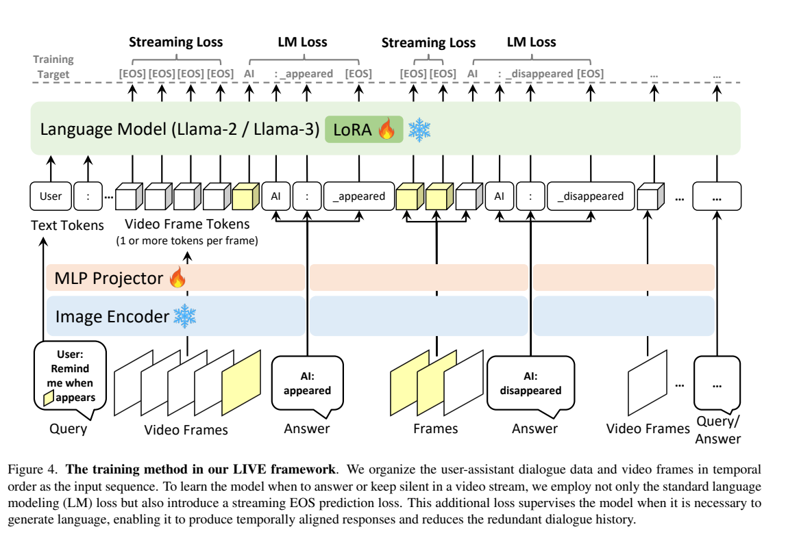
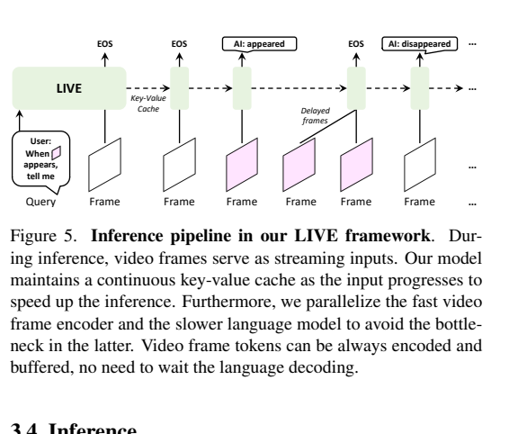
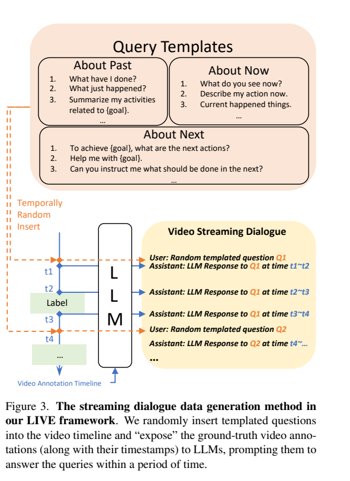
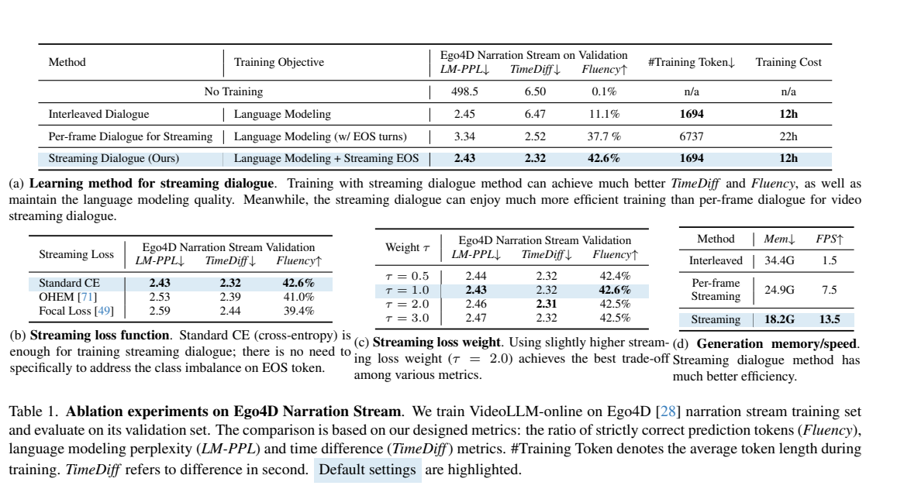
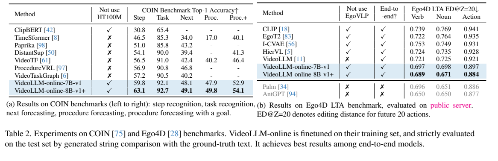

<!-- article-header:start -->
[项目首页](../../../README.md) › [模型系列](../../../reports/model-family-index.md) › [VideoLLM-online](../README.md)
<!-- article-header:end -->

# VideoLLM-online：让视频语言模型学会何时说话、何时等待

<!-- article-toc:start -->

**本篇目录** · [论文定位](#paper-info) · [快速概览](#overview) · [整体架构](#architecture) · [核心原理](#principles) · [数据构建](#data) · [训练流程](#training) · [实验结果](#experiments)
<!-- article-toc:end -->

## 1. 论文信息与模型定位

| 项目 | 信息 |
|---|---|
| 论文 | *VideoLLM-online: Online Video Large Language Model for Streaming Video* |
| 作者与机构 | Joya Chen、Zhaoyang Lv、Shiwei Wu 等；Show Lab（新加坡国立大学）、Meta Reality Labs |
| 来源版本 | [arXiv:2406.11816v1](https://arxiv.org/pdf/2406.11816v1)，2024 年 6 月 |
| 官方资源 | [代码](https://github.com/showlab/VideoLLM-online)、[项目页](https://showlab.github.io/videollm-online) |
| 模型定位 | 面向持续输入视频的在线问答、事件描述与动作预测；LIVE 是训练和推理框架 |

普通视频问答通常先看完片段再回答。本文让模型在视频持续到达时决定是否立即输出，并保留此前的视觉和语言上下文。介绍以 v1 正文及其补充材料为准；该版本已包含 Llama 3 升级实验，部分补充文字仍对应早期配置。

## 2. 快速概览

LIVE 的关键是把“暂时不说话”变成可学习的预测目标。模型收到一帧后，若还没有需要回答的事件，就预测 EOS；若事件出现，则生成文本。静默阶段的 EOS 是监督标签，并不逐帧写入上下文，因此不必为每一帧添加完整的对话轮次。

| 配置 | 视觉与语言骨干 | 每帧视觉 token |
|---|---|---:|
| 7B-v1，主要效率实验 | OpenCLIP ViT-L、Llama 2-7B-Chat | 1 个 CLS |
| 8B-v1+，较强效果版本 | SigLIP ViT-L、Llama 3-8B-Instruct | 1 个 CLS + 3×3 池化特征，共 10 个 |

两者同时更换骨干和视觉 token 数，效果差异不能只归因于语言模型参数量。论文所述约半小时视频容纳于 4,096 上下文，是单 token、2 FPS 配置下的容量估计；十 token 配置的视觉开销约为其十倍。（正文第 4、8–10 页）

## 3. 整体架构

*原文 Figure 4，PDF 第 6 页。左侧是视觉编码器与投影，右侧在同一序列上监督回答文本及静默决策。*

视觉编码器提取帧特征，两层 MLP 映射到语言模型输入空间。用户指令、逐帧视觉 token 和已生成回答交替组成因果序列。视觉骨干与语言模型基础权重冻结，训练 MLP 及语言模型线性层上的 LoRA；后者 rank=128、scaling=256。7B 的 ViT-L 使用 224 分辨率，8B-v1+ 的 SigLIP 使用 384 分辨率。（正文第 4、6、8 页）

*原文 Figure 5，PDF 第 7 页。缓存复用历史上下文，帧编码和文本解码并行执行。*

在线推理维护连续 KV cache。视觉线程可以继续编码并缓存新帧，语言模型完成当前解码后从队列取帧。这个设计减少重复计算，也允许帧在队列中等待；它不意味着文本生成中的每个 token 都实时接收最新画面，或所有事件都保证零延迟。

## 4. 核心创新与数学原理

设第 $`j`$ 个输入位置预测下一 token 的分布为 $`P_j`$。原文式 (5) 的目标可写为：

$$
\mathcal L=-\frac1N\sum_j\left[l_{j+1}\log P_j(\mathrm{Txt}_{j+1})+w f_j\log P_j(\mathrm{EOS})\right].
$$

其中 $`l_{j+1}`$ 表示下一位置是否属于回答文本；$`f_j`$ 仅在当前位置是某帧的最后一个视觉 token、且下一位置不需要回答时为 1；$`w`$ 平衡静默目标与语言目标，默认取 1。两个分量都是交叉熵，分别解决“说什么”和“此时是否需要说”。（正文第 6 页）

EOS 只在帧末参与预测监督，不额外插入历史序列。这样连续静默的几十帧仍主要消耗视觉 token，而不是几十轮用户与助手提示。推理时设置阈值 $`\theta`$：当 EOS 概率低于阈值时，将它排除出下一 token 候选；其余情况仍进行正常解码。论文建议实际取值约 0.5–0.8，这不是经过校准的事件置信度保证。（第 7 页）

只有 CLS 的帧表示空间分辨率很低，有利于长时间历史和速度，却会丢失局部细节。增添池化特征是在该压缩与细节之间调整开销，而非新增专门的运动编码器。

## 5. 数据构建与处理

*原文 Figure 3，PDF 第 5 页。将关于过去、当前、未来的查询插入带时间标签的活动序列。*

Ego4D narration 提供事件文本与时间戳，可以直接在对应帧位置监督回答。主要实验使用原始 narration，去掉 `#C`、`#O` 等标记；用 Llama 2-13B 或 Llama 3-8B 改写描述是演示系统的处理，不能当作主实验统一数据流程。（第 4 页及补充第 15–16 页）

COIN 和 Ego4D GoalStep 的离线标注被改造成连续问答：针对过去、现在、未来各设 50 条查询模板，共 150 条；语言教师读取完整标注时间线，生成不同时间点的回答。教师输入包含事件描述与时间，不是原始视频。随机插入查询时，去掉查询之前的回答、在查询处补充回答，并替换此前查询对应的后续内容。一个训练样本最多含三个查询。（第 5 页）

为保证评估稳定，COINStream 实验把查询放在视频起始位置；演示版才使用随机查询位置和数量。论文的标注合成有助于建立流式任务，但不能等同于大量真实用户连续交互数据。

## 6. 训练流程与目标

训练按 2 FPS 采样，没有额外单独的视觉语言对齐预训练阶段。作者尝试 LLaVA 初始化后效果相近，最终以随机 MLP 开始。流式实验训练 2 个 epoch；COIN 与 Ego4D 长期动作预测的离线基准则分别训练 5–6 个 epoch，属于任务监督实验。（正文第 8 页、补充第 15–18 页）

优化对象是投影层与 LoRA，主损失是上述文本和静默交叉熵。正文比较 OHEM、Focal 等替代目标，普通交叉熵在所报告设置中更稳。不同 $`w`$ 的结果并非所有指标一致提升：$`w=2`$ 的 TimeDiff 为 2.31 秒、Fluency 为 42.5%，默认 $`w=1`$ 分别为 2.32 秒与 42.6%。不宜据此把更大静默权重概括为全面更优。

所核验版本没有给出可补齐完整优化器、学习率和所有训练硬件配置的统一配方，这里不借用其他视频模型的超参数。演示版与主要实验版的骨干、token 数、数据改写和查询采样也应分别处理。

## 7. 实验设置与主要结果

*原文 Table 1，PDF 第 9 页。损失、静默权重及推理速度使用不同子表报告。*

| 7B 流式方式 | LM-PPL ↓ | TimeDiff/秒 ↓ | Fluency ↑ |
|---|---:|---:|---:|
| Interleaved | 2.45 | 6.47 | 11.1% |
| 每帧完整对话 | 3.34 | 2.52 | 37.7% |
| LIVE | 2.43 | 2.32 | 42.6% |

TimeDiff 测量输出时刻偏差；Fluency 是包含语言与流式决策 token 的连续正确预测比例，不是人工评审的语言流畅度。LM-PPL 依赖分词器，跨 Llama 2 与 Llama 3 直接比较没有同样含义。LG-Match 记录第一个错误 token 出现位置相对答案长度的比例，也不是语义正确率。（第 8 页）

单 A100、五分钟 Ego4D narration 验证设置中，LIVE 使用 18.2 GB、吞吐 13.5 FPS；每帧完整对话为 24.9 GB、7.5 FPS，Interleaved 为 34.4 GB、1.5 FPS。这是该配置的处理吞吐，不能替代任意 8B 演示环境下的端到端响应延迟。

*原文 Table 2，PDF 第 9 页。COIN 五项任务与 Ego4D 长期动作预测采用任务监督训练。*

COIN 中，7B 的步骤识别、任务识别、下一步预测、程序预测、面向目标程序预测依次为 59.8、92.1、48.1、47.9、52.9；8B 对应 63.1、92.7、49.1、49.8、54.1。Ego4D LTA 在已有 8 个动作后预测未来 20 个动作，8B 的 verb/noun/action 编辑距离为 0.689/0.671/0.884，优于表中端到端方法，但级联系统 AntGPT 的 0.650/0.650/0.877 仍更好。

正文 Table 3 的 7B TimeDiff 为 2.25 秒，与 Table 1 的 2.32 秒不同，这里分别保留各表结果。8B 十 token 配置比单 token 的 LG-Match 略高（49.0 对 48.3），TimeDiff 都为 2.05 秒。主要证据支持学习静默与缓存复用的价值；空间压缩、合成对话覆盖范围，以及自由回答评价的可靠性仍限制结论外推。

图像均从上述论文原页裁剪；[配图来源清单](figures-manifest.json)。数值为作者报告，未在本仓库重新训练复现。

<!-- article-footer:start -->
---

[← 上一篇：EVE](../../eve/arxiv-2406.11832/README.md) · [按发表时间浏览](../../../reports/paper-reading-guide.md#year-2024) · [下一篇：video-SALMONN →](../../salmonn/arxiv-2406.15704/README.md)

[返回本篇目录](#article-toc) · [返回模型系列](../README.md)
<!-- article-footer:end -->
