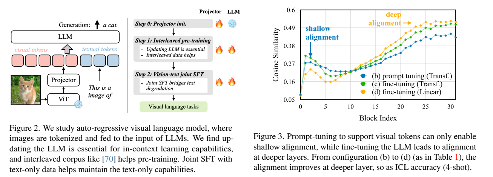
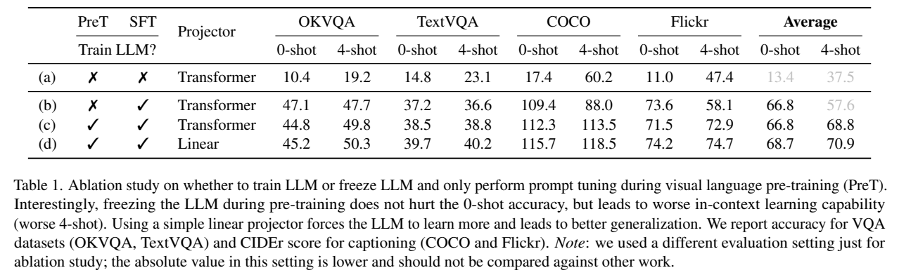
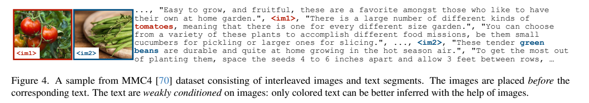
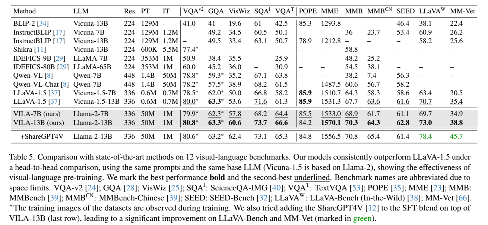

<!-- article-header:start -->
[项目首页](../../../README.md) › [模型系列](../../../reports/model-family-index.md) › [VILA / NVILA](../README.md)
<!-- article-header:end -->

# VILA：多模态预训练如何保留语言能力并获得上下文学习能力

<!-- article-toc:start -->
<a id="article-toc"></a>

**本篇目录** · [论文定位](#paper-info) · [快速概览](#overview) · [整体架构](#architecture) · [核心原理](#principles) · [数据构建](#data) · [训练流程](#training) · [实验结果](#experiments)
<!-- article-toc:end -->

<a id="paper-info"></a>

## 1. 论文信息与模型定位

| 项目 | 信息 |
|---|---|
| 论文 | *VILA: On Pre-training for Visual Language Models* |
| 团队 | NVIDIA、MIT；Ji Lin、Hongxu Yin 等 |
| 阅读版本 | [arXiv:2312.07533v1](https://arxiv.org/pdf/2312.07533v1)，2023-12-12；上游列表记为 2023-12-13 |
| 家族 | VILA / NVILA，本篇为最初的 VILA 预训练研究 |
| 语言骨干 | Llama-2-7B / 13B |
| 模态 | 图像、文本输入，文本输出；支持交错的多图上下文 |
| 官方项目 | [NVlabs/VILA](https://github.com/NVlabs/VILA) |

VILA 研究的是：给已经训练好的语言模型加入视觉能力时，预训练阶段应该如何设计，才能同时获得视觉理解、上下文学习和原有语言能力。论文用控制变量实验比较解冻语言模型、交错图文语料、图文配对语料以及纯文本指令混合，最后将有效配置扩展为 7B、13B 模型。它的主要贡献是训练配方及其证据，而非引入复杂的新连接模块。后续 VILA² 和 NVILA 的数据增强、压缩与部署策略应分别阅读，不能反向归入本篇。

<a id="overview"></a>

## 2. 快速概览

| 核心问题 | 本文方案 | 直接证据 |
|---|---|---|
| 冻结语言模型能否保留多模态上下文学习？ | 多模态预训练和指令微调均更新 LLM，视觉编码器保持冻结 | Table 1 的 0-shot / 4-shot 对照 |
| 图文配对数据是否足够？ | 同时使用 MMC4 交错语料和 COYO 图文对 | Table 3 比较 COYO、MMC4-pairs、MMC4 |
| 如何恢复纯文本能力？ | 在视觉 SFT 中加入 FLAN 纯文本指令 | Table 4、Table 6 |
| 高分辨率的价值来自哪里？ | 主模型使用 336×336 图像；另外研究视觉 token 压缩 | Table 7 的分辨率与 token 数消融 |

最终模型用约 50M 张图像进行多模态预训练。VILA-13B 的 TextVQA 为 66.6，MM-Vet 为 38.8；对应 LLaVA-1.5-13B 为 61.3、35.4。优势并不覆盖所有指标，例如 POPE 为 84.2，低于该基线的 85.9；GQA 同为 63.3。准确说法是多项任务改善，同时具有相对完整的预训练消融证据。（§4.1–4.2、Table 5）

<a id="architecture"></a>

## 3. 整体架构



*来源：v1，PDF 第 2 页，Figure 2–3。左图中的雪花表示冻结、火焰表示更新；右图是不同 LLM 更新策略的逐层嵌入相似度。*

系统由视觉编码器、投影器和自回归 LLM 三部分组成。CLIP 视觉编码器将图像转为一组视觉特征，投影器把特征映射到 LLM 的输入维度，再与文本 token 按实际图文顺序组成同一序列。LLM 在因果注意力下理解这些输入并生成文本，输出端没有图像生成器或音频解码器。（§2）

用简化记号表示输入过程：

```math
V=f_{\mathrm{CLIP}}(I),\qquad Z=VW+b,\qquad H_0=\mathrm{Interleave}(E(T),Z).
```

这里 $`V`$ 是图像特征序列，$`W,b`$ 是投影器参数，$`E(T)`$ 是文本嵌入。这是对原架构的解释性写法。论文比较了 Transformer 投影器与线性投影器，后者在配合 LLM 更新时表现更好；主模型因此采用简单线性投影，视觉编码器保持冻结。

336×336 图像对应 576 个视觉 token。论文还试验将每个 2×2 token 块拼接后线性投影，使每图 token 数降为 144；这属于压缩消融，Table 5 的主结果没有使用该压缩设置。多张图像可以在一个输入序列中出现，但本篇没有提出独立的时间编码或原生音频架构。（§4.4、Table 7）

报告的 VILA-7B/13B 分别采用 **Llama-2-7B/13B** 语言底座。以一段交错图文输入为例，各张图分别经 CLIP 和同一个投影层变成连续视觉嵌入，再按文章或对话中的出现次序放回文字序列；LLM 在这个混合上下文上逐 token 生成文字。这里的线性连接层只负责宽度映射，视觉—语言深层交互发生在共同的语言主干中。（§3、Table5，PDF 第3、6页）

<a id="principles"></a>

## 4. 核心创新与数学原理

### 4.1 更新 LLM，使视觉信息进入更深的表示层



*来源：v1，PDF 第 3 页，Table 1；完整保留表头和评测说明。VQA 指标是准确率，COCO / Flickr 指标是 CIDEr，不能把四项原始数值的平均简单理解为统一准确率。*

冻结 LLM、只训练投影器，相当于用一段学习到的视觉输入适配固定语言模型。它可以获得一定零样本能力，却未必让语言模型学会如何把多组图文示例作为上下文使用。Table 1 的配置 b、c 仅改变预训练是否更新 LLM：COCO 的 4-shot CIDEr 从 88.0 升至 113.5，Flickr 从 58.1 升至 72.9；但 COCO 的 0-shot 反而从 109.4 变为 112.3，变化幅度明显不同。评价预训练质量需要同时观察零样本与少样本能力。

Figure 3 用逐层视觉/文本表示的相似度支持“深层嵌入对齐”解释。相似度可用标准余弦记号理解为：

```math
s(v,t)=\frac{v^\top t}{\Vert v\Vert \,\Vert t\Vert }.
```

原文描述用 Chamfer 距离式的集合比较并采用成对余弦相似度消除向量幅值影响；没有给出完整计算公式。本介绍不补写未经披露的匹配、归一化或采样规则。更深层的相似度与 4-shot 指标一起上升，属于实验相关性证据，不能据此断言单独优化这一相似度就必然改善上下文学习。（§3.1）

### 4.2 交错结构保留更完整的条件信息

把网页序列拆成孤立图文对，会删除图片之间的文本和上下文联系。MMC4 图片与附近文本通常并非严格一一对应：许多词依赖此前文本，少数词才直接依赖图片。保留完整序列，可让语言模型在已有文本条件下学习图片提供的增量信息；强行让每张图片解释整段文字会产生较差训练信号。（§3.2、Figure 4–5）

这可通过标准条件似然理解：完整序列学习 $`p(t_j\mid t_{\lt j},I_{\le j})`$，拆分后则变成更短上下文的条件分布。二者任务不同，因此 Figure 5 中较低的训练损失是机制证据之一，仍需 Table 3 的下游结果佐证。

### 4.3 用联合 SFT 恢复语言任务表现

加入纯文本指令后，模型不再只练习视觉问答形式。Table 4 中，MMC4+COYO 预训练、仅视觉 SFT 的 MMLU 为 40.2；改成视觉与文本联合 SFT 后为 50.9，接近相同纯文本 SFT 基线的 51.2。原文把这解释为语言能力暂时被遮蔽而非完全遗忘；这是基于该实验的解释，不是对所有模型和语料的普遍保证。（§3.3）

<a id="data"></a>

## 5. 数据构建与处理



*来源：v1，PDF 第 4 页，Figure 4。番茄与豆类图片分别出现在对应文本前；颜色标出了与视觉内容联系更强的文字。*

| 数据阶段 | 来源与规模 | 处理方式及用途 |
|---|---|---|
| 投影器初始化 | 图像—描述对 | 固定两侧预训练模型，先建立输入维度和语义接口 |
| 多模态预训练 | MMC4-core 实际下载约 25M 图像；COYO-700M 选取 25M | COYO 按图文 CLIP 相似度排序；主配置按图像数量约 1:1 混合两种来源 |
| 视觉指令 | 18 个视觉语言数据集，最终配置再加入 LLaVA-1.5 SFT 数据 | 转为带任务提示的 FLAN 风格样本；主结果表将视觉 IT 规模记为约 1M |
| 纯文本指令 | 从 FLAN 采样约 1M 条 | 与视觉指令联合 SFT，恢复语言能力并改善指令遵循 |

MMC4-core 原计划约 30M 图像，因为链接失效实际得到约 25M。Table 2 中，MMC4 平均每个样本约 4 张图像，每图约 122.5 个文本 token；COYO 每样本一图，每图约 22.7 token。这些统计说明语料结构不同，并不表示每张图片都具备相同长度或相同质量的标注。（§3.1–3.2、附录 C）

视觉指令的类别包括描述、推理、翻译和问答：例如 TextCaps、CLEVR、NLVR、Multi30k、DocVQA、GQA、OCR-VQA、VQAv2。附录 A 给出了完整 18 个来源。最终配置加入 LLaVA-1.5 的更丰富指令，其中包括视觉指代相关标注。论文另评估加入 ShareGPT4V 的版本；该行结果应与默认 VILA-13B 分开。（附录 A、Table 5）

数据消融还构造 MMC4-pairs：依据 CLIP 分数匹配图片与文本段，再拆成单图配对样本。它保留了部分网页文字，却丢掉原交错结构，因此比单纯比较 MMC4 与 COYO 更能检验结构的作用。本文没有披露完整去重阈值、所有过滤规则或每种 SFT 数据的精确采样权重，不能据此声称已经具备完全可复现的数据配方。

<a id="training"></a>

## 6. 训练流程与目标

| 原文阶段 | 更新部分 | 冻结部分 | 学习任务 |
|---|---|---|---|
| Stage 0：投影器初始化 | 投影器 | CLIP、LLM | 从图像特征建立适用于语言模型的表示 |
| Stage 1：视觉语言预训练 | 投影器、LLM | CLIP | 在大规模交错图文和图文对上做自回归建模 |
| Stage 2：视觉与文本联合 SFT | 投影器、LLM | CLIP | 视觉任务指令、纯文本指令的响应生成 |

自回归目标可以用标准负对数似然表达：

```math
\mathcal L_{\mathrm{AR}}=-\sum_{j\in\mathcal S}\log p_\theta(t_j\mid t_{<j},Z).
```

$`\mathcal S`$ 表示对应阶段实际监督的文本位置；公式帮助理解文本生成目标，并非论文编号公式。原文没有充分列出每个阶段的逐 token 损失掩码、损失权重和优化器超参数，不能把这里的抽象表达当成可直接复制的训练实现。论文也没有报告 RLHF 或 DPO 阶段。（§2）

附录 B 报告 7B 模型训练使用 **128 个节点，每节点 8 张 A100，即 1,024 张 GPU**；三个阶段耗时分别约 4、30、6 小时，总计约 41k GPU 小时。这里不能误写成 128 张 GPU。作者当时未应用样本打包和长度聚类；提出其可能节约至少 30% 训练时间，以及先低分辨率预训练可能降低成本，但这些是后续优化估计，并非本篇已经测得的加速结果。

<a id="experiments"></a>

## 7. 实验设置与主要结果



*来源：v1，PDF 第 6 页，Table 5。星号表示相关数据集的训练图像在训练中出现；绿色数字属于额外加入 ShareGPT4V 的版本。*

### 7.1 主要模型比较

论文尽量使用相同提示和 Llama-2 系列基础模型比较 VILA 与 LLaVA-1.5；后者使用基于 Llama-2 的 Vicuna-1.5。但两者预训练数据量明显不同，不能把结果理解为等数据量、等算力的架构优势。（§4.2）

| 基准 | LLaVA-1.5-13B | VILA-13B | 含义 |
|---|---:|---:|---|
| VQAv2 | 80.0 | 80.8 | 问答准确率；两行带训练图像可见标记 |
| VizWiz | 53.6 | 60.6 | 真实用户视觉问答 |
| ScienceQA-IMG | 71.6 | 73.7 | 图像科学问答 |
| TextVQA | 61.3 | 66.6 | 文本密集图像理解 |
| POPE | 85.9 | 84.2 | 本项未优于基线 |
| MME | 1531.3 | 1570.1 | 综合分数，不能读作百分比 |
| MMBench | 67.7 | 70.3 | 多能力视觉问答 |
| MM-Vet | 35.4 | 38.8 | 综合视觉语言能力 |

额外加入 ShareGPT4V 后，13B 的 MM-Vet 达到 45.7，但 TextVQA 降为 65.3、MME 降为 1556.5；数据增强有不同任务上的取舍。Table 5 的 LLaVA-Bench-In-the-Wild 行值为 VILA-13B 73.0，而 Figure 1 概览图显示 72.8；本介绍采用详细表格并保留这一小差异。

### 7.2 消融与语言能力

Table 7 显示，将输入从 224 提升至 336 后，TextVQA 从 41.6 升至 49.8；再将 576 个视觉 token 压到 144 个后为 45.6。由此可见原始分辨率与 token 数存在不同影响，压缩也并非没有损失。该表使用单独评测协议，不能把这些数值与主表 TextVQA 的 66.6 直接比较。

纯文本 Table 6 中，VILA-7B 的 MMLU / BBH / DROP 为 50.8 / 38.5 / 52.7，相同文本 SFT 基线为 51.8 / 39.3 / 53.1，仍存在小幅差距；13B 对应为 56.0 / 44.2 / 63.6，超过该表中的文本 SFT 基线 54.3 / 43.2 / 59.2。因此“保留语言能力”需要按规模和任务判断。

多图比较、视觉 CoT、地标识别通过定性样例展示；其中地标仅四例，不能视为大规模地理识别准确率。总体证据支持解冻 LLM、保留交错结构、联合文本 SFT 是该训练设置下有效的选择；数据规模、更复杂任务上的泛化和计算成本仍限制结论的外推。上述结果均为原论文报告，本仓库没有重新训练模型或复现基准。

<!-- article-footer:start -->
---

[← 上一篇：SESAME](../../see-say-and-segment-teaching-lmms-to-overcome-false-premises/arxiv-2312.08366/README.md) · [按发表时间浏览](../../../reports/paper-reading-guide.md#year-2023) · [下一篇：CogAgent →](../../cogvlm/arxiv-2312.08914/README.md)

[返回本篇目录](#article-toc) · [返回模型系列](../README.md)
<!-- article-footer:end -->
