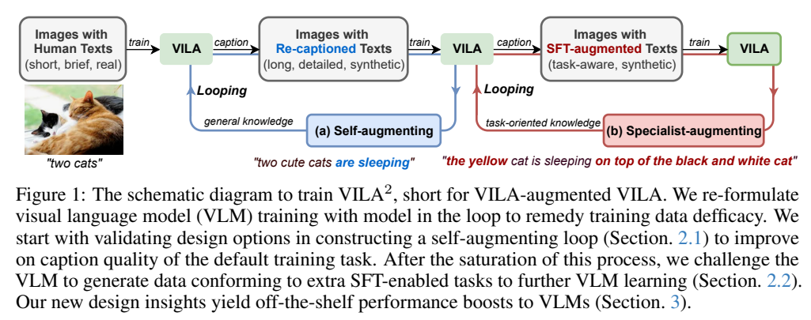
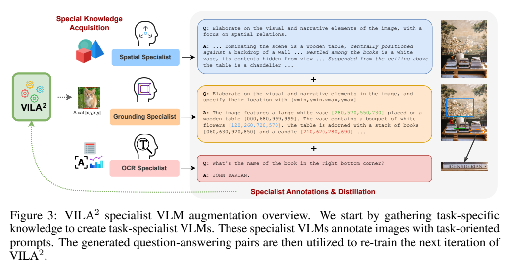
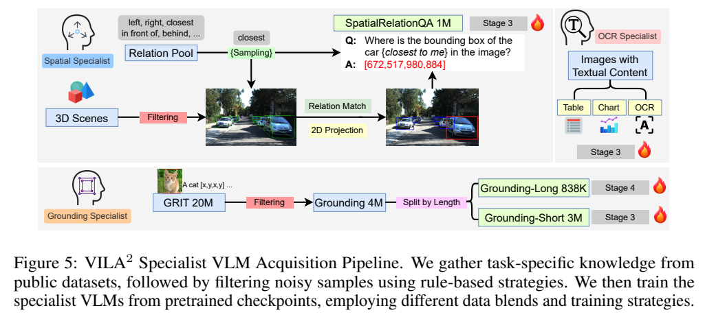
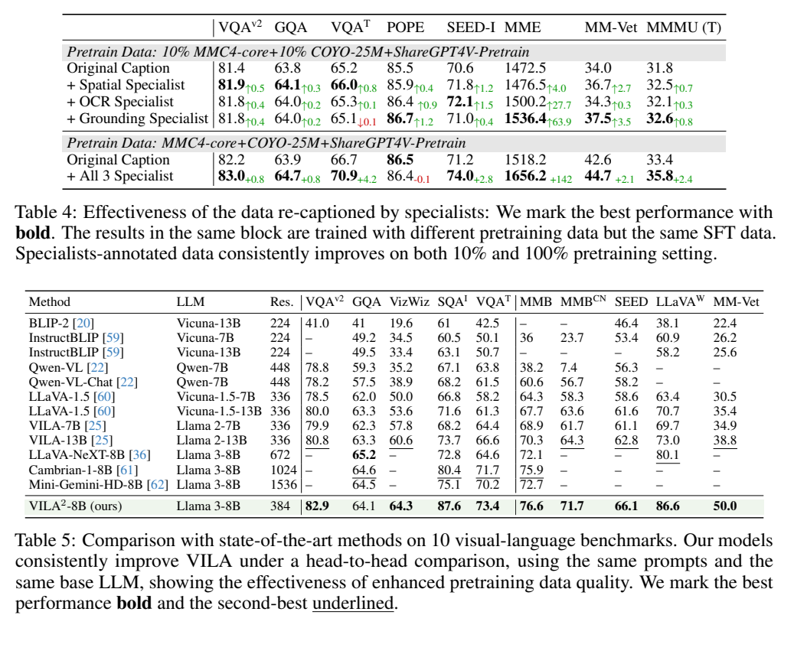
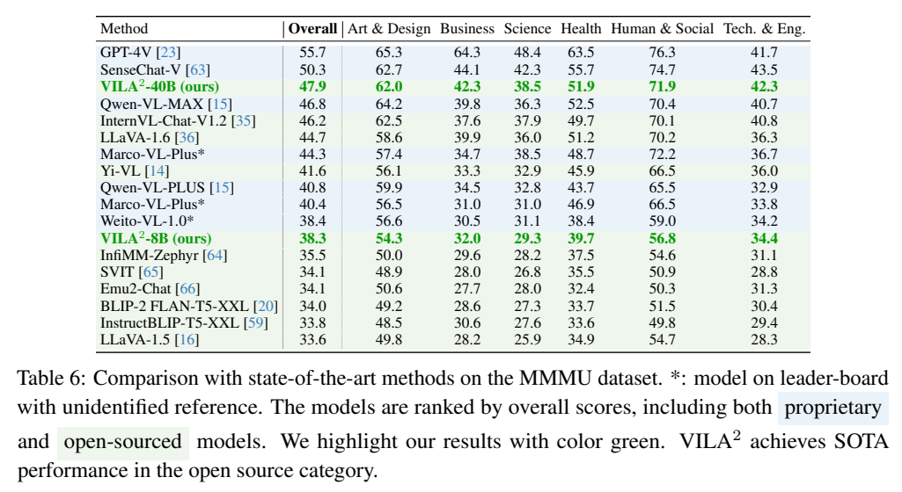

# VILA²：用模型重写训练数据，再以专家知识突破自增强瓶颈

## 1. 论文信息与模型定位

| 项目 | 信息 |
|---|---|
| 论文 | *VILA²: VILA Augmented VILA* |
| 团队 | NVIDIA、UT Austin、MIT；Yunhao Fang、Ligeng Zhu 等 |
| 版本 | [arXiv:2407.17453v1](https://arxiv.org/pdf/2407.17453v1)，2024-07-24 |
| 家族 | VILA / NVILA；承接 VILA 的对齐—预训练—SFT 框架 |
| 模型定位 | 图像与文本输入、文本输出的视觉语言模型；核心贡献是数据增强流程 |
| 主要配置 | Llama-2-7B 用于探索实验；Llama-3-8B-Instruct 与 Yi-34B 用于扩展实验 |
| 官方项目 | 原文指向 [NVlabs/VILA](https://github.com/NVlabs/VILA) |

VILA² 把模型放进数据构建循环：先训练一个 VLM，用它把原来的简短图像描述重写得更详细，再用增强数据训练下一轮模型。当这种通用描述增强接近饱和后，引入空间关系、视觉定位和 OCR 专家，让原来的图像获得更有任务信息的监督。论文提供 7B、8B、40B 配置的验证；40B 配置以 Yi-34B 和 InternViT-6B 组合，不能把它描述成 40B 的纯语言骨干。（§2–3）

文中 $\mathrm{VILA}_i$ 或 VILA 的轮次上标表示第 $i$ 轮自增强模型；**VILA²** 是整个“VILA 增强 VILA”方法的名称，不等同于只进行第二轮增强。

## 2. 快速概览

| 观察 | 方法 | 实验支持 |
|---|---|---|
| 网页原始描述短、细节少 | 模型生成细致描述，同时保留原人类文字 | Table 1–2 |
| 单纯增长描述长度不保证更好 | 混合详细描述提示，约束无依据内容 | Table 2 的提示与模板消融 |
| 自增强在三轮附近趋于饱和 | 小规模任务数据训练专家，再批量标注预训练图像 | Table 3–4 |
| 专家能力需要回流到通用模型 | 将专家输出整理为多轮 QA，与原描述合并训练 | Figure 3、Table 4 |

最终 8B 模型的 TextVQA 为 73.4、MM-Vet 为 50.0；40B 在 MMMU test 的综合分数为 47.9。更有说服力的机制证据来自同一实验块的消融：全量预训练配置加入三类专家标注后，TextVQA 从 66.7 到 70.9，MM-Vet 从 42.6 到 44.7，但 POPE 从 86.5 略降到 86.4。（Table 4–6）

## 3. 整体架构

*来源：v1，PDF 第 2 页，Figure 1。左侧循环增加通用描述细节，右侧循环用经过任务微调的专家补充新的监督内容。*

推理模型仍是视觉编码器、投影器和自回归 LLM。图片特征经投影进入语言模型输入序列，与文本共同参与文本生成。Llama 系列配置采用 SigLIP，Yi-34B 配置采用 InternViT-6B；8B 扩展设置还使用 S2 多尺度视觉特征策略。Table 5 中 8B 的基础分辨率记为 384，并不表示其多尺度视觉处理只看一份 384×384 输入。（§3、§3.2）

模型还将相邻 2×2 视觉 patch 特征沿通道拼接，再通过 MLP，形成约 4 倍的 token 数压缩。若原网格为 $H\times W$，且两个维度可按 2 分组，则 token 数从 $HW$ 变为 $(H/2)(W/2)$，拼接特征的通道维度相应增大；这是对原文压缩过程的解释，不是额外的可学习查询模块。（§3）

*来源：v1，PDF 第 5 页，Figure 3。空间专家描述关系，定位专家输出带边界框的描述，OCR 专家识别图中文字。*

三类专家承担离线数据生成任务。最终通用模型消费其标注，不要求每次推理都同时调用三套专家；论文也没有把这些专家设计成逐 token 路由的 MoE 层。“专家增强”主要指训练数据和知识迁移机制。

## 4. 核心创新与数学原理

### 4.1 自增强是数据分布的迭代改造

设当前模型为 $\theta_k$、图像为 $I_i$、原人类描述为 $c_i$、重标注提示为 $p_i$。用解释性记号写出循环：

$$
\widehat c_i^{(k)}=\operatorname{Generate}_{\theta_k}(I_i,p_i),\qquad
\mathcal D_{k+1}=\{(I_i,c_i\oplus\widehat c_i^{(k)})\}.
$$

下一轮模型用增强语料重新进行视觉语言训练，再经 SFT 获得通用任务能力。$\oplus$ 表示按训练模板组合原文字与合成文字。这里重新训练的是多模态流程；视觉和语言骨干已有各自的预训练基础，不能解释成把所有参数都从随机初始化训练。

关键不是让模型对自己的输出无限自信。原图仍提供固定视觉证据，原始人类文本补充模型可能忽略的专名或上下文，详细提示提高输出的信息密度。Table 2 中仅使用重写文本的 POPE 为 81.0，拼接原文字后为 85.0，说明保留不同监督来源可以改变增强效果。（§2.1）

### 4.2 详细程度、正确性和训练收益是不同指标

原 COYO 描述平均约 11.9 词，前三轮生成描述约为 101.2、117.1、126.77 词。描述增长本身并不能证明质量提高：简短提示产生约 90.4 词，Table 2 的 VQAv2 却从基线 79.6 降到 79.4，MMMU 从 33.8 降到 33.1。论文采用三个详细提示的随机混合，其中一类要求只描述有把握的内容并减少审美性措辞。（Table 1–2）

Table 3 中，轮次推进也没有让每项基准单调上升。例如 MMMU 从第一轮 35.8 到第三轮 35.5，再到第四轮 35.0。作者认为三轮附近已饱和；这一判断来自整体收益趋势，不代表每个指标都恰好在第三轮取得最高值。

### 4.3 专家增强给循环引入新的监督知识

专家先用任务数据微调，再对大规模图片生成任务导向 QA。通用模型随后学习这些 QA，从而把小规模任务知识扩展到更广的视觉样本。标准的响应监督可写为：

$$
\mathcal L_{\mathrm{QA}}=-\sum_{t\in\mathrm{Answer}}
\log p_\theta(y_t\mid I,q,y_{<t}).
$$

这是对自回归监督的解释，原文没有提出此编号公式，也没有给出本介绍之外的新损失权重。知识传递通过合成文本和 QA 完成，不是教师概率分布的 KL 蒸馏；GPT-4V、Gemini 的描述质量判断用于分析，不应写成训练奖励模型或 RLAIF。（§2.2、Figure 2–3）

## 5. 数据构建与处理

*来源：v1，PDF 第 17 页，Figure 5。图中分别列出 SpatialRelationQA、GRIT 过滤、长短定位描述和文字图像来源。*

| 数据用途 | 规模与来源 | 构建过程 |
|---|---|---|
| 小模型完整预训练 | 约 51M 张图像 | COYO 高 CLIP 分数子集 25M、MMC4-core 交错图文中的图像 25M、ShareGPT4V-Pretrain 约 1M |
| 空间专家 | SpatialRelationQA 约 1M 对话 | 从 LV3D 场景抽取 3D 框关系，匹配目标后投影为 2D 框并生成 QA |
| 定位专家 | GRIT 20M 过滤后约 4M | 去掉占图像面积超过 70% 的框及同类实例超过三个的图像；分为约 3M 短描述与 838K 长描述 |
| OCR 专家 | 多种文字、图表、文档数据 | 包含 TextOCR-GPT4V、SynthDoG-En、OCRVQA、DocVQA、AI2D、ChartQA 等 |
| 通用 SFT | 探索实验 1.8M；主要比较 5.9M | 视觉描述、推理、多图、OCR、世界知识、通用 VQA、纯文本指令 |

正文 §3 将 MMC4 记为约 6M 采样条目，附录 A.4.1 则明确其包含约 25M 图像；交错样本可包含多图，应区分样本与图像单位。1.8M SFT 配方含 FLAN-1M；5.9M 配方还加入 MathInstruct、Dolly 等纯文本来源，完整混合表见 Table 7。

自增强消融使用约 5% 预训练数据，每轮给采样 COYO 的一半图像重写描述；MMC4 保留交错结构，不进行该重标注。专家消融另使用约 10% 预训练子集以及全量设置，不能把所有消融视为同一数据规模。（§3.1–3.2）

空间关系覆盖物体—物体的最近、前后、左右，以及物体—相机的远近等关系。定位数据的约 4M 是取整表述，3M 与 838K 不应被强行改为合计恰好 4M。附录还报告用检测器、VLM 和 Llama-3-70B 合并框与文字会引入更多幻觉，因此这种探索不能写成最终可靠的自动清洗方案。（§2.2.1、附录 A.2）

重标注过程减少了持续调用商业 VLM 的需求，但训练配方本身包含 ShareGPT4V、TextOCR-GPT4V 等公开合成数据。不能把“自有模型负责增强”推广为完全没有商业模型生成数据。

## 6. 训练流程与目标

| 阶段 | 小模型流程 | 学习率 |
|---|---|---:|
| Stage 1：接口对齐 | 约 595K 图文对，仅训练多模态投影器 | $10^{-3}$ |
| Stage 2：预训练 | 更新投影器和 LLM，使用原文与增强描述 | $5\times10^{-5}$ |
| Stage 3：指令微调 | 附录明确解冻全部参数，学习通用视觉问答与文本任务 | $2\times10^{-5}$ |
| Stage 4：额外专家阶段 | 用于某些专家流程，例如长定位描述继续微调 | $10^{-4}$ |

训练采用 128 张 A100、全局 batch size 1024、AdamW、余弦学习率、3% warmup、weight decay 0；Table 8 各阶段均记为 1 epoch。Stage 4 不是每个通用模型都必经的阶段。附录中小模型 SFT 解冻视觉编码器，与最初 VILA 的视觉冻结流程不同，不能直接复用前代描述。（§3、附录 A.4–A.5、Table 8）

定位专家先训练短描述，再在长描述阶段混合 Shikra GPT-4、Visual7W、LLaVA-SFT 和 ShareGPT4V 等数据，保留指令遵循和描述能力。随后专家标注被追加至 COYO 原文字，构成下一轮通用模型的预训练监督。主要结果中的三类专家都基于 8B 模型。（§3、§3.3）

40B 使用已有检查点做较经济的增强训练。v1 对其数据配方的描述存在差异：§3.3 写 3.75M 重标注 COYO 与 200K 描述数据；附录 A.4.2 写 7.5M COYO，由原描述、自增强描述、空间专家描述各 2.5M 组成，并省去成本高的完整预训练阶段。两处未充分说明对应关系，本介绍保留差异，不合并成一个可直接复现的精确配方。

## 7. 实验设置与主要结果

*来源：v1，PDF 第 9 页，Table 4–5。Table 4 同一块使用相同 SFT 数据；Table 5 是不同基础模型、视觉处理和训练数据配置的总体比较。*

### 7.1 专家增强的控制变量结果

| 全量预训练设置，Table 4 | 原描述 | 加入三类专家 | 变化 |
|---|---:|---:|---:|
| VQAv2 | 82.2 | 83.0 | +0.8 |
| TextVQA | 66.7 | 70.9 | +4.2 |
| MME | 1518.2 | 1656.2 | +138.0 |
| MM-Vet | 42.6 | 44.7 | +2.1 |
| MMMU test | 33.4 | 35.8 | +2.4 |
| POPE | 86.5 | 86.4 | −0.1 |

原表在 MME 旁写了“+142”，但两列差值实际是 138.0；本表按列值计算并指出差异。10% 数据设置中，定位专家的 MM-Vet 增益最大，而其 TextVQA 为 65.1，略低于原描述 65.2，说明专家类型与受益任务并不一一对应。

### 7.2 主要模型与 MMMU

Table 5 的 VILA²-8B 在 VQAv2 / ScienceQA-IMG / TextVQA / MMBench / MM-Vet 上分别为 82.9 / 87.6 / 73.4 / 76.6 / 50.0。GQA 为 64.1，低于该表 LLaVA-NeXT-8B 的 65.2，因此不宜概括为所有基准均最优。与最初 VILA-7B/13B 的对比还改变了语言骨干、视觉编码器及 SFT 数据，单独的数据增强收益应优先看 Table 3–4。

*来源：v1，PDF 第 10 页，Table 6。分数来自当时榜单的 test 设置，不是 val；部分比较模型在原表标为出处未识别。*

MMMU test 的 VILA²-8B 为 38.3，40B 为 47.9；GPT-4V 为 55.7，SenseChat-V 为 50.3。论文所称开源类别最佳限于当时表中收集的结果，不能当作当前排行榜结论，也不能与 Table 4 的较小 SFT 配方下 35.8 混用。

描述质量分析由 GPT-4V 和 Gemini-1.0-Pro 对 5,000 个 COYO 样本进行判断，偏好评价可能受到判分模型影响；定性样例显示部分幻觉在迭代中被移除，但无法保证所有合成标注都正确。重标注和多轮重训也需要算力，论文的“free lunch”强调复用图片资源，并非计算免费。本仓库整理原文结果，没有重新训练或复现实验。
