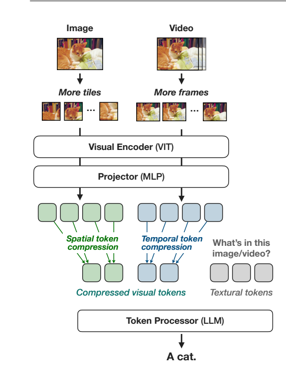
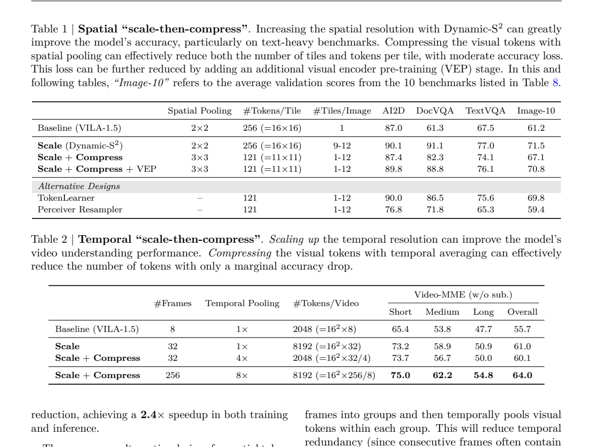
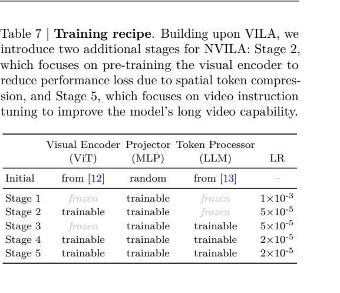
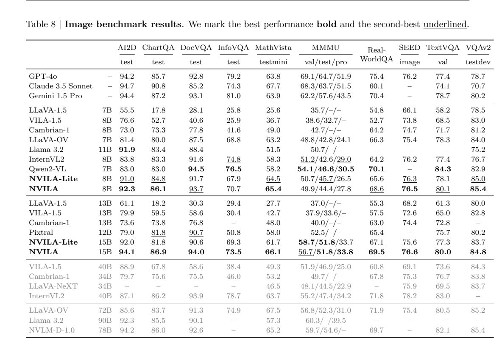
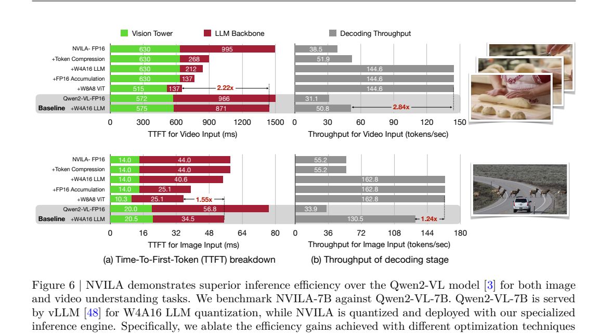

<!-- article-header:start -->
[项目首页](../../../README.md) › [模型系列](../../../reports/model-family-index.md) › [VILA / NVILA](../README.md)
<!-- article-header:end -->

# NVILA：兼顾效果与全流程效率的视觉语言模型

<!-- article-toc:start -->

**本篇目录** · [论文定位](#paper-info) · [快速概览](#overview) · [整体架构](#architecture) · [核心原理](#principles) · [数据构建](#data) · [训练流程](#training) · [实验结果](#experiments)
<!-- article-toc:end -->

## 1. 论文信息与模型定位

| 项目 | 信息 |
|---|---|
| 论文 | *NVILA: Efficient Frontier Visual Language Models* |
| 团队 | NVIDIA、MIT、UC Berkeley、UC San Diego、华盛顿大学、清华大学等 |
| 版本 | [arXiv 2412.04468v1](https://arxiv.org/pdf/2412.04468v1)，arXiv 首版日期 2024-12-05；PDF 首页另标 2024-12-06 |
| 系列与实现 | VILA / NVILA；[NVlabs/VILA](https://github.com/NVlabs/VILA) |
| 模型定位 | 高分辨率图像与长视频理解，重点研究训练、领域微调和推理的成本 |
| 主要配置 | SigLIP 视觉编码器、两层 MLP、Qwen2 语言模型；表 8 包括 8B、15B 与 Lite 版本 |

NVILA 将 VILA 的视觉编码器—连接器—语言模型结构保留下来，把研究重点移到视觉信息密度和系统效率。它首先提高输入的空间或时间分辨率，再压缩送入语言模型的视觉 token；配合数据筛选、FP8 训练和分模块量化，让模型处理更多细节。本文依据首版报告描述，不将后续代码版本的配置补写为论文原始结果。

## 2. 快速概览

| 问题 | 方法 | 为什么有效 |
|---|---|---|
| 单张低分辨率图片丢失文字、图表细节 | Dynamic-S2 多尺度分块 | 保留高分辨率信息，同时适应长宽比 |
| 分块和加帧让 LLM 输入变长 | 空间重排与时间平均 | 减少冗余视觉 token，控制注意力与缓存成本 |
| 强压缩导致精度下降 | 增加视觉编码器预训练阶段 | 让编码器和连接器适应压缩后的表示 |
| 大规模 SFT 混合数据冗余 | DeltaLoss 逐子集筛选 | 优先保留大模型能学、小模型尚未掌握的监督 |
| 训练、微调、部署成本较高 | FP8、视觉 LayerNorm 微调、W8A8 / W4A16 量化 | 分别针对训练显存、可训练参数、预填充与解码瓶颈 |

最值得借鉴的是这种完整配方：分辨率提升负责增加信息，压缩负责降低成本，额外训练阶段负责恢复效果。表 1 中空间压缩后的 DocVQA 从 82.3 回升至 88.8，仍低于未压缩高分辨率模型的 91.1，说明效率收益存在精度权衡，而非所有压缩都没有损失。（PDF 第 4–8 页）

## 3. 整体架构

*来源：原文 Figure 4，PDF 第 4 页；图片直接裁自原文。*

图像经 SigLIP 提取特征，由两层 MLP 投射到 Qwen2 的输入空间，再与文字 token 拼接，语言模型自回归生成答案。视频先均匀采样帧，复用视觉编码器；时间压缩汇聚相邻帧的视觉表示。

Dynamic-S2 从 S2 多尺度提特征出发。例如预训练分辨率为 448² 时，可采用 448²、896²、1344² 多尺度，各尺度分为 448² 图块，编码后拼回特征图。与所有尺度都缩放为正方形的 S2 相比，Dynamic-S2 的最大尺度采用接近原始长宽比、可以整分为图块的尺寸；各尺度特征插值到最大尺度网格并沿通道拼接。这样小字号、狭长文档不必完全依赖一次统一缩图。

## 4. 核心创新与数学原理

### 4.1 先扩展再压缩

空间压缩使用 spatial-to-channel 重排，将邻近位置的信息搬到通道维。理解其作用可写为下式；这是解释性记号，具体边界处理以实现为准：

$$
F\in\mathbb R^{H\times W\times C}
\quad\longrightarrow\quad
\widetilde F\in\mathbb R^{H'\times W'\times k^2C}.
$$

表 1 的 2×2 配置为每图块 256 个 token，3×3 配置为 121 个 token；因此实际压缩比是 256/121≈2.12，不能只根据“3×3”就宣称实验 token 总量下降九倍。图块数量同时由固定 9–12 改为 1–12，作者另报告整体训练与推理约 2.4 倍加速。

对视频，可以将一组相邻帧特征平均：

$$
\bar z_{g,j}=\frac1r\sum_{i=1}^{r}z_{gr+i,j},\qquad
N_{\text{video}}\approx \frac{T}{r}N_{\text{frame}}.
$$

这里平均公式是对正文 temporal averaging 的说明；压缩比与帧数依实验配置变化。表 2 中 8 帧无压缩和 32 帧四倍压缩均为 2048 个视觉 token，后者 Video-MME 无字幕总分从 55.7 提高至 60.1。256 帧八倍压缩为 8192 个 token，得到 64.0；不能把这组消融直接替代最终模型表 9 的 64.2。

*来源：PDF 第 5 页。Image-10 是表 8 所列十项基准的验证集平均分。*

### 4.2 DeltaLoss 数据选择

原文公式（1）用大小模型在答案 token 上的概率比评分：

$$
s(x)=\log\frac{p_{\text{large}}(x)}{p_{\text{small}}(x)},\qquad
D'=\bigcup_i\operatorname{Top}_{k_i}\{s(x):x\in D_i\}.
$$

这里用不同记号区分子集索引和保留样本数。大小模型都容易回答时，监督增量有限；小模型置信度高、大模型反而较低的样本得负分；大模型可以回答、小模型较困难的样本得正分。实际筛选使用概率差而非“答对/答错”的二元标签，正文的正确性描述是直观解释。这是监督数据筛选，不是将教师 logits 的 KL 散度作为模型训练损失。

### 4.3 量化对应不同瓶颈

视觉压缩降低 LLM 预填充负担后，视觉塔成为重要瓶颈；因此预填充阶段使用视觉塔 W8A8。解码阶段使用 AWQ 的语言模型 W4A16，并优化矩阵乘中的 FP16 累加。权重与激活精度分别由 W、A 表示；训练中的 FP8 与部署的这些量化配置属于不同实验。（PDF 第 7–8 页）

## 5. 数据构建与处理

附录 Table A1 给出五阶段来源：连接器对齐使用 LLaVA-CC3M；视觉对齐使用 ALLAVA、Docmatix、PDFA、LSVT、ArT；多模态预训练包含 VILA² 重描述的 COYO 25M 子集、ShareGPT4V、文档数据与 MMC4 交错数据。图像 SFT 混合 OCR、图表、一般 VQA、指令、纯文本和部分视频数据，并包括 Molmo、Cauldron、Cambrian、OneVision 的子集。最终视频阶段使用 LLaVA-Video-178K，并继续混入 OneVision 图像子集。（PDF 第 20 页）

正文描述训练涉及超过 100M 数据，另在效率部分说明 SFT 候选混合为约 10M 样本、经 DeltaLoss 保留约 5M。这三个数量分别对应总体训练、SFT 候选与筛选后集合，不能相加视为独立图片数。

筛选在各数据子集中进行，避免直接让大来源主导所有名额。表 3 比较 DeltaLoss、SigLIP 特征 k-means 聚类筛选及随机筛选；随机实验运行三次报告平均。保留 50% 时 Image-10 从 75.6 到 75.5、DocVQA 从 90.1 到 89.7；保留 10% 时 DocVQA 降至 84.4。作者采用 50% 作为后续配置，不代表任意数据都能裁去九成且不掉分。

## 6. 训练流程与目标

*来源：PDF 第 8 页。*

| 阶段 | 可训练模块 | 学习率 | 作用 |
|---|---|---|---|
| 1 连接器初始化 | MLP | 1e-3 | 建立视觉和语言表示接口 |
| 2 视觉编码器预训练 | SigLIP、MLP | 5e-5 | 恢复强空间压缩损失 |
| 3 token processor 预训练 | MLP、LLM | 5e-5 | 学习多模态序列关系 |
| 4 图像指令微调 | 全部模块 | 2e-5 | 形成图像问答与指令能力 |
| 5 视频指令微调 | 全部模块 | 2e-5 | 扩展长视频理解 |

常规答案生成目标可概括为条件负对数似然：

$$
\mathcal L=-\sum_{t\in\mathcal A}\log p_\theta(y_t\mid y_{<t},V,q).
$$

这是对自回归训练的解释，正文未逐项提供所有数据集的掩码和配权。时间定位扩展另加入离散时间 token，采用平滑交叉熵。不能把该任务专用设置描述为所有普通问答训练的统一额外目标。

作者使用 128 张 H100、各阶段全局 batch size 2048，AdamW、无 weight decay、余弦衰减和 3% 线性 warmup；序列打包报告约 30% 加速。表 4 的 FP8 吞吐实验则使用 64 张 H100、各配置最大可达 batch：不开启梯度检查点时 BF16/FP8 吞吐 199.2/390.1，开启后为 491.7/579.9。后两者约 1.18 倍，而不是再次两倍。

领域微调建议视觉编码器学习率比语言模型小 5–50 倍，并比较视觉 LayerNorm 与 LoRA。表 5 的视觉 LN＋LLM LoRA 使用 19.2GB、平均分 71.4，全量微调为 63.5GB、77.7；显存降低同时伴随效果差距。此测量限定 A100-80G、batch 1、单图、448 分辨率、上下文 300，不能直接推为所有长视频微调的显存需求。

## 7. 实验设置与主要结果

*来源：PDF 第 9 页。*

| 指标及协议 | NVILA-8B | NVILA-15B | 解读 |
|---|---:|---:|---|
| AI2D test | 92.3 | 94.1 | 强于表中的同档开放模型 |
| DocVQA test | 93.7 | 94.0 | 8B 仍低于 Qwen2-VL-7B 的 94.5 |
| TextVQA val | 80.1 | 80.0 | 不是所有任务随规模单调提升 |
| MMMU val / test / pro | 49.9 / 44.4 / 27.8 | 56.7 / 51.8 / 33.8 | 三种评测需分开比较 |
| MathVista testmini | 65.4 | 66.1 | 图像数学推理得分 |

NVILA-Lite-8B 的 MMMU val 为 50.7，反而高于完整 8B 的 49.9。报告所说“效率与精度兼顾”不等于每个大版本、完整版本都在每项领先。MMMU 使用零样本 CoT；表内外部模型结果也应按各自来源协议理解。

视频最终结果见表 9：NVILA-8B 使用 256 帧，Video-MME 无字幕/有字幕分别 64.2/70.0，MLVU m-avg 70.1、MVBench test 68.1、NExT-QA mc 82.2。Qwen2-VL-7B 的 Video-MME 为 63.3/69.0，但使用 2fps 采样；GPT-4o 为 71.9/77.2。由此可看出较强的开放模型视频能力，也能看出输入与规模并不完全一致。

*来源：PDF 第 11 页。*

效率对比采用单张 RTX 4090，视频双方都输入 64 帧；Qwen2-VL 使用 vLLM 和 W4A16，NVILA 使用专用引擎并量化视觉塔。图中视频 TTFT 为 Qwen2-VL 575＋871=1446ms、最终 NVILA 515＋137=652ms，约 2.22 倍；视频解码为 50.8 对 144.6 token/s，约 2.84 倍。图像 TTFT 改善约 1.55 倍、解码约 1.24 倍。Figure 6 图注明写 NVILA-7B，而主体结果写 8B；本介绍保留这个标记差异，不据此虚构另一个已明确发布的权重。

这些结果支持针对视觉 token、数据和算子的联合优化路线。原文还展示导航、医疗与时间定位扩展，但它们涉及专门微调或专家模型；这里不将它们视为基础模型直接具备的统一零样本能力。

<!-- article-footer:start -->
---

[← 上一篇：TimeMarker](../../timemarker/arxiv-2411.18211/README.md) · [按发表时间浏览](../../../reports/paper-reading-guide.md#year-2024) · [下一篇：CompCap →](../../compcap/arxiv-2412.05243/README.md)

[返回本篇目录](#article-toc) · [返回模型系列](../README.md)
<!-- article-footer:end -->
