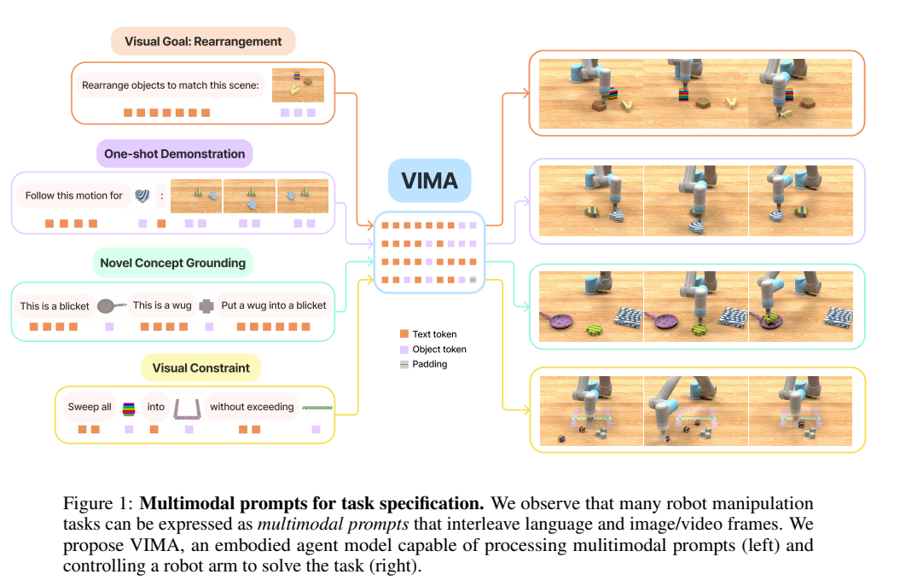
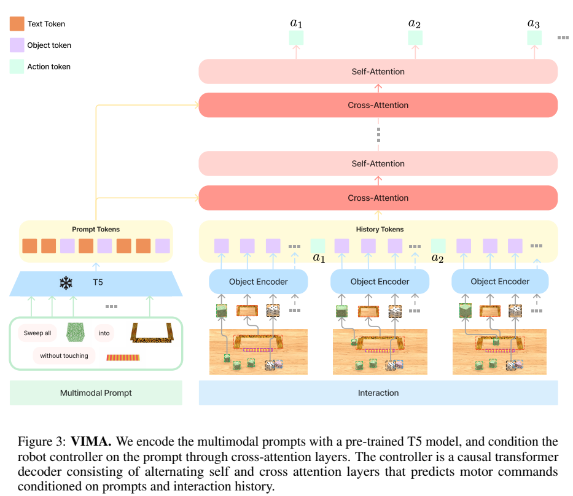
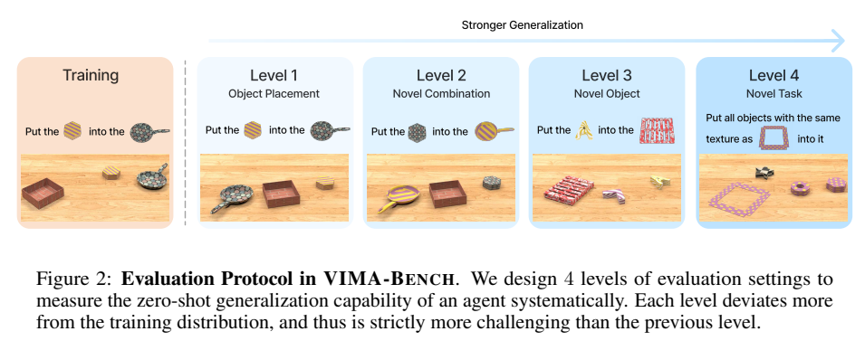
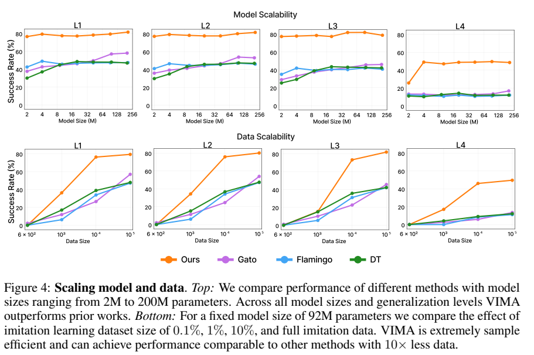
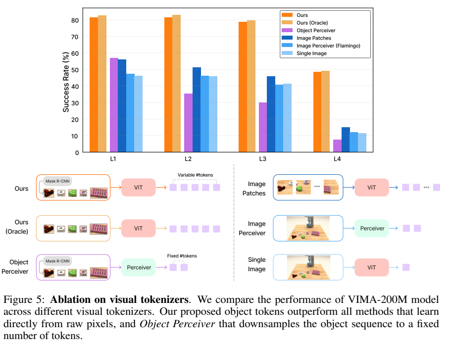

<!-- article-header:start -->
[项目首页](../../../README.md) › [模型系列](../../../reports/model-family-index.md) › [VIMA](../README.md)
<!-- article-header:end -->

# VIMA：用图文交错提示统一机器人操作任务

<!-- article-toc:start -->
<a id="article-toc"></a>

**本篇目录** · [论文定位](#paper-info) · [快速概览](#overview) · [整体架构](#architecture) · [核心原理](#principles) · [数据构建](#data) · [训练流程](#training) · [实验结果](#experiments)
<!-- article-toc:end -->

<a id="paper-info"></a>

## 1. 论文信息与模型定位

| 项目 | 信息 |
|---|---|
| 论文 | VIMA: General Robot Manipulation with Multimodal Prompts |
| 作者与团队 | Yunfan Jiang、Agrim Gupta 等；NVIDIA、Stanford、Caltech、Macalester、清华、UT Austin |
| 日期与版本 | 2022-10-06；arXiv:2210.03094v1，40 页；后续发表于 ICML 2023 |
| 家族 | VIMA，VisuoMotor Attention |
| 定位 | 根据多模态提示和交互历史输出机器人动作的通用策略 |
| 原始资料 | [论文 v1](https://arxiv.org/pdf/2210.03094v1)、[项目](https://vimalabs.github.io/)、[模型仓库](https://github.com/vimalabs/VIMA) |

VIMA 将语言指令、目标图像、演示视频帧和视觉约束放入同一种提示序列。模型生成的是机器人的操作参数，因此本篇属于多模态具身策略资料，不能按聊天模型的问答性能解读。实验主要在桌面物理仿真中开展，不等于已经验证真实家庭环境的通用机器人。（第 1–4 页）

<a id="overview"></a>

## 2. 快速概览



*原文 Figure 1，PDF 第 2 页。图像不仅是观察输入，也可以指定目标对象、动作示例和约束。*

| 关键问题 | VIMA 的处理 |
|---|---|
| 多种任务描述方式彼此割裂 | 文字与对象图像、场景图像、视频帧交错构成提示 |
| 原始像素策略容易在小数据上过拟合 | 先解析对象，用对象图像和边界框组成 token |
| 长交互历史削弱任务条件 | 在控制器各层反复交叉注意提示 |
| 泛化评测难以区分难度 | VIMA-Bench 分别测试位置、组合、新对象、新任务 |

训练是离线行为克隆，使用脚本专家生成的 650K 条成功轨迹。2M–200M 指机器人控制器的参数规模，预训练 T5 编码器不计在该数字内。（第 4、7 页）

<a id="architecture"></a>

## 3. 整体架构



*原文 Figure 3，PDF 第 5 页。提示编码与交互历史建模通过交叉注意连接。*

文字通过 T5 tokenizer 与词嵌入编码。场景图像先由适配桌面环境的 Mask R-CNN 检测对象；每个对象的裁剪图像进入 ViT，边界框进入 MLP。单对象提示图像采用同样流程，但配一个占位边界框。文本和对象 token 交错后输入 T5-Base，构成任务条件。（第 4–5、33–34 页）

观察来自正面与俯视两种视角，对象 token 按视角顺序排列，并加入末端执行器类型：吸盘或铲子。历史动作由两层 MLP 编码。控制器交替使用交叉注意和因果自注意，根据提示及过去观察、动作预测下一动作。（附录 C，第 34–35 页）

动作空间沿用抓取放置和推扫等高层原语，用起始与终止两个 SE(2) 位姿表示。附录实现为每个位姿设置六个独立分类头：两个位置分量及四个四元数分量。X、Y 和旋转的离散桶数分别为 50、100、50，随后反离散化映射为连续值。这种结构不是逐关节低层控制，也不是在同一动作内部逐分量自回归；自回归主要指环境交互的时间序列。（第 22、35 页）

| 模块 | 输入与输出 | 公开机制 |
|---|---|---|
| 对象token化 | 场景/对象图 → 裁剪视觉与边界框编码 | Mask R-CNN检测，ViT处理裁剪、MLP处理框；单物体提示用占位框 |
| 提示编码器 | 交错文字与对象token → 任务表示 | 冻结T5预训练编码器，保留多模态提示位置 |
| 历史编码 | 当前观察与过去动作 → 因果历史序列 | 双视角对象及末端执行器信息，动作MLP编码后交错 |
| 策略Transformer | 历史Query、提示K/V → 下一动作隐藏态 | 交替cross-attention与causal self-attention，反复读取任务 |
| 独立离散动作头 | 隐藏态 → 起/止位姿分量 | 每个位姿六头独立分类，再反离散化为高层原语参数 |
| 离线行为克隆 | 成功专家轨迹 → 策略参数 | 负对数似然训练；随机假阳性对象增强应对检测误差 |


<a id="principles"></a>

## 4. 核心创新与数学原理

### 4.1 任务条件与交互历史分开读取

设多模态提示为 $`P`$，交互历史为 $`H_t=[o_1,a_1,\ldots,o_t]`$，学习策略 $`\pi_\theta(a_t\mid P,H_t)`$。历史作为 Query，提示作为 Key 和 Value，交叉注意为：

```math
H'=\mathrm{softmax}\left(\frac{Q_HK_P^\top}{\sqrt d}\right)V_P.
```

这使每一步决策都可以重新读取任务提示。其后使用因果自注意处理交互顺序，禁止访问未来信息。交叉注意省去提示与所有历史之间的完整联合自注意，但总体计算仍包含历史侧的自注意，不能笼统说成整个模型线性复杂度。（第 5、35 页）

提示在每层作为固定Key/Value被历史重新查询，而不是只在序列开头接入一次后随历史一起改写。附录伪代码先cross-attention及FFN，再causal self-attention及FFN，用最后历史位置预测动作；自回归关系发生在交互时间上，不要求同一动作的所有坐标依次生成。〔v1 §4，第5页；附录C.1.5前伪代码，第35页〕

### 4.2 对象接口减少发现负担但引入检测依赖

模型保留变长对象序列，而不是把整个图像压成一个向量或固定数量潜在 token。物体数量与图文指代更直接对应，减少控制器从底层像素重新发现对象的负担。该收益依赖检测器；对象中心设计并不消除漏检、遮挡和陌生外观问题。（第 7–8 页）

框编码提供几何位置，裁剪编码提供外观，两者互补；单对象提示的占位框避免把展示图片中的任意位置误当任务要求的位置。论文还随机注入假阳性对象训练鲁棒性，主要应对多余检测，不等于补回真正漏掉的目标。〔§4 Tokenization与Training，第4–5页〕

### 4.3 离线分类目标与连续执行之间的差距

作者最小化专家动作的负对数似然：

```math
\mathcal L_{\mathrm{BC}}=-\sum_{t=1}^{T}\log\pi_\theta(a_t\mid P,H_t).
```

独立动作头对应各离散分量的分类学习。这里没有在线强化学习、奖励模型或语言回答的监督目标；专家成功轨迹训练出的策略也不自动具有从错误执行中恢复的能力。（第 5、35 页）

两组位姿及其分量独立预测，将动作学习转成易优化的离散分类；反离散化提供连续执行参数，但量化误差和分量组合不协调仍可能影响成功率。训练过程不访问物理模拟器反馈，模拟交互只用于评价，所以不能把行为克隆损失下降等同真实闭环成功保证。〔§4 Training，第5页；附录C.1.5，第35页〕


<a id="data"></a>

## 5. 数据构建与处理

VIMA-Bench 在 Ravens / PyBullet 上构建 UR5 桌面环境，工作区大小为 0.5×1 米。17 个元任务覆盖简单操作、视觉目标、概念绑定、单次视频模仿、视觉约束和视觉推理六类。纹理、对象几何、位置和提示模板程序化组合，可生成大量任务实例。（第 3–4、22–33 页）

数据按参与训练的 13 个元任务各 50K 条轨迹生成，共 650K 条；另外 4 个元任务留作新任务评测。因此不是 17×50K 条训练数据。脚本专家可以访问精确对象位置和正确指令解释，这些特权状态用于构造专家轨迹，不应描述成策略部署时直接获得的输入。

检测器用桌面数据微调，模型不使用预测对象类别名称。训练时以 0.95 概率不添加伪对象、以 0.05 概率添加一个随机边界框和图像裁剪，提高对误检的容忍度。这是针对假阳性的增强，不能直接证明能抵御所有漏检。（第 37 页）



*原文 Figure 2，PDF 第 3 页。L1 为位置变化，L2 为已见属性与形状的新组合，L3 为新对象或属性，L4 为新元任务与提示模板。每级泛化对象不同。*

<a id="training"></a>

## 6. 训练流程与目标

模型完全在离线专家数据上训练，以验证集的综合动作预测准确度选择检查点，再进入模拟器运行并测任务成功率。训练没有访问物理仿真器进行试错。正文用“冻结预训练语言模型”概括提示编码，但 §5.3 和附录 Table 1 明确写为解冻 T5 最后两层、冻结其余部分，本文按具体配置记录。（第 5、9、34 页）

| 项目 | 原文配置 |
|---|---|
| 优化器 | AdamW；Transformer 中采用 GEGLU |
| 学习率 | $`10^{-4}`$ |
| 日程 | warmup 7K 步；cosine annealing 17K 步 |
| 正则与稳定性 | weight decay 0；dropout 0.1；梯度裁剪 1.0 |
| 模型扩展 | 2、4、9、20、43、92、200M 控制器 |
| 200M 控制器 | 宽度 768，11 个交叉注意/自注意块，各 24 头 |
| 对象 ViT | 输入 32×32，patch 16，宽度 768，4 层，24 头 |

配置来自附录 Tables 1、6–7（第 34、38 页）。这些参数不包括检测器与 T5 的预训练成本；原文此处没有完整列出训练批量和硬件，不能据控制器规模直接推算总训练费用。

<a id="experiments"></a>

## 7. 实验设置与主要结果

基准以任务是否成功作二值判定，不给部分成功奖励，报告各元任务成功率的平均值。对比方法是适配本任务的 Gato、Flamingo 和 Decision Transformer：使用相同提示与训练数据，并修改输出头或条件输入。结果反映这些实现的架构差别，不是在原始 Gato、Flamingo 全部能力上作总体排名。（第 4、6 页）



*原文 Figure 4，PDF 第 6 页。上半部分比较 2M–200M 控制器；下半部分固定 92M，使用 0.1%、1%、10% 和全部训练数据。*

200M 控制器配 T5-Base，在附录 Table 13 中 L1/L2/L3/L4 分别为 81.5%、81.5%、78.7%、48.6%。新任务泛化明显更困难。摘要的“最多 2.9 倍”及“10 倍更少数据下 2.7 倍”是特定比较中的成功率倍数，不是增加了 290 个百分点，也不是保证每个任务都有该增益。

值得具体看 Table 12（第 39 页）：200M 模型在 L4 的 Tasks 08/10/13/14 为 100 / 0 / 0 / 94.5。Task 10 为未见的一次视频模仿，Task 13 为未见视觉约束任务；平均领先依然伴随这两个任务完全失败。T5-Large 的 L4 为 49.3，与 Base 48.6 接近，也不支持“只扩大语言编码器就能解决控制泛化”。



*原文 Figure 5，PDF 第 7 页。对象序列优于像素和固定长度 Perceiver 表示，与直接读取模拟器对象框的 Oracle 版本接近。*

交叉注意消融在小模型和 L4 上收益尤为明显，大模型的纯解码器变体差距较小。（Figure 7，第 8 页）实验支持对象表示与反复读取提示对该桌面任务集的数据效率，但检测器经过环境适配，训练数据也来自脚本专家。报告没有提供真实机器人、开放环境或长期安全执行的验证，因而不能将仿真成功率直接迁移为实际部署表现。

<!-- article-footer:start -->
---

[← 上一篇：MineDojo](../../minedojo/arxiv-2206.08853/README.md) · [按发表时间浏览](../../../reports/paper-reading-guide.md#year-2022) · [下一篇：MultiInstruct →](../../multiinstruct/arxiv-2212.10773/README.md)

[返回本篇目录](#article-toc) · [返回模型系列](../README.md)
<!-- article-footer:end -->
