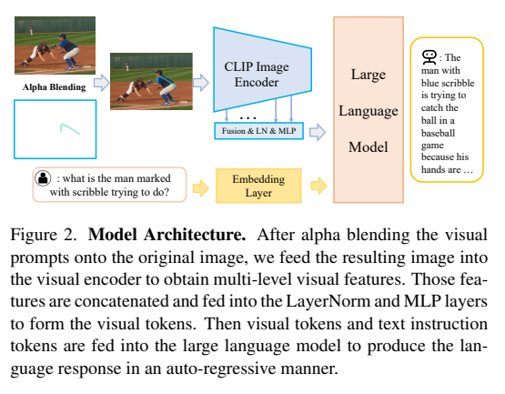
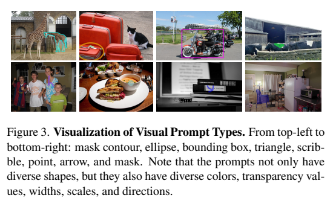
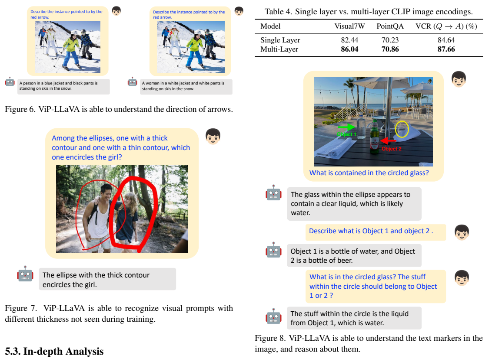
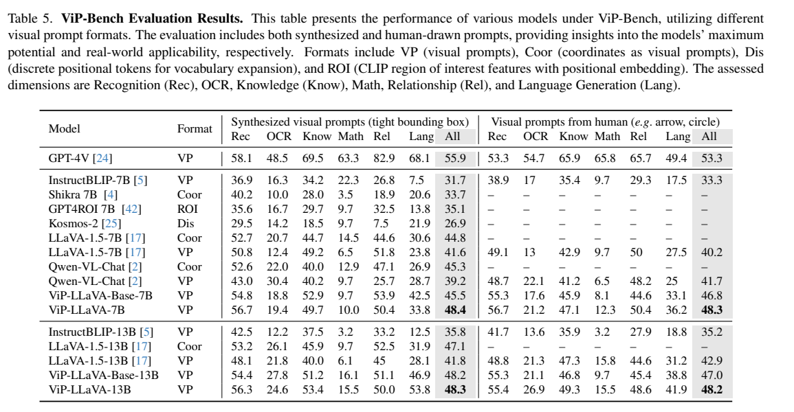

<!-- article-header:start -->
[项目首页](../../../README.md) › [模型系列](../../../reports/model-family-index.md) › [VIP-LLaVA](../README.md)
<!-- article-header:end -->

# ViP-LLaVA：直接读懂画在图像上的箭头、圈线与涂鸦

<!-- article-toc:start -->

**本篇目录** · [论文定位](#paper-info) · [快速概览](#overview) · [整体架构](#architecture) · [核心原理](#principles) · [数据构建](#data) · [训练流程](#training) · [实验结果](#experiments)
<!-- article-toc:end -->

## 1. 论文信息与模型定位

| 项目 | 信息 |
|---|---|
| 论文 | *Making Large Multimodal Models Understand Arbitrary Visual Prompts* |
| 作者与机构 | Mu Cai、Haotian Liu、Siva Karthik Mustikovela、Gregory P. Meyer、Yuning Chai、Dennis Park、Yong Jae Lee；威斯康星大学麦迪逊分校、Cruise |
| 来源 | [arXiv:2312.00784v1](https://arxiv.org/pdf/2312.00784v1)，2023 年 12 月 |
| 官方资源 | [项目页](https://vip-llava.github.io/) |
| 定位 | Vicuna 7B/13B + CLIP 的区域提示理解模型，并提出 ViP-Bench |

模型让用户直接圈出或指向图像中的对象，再提问。标记是输入图像的一部分，模型输出文字回答；本文不以输出分割掩码为目标，也不需要额外的 ROI 特征编码器。

## 2. 快速概览

| 要点 | 具体设计 |
|---|---|
| 区域指定 | 将八类视觉标记直接绘制到 RGB 图像 |
| 几何细节 | 拼接 CLIP 第 6、15、18、21、24 层特征 |
| 连接器 | LayerNorm 与两层 MLP |
| 区域数据 | 约 520K 公开数据转换；可选 13K GPT-4V 指令 |
| 评测 | 传统区域任务 + 303 图问对的 ViP-Bench |

Base 表示完成第二阶段的模型；最终 ViP-LLaVA 追加 GPT-4V 区域对话数据。后一步提高开放式对话总分，但不是所有指标都提升，13B 的 PointQA 还有退化。

## 3. 整体架构

*Figure 2，PDF 第 3 页。区域提示与原图合成后，只需一个视觉编码流程。*

输入先将箭头、框、轮廓等标记叠加到原图。CLIP-336px 提取多层特征，沿特征维度拼接，经过 LayerNorm 和 MLP 映射到 Vicuna v1.5 的输入空间；视觉 token 与文本指令一起进入语言模型。浅层偏重线条和几何形状，深层偏重对象语义，使标记与被标记内容均可被读取。（第 3、5 页）

这种方法无需把坐标写进语言词表，也不为每一种标记形状设计专用模块；但仍依赖用户标记清晰、视觉分辨率足够，不能把“arbitrary”理解为对任何绘画、遮挡和尺度都可靠。

## 4. 核心创新与数学原理

原文式 1 采用 alpha blending：

$$
\hat X_v=\alpha P_v+(1-\alpha)X_v.
$$

这里 $P_v$ 是含标记的图像，$X_v$ 是原图，混合仅作用于标记覆盖的像素，未标记区域保持原像素。训练随机选择透明度 $\alpha\in[0.5,1]$，同时随机颜色、线宽、方向和尺度，避免模型仅记住固定红框。（第 3、5 页）

原文式 2 的答案似然分解为：

$$
p(X_a\mid\hat X_v,X_q)=\prod_{i=1}^{L}p_\theta(x_i\mid\hat X_v,X_q,X_{a,<i}).
$$

最大化似然等价于答案 token 的负对数似然训练。没有单独的提示定位损失，区域对应关系通过“标记图像—问题—答案”训练获得。多层特征消融在 Base-7B 上使 Visual7W 82.44→86.04、PointQA 70.23→70.86、VCR Q→A 84.64→87.66，支持特征融合的价值。（Table 4）

仅输入叠加图像的 VCR 消融为 82.47，再额外输入原图为 81.63；这是特定对照，不能证明任何提示都完全没有遮挡影响。相同数据训练的坐标格式在 Visual7W 86.36 略高于视觉提示 86.04，但 PointQA 与 ViP-Bench 较弱，因此视觉提示优势依赖任务。（Tables 10 与正文第 7 页）

## 5. 数据构建与处理

*Figure 3，PDF 第 4 页。从轮廓、椭圆到箭头和掩码，均作为图像输入标记。*

约 520K 区域样本包括 RefCOCOg 80K、PointQA 37K、Visual Genome 关系 80K、Flickr30k Entities 30K、VCR 213K、Visual7W 82K。分项合计约 522K，正文总数使用约数；不能将其称为 520K 独立图像。数据来自各训练划分。（第 3 页）

只有框标注时生成矩形、椭圆、箭头；有真实像素掩码时可生成点、三角形、涂鸦等全部八类，约束相关标记落在对象内。涂鸦用掩码中的三点形成二次 Bézier 曲线。这些掩码用于构造训练提示，不代表模型自身预测了掩码。

可选 GPT-4V 数据让教师同时看原图、叠加标记图、真实文字标注和系统指令，生成区域对话，共 7K 单区域、6K 多区域。训练中把教师使用的“红框”等文字引用替换为其他提示形状描述；它不是仅将坐标喂给纯文本教师。（第 4 页）

## 6. 训练流程与目标

| 阶段 | 数据与检查点 |
|---|---|
| 连接器预训练 | 558K BLIP 描述图文对，1 epoch |
| 区域能力训练 | LLaVA-v1.5 指令 + 约 520K 提示数据，1 epoch，得到 Base |
| 可选区域对话训练 | 13K GPT-4V + 第二阶段抽取 13K，共 26K，1 epoch |

前两阶段在 8 张 A100 上，7B/13B 约需 20/40 小时；第三阶段再需约 0.5/1 小时。来源版本给出训练轮数、骨干、数据和时间，但未提供每阶段完整学习率、batch、优化器及冻结清单，这里不凭 LLaVA 的惯常配方补写。（第 5 页）

VCR 主表另对 Base-7B 进行目标数据微调；区域描述附录也在 RefCOCOg 上再微调 1 epoch。正文将模型称为 generalist，但数据构建已经包含 Visual7W、PointQA 等训练集，不能将相关结果统称为严格未见数据集零样本。

## 7. 实验设置与主要结果

*PDF 第 7 页。图为定性示例，表为多层特征消融。*

主文 Visual7W 的 7B/13B 为 86.60/87.91，但附录 Table 8 写为 86.09/88.28；同一 v1 存在数值冲突，不能混用成统一成绩。PointQA 主表为 71.31/71.77，13B Base 为 72.15，所以追加 GPT-4V 后反而下降 0.38 分。微调 VCR 的 Q→A/QA→R/Q→AR 为 87.66/89.80/78.93。附录另构造 3,520 例两种不同对象的箭头方向选择，13B 准确率 90.28%，这属于受控方向测试。（Tables 1–3、8；第 13 页）

*Table 5，PDF 第 8 页。分数由文本 GPT-4 依据真实答案评分，不是逐题准确率。*

ViP-Bench 的 303 图问对覆盖识别、OCR、知识、数学、关系、语言生成，分别测试合成紧框与人工绘制提示。7B 总分为 48.4/48.3，13B 为 48.3/48.2，均低于 GPT-4V 的 55.9/53.3；增大语言骨干未提高所有整体分数。7B 在合成提示上的数学分仅 10.0，OCR 19.4，仍有明显短板。开源模型采用 greedy decoding，temperature=0。（第 5、8 页）

附录区域描述 METEOR/CIDEr 为 16.6/105.9，但来自额外任务微调。论文的实质结论是自然视觉标记可以成为有效区域接口，多层视觉表示和区域数据能改善提示理解；它尚不支持对任意手绘输入、复杂数学或精细 OCR 的普遍可靠性判断。

<!-- article-footer:start -->
---

[← 上一篇：VTimeLLM](../../vtimellm/arxiv-2311.18445/README.md) · [按发表时间浏览](../../../reports/paper-reading-guide.md#year-2023) · [下一篇：TimeChat →](../../timechat/arxiv-2312.02051/README.md)

[返回本篇目录](#article-toc) · [返回模型系列](../README.md)
<!-- article-footer:end -->
