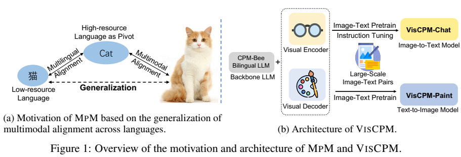
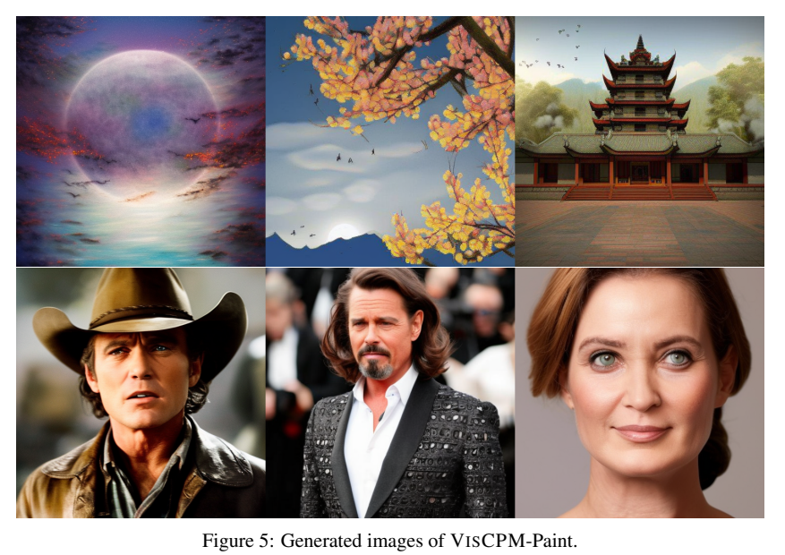
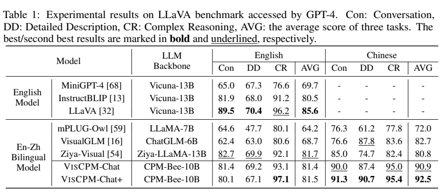
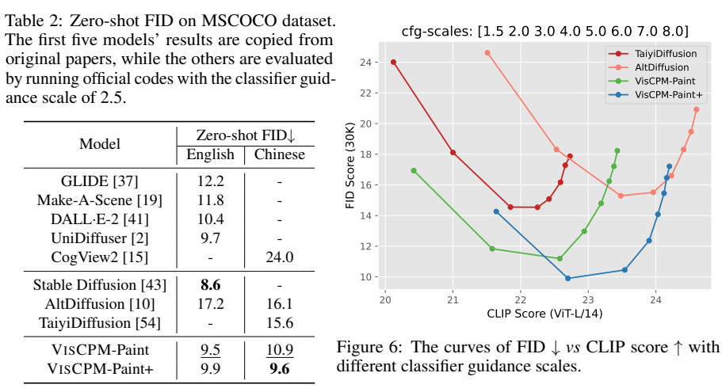
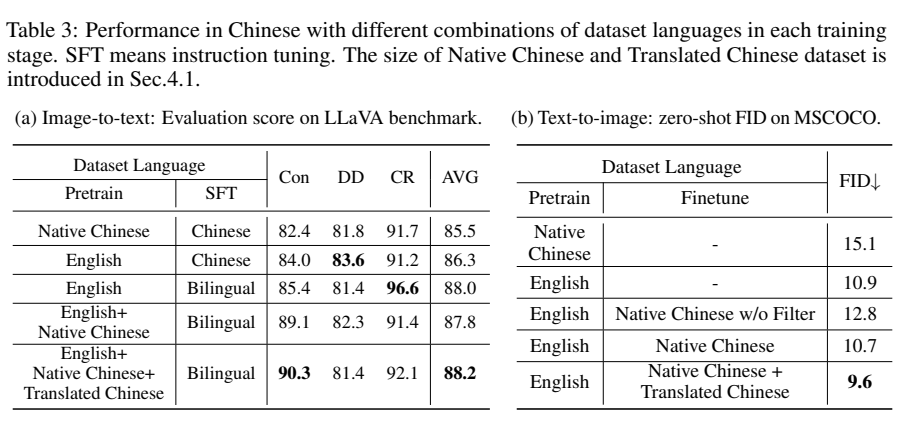

<!-- article-header:start -->
[项目首页](../../../README.md) › [模型系列](../../../reports/model-family-index.md) › [VisCPM](../README.md)
<!-- article-header:end -->

# VisCPM：以多语言模型为桥梁迁移视觉能力

<!-- article-toc:start -->
<a id="article-toc"></a>

**本篇目录** · [论文定位](#paper-info) · [快速概览](#overview) · [整体架构](#architecture) · [核心原理](#principles) · [数据构建](#data) · [训练流程](#training) · [实验结果](#experiments)
<!-- article-toc:end -->

<a id="paper-info"></a>

## 1. 论文信息与模型定位

| 项目 | 信息 |
|---|---|
| 论文 | *Large Multilingual Models Pivot Zero-Shot Multimodal Learning across Languages* |
| 作者与机构 | Jinyi Hu、Yuan Yao、Chongyi Wang 等；清华大学、中国人民大学、北京邮电大学、知乎、ModelBest |
| 来源版本 | [arXiv:2308.12038v1](https://arxiv.org/pdf/2308.12038v1)，2023 年 8 月 |
| 官方资源 | [OpenBMB/VisCPM](https://github.com/OpenBMB/VisCPM) |
| 定位 | MPM 跨语言训练范式；VisCPM-Chat 图像聊天与 VisCPM-Paint 文生图 |

本文用英语作为拥有丰富图文数据的枢纽语言，通过已学会中文和英文的语言骨干将视觉能力迁移到中文。Chat 与 Paint 是不同模型分支，不能把二者描述成同一个既理解又生成图像的端到端检查点。

<a id="overview"></a>

## 2. 快速概览

| 分支 | 架构与训练重点 | “零样本”的具体范围 |
|---|---|---|
| Chat | BEiT-3/Muffin 视觉模块 + CPM-Bee-10B | 图文预训练仅英文；最终中文聊天 SFT 含翻译数据 |
| Paint | CPM-Bee 条件表示 + Stable Diffusion U-Net | 基础版本图文训练只有英文，可直接输入中文提示 |
| `+` 版本 | 加入中文原生、翻译图文数据 | 不再是只用英文图文训练的设置 |

只进行英文聊天指令微调时，模型能够理解中文问题，但通常用英文回答，作者称之为 quasi-zero-shot。为校准输出语言，最终 Chat 加入中文指令。这是标题中“零样本跨语言”最容易被误读的地方。（正文第 4、6 页）

<a id="architecture"></a>

## 3. 整体架构



*原文 Figure 1，PDF 第 2 页。语言间对齐由既有多语言模型提供，图文对齐借助英文数据建立。*

Chat 的视觉模块采用 Muffin，利用预训练 BEiT-3 作为视觉语言桥梁，把图像特征映射到 CPM-Bee 的语言输入。预训练冻结语言骨干，指令微调同时更新视觉模块与语言模型。它不是 BLIP-2 Q-Former 结构的直接重命名。（第 5、20 页）

Paint 从 Stable Diffusion 初始化 U-Net。CPM-Bee hidden states 经线性层和 LayerNorm 的 transblock 转换维度，供 U-Net 交叉注意力读取。训练只更新 transblock 与 U-Net 的交叉注意力，冻结语言骨干和其余生成模块，尽量保留已有图像生成能力。（第 6、21 页）



*原文 Figure 5，PDF 第 9 页。这里使用论文中已经生成的图片，不是本仓库重新生成的素材。*

两种变体的推理方向不同。Chat 把图像经 Muffin 转成视觉特征，再与中文或英文问题的嵌入拼接，CPM-Bee 自回归输出文字；它不在回答时调用 Paint。Paint 把文字送入 CPM-Bee，取隐藏状态经 transblock 作为 U-Net 的交叉注意力条件，扩散模型从噪声逐步生成图像潜变量，再还原为图像。二者利用同一个多语言语义底座建立跨语言迁移，但并非一套模型在每次请求中自动双向往返。附录 B 记录 Chat 使用 beam size 3，附录 C 记录 Paint 的 DDPM 50 步采样，分别属于两条输出路径的解码设置。[原文 §3.2–3.3、附录 B–C，PDF 第 4–5、20–21 页](https://arxiv.org/pdf/2308.12038v1#page=21)


<a id="principles"></a>

## 4. 核心创新与数学原理

核心假设是：多语言模型 $`f_\sigma`$ 对相同语义的目标语言与枢纽语言文本给出相近表示，即 $`f_\sigma(y^{l_t})\approx f_\sigma(y^{l_p})`$。据此，视觉模块在英文上学习后，可能处理中文条件表示。这是迁移机制的近似解释，不是保证所有词和语言等价的定理，也没有新增一个显式跨语言向量距离损失。（第 3–5 页）

图像到文本预训练的原文式 (1) 为：

```math
\mathcal L_1=-\sum_i\log p_\theta(y_i^{l_p}\mid h_\xi(x_i)),\qquad \theta=\{\xi\}.
```

冻结语言模型，只更新视觉模块。指令微调式 (2) 以图像和问题为条件预测回答，并更新 $`\theta=\{\xi,\sigma\}`$。两个阶段的训练对象不同：后者也校准回答语言与指令遵循。

文生图采用原文式 (3) 的扩散噪声预测：

```math
\mathcal L_{\mathrm{diff}}=\mathbb E_{x,y^{l_p},\epsilon,\tau}\left[\Vert g_\delta(x_\tau,f_\sigma(y^{l_p}),\tau)-\epsilon\Vert _2^2\right].
```

如果中文文本条件与对应英文条件接近，冻结的语言模型就能让已训练的去噪器生成相关图像。实际 Paint 只更新去噪网络的交叉注意力及连接模块，而非全部 U-Net。该范式依赖骨干语言能力和视觉概念覆盖，不能保证未知语言或文化概念自动迁移。

<a id="data"></a>

## 5. 数据构建与处理

Chat 使用 CC3M、CC12M、COCO、Visual Genome、LAION-COCO 英文图文数据；LAION-COCO 的 caption 由 BLIP 生成。附录 Table 6 为基础 Chat 列出 626K、8.4M、390M 数据池和 12.5%、25%、62.5% 的采样权重；正文用“100M 图文”概述训练规模，不宜将其当作附录全部不同样本的精确总数。（第 5、19–20 页）

指令调优混合 LLaVA-Instruct-150K、UniMM-Chat 的英中双语版本与 M3IT 的英语部分，翻译通常使用 CPM-Bee。六语言扩展则以 LLaMA 为骨干，用 M2M-100 把 LLaVA 指令翻译到德、法、西、意、葡语，再和英语一起微调，不能称该聊天设置完全不含目标语言多模态样本。（第 12 页）

中文图文对照使用 Wukong 与 Zero，并以中文 CLIP 分数 >0.18 过滤。本文 v1 的规模记法并不完全统一：正文列出的中文原生/翻译数据，与 Table 6、附录 D 的 20M 合并原生数据、136M 或 390M 翻译数据存在差别。这里保留不同实验位置的说明，不给出一个拼接后的“准确总量”。（第 6、19、21 页）

<a id="training"></a>

## 6. 训练流程与目标

Chat 预训练 180K 步、batch 768、学习率 10⁻⁵、Adam；SFT 80K 步、batch 64、同一学习率与优化器。Chat+ 附录报告预训练 480K 步，SFT 配方同基础版。推理采用 beam size=3。（第 5–6、20 页）

Paint 训练共 300K 步、batch 4096、学习率 10⁻⁴、AdamW。前 200K 步分辨率存在来源冲突：正文写 384×384，附录 C 写 256×256；后 100K 步均写 512×512。这里不能任选其一而删除矛盾。采样采用 DDPM scheduler、50 步，附录说明每个提示生成四张，以中文 CLIP 选得分最高的图。（第 6、21 页）

原文没有统一披露完整硬件与训练耗时，不能由 batch 和步数推算实际成本。语言间表示近似来自已有骨干，论文训练并未从头建立完整语言预训练过程。

<a id="experiments"></a>

## 7. 实验设置与主要结果



*原文 Table 1，PDF 第 7 页，以 GPT-4-0314 评审模型和参考答案。*

图像聊天用 90 个 LLaVA benchmark 实例及中文翻译版。Chat 的英/中平均相对分为 81.4/90.9，Chat+ 为 81.5/92.5；基础 Chat 英语低于 LLaVA 的 85.6。中文详细描述 87.4 也略低于 VisualGLM 的 87.8，因此正文“中文三方面均优于对照”的概括并非每列严格成立。这些分数是教师评审相对值，六语言表甚至有单项超过 100，不能当作准确率。（Table 1、4）



*原文 Table 2、Figure 6，PDF 第 10 页，区分固定 guidance 表格与多 guidance 曲线。*

在 COCO 验证集抽取 30K 提示，中文提示由英文 caption 翻译。Table 2 的英/中 FID：Paint 9.5/10.9，Paint+ 9.9/9.6；中文优于 AltDiffusion 16.1、Taiyi 15.6，英语仍低于 Stable Diffusion 的质量表现（FID 8.6 更好）。表注固定 guidance=2.5，而正文及 Figure 6 描述八个 guidance 的搜索；两种口径不宜合并成一个“统一最佳 FID”。

Chinese Drawbench 包含 174 个提示、八类能力，五位评审比较最佳图像的质量、对齐与总体偏好。作者报告各方面超过 40% 偏好 Paint，但该设置先每模型生成四图再选一，不能解释为随机单次生成胜率。（第 11、21 页）



*原文 Table 3，PDF 第 11 页；聊天消融只使用 LLaVA 指令，和主实验完整指令混合不同。*

英文预训练、双语 SFT 的聊天平均分为 88.0；加原生中文变成 87.8，再加翻译中文为 88.2。文生图英文训练 FID 10.9，继续用未过滤中文降为 12.8，过滤后为 10.7，加入翻译中文为 9.6。这支持数据质量与语言骨干的作用，但不支持“更多中文数据总会提升”，也不能据少量语言和翻译基准推出所有低资源语言的可靠迁移。

配图取自原论文；[来源清单](figures-manifest.json)。本仓库未重新训练复现。

<!-- article-footer:start -->
---

[← 上一篇：BLIVA](../../bliva/arxiv-2308.09936/README.md) · [按发表时间浏览](../../../reports/paper-reading-guide.md#year-2023) · [下一篇：Qwen-VL →](../../qwen/arxiv-2308.12966/README.md)

[返回本篇目录](#article-toc) · [返回模型系列](../README.md)
<!-- article-footer:end -->
