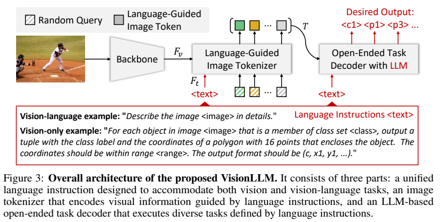
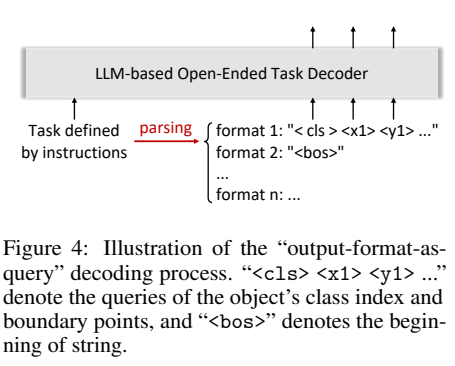
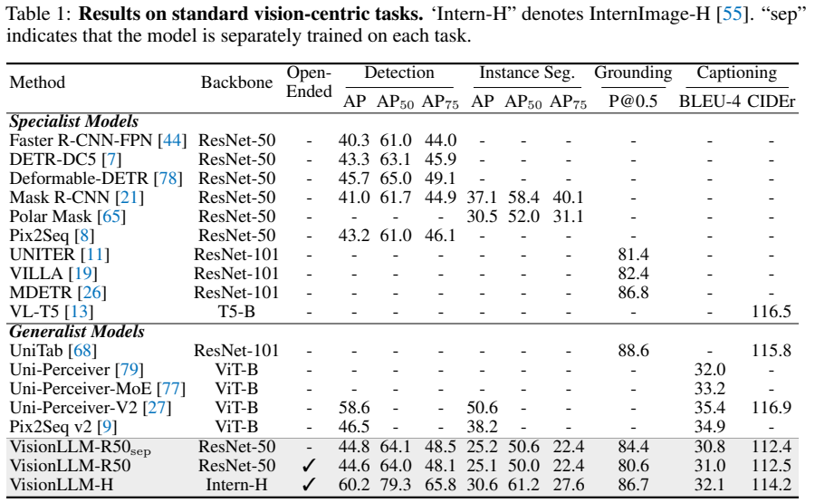
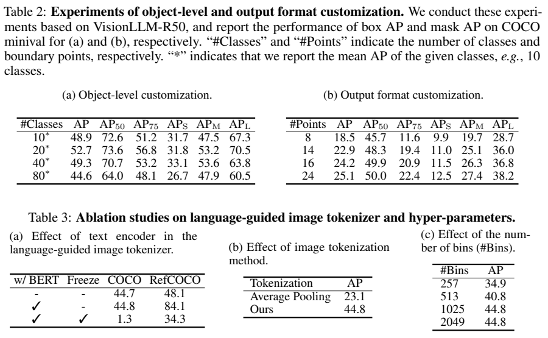

<!-- article-header:start -->
[项目首页](../../../README.md) › [模型系列](../../../reports/model-family-index.md) › [VisionLLM](../README.md)
<!-- article-header:end -->

# VisionLLM：让语言模型按指令解码检测、分割与图文任务

<!-- article-toc:start -->
<a id="article-toc"></a>

**本篇目录** · [论文定位](#paper-info) · [快速概览](#overview) · [整体架构](#architecture) · [核心原理](#principles) · [数据构建](#data) · [训练流程](#training) · [实验结果](#experiments)
<!-- article-toc:end -->

<a id="paper-info"></a>

## 1. 论文信息与模型定位

| 项目 | 内容 |
|---|---|
| 论文 | VisionLLM: Large Language Model is also an Open-Ended Decoder for Vision-Centric Tasks |
| 作者与机构 | Wenhai Wang、Zhe Chen、Xiaokang Chen 等；OpenGVLab/上海 AI 实验室、南京大学、北京大学、香港大学、商汤、清华大学 |
| 本文依据 | [arXiv v1，2023-05-18](https://arxiv.org/pdf/2305.11175v1)，15 页 |
| 官方代码 | [OpenGVLab/VisionLLM](https://github.com/OpenGVLab/VisionLLM) |
| 定位 | 以 Alpaca-7B 为解码器的通用视觉任务框架，通过语言指定类别、坐标格式和任务 |
| 输出 | 检测框、物体多边形、指代定位结果或自然语言；结构化几何输出可还原为视觉结果 |

VisionLLM 试图把“检测这几类物体”“用 16 个点表示边界”与“描述图像”放入统一指令接口。它仍基于有监督的视觉任务训练，论文的开放式能力主要指任务、类别与格式可定制，不能直接解读为无需训练即可执行任意新视觉算法。（§1、3）

<a id="overview"></a>

## 2. 快速概览

| 设计 | 解决的问题 |
|---|---|
| 统一语言指令 | 给出任务、目标类别集合和输出结构，按提示切换任务 |
| 语言引导图像 tokenizer | 用 BERT 特征引导多尺度图像表示，抽取 100 个语义与位置 token |
| 类别与位置新词表 | 将类别索引和相对坐标转成单个离散 token |
| 输出格式作为 query | 几何结构可并行解码，减少逐 token 生成的开销 |
| LoRA 与两阶段训练 | 先学习检测与对齐，再加入多任务监督 |

InternImage-H 版本的 COCO 检测 AP 为 60.2，但实例分割 AP 为 30.6；ResNet-50 共享模型检测 AP 44.6。结果说明大型视觉骨干有助于检测，同时多边形表示的精细分割仍是限制。（Table 1）

<a id="architecture"></a>

## 3. 整体架构



*来源：v1 Figure 3，PDF 第 5 页。图像 tokenizer 会根据指令调整表示，输出包括语义 embedding 与位置。*

视觉骨干为 ResNet-50 或 InternImage-H，输出四尺度特征；BERT-Base 编码提示，跨注意力把语言信息注入视觉特征。Deformable DETR 的 Transformer 使用 100 个可学习查询，编码器、解码器各 6 层，抽取 $`T=\{(e_i,l_i)\}_{i=1}^{100}`$，其中 $`e_i`$ 表示语义，$`l_i`$ 表示位置。（§3.3、4.1）

Alpaca-7B 接收这些图像 token 和任务指令。图文任务输出正常词语，感知任务输出类标签与坐标 token；物体边界由若干点组成，解析后获得检测框或多边形掩码。因此这里的分割不是通过另一个独立像素解码器预测完整概率图。（§3.2–3.4）

指令参与两次不同计算。BERT 编码的任务描述先通过跨注意力影响多尺度视觉特征，让 100 个查询提取与当前任务相关的语义和位置；这些图像 token 再与原语言指令进入 Alpaca 解码器。因此 tokenizer 输出并不是与问题无关的一组普通 patch，也不是最终检测结果。

输出侧的“格式即查询”同样重要：模型先从指令解析结构，例如检测的类别与两个角点槽位，再用这些格式 token 作为查询产生类别和位置；描述任务则从开始标记生成文字。类别 token 与名称的映射由本次指令给出，位置 token 表示相对图像 token 位置的离散偏移，后续按该任务格式恢复框或多边形。这样检测输出不必机械地逐字生成一长串自然语言数字。[原文 §3.1–3.4、Figure 4，PDF 第 5–7 页](https://arxiv.org/pdf/2305.11175v1#page=6)

| 模块 | 输入与输出 | 公开机制 |
|---|---|---|
| 四尺度视觉骨干 | 图像 → 多尺度特征 | ResNet-50或InternImage-H，提供不同尺度视觉内容 |
| BERT及语言引导融合 | 任务描述、视觉特征 → 任务相关特征 | BERT-Base编码指令，各尺度cross-attention注入语言 |
| Deformable DETR tokenizer | 融合特征、100查询 → 语义/位置图像token | 编码/解码各六层，每token同时含语义嵌入和位置基准 |
| Alpaca-7B任务解码 | 图像token、指令、格式查询 → 分类/位置或文字 | 扩展类别与偏移词表，感知用格式查询，描述保持语言出口 |
| 结构化结果恢复 | 类别索引、离散偏移 → 框/多边形 | 类别映射由当前指令指定；位置相对图像token，不是绝对像素词表 |


<a id="principles"></a>

## 4. 核心创新与数学原理

### 4.1 任务指令同时定义视觉关注与输出语义

指令先通过BERT影响视觉特征，让图像查询提取任务所需内容，再在解码端声明类别名称与专用索引的映射。同一个类别token可以在不同任务指令中指向不同名字；这种可定制接口依赖模型正确理解当前集合，不是永久绑定所有类别的固定检测头。[原文 §3.2–3.4，PDF 第 5–6 页](https://arxiv.org/pdf/2305.11175v1#page=6)

**语义无关类别索引。** 增加 `<c0>` 至 `<c511>`，提示里声明类别到 token 的映射，例如 person 对应 `<c0>`。其索引含义由当前类别集合决定；不能将 `<c0>` 固定解释为某个数据集类别。单 token 类别表示减少用多个词生成类别名的开销。（§3.4）

### 4.2 位置token围绕图像查询基准表达偏移

tokenizer为每个图像token提供位置，解码器再预测相对于该基准的量化偏移，把连续定位改成有限类别选择。检测用两个角点，轮廓用更多边界点，两种任务共享输出语法却具有不同长度与近似误差。更密边界点可表达复杂形状，但增加槽位和计算，不能等同完整像素概率图。[原文 §3.2–3.4、位置词表](https://arxiv.org/pdf/2305.11175v1#page=6)

**把定位变成离散分类。** 增加 `<p-512>` 至 `<p512>`，共 1025 个位置 token。相对偏移按图像宽高归一化后量化；例如横向坐标可用以下解释形式还原：

```math
\hat x=l_{i,x}+\frac{k_x}{512}W,\qquad k_x\in\{-512,\ldots,512\}.
```

该式说明原文“相对于图像 token 位置、偏移量占宽高的 $`k/512`$”的含义；具体裁剪和舍入细节未完整给出。离散化统一训练目标，也引入量化误差。框只需两个角点，分割通常用 8–24 个边界点；点数与坐标精度限制复杂轮廓。（第 6、8–9 页）

### 4.3 格式作为查询改变感知任务的解码方式

类别与坐标槽位先由任务格式确定，再作为查询交给同一解码器产生结果，因此感知输出无需像长文本那样逐字串行。caption则用字符串起始符启动语言生成。统一交叉熵只说明目标类型相容，不表示两类任务拥有相同因果上下文或延迟；原文也未给足以量化固定加速倍数的测速。[原文 §3.4、Figure 4，PDF 第 7 页](https://arxiv.org/pdf/2305.11175v1#page=7)



*来源：v1 Figure 4，PDF 第 7 页。结构化坐标查询与文本生成使用同一任务解码器。*

检测指令中的输出结构可转换成类别、横纵坐标等查询并行预测；caption 则以字符串起始符启动语言输出。这使感知输出无需完全采用通常的逐词自回归过程，但论文没有提供可据此引用的统一 FPS 或固定倍数测速结果。（§3.4）

各任务都可以使用 token 交叉熵：

```math
\mathcal L=-\sum_j\log p_\theta(t_j\mid I,\mathrm{instruction},\mathrm{context}_j)
```

这里是作用说明，感知任务的上下文与并行查询方式不同于 caption 的前缀。原文没有把全部定位转换回另一个连续回归损失。（第 7 页）

<a id="data"></a>

## 5. 数据构建与处理

检测、实例分割使用 COCO2017；指代定位合并 RefCOCO、RefCOCO+、RefCOCOg 标注，超过 120K 指代对象，评估用 RefCOCO 验证集。图像描述使用 COCO Caption，评估按 Karpathy test；VQA 使用 LLaVA-Instruct-150K，主要通过案例展示，未提供标准 VQA 测试表。（§4.1）

感知标注被转换成类别与坐标序列。指令先编写含任务、类别集合、坐标范围和格式的种子模板，再由 LLM 生成相关描述，训练时随机选用；同时随机化目标类别，训练模型理解当前任务的类别集合。坐标是离散偏移表示，图中的连续坐标展示可由其解码得到，不能据展示的小数推断模型直接回归了浮点坐标。（§3.2–3.4）

论文没有给出完整的多任务采样比例、所有指令生成数量与后处理阈值，本文不把五个任务的数据条数简单相加为独立图像总数。（§4.1）

<a id="training"></a>

## 6. 训练流程与目标

| 阶段 | 训练安排 |
|---|---|
| 第一阶段 | 从预训练 D-DETR、BERT、Alpaca 初始化；训练视觉骨干与语言引导 tokenizer，LLM 大多数参数冻结，训练 LoRA；重点为随机类别和随机描述的检测任务 |
| 第二阶段 | 冻结视觉骨干，引入检测、分割、定位、描述等统一多任务监督 |

默认报告训练 50 epochs，使用 4×8 张 A100，每 GPU 一份样本，AdamW、初始学习率 $`2\times10^{-4}`$ 和余弦退火。原文未明确将 50 epochs 分配给每一阶段，也没有完整列出 LoRA rank 等超参数，不能据此写成两阶段各训练 50 epochs。（第 7–8 页）

这个训练成本建立在已经预训练的检测、文本和语言模型资产上。LoRA 减少语言模型更新量，并不意味着预训练视觉系统与整个框架的计算成本可以忽略。（§3.4、4.1）

<a id="experiments"></a>

## 7. 实验设置与主要结果



*来源：v1 Table 1，PDF 第 8 页。`sep` 是每个任务分别训练的模型，其余 VisionLLM 行来自共享参数模型。AP、定位 P@0.5、BLEU 与 CIDEr 不能相互当作同一种准确率。*

| 版本 | 检测 AP | 分割 AP | RefCOCO P@0.5 | Caption CIDEr |
|---|---:|---:|---:|---:|
| ResNet-50，分别训练 | 44.8 | 25.2 | 84.4 | 112.4 |
| ResNet-50，共享模型 | 44.6 | 25.1 | 80.6 | 112.5 |
| InternImage-H，共享模型 | 60.2 | 30.6 | 86.7 | 114.2 |

同为 ResNet-50，检测高于 Pix2Seq 43.2，但低于 D-DETR 45.7。H 版本分割 AP50 为 61.2，AP75 为 27.6，显示较宽松匹配尚可而精细边界不足；caption CIDEr 114.2 也低于表中 VL-T5 116.5、Uni-Perceiver-V2 116.9。共享训练的定位比单任务下降 3.8，保留了多任务冲突的证据。（Table 1、§4.2、4.4）



*来源：v1 Tables 2–3，PDF 第 9 页。限定类别集合的 AP 只对所选类别平均，不能与 80 类 AP 不加条件地比较。*

指定边界点数由 8 增到 24，分割 AP 18.5→25.1；位置 bins 从 257 增到 1025，检测 AP 34.9→44.8，继续到 2049 不再提升。平均池化图像表示 AP 23.1，查询式表示 44.8，支持面向物体的表示设计。（Tables 2b、3b–c）

去掉 BERT 时定位 48.1，加入可训练 BERT 后 84.1，冻结 BERT 时降到 34.3，说明语言条件表示对定位重要；对应检测 44.7、44.8、1.3 也显示冻结设置存在严重对齐问题。开放词汇与复杂 VQA 主要由 Figure 2 展示，姿态估计虽可写成类似格式，在本报告中没有对应的定量基准，应作为扩展方向理解。（Table 3a、§3.2、4.1）

**来源说明：** 本文固定依据 v1 的框架与结果，未复现训练；图表来源与裁切坐标见 [图片清单](figures-manifest.json)。

<!-- article-footer:start -->
---

[← 上一篇：LTU](../../ltu/arxiv-2305.10790/README.md) · [按发表时间浏览](../../../reports/paper-reading-guide.md#year-2023) · [下一篇：Pengi →](../../pengi/arxiv-2305.11834/README.md)

[返回本篇目录](#article-toc) · [返回模型系列](../README.md)
<!-- article-footer:end -->
