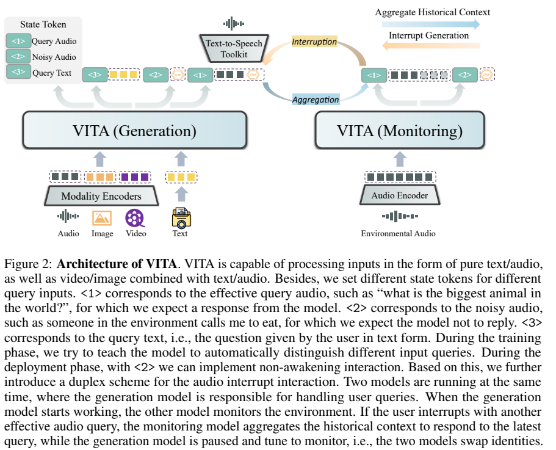
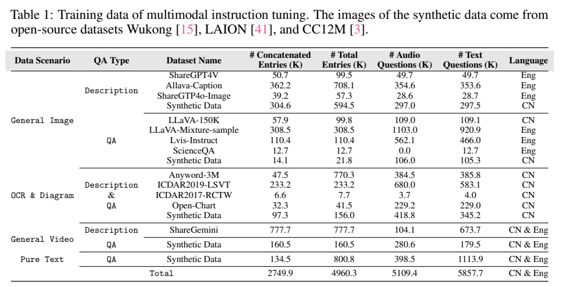
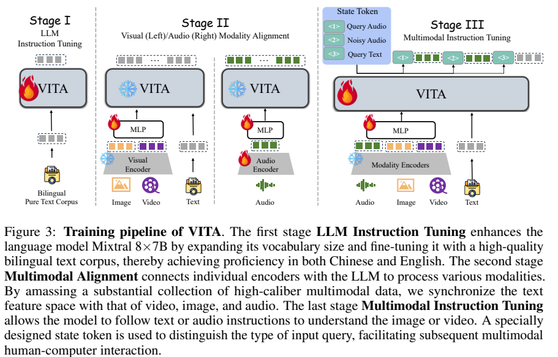
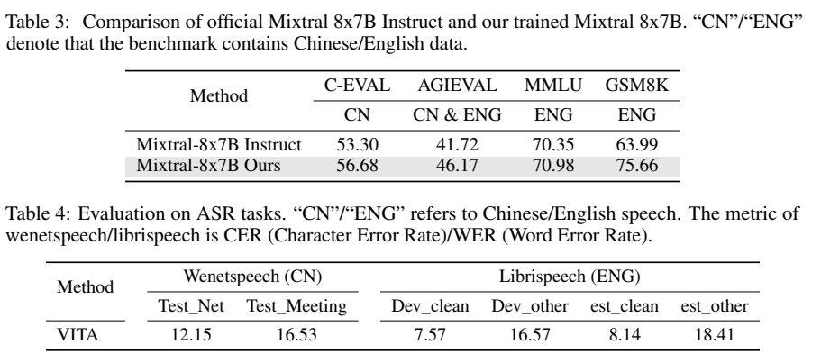
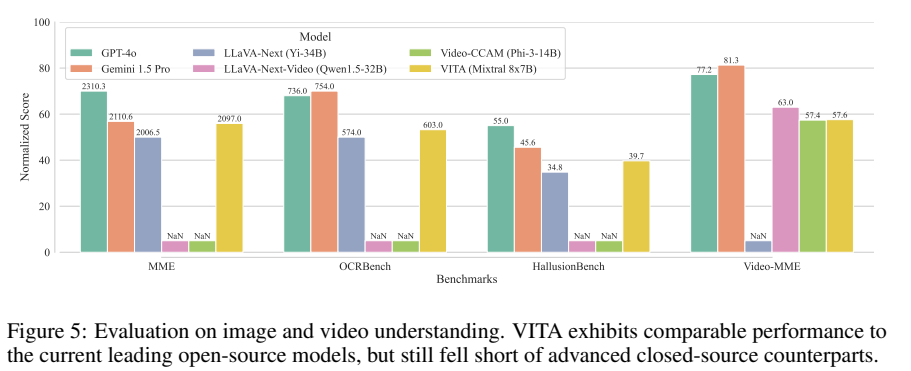

# VITA：结合多模态理解与可打断语音交互

## 1. 论文信息与模型定位

| 项目 | 信息 |
|---|---|
| 论文 | VITA: Towards Open-Source Interactive Omni Multimodal LLM |
| 作者与团队 | Chaoyou Fu、Haojia Lin 等；腾讯优图、南京大学、厦门大学、中科院自动化所 |
| 日期与版本 | 2024-08-09；arXiv:2408.05211v1，13 页 |
| 家族与底座 | VITA 初代；Mixtral 8×7B |
| 定位 | 中英双语图像、视频、文本与音频理解，以及无需唤醒词和可打断交互 |
| 原始资料 | [论文 v1](https://arxiv.org/pdf/2408.05211v1)、[项目](https://vita-home.github.io/)、[系列仓库](https://github.com/VITA-MLLM/VITA) |

VITA 尝试把多模态能力与自然交互放进同一个系统：用户可以用文本或语音询问图像、视频，模型还需判断环境中的话语是否值得回应。初代重点是多模态输入理解，语言模型输出文本，再通过额外 TTS 合成语音。不能将后续 VITA-1.5、VITA-Audio 等版本的语音生成方法归入本篇。（第 1–3、9 页）

## 2. 快速概览

| 核心问题 | 方法 | 边界 |
|---|---|---|
| Mixtral 中文能力不足 | 扩大中文词表并进行双语指令训练 | 依赖已有语言底座 |
| 多种输入模态如何连接 | 独立视觉、音频编码器与两层 MLP 连接器 | 不是用一个共享编码器处理所有原始信号 |
| 环境语音不一定是对模型的请求 | 学习三个输入状态 token | 训练负例较简单，仍会误触发 |
| 回答期间需要监听新请求 | 双实例部署，一边生成、一边监听 | 系统层面的双工，需要额外运行资源 |

这篇工作的辨识度来自“理解输入、判断是否回应、管理打断”之间的结合。原文主要报告语言、ASR、图像和视频基准；没有提供完整交互触发准确率和时延统计。（第 7–9 页）

## 3. 整体架构

*原文 Figure 2，PDF 第 3 页。两个模型实例可交换生成与监听职责；输出语音由外部工具完成。*

语言侧为扩展词表的 Mixtral 8×7B。视觉侧采用 InternViT-300M-448px，448×448 输入经过连接器后对应 256 个视觉 token。高分辨率图像动态切块。视频不足 4 秒时均匀采 4 帧，4–16 秒按每秒一帧采样，超过 16 秒均匀采 16 帧；视频帧不再动态切块，控制 token 数量。（第 4–5 页）

音频先转成 Mel Filter Bank 特征，经 4 倍 CNN 下采样与 24 层 Transformer，编码器共 341M 参数，再由两层 MLP 连接语言模型。每 2 秒音频对应 25 个 token。该支路让语言模型直接接收音频表示，不需要先执行独立 ASR 把问题转换成文本。（第 6 页）

部署先由 VAD 判断是否有人声，再由模型状态决定是否回应。生成实例回答当前请求，监听实例持续检查新的有效语音请求；发生打断时暂停原生成、聚合历史上下文，由监听实例接手回答并交换角色。这个方案与单模型原生同时收发音频的架构不同。（第 7–8 页）

## 4. 核心创新与数学原理

**状态识别融合到生成序列。** 作者在回答开头增加三个状态 token：`<1>` 为有效语音问题，`<2>` 为不需回应的语音，`<3>` 为文本问题。可以用下式解释其联合建模，但这是对训练机制的数学概括，不是原文公开的独立分类损失：

$$
p_\theta(s,y\mid x)=p_\theta(s\mid x)\prod_{t=1}^{|y|}p_\theta(y_t\mid x,s,y_{<t}).
$$

系统先生成状态，再决定是否将后续内容呈现给用户。它不仅在识别“声音是否存在”，还要判断语义上的回应需求。VAD 只能解决前者，因此仍需要模型处理语音内容。（第 7 页）

**训练负例并非立即停止。** 作者发现将非请求音频的监督目标直接设成 EOS 会降低性能，于是让另一个 LLM 为负例文本生成回复，作为训练目标；推理时才把 `<2>` 当成终止信号。因此不能把负例训练概括为“听到噪声只学习输出 EOS”，也不能称其为完全没有回答监督的二分类。（§3.3.2）

**双工交互是状态驱动的调度。** 两个实例保证输出期间仍有一个实例可以处理新输入。其收益依赖 VAD 分段、状态判断、生成停止和历史拼接，并不是修改 Mixtral 自注意公式即可实现。论文没有给出误触发、漏触发与打断延迟之间的完整曲线。

**动态切块与序列拼接控制预算。** 图片细节用局部块保留，视频限制帧数；纯文本和图文数据拼至约 6K token，提高批内长度利用率。拼接独立图文样本不等于学习真实连续视频的因果关系。（第 5–6 页）

## 5. 数据构建与处理

双语文本阶段使用 5M 合成语料，词表从 32,000 扩至 51,747。视觉数据覆盖 ShareGPT4V、Allava-Caption、ShareGPT4o-Image、LLaVA、LVIS、ScienceQA、OCR/图表集和视频数据；补充中文合成描述，翻译部分 LLaVA-150K 问答，并重标注 Video-ChatGPT、VideoChat2 数据。（第 4–5 页）

*原文 Table 1，PDF 第 5 页。数据条目、拼接条目和问题数量的统计单位不同。*

表中原始条目合计 4,960.3K，拼接后 2,749.9K；语音问题 5,109.4K、文本问题 5,857.7K。一个条目可以含多个问题，不能把问题数直接当成唯一图像或视频数。800K 纯文本条目用于指令阶段保留文本能力，不用于冻结语言模型的视觉对齐阶段。

语音对齐使用中文 WenetSpeech、英文 GigaSpeech，以及 WavCaps 的 AudioSet SL 子集进行 ASR 和音频描述。指令阶段把约一半问题用 GPT-SoVITS 等 TTS 转成语音，增加语音指令监督。（第 6 页）

另外，从已有问答的回答中采样 474K 句非问题文本，匹配正例长度分布后合成为负例音频。这里的“噪声”包括不应对其回应的人声，不仅是声学噪声。回答句合成负例与真实环境中的旁人交谈、含混请求存在分布差异，作者也承认会误判。（第 7、9 页）

## 6. 训练流程与目标

*原文 Figure 3，PDF 第 4 页。视觉对齐与音频对齐的训练模块不同。*

| 阶段 | 数据与目的 | 训练范围 |
|---|---|---|
| 双语语言指令训练 | 扩展中文词表，学习 5M 中英文本指令 | 语言模型 |
| 视觉对齐 | 视觉描述、问答、OCR、图表与视频文本监督 | 只训练视觉连接器，冻结视觉编码器与 LLM |
| 音频对齐 | ASR 与音频描述 | 训练音频编码器及连接器 |
| 多模态指令训练 | 图文、视频、文本及合成语音问题，加入状态 token | 冻结视觉和音频编码器，训练连接器与 Mixtral |

正文将第二行和第三行合称多模态对齐阶段，所以整体仍是三阶段流程。各阶段主要学习目标由目标文本及状态序列提供，而不是视觉对比学习或偏好强化学习。首版没有披露足够完整的学习率、优化器、批量、总步数及硬件配置，不能把后续仓库版本的训练参数无版本说明地补到本篇。（第 4–7 页）

## 7. 实验设置与主要结果

*原文 Tables 3–4，PDF 第 8 页。中文 ASR 用 CER，英文 ASR 用 WER，两者都是越低越好，不能当作同一种准确率直接平均。*

双语训练后的 Mixtral 在 C-Eval 从 53.30 升至 56.68，AGIEval 从 41.72 升至 46.17，MMLU 从 70.35 升至 70.98，GSM8K 从 63.99 升至 75.66。这一表测试的是语言侧改进，不是每项都用最终音视频交互系统得到的分数。

ASR 在 WenetSpeech test_net/test_meeting 的 CER 为 12.15/16.53；LibriSpeech test_clean/test_other 的 WER 为 8.14/18.41。后者是作者所述未见数据集评测。但 Table 4 没有比较其他 ASR 模型，无法据此推出语音识别达到业界最优。（第 8 页）

*原文 Figure 5，PDF 第 9 页。纵轴做了归一化展示，柱上的原始分数仍属于不同量纲；NaN 表示未给数据。*

| 基准 | VITA | 代表性比较 |
|---|---:|---|
| MME | 2097.0 | LLaVA-Next 2006.5；GPT-4o 2310.3 |
| OCRBench | 603.0 | LLaVA-Next 574.0；Gemini 1.5 Pro 754.0 |
| HallusionBench | 39.7 | LLaVA-Next 34.8；GPT-4o 55.0 |
| Video-MME | 57.6 | Video-CCAM 57.4；LLaVA-Next-Video 63.0；GPT-4o 77.2 |

VITA 的图像结果在所列开放模型中具有竞争力，但视频理解仍低于 LLaVA-Next-Video 和闭源基线，不能写成全面超越专用视觉模型。论文没有完整交互基准，ASR 或 Video-MME 的得分也不直接证明无需唤醒和打断功能的可靠性。

作者将负例构建偏简单、基础能力仍有差距和外部 TTS 耗时列为后续改进方向。因此，本篇适合研究多模态理解如何接入交互调度；实时双向原生语音生成需要继续阅读后续版本，而不能从初代的功能演示推断其已完成。（第 9 页）
