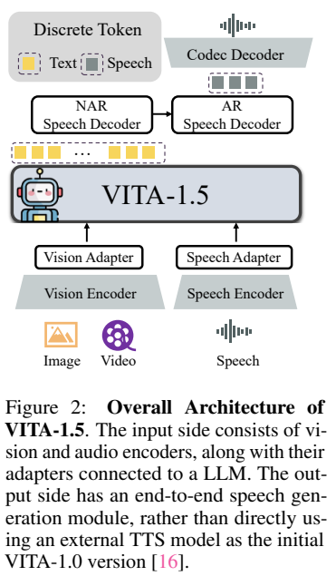
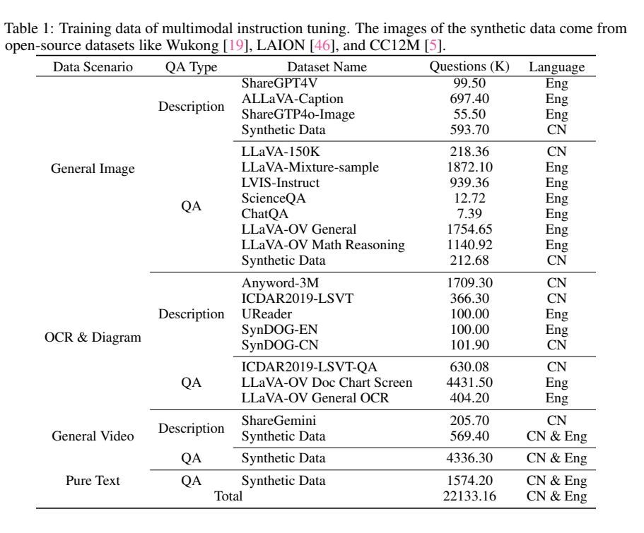
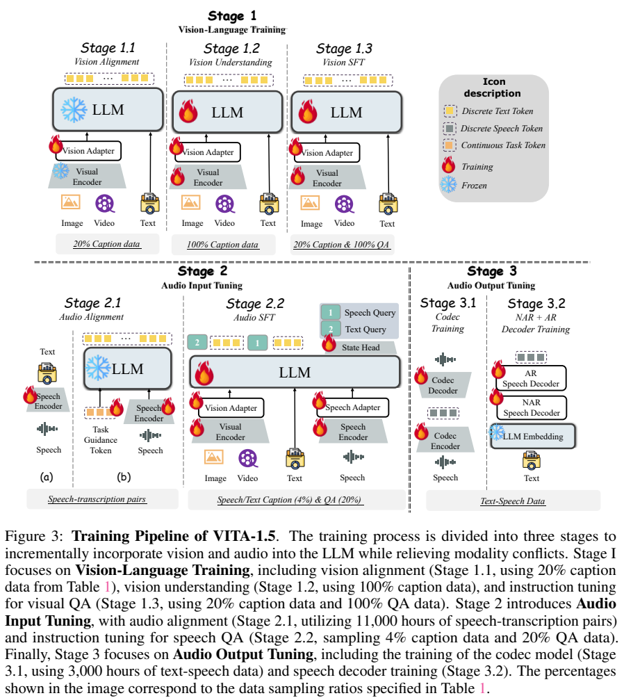
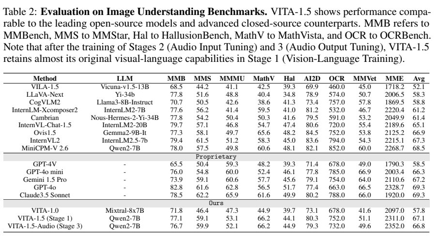
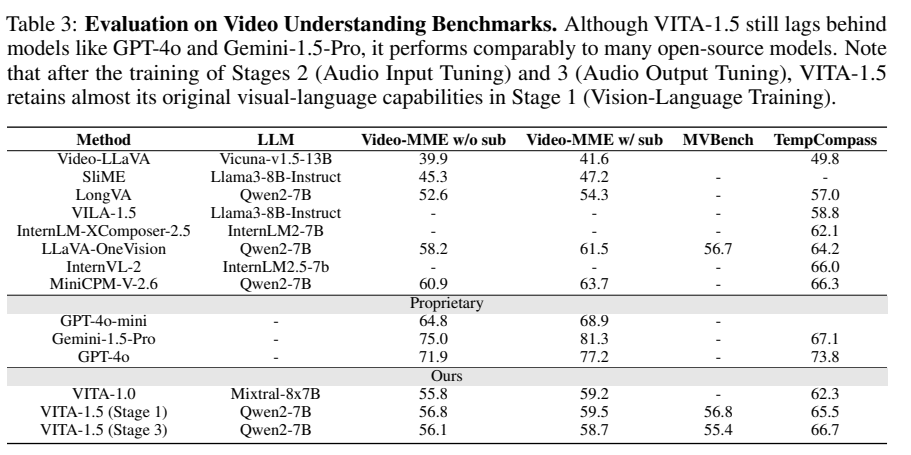
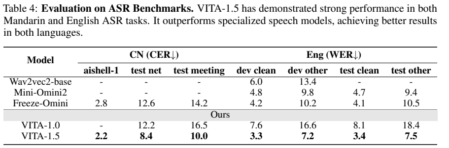

<!-- article-header:start -->
[项目首页](../../../README.md) › [模型系列](../../../reports/model-family-index.md) › [VITA](../README.md)
<!-- article-header:end -->

# VITA-1.5：逐步引入视觉、语音理解与语音生成

<!-- article-toc:start -->

**本篇目录** · [论文定位](#paper-info) · [快速概览](#overview) · [整体架构](#architecture) · [核心原理](#principles) · [数据构建](#data) · [训练流程](#training) · [实验结果](#experiments)
<!-- article-toc:end -->

## 1. 论文信息与模型定位

| 项目 | 信息 |
|---|---|
| 论文 | VITA-1.5: Towards GPT-4o Level Real-Time Vision and Speech Interaction |
| 团队 | Chaoyou Fu、Haojia Lin 等；南京大学、腾讯优图、厦门大学、中科院自动化所 |
| 日期与版本 | 2025-01-03；arXiv:2501.01957v1，13 页 |
| 模型家族 | VITA；本篇为 VITA-1.5，实验底座 Qwen2-7B |
| 定位 | 保留视觉能力，同时支持语音输入和集成式语音回复 |
| 原始资料 | [论文 v1](https://arxiv.org/pdf/2501.01957v1)、[系列仓库](https://github.com/VITA-MLLM/VITA) |

相对使用外部 TTS 的 VITA 初代，本篇增加专门训练的语音输出模块，并通过逐阶段训练降低视觉与语音之间的干扰。标题中的“GPT-4o Level”表达研究目标；首版基准并不支持所有任务都达到 GPT-4o，也没有完整实时交互延迟表。（第 1–3、7–9 页）

## 2. 快速概览

| 关键设计 | 作用 |
|---|---|
| 先视觉、再语音输入、最后语音输出 | 每一步引入新能力，减少混合训练冲突 |
| 视觉与音频各自编码并接入 LLM | 保留空间与时序信号的不同处理方式 |
| TiCodec 单码本 | 把语音变为可预测的离散 token |
| NAR 与 AR 两级语音解码 | 先获得全局语义条件，再生成声学 token |
| 输出阶段冻结 LLM | 避免训练语音生成时直接改动语言底座 |

最终模型在 MathVista 为 66.2，Video-MME 无字幕为 56.1，LibriSpeech test_clean/test_other 的 WER 为 3.4/7.5。结果体现语音能力与视觉能力的结合，并伴随部分视觉分数小幅回落。（Tables 2–4）

## 3. 整体架构

*原文 Figure 2，PDF 第 3 页。输入编码器、LLM、NAR/AR 语音解码器和 codec 解码器共同组成系统。*

视觉侧采用 InternViT-300M，448×448 输入产生 256 个视觉 token，经两层 MLP 接入语言模型。高分辨率图像动态切块；视频采样沿用初代：短于 4 秒采 4 帧，4–16 秒每秒一帧，更长视频最多均匀采 16 帧，视频帧不再动态切块。（§3.1）

语音侧输入 Mel 特征，窗口 25ms、步长 10ms，经下采样卷积和 24 个 Transformer 块，隐藏维度 1024，约 350M 参数。正文将编码器输出帧率写为 12.5Hz，又描述语音适配器有 2 倍下采样，未完全说明帧率统计位置；不能直接把这些文字换算成一套确定的最终 token 预算。

输出侧采用 TiCodec：单码本大小 1024，语音 token 频率 40Hz，重建波形采样率 24kHz。NAR 语音解码器读取文本表示并提取全局语义，AR 解码器在该条件下逐步生成离散语音 token，codec 解码器还原波形。NAR 与 AR 各采用 4 层 LLaMA 解码结构，隐藏维度 896；正文称参数量约 120M，但没有清楚区分该数值是否合计，本文不额外推算。（第 3–4 页）

“端到端”在这里指系统不再外接独立 ASR/TTS 服务，内部仍存在文本生成及文本条件语音解码。不能据此称它完全绕过文本中介，或等同于单序列原生全双工模型。

## 4. 核心创新与数学原理

**用训练调度控制模态干扰。** 视觉阶段建立表示与指令能力，再用语音转写把音频对齐到语言空间，随后引入语音问答，最后训练输出模块。其依据是实验中视觉能力大体保留，而非对梯度冲突已经给出一般性的数学消除证明。（第 4–7 页）

**CTC 对齐无需逐帧标注。** 音频编码器先通过 CTC 学习转写。下面是标准 CTC 的解释式，帮助理解原文采用的目标，非本文报告新推导：

$$
\mathcal L_{\mathrm{CTC}}=-\log\sum_{\pi:\mathcal B(\pi)=y}\prod_{t=1}^{T}p_\theta(\pi_t\mid x).
$$

$\mathcal B$ 去掉空白并合并重复符号，求和覆盖能形成正确文本的对齐路径。随后连接器让 LLM 根据语音特征预测转写，加入可训练任务提示 token 区分 ASR 与问答用途。（第 5–6 页）

**离散 codec 与分级解码。** 将波形 $a$ 编码为离散序列 $z$ 后，AR 解码可解释为：

$$
p(z\mid h)=\prod_{t}p(z_t\mid z_{<t},h),
$$

其中 $h$ 是 NAR 从文本表示得到的语义条件。单码本让每个时刻只需生成一个离散索引，减少多码本调度复杂度；每秒 40 个索引与每秒 24,000 个波形采样点是不同单位。正文没有充分披露 NAR 长度对齐、codec 损失各项或流式分块规则，不能凭此公式补出全部实现。（第 3–4、7 页）

## 5. 数据构建与处理

*原文 Table 1，PDF 第 5 页。Questions(K) 合计 22,133.16K，即约 22.13M 问题记录，不是独立图像数。*

视觉与文本数据包括 ShareGPT4V、ALLaVA、LLaVA、LVIS、ScienceQA、ChatQA、OneVision 问答及数学数据、OCR、文档、图表和视频描述/问答。中文、英文都包含，部分描述由已有模型生成，合成图像来自 Wukong、LAION、CC12M 等来源。

音频输入采用内部中英转写数据，输出采用 TTS 生成的 3,000 小时文本语音对。需要保留原文的不一致：§3.2 总体数据写为 110,000 小时内部 ASR 数据，§3.3.2 和 Figure 3 的音频对齐阶段却写为 11,000 小时。作者没有解释是否分别为总池和阶段子集，本文不自行判定哪个是笔误。（第 4–6 页）

语音问答阶段从 Table 1 采 4% 描述、20% QA，并将约一半文本问题替换为 TTS 语音。此比例是相应数据类别的取样比例，不是所有训练数据固定 4:20 混合。内部语料来源和合成音色配置缺乏完整公开说明，影响独立复现。

## 6. 训练流程与目标

*原文 Figure 3，PDF 第 6 页。三大阶段各含多个子阶段，图中注明冻结与可训练模块。*

| 子阶段 | 目的与训练范围 |
|---|---|
| 1.1 视觉对齐 | 使用 20% 描述，只训练视觉适配器 |
| 1.2 视觉理解 | 使用全部描述，训练视觉编码器、适配器、LLM |
| 1.3 视觉 SFT | 全部 QA 加 20% 描述，训练视觉与语言模块 |
| 2.1 音频对齐 | 先 CTC 训练编码器，再连接 LLM 做转写；图中语言模型冻结 |
| 2.2 音频 SFT | 语音/文本混合问答，视觉及音频编码器、适配器、LLM 均可训练 |
| 3.1 codec 训练 | 学习语音到离散 token 及波形重建 |
| 3.2 NAR+AR 训练 | 用文本嵌入与 codec token 监督语音输出，冻结 LLM |

阶段 2.2 另加分类头区分语音与文本输入；这与初代区分有效/无效音频的三个生成状态 token 不能直接视为同一机制。阶段 3.2 的文字经 tokenizer 和 LLM 嵌入层获得条件，并非直接明确使用 LLM 最后一层隐藏状态。（第 6–7 页）

首版未给出完整优化器、学习率、批量、硬件或时延测试配置。冻结 LLM 是阶段 3 的保护措施，但不能推导成引入全部语音阶段后视觉性能完全不变，因为阶段 2.2 会更新主体。

## 7. 实验设置与主要结果

*原文 Table 2，PDF 第 7 页。分别报告视觉阶段模型与加入语音后的最终模型。*

| 基准 | Stage 1 | Stage 3 | 变化 |
|---|---:|---:|---:|
| MMBench | 77.1 | 76.7 | −0.4 |
| MMMU | 53.1 | 52.1 | −1.0 |
| MathVista | 66.2 | 66.2 | 保持 |
| OCRBench | 752 | 732 | −20 |
| MMVet | 51.1 | 49.6 | −1.5 |
| MME | 2311 | 2352 | +41 |

视觉能力总体接近，但有升有降。Table 2 的 Avg 为 67.1→66.8，原文没有足够说明不同量纲指标的归一化计算；不把平均值当作所有任务统一准确率。MathVista 最终模型 66.2 高于表中 GPT-4o 56.5，但 MMMU 52.1 低于 GPT-4o 62.8，因而不是全面达到或超越 GPT-4o。

*原文 Table 3，PDF 第 8 页。带字幕与不带字幕属于不同输入条件。*

Video-MME 无字幕从 56.8 降至 56.1，带字幕从 59.5 降至 58.7，MVBench 从 56.8 降至 55.4，TempCompass 从 65.5 升至 66.7。最终无字幕 Video-MME 仍低于 MiniCPM-V-2.6 的 60.9 和 GPT-4o 的 71.9。

*原文 Table 4，PDF 第 8 页。CER/WER 越低越好。*

VITA-1.5 在 AISHELL-1 的 CER 为 2.2，WenetSpeech test_net/test_meeting 为 8.4/10.0，LibriSpeech test_clean/test_other 的 WER 为 3.4/7.5，优于表中 Freeze-Omni 和 Mini-Omni2 对应项。这里测试转写能力，没有语音自然度 MOS、说话人相似度、首次音频延迟、实时率或打断成功率的完整表格。因此“近实时”的证据主要来自系统设计与演示，不能由 ASR 分数直接推导。（第 8–9 页）

<!-- article-footer:start -->
---

[← 上一篇：QVQ-72B-Preview](../../qwen/document-b615730dc322/README.md) · [按发表时间浏览](../../../reports/paper-reading-guide.md#year-2025) · [下一篇：LlamaV-o1 →](../../llamav-o1/arxiv-2501.06186/README.md)

[返回本篇目录](#article-toc) · [返回模型系列](../README.md)
<!-- article-footer:end -->
