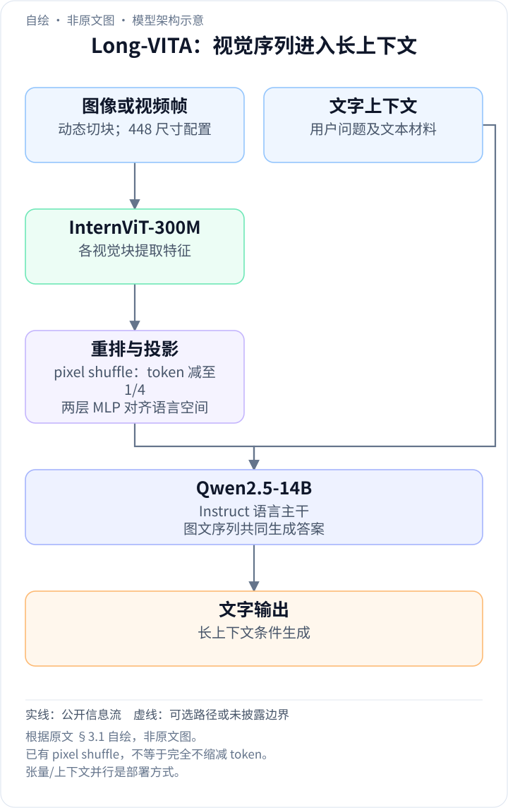
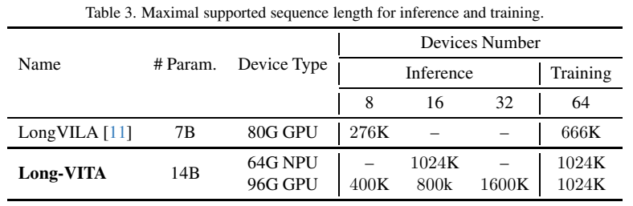
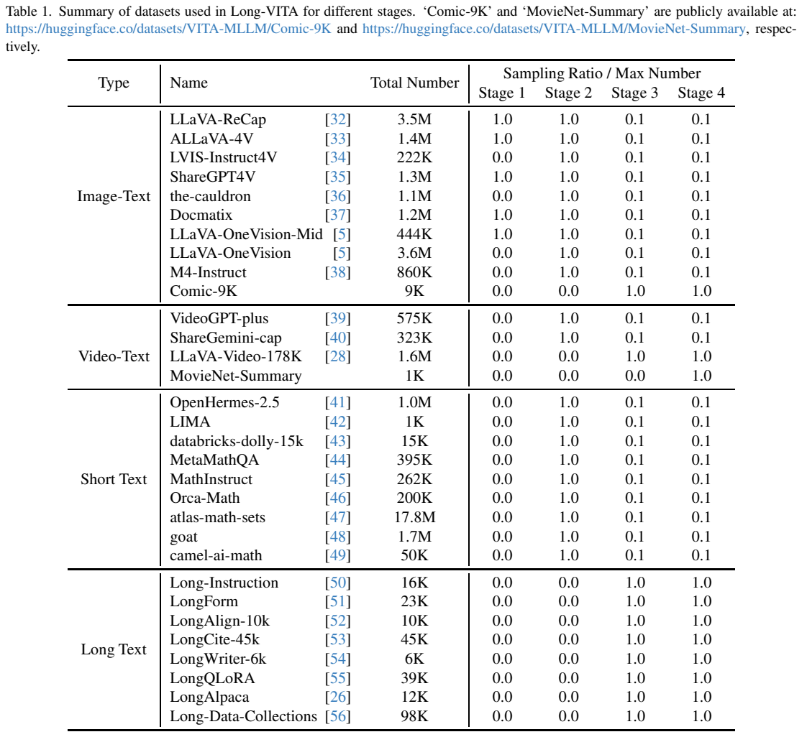
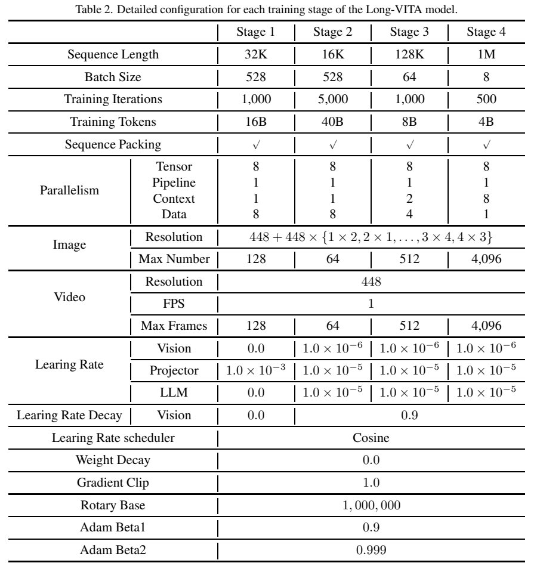
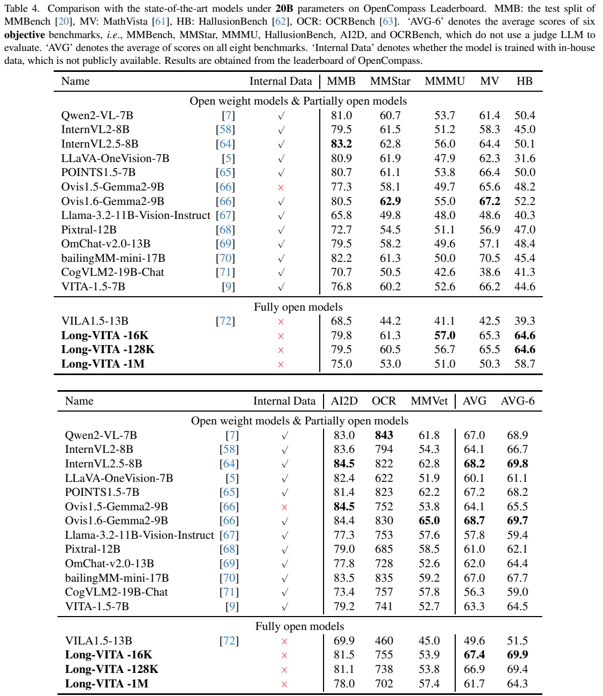
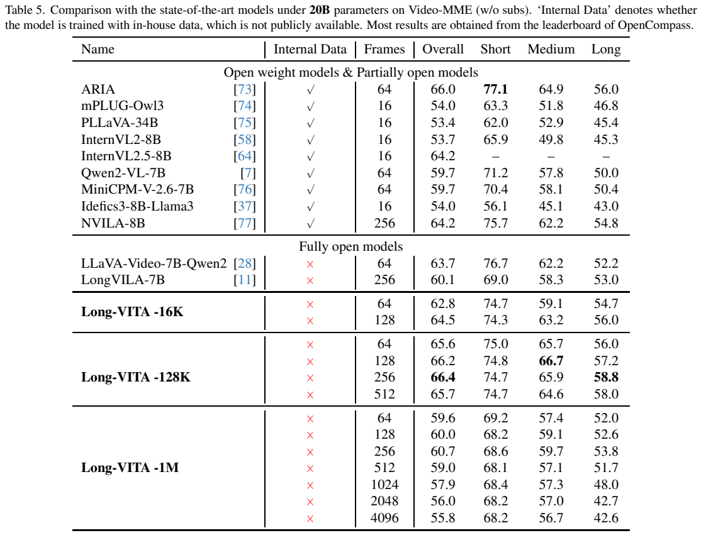

<!-- article-header:start -->
[项目首页](../../../README.md) › [模型系列](../../../reports/model-family-index.md) › [VITA](../README.md)
<!-- article-header:end -->

# Long-VITA：百万 token 的多模态上下文训练与分布式推理

<!-- article-toc:start -->
<a id="article-toc"></a>

**本篇目录** · [论文定位](#paper-info) · [快速概览](#overview) · [整体架构](#architecture) · [核心原理](#principles) · [数据构建](#data) · [训练流程](#training) · [实验结果](#experiments)
<!-- article-toc:end -->

<a id="paper-info"></a>

## 1. 论文信息与模型定位

| 项目 | 信息 |
|---|---|
| 论文 | Long-VITA: Scaling Large Multi-modal Models to 1 Million Tokens with Leading Short-Context Accuracy |
| 团队 | Yunhang Shen、Chaoyou Fu 等；腾讯优图、南京大学、厦门大学 |
| 日期与版本 | 2025-02-07；arXiv:2502.05177v1，12 页；元数据题名末词拼作 Accuray |
| 家族与底座 | VITA；Qwen2.5-14B-Instruct + InternViT-300M |
| 定位 | 高分辨率图像、多图及长视频的视觉语言理解 |
| 原始资料 | [论文 v1](https://arxiv.org/pdf/2502.05177v1)、[官方仓库](https://github.com/VITA-MLLM/Long-VITA) |

Long-VITA 将多模态上下文从普通视觉指令训练扩展到 128K 与 1M，并提供 NPU/GPU 分布式训练和推理方案。它不是 VITA 初代的语音对话模型；音频和 3D 在本报告中属于未来工作。本篇最值得学习的是上下文扩展、样本拼接与显存控制之间的关系，以及长窗口能力与实际理解效果之间的区别。（第 1–2、9 页）

<a id="overview"></a>

## 2. 快速概览

| 关键设计 | 作用 | 实验边界 |
|---|---|---|
| 四阶段训练 | 对齐、通用学习、128K 和 1M 微调 | 1M 版本并非所有任务最优 |
| 漫画与电影摘要数据 | 提供真正包含较多图像的训练序列 | 与独立样本简单拼接不同 |
| 上下文并行与 Ring Attention | 将长序列分散到多个设备 | 输入容量依赖设备数与显存 |
| 只对需要输出的位置计算词表 logits | 降低大词表输出层显存 | 不消除注意力与 KV 缓存成本 |

报告支持最多 4,096 帧，并在 16 张 64GB NPU 上展示 1,024K token 推理容量。但 Video-MME 主结果最好的是 128K 模型配 256 帧，而不是 1M 配最大帧数。（Tables 3、5）

<a id="architecture"></a>

## 3. 整体架构

<!-- derived-architecture:start -->


*自绘模型架构示意（非原文图）。依据下述公开资料归纳；方框表示功能组件，不代表逐层实现。*

依据：[2502.05177v1; §3.1 / Table 2](https://arxiv.org/pdf/2502.05177v1)。
<!-- derived-architecture:end -->

模型采用视觉编码器、两层 MLP 投影器与语言模型三部分。InternViT-300M 配动态切块处理不同分辨率和宽高比的图像，pixel shuffle 将视觉 token 数减到原来的四分之一，再投影到 Qwen2.5-14B-Instruct 的词嵌入空间。（第 3 页）

原文一方面说“不采用 token 压缩和稀疏局部注意”，另一方面明确存在上述 pixel shuffle。合理的阅读方式是：不采用额外的自适应视频 token 压缩与近似注意方案；不能把它写成“所有视觉 token 完全不缩减”。视频帧分辨率 448，训练采样 1 FPS，帧数上限随阶段改变。（Table 2）



*原文 Table 3，PDF 第 5 页。容量是在指定设备数上测试的显存边界，不是单卡能力或理解准确率。*

推理使用张量并行与上下文并行。输入补足最大输出长度的 padding，在固定长度上执行解码并提取新预测 token。96GB GPU 的 8/16/32 卡分别支持 400K/800K/1600K 输入；64GB NPU 的 16 卡支持 1024K。作者还比较 LongVILA，但模型规模、设备和激活检查点设置不同，这不是相同资源条件下的效率竞赛。（第 5、7 页）

| 模块 | 输入与输出 | 公开机制 |
|---|---|---|
| InternViT300M | 动态图块及448视频帧 → 视觉网格 | 按宽高比切图，帧数阶段变化，视频训练1 FPS |
| pixel shuffle与MLP | 视觉网格 → 四分之一位置的语言嵌入 | 邻近位置搬到通道，两层MLP映射Qwen词嵌入空间 |
| Qwen2.5-14B-Instruct | 长图文序列 → 回答隐藏态 | 使用完整注意力，不以额外自适应视频压缩近似长上下文 |
| 上下文并行 | 序列分片、跨设备K/V → 注意力结果 | 语言侧分担长序列；视觉塔采用不同并行配置 |
| logits mask输出头 | 需预测位置隐藏态 → 词表概率 | 只对必要输出位置计算logits，减少L×V矩阵显存 |
| 长序列构建 | 不同长度样本 → 固定训练长度 | 早期样本隔离掩码，后期不重置以覆盖长位置 |


<a id="principles"></a>

## 4. 核心创新与数学原理

### 4.1 输出头节省与骨干成本分开计算

设序列长度 $`L`$、词表大小 $`V`$，对每个输入位置都计算 float32 logits，空间约为：

```math
M_{\mathrm{logits}}\approx4LV\ \mathrm{bytes}.
```

原文以 $`L=10^6,V=10^5`$ 举例，得到约 400GB。推理时只保留预测下一 token 的一个隐藏向量进入词表头，输出约 0.0004GB。这是输出 logit 矩阵的缩减比例，不是整个模型显存减少一百万倍。训练时应保留所有需要监督的输出位置，而不是只监督最后一个位置。（第 5–7 页）

词表头前的Transformer仍需建立长输入表示，logits mask只避免在不需要预测的位置展开整个词表。推理只需要下一token概率，训练则需要所有被监督文字位置；两种阶段可删的输出位置不同，不能把推理最后一位置规则直接复制到全部训练样本。〔v1 §3.4，第5页，Logits-Masked Language Modeling Head〕

### 4.2 语言侧上下文并行不同于视觉侧切块

Ring Attention 在设备间传递 Key/Value 等序列信息，使每个设备处理自身分片对应的注意力。它降低单设备长序列负担，但完整注意力的总体算术成本仍随长度近似平方增长，还需要通信。原文所谓“无限长度”表达的是可扩展设计，实测仍受显存、设备数和时间限制。

原文把视觉模块放在首个LLM流水线阶段，并使用数据、张量和序列并行，却不对视觉塔使用上下文并行。语言主干在长序列阶段才以分布式attention分担上下文，表明图像切块和跨设备分片解决的是不同问题：前者适应图像输入，后者承受LLM长序列。〔§3.4 Training，第5页〕

### 4.3 拼接让位置覆盖增长但不创造语义关系

前两阶段重置位置和注意力掩码，独立样本只关注自身；长序列阶段不重置，使序列位置覆盖更长范围。这样可以训练长窗口，但彼此无关的数据不天然具有语义联系，跨样本注意还可能造成混淆。作者将 1M 版本表现下降部分归因于该问题。（第 5、8 页）

Stage 1/2同源样本拼为32K/16K并重置位置与mask，样本之间无法读到对方；Stage 3/4改成128K/1024K且不重置，模型开始在更长位置范围计算跨样本注意。这里“扩窗”改变了可读上下文，但无关数据仍无真实因果联系，不能把所有长序列当作同一部电影或同一故事。〔§3.3，第5页〕


<a id="data"></a>

## 5. 数据构建与处理



*原文 Table 1，PDF 第 3 页。Total Number 与各阶段取样比例分开列出，不能将各来源总量相加当作实际训练条目数。*

视觉数据来自 LLaVA-ReCap、ALLaVA、ShareGPT4V、Docmatix、OneVision、M4-Instruct 等；视频来自 VideoGPT-plus、ShareGemini、LLaVA-Video。文本包括一般指令、数学及长文本指令。作者称混合训练使用 17M 样本，但 Table 1 仅 atlas-math-sets 就列 17.8M 来源记录，未完全解释总池到最终混合的统计映射，本文不自行“校正”或声称逐条总数可复算。（第 1、3–4 页）

新建 Comic-9K 包含 9K 漫画、约 200K 图像和从网上收集的人工摘要，平均约 20 张高分辨率图像。MovieNet-Summary 包含约 1K 电影及摘要对，仅在最后阶段加入。这些序列提供多图或电影级语境，不等于每一训练样本都有百万 token。

作者强调使用公开数据，并明确没有采用数据过滤方法。“公开来源”不自动意味着所有来源质量一致或不存在基准重叠；报告未提供完整污染审计。清洗选择也被列作后续改善方向。（第 4、9 页）

<a id="training"></a>

## 6. 训练流程与目标



*原文 Table 2，PDF 第 4 页。阶段长度为 32K→16K→128K→1M，前两阶段不是单调增加。*

| 阶段 | 主要目的 | 长度 / batch / 迭代 | 可训练模块 |
|---|---|---|---|
| 1 | 描述为主，加 Docmatix 建立对齐 | 32K / 528 / 1000 | 投影器；视觉与 LLM 冻结 |
| 2 | 通用视觉、短视频、文本与数学 | 16K / 528 / 5000 | 视觉、投影器与 LLM |
| 3 | 加长文本、漫画、LLaVA-Video | 128K / 64 / 1000 | 全部主要模块 |
| 4 | 进一步加入电影摘要 | 1M / 8 / 500 | 全部主要模块 |

表中训练 token 数分别约 16B、40B、8B、4B，是累计训练用量，不是 68B 个独立问题。阶段 3–4 对普通阶段 2 数据采用 0.1 取样，长数据充分保留。文本目标按自回归语言建模监督，文中没有强化学习阶段或 LoRA。（第 4–5 页）

阶段 1 投影器学习率 $`10^{-3}`$；后续视觉 $`10^{-6}`$、投影器与 LLM $`10^{-5}`$。采用 cosine 日程、weight decay 0、梯度裁剪 1.0，Adam 的 beta 为 0.9/0.999，rotary base 为 1,000,000。训练不使用位置插值；作者提到可进一步结合 YaRN 等，是潜在扩展，不是已报告实验的必要组件。（Table 2，第 5 页）

张量并行度始终为 8，上下文并行度从 1/1 增至 2/8，数据并行度为 8/8/4/1，流水线并行度为 1。模型支持 Ascend NPU 和 GPU；这些工程配置与原底座预训练成本应区分。

<a id="experiments"></a>

## 7. 实验设置与主要结果



*原文 Table 4，PDF 第 6 页。16K、128K 和 1M 是不同训练阶段的检查点。*

| 指标 | 16K | 128K | 1M |
|---|---:|---:|---:|
| MMMU | 57.0 | 56.7 | 51.0 |
| MathVista | 65.3 | 65.5 | 50.3 |
| HallusionBench | 64.6 | 64.6 | 58.7 |
| OCRBench | 755 | 738 | 702 |
| MMVet | 53.9 | 53.8 | 57.4 |
| AVG-6 | 69.9 | 69.4 | 64.3 |

AVG-6 汇总六个不使用 LLM 裁判的客观基准，不能当作单一任务准确率。1M 的多数指标回落，但 MMVet 上升，也不能一概说所有短任务退化。基线分数多数来自 OpenCompass 榜单，评测采用温度 0、greedy decoding；没有据此获得统计置信区间。（第 6–7 页）



*原文 Table 5，PDF 第 7 页。所有结果不带字幕；不同模型的输入帧数不相同。*

128K 模型在 256 帧时总体 66.4，long 子集 58.8；增加至 512 帧后为 65.7/58.0。1M 模型 256 帧为 60.7/53.8，4096 帧为 55.8/42.6。可见大窗口和更多帧并未自动带来更好理解。Table 5 标题写“20B 以下”，却纳入 PLLaVA-34B，应以具体模型行的规模为准。

在 Table 6（第 8 页），128K 配 256 帧的 LongVideoBench 为 60.9，但 MVBench 为 55.4，低于表中 LongVILA 的 67.1；该表对 LongVILA 的内部数据标记也与 Table 5 不同，不能根据勾叉推导完整数据开放性排序。

本报告清楚展示了百万长度的工程可行性，同时承认长内容训练与数据仍需改进。它没有用完整检索位置曲线或同预算长期推理实验证明每个百万 token 都被可靠利用，阅读时应分别评估“装得下”和“理解得好”。

<!-- article-footer:start -->
---

[← 上一篇：Qwen2.5-VL](../../qwen/qwen2.5-vl/README.md) · [按发表时间浏览](../../../reports/paper-reading-guide.md#year-2025) · [下一篇：Claude 3.7 Sonnet →](../../claude/document-2c9bf7e5f94a/README.md)

[返回本篇目录](#article-toc) · [返回模型系列](../README.md)
<!-- article-footer:end -->
