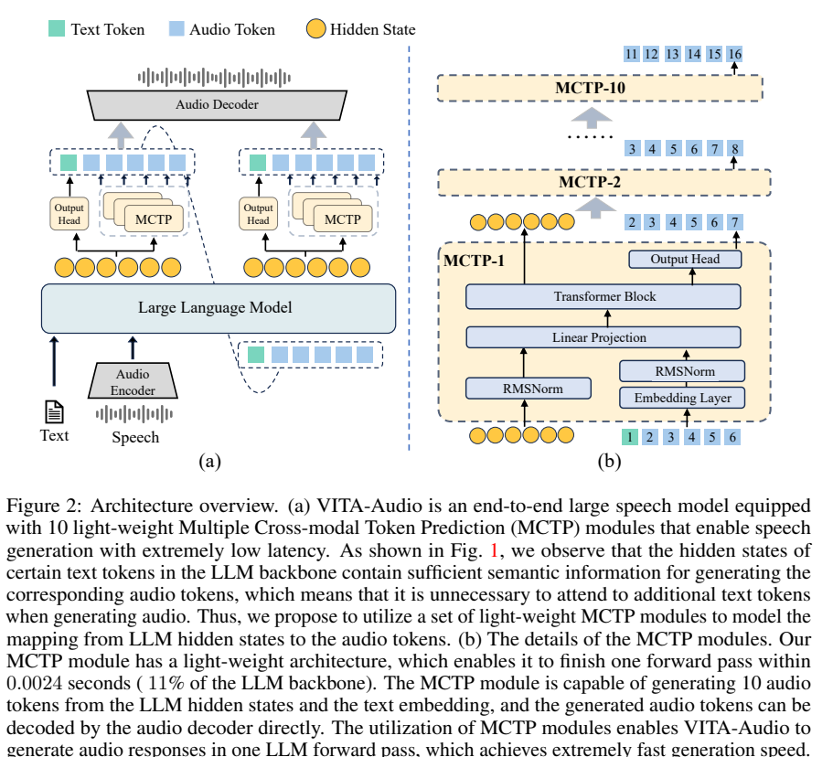
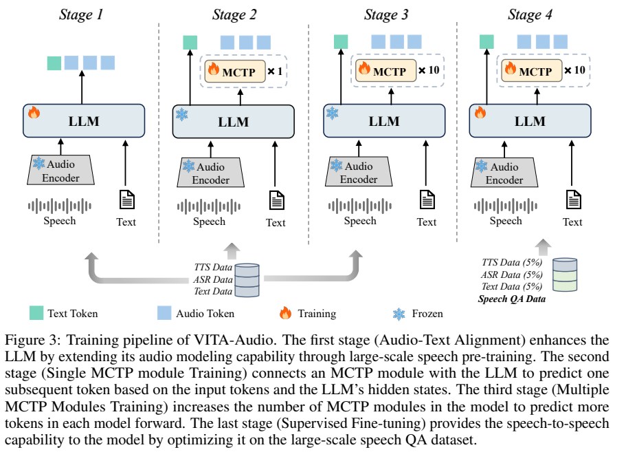
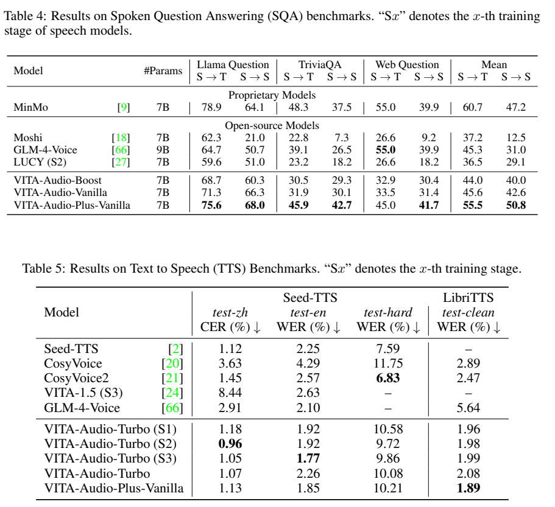
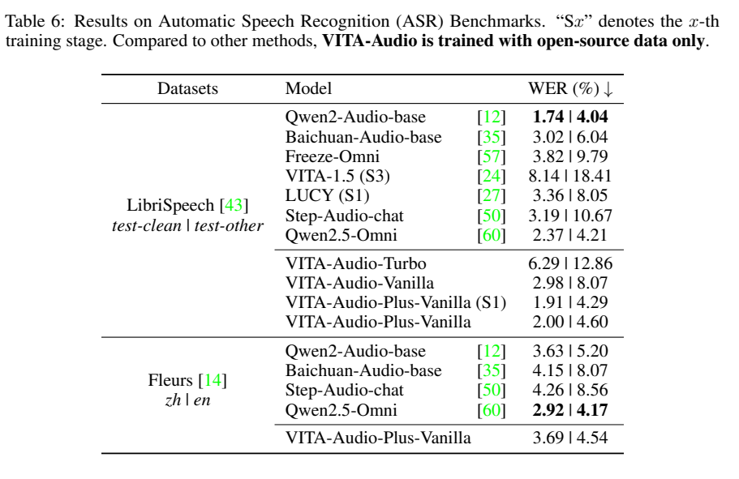
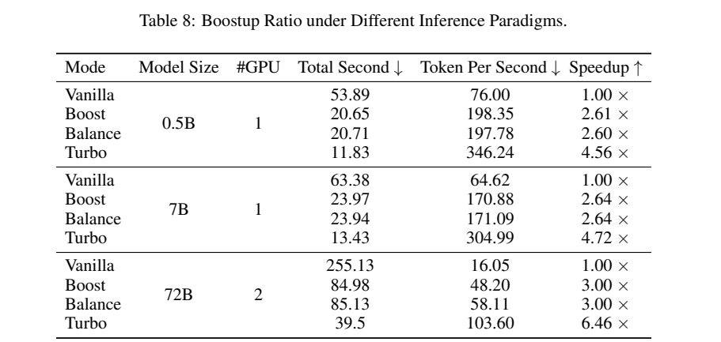
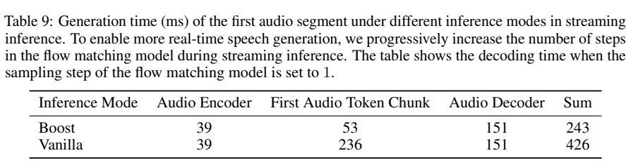

<!-- article-header:start -->
[项目首页](../../../README.md) › [模型系列](../../../reports/model-family-index.md) › [VITA](../README.md)
<!-- article-header:end -->

# VITA-Audio：用跨模态多 token 预测加速流式语音

<!-- article-toc:start -->

**本篇目录** · [论文定位](#paper-info) · [快速概览](#overview) · [整体架构](#architecture) · [核心原理](#principles) · [数据构建](#data) · [训练流程](#training) · [实验结果](#experiments)
<!-- article-toc:end -->

## 1. 论文信息与模型定位

| 项目 | 信息 |
|---|---|
| 论文 | VITA-Audio: Fast Interleaved Cross-Modal Token Generation for Efficient Large Speech-Language Model |
| 团队 | Zuwei Long、Yunhang Shen 等；腾讯优图、南京大学、厦门大学 |
| 日期与版本 | 2025-05-06；arXiv:2505.03739v1，18 页 |
| 家族与底座 | VITA；Qwen2.5-7B，含 Audio 与 Audio-Plus 变体 |
| 定位 | 语音识别、合成和语音问答的低延迟生成 |
| 原始资料 | [论文 v1](https://arxiv.org/pdf/2505.03739v1)、[官方仓库](https://github.com/VITA-MLLM/VITA-Audio) |

本篇解决交错生成文本和音频时，逐 token 调用大语言模型导致的开销。核心是让轻量 MCTP 模块利用 LLM 隐藏状态生成后续多个 token。报告重点是语音，不应因属于 VITA 家族就默认其具有本篇未评测的图像或视频功能。（第 1、4、9 页）

## 2. 快速概览

| 问题 | 方法 | 边界 |
|---|---|---|
| 音频 token 多，主模型重复前向昂贵 | 主模型生成一个 token，级联 MCTP 补充多个 token | 辅助模块仍需计算，不是十个 token 完全无成本并行 |
| 流式首块需要足够音频 token | 首次前向即可补齐可解码音频块 | “零延迟”是额外主模型步骤为零，不是 0ms |
| 多步预测误差积累 | 后续模块读取前一模块状态及输出 | 不是严格保留原模型分布的推测解码 |
| 速度和文字质量有取舍 | Turbo、Boost、Balance、Vanilla 模式 | 速度最大不等于问答与 ASR 最优 |

7B 的输出生成速度测试中，Turbo 相对 Vanilla 为 4.72 倍，Boost 为 2.64 倍。计时不包含音频编解码；首段完整管线另有约 243ms 的结果。（Tables 8–9）

## 3. 整体架构

*原文 Figure 2，PDF 第 5 页。MCTP 共用主模型的嵌入和输出头，并按级联方式预测后续 token。*

基础版本使用 GLM-4-Voice 的语音 tokenizer/decoder，输入语音编码成离散 token，再进入 Qwen2.5-7B。Plus 版本将输入替换为 SenseVoiceSmall 与 MLP 适配器，输出仍使用 GLM-4-Voice decoder。因此 Plus 并非仅调整推理速度，而是输入表示也改变了。（Table 3，第 9 页）

主模型最后一层的隐藏状态与已预测 token 的嵌入分别归一化，经线性投影、Transformer 块和共享输出头生成下一 token。后续 MCTP 读取前一个模块的状态与结果。生成结果并入下一轮主模型输入，最终音频 token 交给语音解码器。默认设置包括十个 MCTP 模块。（第 5–6 页）

观察实验显示，对应文本 token 的隐藏状态可以提供合成相关音频所需的上下文，包括中文多音字判断。遮掉其余文本仍可读对，全部文本遮掉则失败。但这是一组机制探索，不是所有语言、韵律和长对话都只需单个文本状态的证明。（Figure 1，第 2 页）

## 4. 核心创新与数学原理

标准自回归语音建模为 $P(Y_t\mid Y_{<t})$。若独立预测远处 $Y_{t+i}$ 而不看到中间生成结果，预测分布偏离会逐步扩大。原文因此采用级联条件，概括为：

$$
\widetilde P(Y_{t+i}\mid Y_{<t},h_{t+i-1},o_t,\ldots,o_{t+i-1}),
$$

$h$ 与 $o$ 分别是此前模块的隐藏状态和输出。它让后续预测利用更新后的局部条件，而不是十个互不依赖的预测头。模块串行计算的代价比多次调用完整 LLM 小，是加速的关键。（Equations 1–3，第 5–6 页）

MCTP 借鉴多 token 预测，但不像严格推测解码那样通过主模型验证和拒绝采样保证分布相同。其输出直接进入生成过程，质量需要靠训练与实验验证，不能声称数学上无损。（第 6 页）

“音频 token 延迟”定义为首次主模型前向后还需多少次主模型前向才能获得首个音频 token；“音频生成延迟”则看能否凑够可解码的一块。零步骤仍包含首次 LLM 前向、MCTP、音频解码和输入处理耗时。Balance 因严格控制文本音频比例需要两次前向才能形成首块，不能把所有模式都概括为首轮即可播放。（第 3、9 页）

## 5. 数据构建与处理

训练使用公开 ASR、TTS、语音问答及普通/长文本数据。ASR 总体约 100K 小时，覆盖 WenetSpeech、LibriSpeech、多语 LibriSpeech、GigaSpeech、Common Voice、AISHELL 等；TTS 约 100K 小时，主要来自 WenetSpeech4TTS、LibriTTS、GLOBE 与 Emilia。（Table 2，第 6–7 页）

语音问答为 VoiceAssistant-400K 与 AudioQA-1.0M，共 1.4M 记录。文本包含 OpenHermes、LIMA、数学数据和 LongAlign、LongCite、LongWriter 等长文本指令。小时数、问题记录数与来源数据池大小不可直接相加。

统一打包到 8K token，重置位置及注意力掩码，独立样本只关注本样本。SFT 阶段降低 ASR/TTS/文本取样至 0.05，语音问答取样系数为 2.0；这不是“200% 的总数据属于语音问答”。输出构造为文字片段与音频片段交错，而非等整段文字生成完再合成。（第 7–9 页）

## 6. 训练流程与目标

*原文 Figure 3，PDF 第 7 页。先学习音频文本，再逐步引入辅助预测，最后联合做语音问答。*

| 阶段 | 训练目标与范围 | 学习率 |
|---|---|---|
| 1 音频文本对齐 | 冻结音频编解码器，训练 LLM 学习 ASR/TTS/文本 | LLM $6\times10^{-5}$ |
| 2 单 MCTP | 从主模型最后一层初始化一个模块，预测下一个 token；图中 LLM 冻结，切断其梯度 | MCTP $10^{-3}$ |
| 3 多 MCTP | 从阶段 2 权重初始化更多模块，各自学习后续位置；使用梯度截断 | MCTP $10^{-3}$ |
| 4 语音 SFT | 以交错语音问答联合优化主模型与 MCTP，保留少量旧任务 | LLM $5\times10^{-5}$；MCTP $4\times10^{-5}$ |

全局 batch 为 256，AdamW 的 beta 为 0.9/0.95，原文称训练 1 epoch，未给出逐阶段完整步数。分阶段初始化降低同时训练多个位置分布的难度，不能被描述成十个模块从随机初始化一次训练完成。（第 8–9 页）

Turbo 允许 MCTP 生成部分文本和音频，最快但问答易损；Boost 保留由主模型生成文本；Balance 进一步控制交错比例；Vanilla 完全由主模型预测。首版在 §3.4 又使用 Speed 命名，Figure 4 的 Balance 图注还有将一组音频 token 写成 text tokens 的表述问题，本文以具体表格行名报告成绩，不无条件将名称合并为同一检查点。

## 7. 实验设置与主要结果

*原文 Tables 4–5，PDF 第 10 页。S→T 直接评文本，S→S 将生成语音经 Whisper 转写后评答案。TTS 的 CER/WER 也来自再次转写，不是人评自然度。*

Boost 的语音问答平均分 S→T/S→S 为 44.0/40.0，Vanilla 为 45.6/42.6，Plus-Vanilla 为 55.5/50.8。Plus 的语音答案分高于表中 MinMo 47.2，但文本答案仍低于 MinMo 60.7，不能称两种输出都全面最佳。GLM-4-Voice 的 Mean 行与三个子任务数值简单平均不一致，不用该行自行计算额外优越幅度。

Turbo 最终 TTS 在 Seed-TTS 中文 CER 为 1.07、英文 WER 为 2.26，test-hard 为 10.08；CosyVoice2 的 hard 为 6.83，所以困难发音仍有差距。没有完整 MOS 或说话人相似度表，转写错误率低并不单独证明更自然的声音。

*原文 Table 6，PDF 第 11 页。输入编码器替换与推理模式都会显著影响准确率。*

LibriSpeech test_clean/test_other 的 WER，Turbo 为 6.29/12.86、基础 Vanilla 为 2.98/8.07、Plus-Vanilla 为 2.00/4.60。后者仍不及 Qwen2-Audio 的 1.74/4.04。Table 7 的 WenetSpeech 中，Plus 为 7.12/6.90，但首版误将 VITA-1.5 的 8.14/18.41 放入该行，数字与前篇语音基准不对应，不能作为可靠跨模型收益依据。（第 11–12 页）

*原文 Table 8，PDF 第 13 页。模型随机初始化，固定输出 4096 token，音频编码与解码不计入。Token Per Second 的向下箭头与通常的“越高越好”含义冲突，应看数值和时间。*

7B 单 GPU，Vanilla 63.38 秒、64.62 token/s，Boost 23.97 秒、170.88 token/s，Turbo 13.43 秒、304.99 token/s，对应 2.64× 与 4.72× 加速。测试使用 BF16、Transformers 与 FlashAttention-2，设备按 148 TFLOPS 描述，未明确型号。随机模型的结构计时不代表这些尺寸都有训练完成且质量相同的检查点。

*原文 Table 9，PDF 第 14 页。flow matching 解码设置为一步。*

Boost 首批 token 53ms，输入编码 39ms、音频解码 151ms，总计 243ms；Vanilla 分别为 236、39、151ms，总计 426ms。总延迟约缩短 1.75 倍，不能直接使用 token 生成加速倍数称整条语音管线加速 4.72 倍。该时间也不包括用户完整录音时长、网络传输与真实服务排队。

<!-- article-footer:start -->
---

[← 上一篇：Skywork R1V2](../../skywork/arxiv-2504.16656/README.md) · [按发表时间浏览](../../../reports/paper-reading-guide.md#year-2025) · [下一篇：感知、推理、思考与规划 →](../../multimodal-reasoning-survey/arxiv-2505.04921/README.md)

[返回本篇目录](#article-toc) · [返回模型系列](../README.md)
<!-- article-footer:end -->
