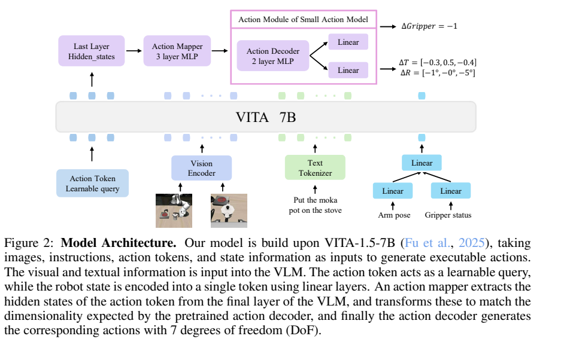
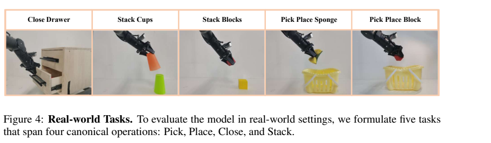
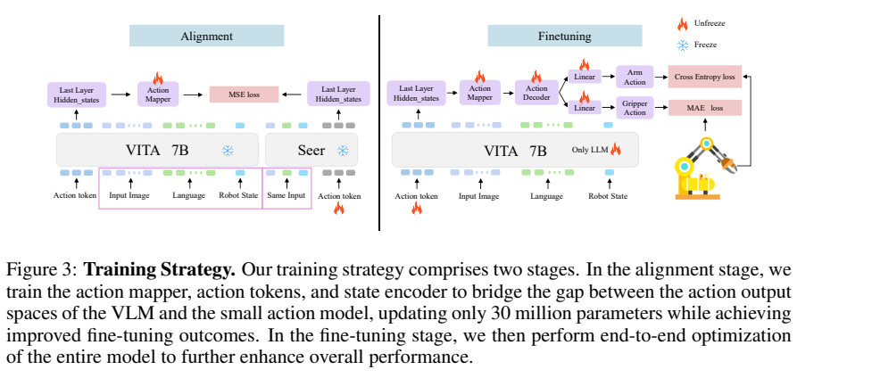
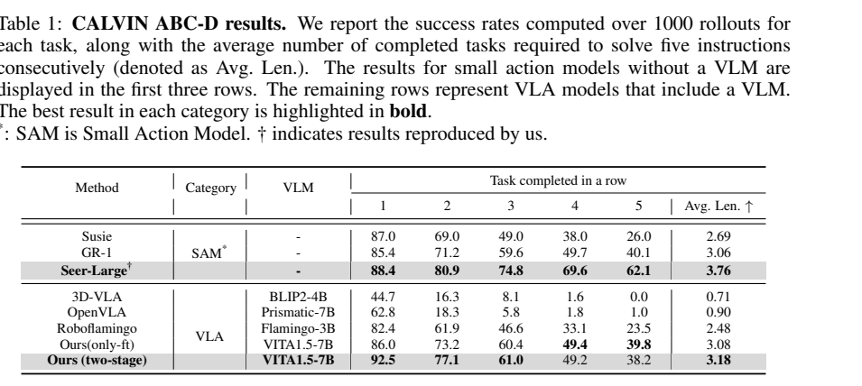
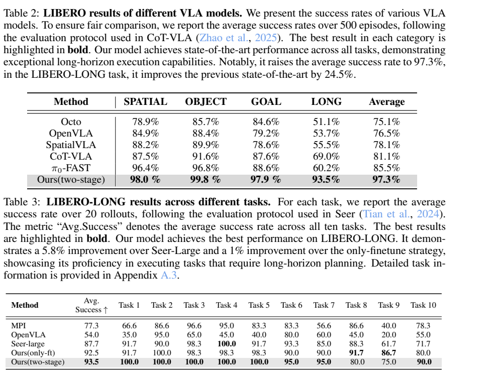
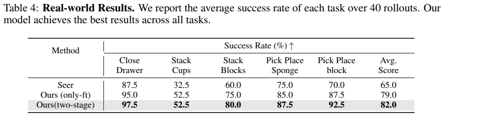

# VITA-VLA：通过小型动作专家蒸馏，让视觉语言模型学习机器人控制

## 1. 论文信息与模型定位

| 项目 | 信息 |
|---|---|
| 原文 | *VITA-VLA: Efficiently Teaching Vision-Language Models to Act via Action Expert Distillation* |
| 作者与机构 | Shaoqi Dong、Chaoyou Fu 等；南京大学、腾讯优图、中国科学院自动化研究所等 |
| 版本 | [arXiv:2510.09607v1](https://arxiv.org/abs/2510.09607v1)，2025-10-10；本文固定解读 v1 |
| 资料 | [原文 PDF](https://arxiv.org/pdf/2510.09607v1)、[项目主页](https://ltbai.github.io/VITA-VLA/) |
| 系列与定位 | VITA 系列的视觉语言动作模型（VLA），面向语言指令驱动的机器人操作 |

VITA-VLA 把视觉语言模型的理解能力与小型机器人策略的控制经验连接起来。教师 Seer 已在对应机器人数据上训练；学生通过表示对齐复用教师动作解码器，再学习连续控制。它不是仅凭通用图文预训练就能执行任意机器人任务的系统。（原文第 3–6 页）

## 2. 快速概览

| 要点 | 内容 |
|---|---|
| 输入 | 静态相机与腕部相机图像、语言指令、机器人状态 |
| 输出 | 六维连续机械臂动作与夹爪动作，预测未来三个时间步 |
| 骨干 | InternViT-300M、三层视觉连接 MLP、Qwen2.5-7B |
| 关键方法 | 约 30M 参数的动作表示对齐，随后联合微调语言模型和控制模块 |
| 主要结果 | LIBERO 平均成功率 97.3%；五项实机任务平均 82.0% |
| 主要代价 | 依赖适用的动作专家与示范数据，推理比小型教师慢 |

论文称学生基于 VITA-1.5，但本篇 §3.2 明确使用 Qwen2.5-7B 和三层视觉连接器；这里采用本篇配置，不直接套用 VITA-1.5 报告的 Qwen2-7B 配置。

## 3. 整体架构

*原文 Figure 2，第 3 页。动作查询从语言模型隐藏状态中提取控制表示，再经映射器和教师动作解码器输出动作。*

机器人状态包含六维机械臂状态和一维夹爪状态。六维部分经一个线性层，夹爪状态转为二维独热表示后经另一线性层，两者拼接，再投影成一个状态 token。直接把原始数值写成文本的方案效果不佳，因此使用显式数值编码。

每个时间步输入两张 200×200 图像，每张产生 49 个视觉 token，共 98 个；再接指令、一个状态 token 与三个动作查询。三个查询复用同一个可学习 token，用来预测连续三个未来动作，并非三个独立学习的查询。语言模型末层查询隐藏状态的宽度为 3584。

三层动作 MLP 把隐藏状态映射到教师的动作空间；教师的两层 MLP 解码器与线性预测头产生控制输出。CALVIN 的映射维度为 1024，LIBERO 为 384。这条路径不需要把动作量化成文本词表后逐词生成。（第 4–6、12 页）

## 4. 核心创新与数学原理

第一项创新是先匹配动作表示，再优化真实控制。令学生动作查询表示为 $h_i^S$、冻结教师表示为 $h_i^T$、动作映射器为 $M$，原文式 (3) 为：

$$
\mathcal L_{\mathrm{align}}=\frac1N\sum_{i=1}^{N}\|M(h_i^S)-h_i^T\|_2^2.
$$

这项 MSE 约束让学生进入教师解码器可使用的特征空间，避免一开始同时学习理解与低层控制。它匹配隐藏表示，而非蒸馏文本概率分布。

第二阶段转向动作监督。令 $\hat a_t^{\mathrm{arm}}$ 为六维机械臂预测，$p_t$ 为夹爪关闭概率、$g_t\in\{0,1\}$ 为标签，原文目标为：

$$
\mathcal L=\frac1T\sum_t\|\hat a_t^{\mathrm{arm}}-a_t^{\mathrm{arm}}\|_1
-\frac{0.01}{T}\sum_t[g_t\log p_t+(1-g_t)\log(1-p_t)].
$$

MSE 对较大的特征偏差惩罚更强；控制阶段改用 MAE，以减轻异常连续动作值的影响。0.01 来自作者观察的损失量级，不代表夹爪在实际任务中只具有 1% 的重要性。

显式状态 token 是另一关键设计：视觉可能无法唯一确定关节与夹爪状态，数值状态提供额外控制条件。论文保留 VLM 主体结构，但没有用通用视觉语言评测量化微调后原有能力的保持程度。（第 5–6 页）

## 5. 数据构建与处理

训练样本采用 13 步轨迹，教师与学生接收相同图像、指令和状态，保证表示对齐条件一致。模型最大历史长度另设为 CALVIN 10、LIBERO 7；样本轨迹长度与实际历史窗口不是同一个参数。

CALVIN 使用 A、B、C 环境训练、在未见的 D 环境测试，只使用带语言条件的数据，约占完整训练集的 58%。LIBERO 包含 Spatial、Object、Goal、LONG 四套任务，每套十项。两个阶段使用相同的对应机器人数据；论文未报告大规模新增跨机器人预训练数据。（第 7、12 页）

*Figure 4，第 9 页：关抽屉、叠杯、叠积木、把海绵放入篮子、把积木放入篮子。*

实机数据由遥操作收集，每项任务 100 条示范，共 500 条，教师和学生均在这些数据上训练。附录描述 PiPer 机械臂、Songling 夹爪，以及基座 Intel RealSense D435i 与腕部 Dabai DCW 相机；正文又称 ALOHA 平台，存在硬件名称口径不一致，不能据此推断进行了两套不同设备实验。（第 8–9、13 页）

## 6. 训练流程与目标

*Figure 3，第 5 页。左侧对齐动作表示，右侧使用真实动作监督。原图将机械臂/夹爪分支的 Cross Entropy 与 MAE 标签放置得与 §3.3 公式相反；本文依据明确的损失公式说明。*

| 阶段 | 更新模块 | 目标与配置 |
|---|---|---|
| 对齐 | 状态编码器、动作查询、动作映射器；VLM 和教师冻结 | MSE；约 30M 可训练参数；batch 8、累积 4、3 epochs、warmup 1 epoch |
| 控制微调 | LLM、状态编码器、查询、映射器与动作解码器/输出头 | MAE+BCE；batch 4、累积 4、2 epochs、warmup 2 epochs |

两阶段均用 AdamW、学习率 $10^{-4}$ 与余弦衰减。表中 batch 是否为设备级未明确，不自行换算为全局 batch。第二阶段 §3.3 列出语言模型和动作模块更新，并未列出视觉编码器；因此图注“整个模型端到端优化”不能解释成所有参数均解冻。§3.2 对解码器“fixed”的描述也需结合第二阶段的明确更新名单理解。（第 5–6 页、Table 5）

文中没有给出可核算的训练 GPU 型号、总 GPU 小时和教师训练总成本。“避免昂贵预训练”是利用已有骨干与教师的路线优势，不能从 30M 对齐参数直接推导完整项目成本。

## 7. 实验设置与主要结果

*Table 1，第 7 页，1000 次评测 rollout，分别报告连续完成 1–5 个任务的成功率与平均长度。*

两阶段模型首任务成功率 92.5%，高于仅微调的 86.0% 与 Seer 的 88.4%；但五任务连续成功率为 38.2%，低于仅微调的 39.8% 与 Seer 的 62.1%。平均完成长度为 3.18，亦低于 Seer 的 3.76。因此首任务优势不等于长任务链全面占优。冻结 VLM 的变体首任务仅 45.3%，说明仅接入动作模块不足以达到完整方法效果。

*第 8 页。Table 2 使用 500 episodes 的口径；Table 3 则描述每任务 20 rollouts，二者协议需分开理解。*

Table 2 的 Spatial/Object/Goal/LONG 分别为 98.0/99.8/97.9/93.5%，均值 97.3%。相对表内最优基线平均 85.5% 提升 **11.8 个百分点**；LONG 相对 CoT-VLA 69.0% 提升 **24.5 个百分点**。Table 3 与 Seer 比较为 93.5% 对 87.7%，提升 5.8 个百分点；对仅微调的 92.5% 则只提升 1 个百分点。LONG 的任务 8、9，两阶段仍低于仅微调，不能写成每项任务都更好。

附录 Table 7 的 Goal/Object 标签、逐项结果与主表汇总并不完全一致，本文保留主表数值并标明该问题，不根据附录静默重算主结果。

*Table 4，第 9 页，每项任务 40 次 rollout，共 200 次。*

实机平均成功率：Seer 65.0%、仅微调 79.0%、两阶段 82.0%，即较教师提升 17 个百分点。叠杯任务仅为 52.5%，且与仅微调持平；该评测限于五项已收集示范的任务，不是任意新指令零样本测试。

附录给出学生约 0.15 秒/次推理（6–7 Hz），教师约 0.05 秒/次（20 Hz），单 GPU 型号未说明。学生改善平均任务成功率，但推理约慢三倍。论文没有给出置信区间，也没有直接验证保留通用图文能力；以上均为作者报告结果，未做模型复现。（第 9、13 页）
