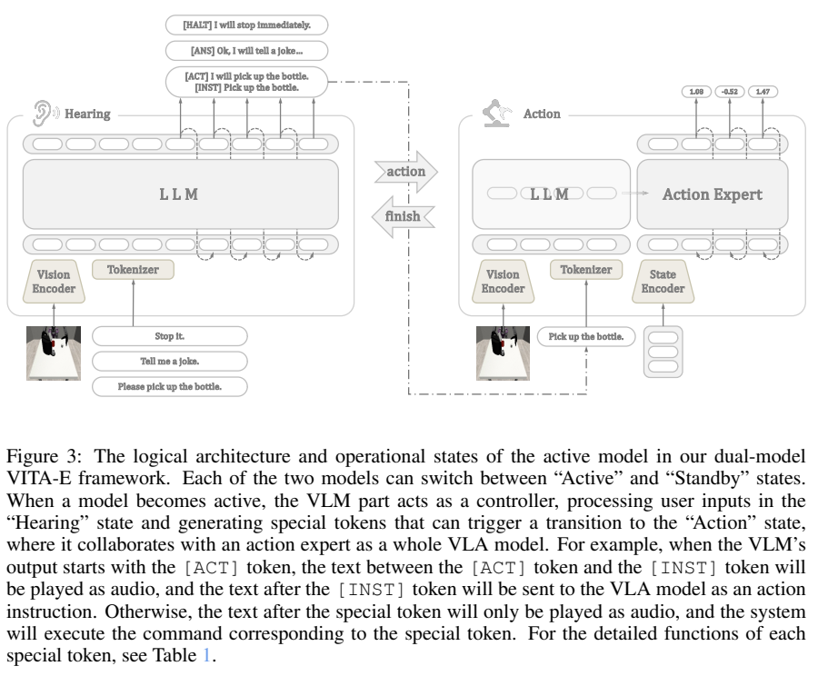
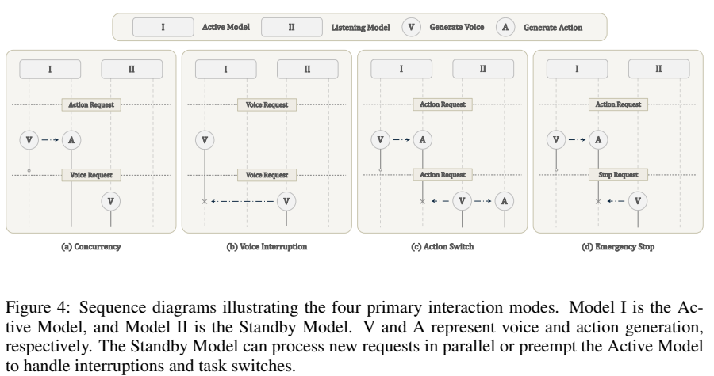
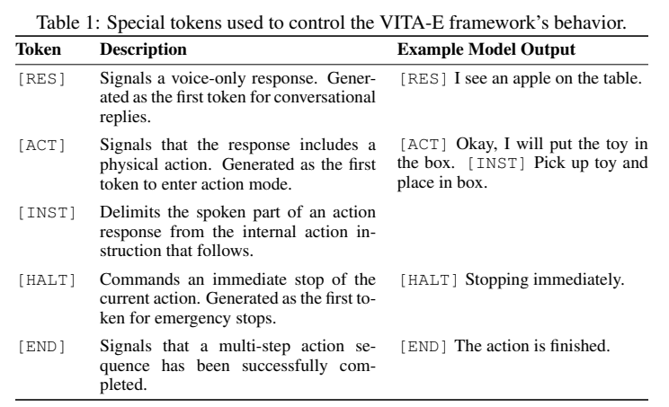
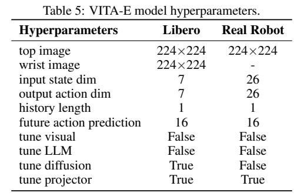
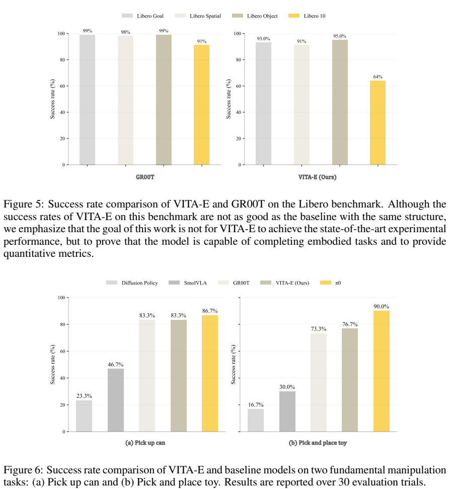
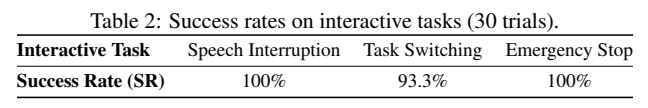
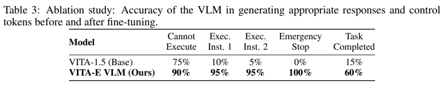

<!-- article-header:start -->
[项目首页](../../../README.md) › [模型系列](../../../reports/model-family-index.md) › [VITA](../README.md)
<!-- article-header:end -->

# VITA-E：支持同时观察、聆听、说话和行动的具身交互系统

<!-- article-toc:start -->
<a id="article-toc"></a>

**本篇目录** · [论文定位](#paper-info) · [快速概览](#overview) · [整体架构](#architecture) · [核心原理](#principles) · [数据构建](#data) · [训练流程](#training) · [实验结果](#experiments)
<!-- article-toc:end -->

<a id="paper-info"></a>

## 1. 论文信息与模型定位

| 项目 | 信息 |
|---|---|
| 原文 | *VITA-E: Natural Embodied Interaction with Concurrent Seeing, Hearing, Speaking, and Acting* |
| 作者与机构 | Xiaoyu Liu、Chaoyou Fu、Chi Yan 等；南京大学、腾讯优图、CASIA、傅利叶智能 |
| 版本 | [arXiv:2510.21817v1](https://arxiv.org/abs/2510.21817v1)，2025-10-21 |
| 资料 | [原文 PDF](https://arxiv.org/pdf/2510.21817v1)、[项目主页](https://lxysl.github.io/VITA-E/) |
| 定位 | VITA 系列具身交互框架，重点是并发、打断和任务切换 |

VITA-E 使用 VITA-1.5 做高层理解，以 GR00T 的动作专家产生控制。它关注机器人执行任务时还能交谈、接受新指令与停止动作，并未把提高静态操作基准成功率作为首要目标。它也不同于 VITA-VLA 的 Seer 表示蒸馏路线。（原文第 1–8 页）

<a id="overview"></a>

## 2. 快速概览

| 要点 | 内容 |
|---|---|
| 两层系统 | 高层 VLM 解释指令，低层扩散动作专家生成动作块 |
| 两个实例 | Active 执行当前任务，Standby 持续处理新的请求；角色可以互换 |
| 控制方式 | 特殊 token 触发说话、行动、结束、停止等状态转换 |
| 动作配置 | 仿真 7 维、实机 26 维；每次预测 16 步，历史长度 1 |
| 部署 | Fourier GR2 人形机器人，头部 RealSense D455 相机 |
| 主要证据 | 三项交互任务各 30 次测试；并发语音响应另测 10 次，平均 2.26 秒 |

“两层系统”和“两个实例”分别描述理解/动作分工与运行时并发机制，不能混为两个完全不同、独立训练的基础模型。

<a id="architecture"></a>

## 3. 整体架构



*Figure 3，第 5 页，单个实例在 Hearing 与 Action 状态间转换；系统另有 Active/Standby 的实例角色。*

Hearing 状态下，VLM 根据图像与用户指令生成结构化字符串。若要执行动作，先输出控制 token 和口头确认，再用 `[INST]` 分隔供动作模块执行的内部指令。Action 状态下，VLM 将图像与内部指令编码，动作专家结合自身状态预测连续关节动作。



*Figure 4，第 7 页，包括行动中交谈、语音打断、动作切换、紧急停止。*

执行动作时，Standby 可以回答新问题而让 Active 保持控制；新的动作请求则抢占旧任务，并交换实例角色。切换时用动作栈逆序回放回撤到初始姿态，再开始新任务。停止请求优先生成 `[HALT]`，中断控制循环并向客户端发停止命令。

服务端运行模型，客户端收集图像/状态并执行动作；同步原语协调实例。这里的并发主要来自系统调度，并不意味着单次模型前向能同时完成所有任务。（第 5–8 页）

从模型职责看，这是高层 VLM 与低层**扩散动作专家**组成的双系统：前者解释图像和用户意图、生成命令 token，后者读取 VLM 条件与机器人状态并产生连续控制量。Active/Standby 是两份运行实例的调度角色，Hearing/Action 是单份实例的工作状态；它们不是四套不同的神经网络，也不能把系统级并发当成单次前向的四路输出。原文 §3.1 Overall Framework，PDF 第 4–5 页。

<a id="principles"></a>

## 4. 核心创新与数学原理



*Table 1，第 6 页。Figure 3 的语音示例写 `[ANS]`，与表格及正文 `[RES]` 不一致，本文以控制表为准。*

| token | 系统行为 |
|---|---|
| `[RES]` | 纯语音回复 |
| `[ACT]` | 进入动作执行模式 |
| `[INST]` | 区分口头回复与内部动作指令 |
| `[HALT]` | 抢占并停止当前动作 |
| `[END]` | 表示多步动作已完成 |

原文将高层输出写为 $`S_t=(c_t,L_t^{\mathrm{robot}},C_t^{\mathrm{robot}})`$：分别是控制 token、口头回复与内部动作命令。模型学习 $`\pi_{\mathrm{VLM}}(S_t\mid I_t,L_t^{\mathrm{user}})`$；若不需要行动，内部命令为空。可用下式**解释**结构化 SFT：

```math
\mathcal L_{\mathrm{control}}=-\sum_k\log p_\theta(S_{t,k}\mid I_t,L_t^{\mathrm{user}},S_{t,<k}).
```

这不是原文给出的独立新损失公式，而是说明特殊 token 与文本共同参与序列预测。论文的动作接口为：

```math
h_t=\pi_{\mathrm{VLM}}(I_t,C_t^{\mathrm{robot}})_{\mathrm{hidden}},\qquad A_t=\pi_a(h_t,q_t).
```

动作专家把语言目标、视觉隐藏表示与机器人状态 $`q_t`$ 转成动作块。本文没有公开完整扩散/流匹配训练目标，不借 GR00T 的其他版本推断本模型噪声参数化。

创新核心是把模型输出当作运行时控制命令，并以另一实例保持对新请求的处理能力。输出正确 token 仍依赖意图理解；被抢占后回撤也并非在任意接触状态下都有验证过的保证。（第 5–7 页）

<a id="data"></a>

## 5. 数据构建与处理

控制训练来自 ActionNet、LIBERO 与自采集场景，原始形式为视频、指令和动作。数据重新组织为四类：执行动作、不能完成的指令、停止请求与已完成任务，自动生成问答后在指定位置插入控制 token。停止样本通过在已有轨迹中随机注入“Stop”等新请求构造；完成样本取成功轨迹的终态。

附录 Table 6–9 提供合成提示，要求根据图像生成可执行/不可执行指令、机器人回应或已完成的动作，并以中文输出。正文没有给出完整控制训练样本总数、生成教师型号、清洗比例或训练测试去重统计，不将其写成规模已明确的人类交互语料。（第 6、13–16 页）

动作数据方面，仿真先用 LIBERO-90，再用四套目标任务混合微调；实机每个基础任务遥操作收集 300 条示范，两个任务共 600 条，控制频率 20 Hz、26 自由度。该频率是数据采集设置，不是模型已测得的端到端实时响应频率。（第 8 页）

<a id="training"></a>

## 6. 训练流程与目标

第一阶段用具身图文数据微调 VITA-1.5，采用 DeepSpeed ZeRO-3，使其输出控制 token、回应与内部动作目标。第二阶段学习机器人动作。此时视觉与语言主体冻结，动作相关更新范围按场景区分：



*Table 5，第 14 页，LIBERO 与真实机器人配置。*

| 设置 | LIBERO | 真实机器人 |
|---|---|---|
| 图像 | 224×224 基座和腕部图像 | 224×224 顶部图像，无腕部图像 |
| 状态/动作维度 | 7 / 7 | 26 / 26 |
| 历史/预测长度 | 1 / 16 | 1 / 16 |
| 可训练部分 | 扩散动作模块与投影器 | 仅投影器 |

因此 §3.2“仅训练投影头”的概括主要对应实机设置，不能用于整个仿真训练；Table 5 明确写仿真扩散模块也更新。该阶段冻结 LLM 也不代表此前的控制 SFT 从未微调语言模型。

Table 4 给出 batch 64、累积 1、AdamW、学习率 $`10^{-4}`$、余弦衰减、warmup 比例 0.05、20000 steps，但没有为两个阶段分别列完整配方或总 GPU 小时。训练借用已有 VITA 与 GR00T 权重；两个运行实例提高资源消耗，正文没有详细显存/吞吐测量。（第 6、8、10、13–14 页）

<a id="experiments"></a>

## 7. 实验设置与主要结果



*第 9 页，LIBERO 对比及两个真实操作任务；实机各方法每任务 30 次评测。*

仿真图中 VITA-E 的 LONG 成功率约 64%，低于 GR00T 的 91%；作者承认物体/关系理解与训练资源差异影响性能。替换 VLM 后的适配与原始 GR00T 的预训练、解冻方案不完全相同，不能当成只改变一项因素的严格因果对照。

实机拾罐成功率 VITA-E 83.3%，与 GR00T 持平，低于 $`\pi_0`$ 的 86.7%；拾取玩具放入篮子为 76.7%，高于 GR00T 的 73.3%，低于 $`\pi_0`$ 的 90%。对比方法的更新范围不同，证明了可用的操作基础，而非操作能力全面领先。



*Table 2，第 10 页，各交互任务 30 次。*

语音打断 100%、任务切换 93.3%、紧急停止 100%。任务切换失败来自把行动请求误识别为对话。并发能力主要定性展示，10 次语音响应测试平均 2.26 秒；论文未给出停止延迟分布、测时起止定义或最坏情况延迟，不能将“100% 成功”解释为 0 毫秒响应或任意环境可靠性。



*Table 3，第 10 页，人工判断响应及控制 token 是否恰当，非真实机器人全部任务成功率。*

微调后两类可执行指令的正确响应为 95%、紧急停止命令为 100%，但任务完成判断只有 60%，说明结束 token 的语义判断仍薄弱。该消融没有完整说明各类样本数；两实例对比单实例的等算力测试、完整动作延迟和多机器人迁移验证也未给出。以上数字为作者报告，未复现机器人实验。（第 9–11 页）

<!-- article-footer:start -->
---

[← 上一篇：DeepSeek-OCR](../../deepseek/arxiv-2510.18234/README.md) · [按发表时间浏览](../../../reports/paper-reading-guide.md#year-2025) · [下一篇：Emu3.5 →](../../emu/arxiv-2510.26583/README.md)

[返回本篇目录](#article-toc) · [返回模型系列](../README.md)
<!-- article-footer:end -->
