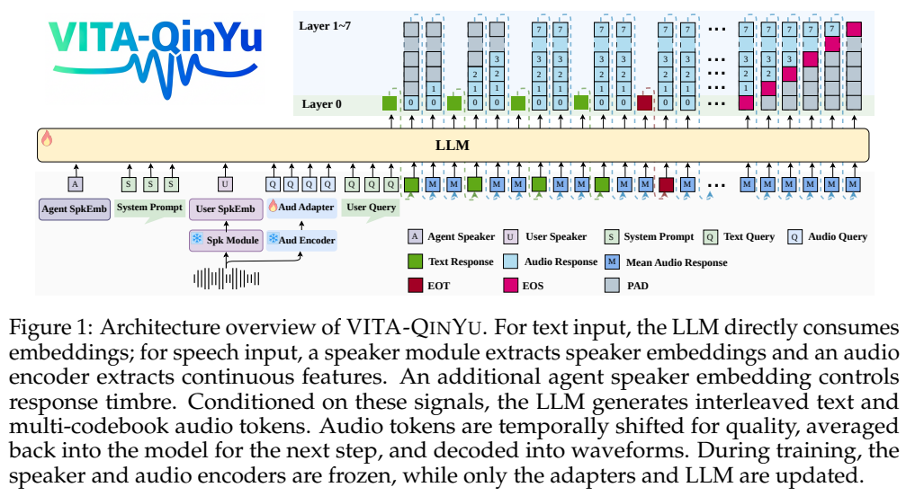
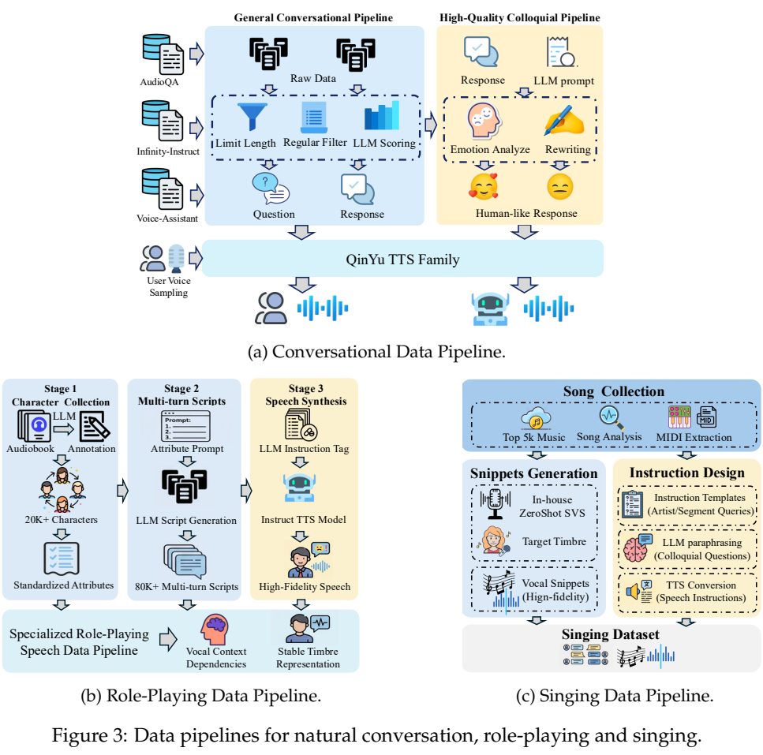
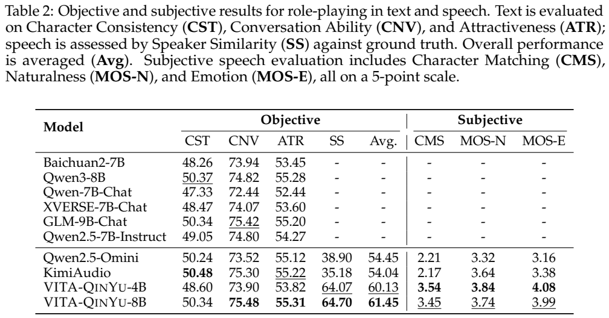
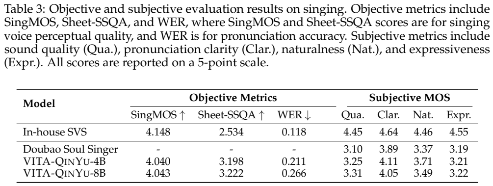
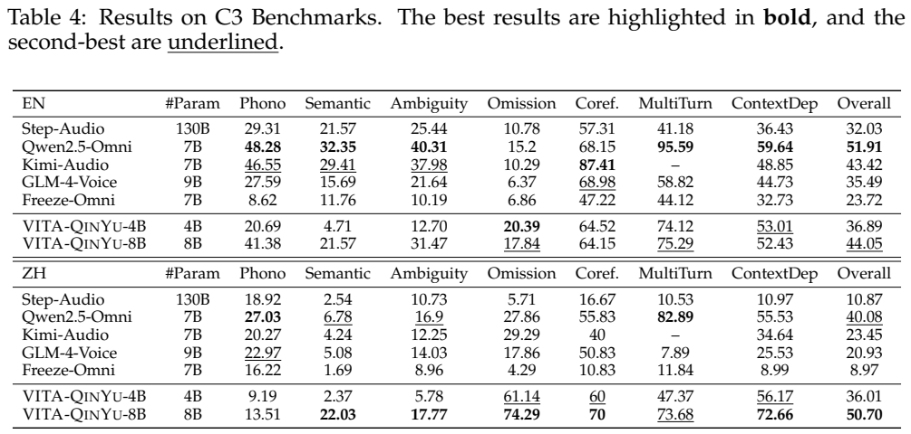
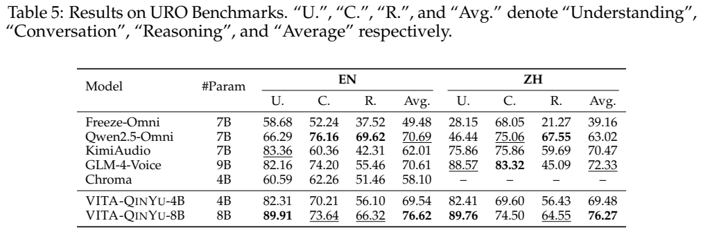

<!-- article-header:start -->
[项目首页](../../../README.md) › [模型系列](../../../reports/model-family-index.md) › [VITA](../README.md)
<!-- article-header:end -->

# VITA-QinYu：在统一语音模型中学习角色扮演与歌唱表达

<!-- article-toc:start -->
<a id="article-toc"></a>

**本篇目录** · [论文定位](#paper-info) · [快速概览](#overview) · [整体架构](#architecture) · [核心原理](#principles) · [数据构建](#data) · [训练流程](#training) · [实验结果](#experiments)
<!-- article-toc:end -->

<a id="paper-info"></a>

## 1. 论文信息与模型定位

| 项目 | 信息 |
|---|---|
| 论文 | VITA-QINYU: Expressive Spoken Language Model for Role-Playing and Singing |
| 作者与机构 | QinYu Team、VITA-Team；TME Lyra Lab、Tencent YouTu Lab、南京大学 |
| 版本 | arXiv:2605.06765v1，2026-05-07，20 页 |
| 家族 | VITA，表达性语音分支 |
| 模型 | VITA-QinYu-8B，Qwen3-8B 主干；VITA-QinYu-4B，报告称 Youtu-LLM-4B 主干 |
| 模态 | 输入文本或语音，输出文本与语音；研究角色音色、情绪和歌唱 |
| 资源 | [论文](https://arxiv.org/abs/2605.06765v1)、[官方代码](https://github.com/VITA-MLLM/VITA-QinYu)、[模型集合](https://huggingface.co/collections/VITA-MLLM/vita-qinyu) |

本文以原目录中的官方仓库为入口，补充其链接的技术论文。VITA-QinYu 关注语音内容之外的表达因素：相同句子可以用不同的身份、音色、节奏和情绪说出，歌唱还需要旋律信息。它把自然对话、角色扮演和歌唱作为统一语音生成模型的任务。

“原生端到端”在论文中描述文本与语音生成的联合模型设计；实际 demo 的轮次检测、打断控制和文字到音色模块仍使用额外组件。模型侧训练与完整交互系统要分开理解。仓库路线图写明歌唱 checkpoint 仍在内部审核，不能因为论文报告歌唱结果，就假设所有歌唱权重均已公开。

<a id="overview"></a>

## 2. 快速概览

| 关键设计 | 具体内容 | 作用 |
|---|---|---|
| 混合建模 | 文字块与语音块交错，语音块内部采用多码本 | 同时保持语言关联与丰富声学信息 |
| 语音输入 | SenseVoiceSmall，16.7 Hz 连续特征，MLP 适配 | 对接语言主干，冻结音频编码器 |
| 语音输出 | XY-Tokenizer，八个 12.5 Hz 码本 | 保存音色、韵律与旋律信息 |
| 音色控制 | 用户 / 助手 speaker embeddings，角色描述生成音色 | 将角色条件与语音生成连接 |
| 训练数据 | 约 15.8K 小时对话与表达性数据，其中角色 2.6K、歌唱 1.2K | 与更大规模预训练语料区分 |
| 交互工程 | 外部 VAD、ASR、turn detector 实现打断与轮次 | 本篇不把系统功能称为无辅助模块的原生全双工训练 |

最有代表性的结果是角色条件下音色相似度明显提高，并且中英文 URO 平均分具有竞争力。歌唱验证了统一语音模型可以学习音乐表达，但在多个主观指标上仍低于 MIDI 条件的专门 SVS 系统，不能只保留摘要中的领先描述。

<a id="architecture"></a>

## 3. 整体架构



*原文 Figure 1，PDF 第 3 页的原图区域。底部是文本 / 语音输入及说话人条件，顶部是文字与多层音频 token 生成；灰色区域包含延迟码本的填充。*

文本输入直接使用语言嵌入；语音输入先经 SenseVoiceSmall 得到隐藏维度 560、16.7 Hz 的连续特征，再由 MLP 适配到主干空间。CAM++ 提取用户说话人表示，助手说话人表示用于控制回答音色。训练时音频和说话人编码器冻结，适配器及语言模型参与更新。

输出侧，原 LM head 扩展为预测文字或第一层音频码本，另外七个 head 预测其余音频层。每帧包含八层音频 token，嵌入平均后用于下一步输入；解码器把这些码本还原为波形。每层一 token 的延迟改善语音质量，论文称不延迟时仍可理解但语速过快。

多轮历史保留用户的原始文本或语音查询，助手历史主要保留文字回答、丢弃冗长且与文字重复的语音。角色扮演时，DeepDubbing 的 Text-to-Timbre 模块依据角色描述生成助手 embedding；有参考音频时也可提取音色信息。

系统 demo 使用 SileroVAD 检测语音活动、Whisper 做 ASR，再用 TEN 判断轮次是否结束。检测器触发后把音频送到 VITA-QinYu，用户发声可触发中断。这是实用的交互控制流程，不能据此证明主干在训练时已经直接学习所有连续听说状态。[来源：PDF §3，第 3–5 页。](https://arxiv.org/pdf/2605.06765v1#page=3)

输出采用 **XY-Tokenizer 的八个 12.5 Hz 码本**；“合计 100 Hz”是八路码索引总量口径，时间轴仍为每秒 12.5 帧，不是语言主干每秒推进 100 个独立音频帧。每帧平均码嵌入进入后续语言步，延迟布局决定各 head 预测哪个时间位置的码；随后由语音解码器恢复声音。原文 §3 Speech Decoder，PDF 第 4 页。

<a id="principles"></a>

## 4. 核心创新与数学原理

### 4.1 时间交错与多码本并行结合

设文字为 $`Y`$，音频为 $`Z`$，交错块大小为 $`n:m`$。原文 Equation 1 写为

```math
S=[Y_{0:n-1},Z_{0:m-1},Y_{n:2n-1},Z_{m:2m-1},\ldots].
```

文字结束后剩余音频接在序列末尾。每个音频位置又包含 $`J=8`$ 个码本，故“交错”描述文本和音频块的先后关系，“并行”描述音频位置内部的多层表示。不能把八个 12.5 Hz 码本误写成波形帧率 100 Hz：帧步进是 12.5 Hz，总码本 token 速率合计为 100/s。

论文用多个声学层保存更丰富的语音属性。代价是输出 head 和总音频 token 数增加；是否更高效要结合整个解码系统，不能仅因 head 是 MLP 就认定总生成成本比所有专门 TTS 更低。$`n:m`$ 在方法段作为符号给出，本文不补造未明确报告的固定数值。

### 4.2 联合生成的损失与原文符号问题

文本位置采用普通 token 对数概率，音频位置对八个码本的对数概率取平均。按原文所称“负对数似然”，数学上应写为

```math
\mathcal L=-\sum_{i,t}\ell_{i,t},\qquad
\ell_t=\begin{cases}
\log p(Y_t\mid X,S_{<t}),&\text{文字位置},\\
\frac1J\sum_{j=0}^{J-1}\log p(Z_t^{(j)}\mid X,S_{<t}),&\text{音频位置}.
\end{cases}
```

原文 Equation 2 称 negative log-likelihood，却排版成正号的 $`\sum\log P`$。本文补上负号以符合最小化 NLL 的通常定义，并明确这是符号修正；不是额外提出新损失。Equation 3 则提供码本平均的依据。码本延迟改变各层在时序中看到的条件，不能把上式简化理解成同一帧各层完全没有依赖结构。

### 4.3 保留旋律与音色的证据

附录随机选 100 首歌曲比较 tokenizer 重建。XY-Tokenizer 的归一化 pitch MSE 为 0.213、DTW 距离为 9.162，低于 CosyVoice2 的 0.374 / 13.063 与 GLM-4-Voice 的 0.509 / 15.460。但三种 tokenizer 的速率不同，分别约 100、25、12.5 个总 token/s，因而不是同预算下只改变码本数量的纯粹消融。

说话人预训练消融去掉第一阶段中的用户和助手音色信息后，8B 的角色文字与 speaker similarity 均下降，例如相似度从 64.70 到 64.02。这个实验支持预训练时显式音色信息有帮助，但增幅不能替代大规模随机种子和置信区间分析。[来源：PDF 第 4、19–20 页。](https://arxiv.org/pdf/2605.06765v1#page=19)

<a id="data"></a>

## 5. 数据构建与处理



*原文 Figure 3，PDF 第 6 页原页。上部为自然对话管线，下左为角色脚本和表达性合成，下右为歌曲拆分、MIDI 提取及指令转换。*

自然对话来自 AudioQA-1.0M、Voice Assistant 400K、Infinity-Instruct。管线限制响应最多 800 tokens，过滤不适合口语交互的复杂公式与代码，用 DeepSeek 从相关性、语气、流畅度评分，再将高质量样本按情绪改写为自然口语。最终报告 800K 中英 AudioQA 样本、300K 中文 Infinity-Instruct、450K 英文 Voice Assistant 样本；这里的名称不等于处理后样本一定与源集合保持一对一关系。另改写约 400K 情绪表达对话。

用户端从 ASR 数据取超过 90K speaker prompts，用内部 zero-shot TTS 合成多样提问；回答使用经过 speaker 微调的 TTS。这样能扩展声音变化，但也意味着训练语音存在合成来源偏差。

角色数据从有声书抽取超过 20K 角色，规范化人口属性、社会身份、行为性格和声学风格，再生成约 80K 多轮脚本，每段 8–15 轮。LLM 添加表达指令标签，内部 instruct TTS 合成稳定角色音色。歌唱数据从约 5K 歌曲拆分片段，提取 MIDI 与字词时长，使用内部 zero-shot SVS 合成；自然语言模板及改写把歌曲、歌手或片段请求变成语音指令。

角色与歌唱分别约 2.6K 和 1.2K 小时，与自然对话合计约 15.8K 小时。附录预训练还列出约 867K 小时 TTS（762K 内部、105K 开源）、100K 小时 ASR、18K 小时 SQA 与 11B 文本 tokens。这些是不同任务与单位的规模，不等于仅用 15.8K 小时完成全部训练，也不能简单相加视为唯一不重复的录音总量。[来源：PDF §4 及附录 B，第 5–7、17 页。](https://arxiv.org/pdf/2605.06765v1#page=17)

<a id="training"></a>

## 6. 训练流程与目标

| 阶段 | 更新内容 | 主要设置 |
|---|---|---|
| Stage 0：对齐 | 冻结音频编码器和主干，仅更新音频 MLP adapter | 用 10% 预训练数据；500 steps；effective batch 1.28M；LR 1e-3 |
| Stage 1：预训练 | 更新 adapter 与 LLM | ASR、TTS、SQA、文本全量混合；8K steps；2.56M tokens effective batch；LR 6e-5 |
| Stage 2：SFT | 更新 adapter 与 LLM | 自然对话、角色、歌唱为主，加少量预训练数据；8K steps；1.28M tokens effective batch；LR 6e-5 |

全部数据 packing 到固定 10K token 序列，提高训练利用率。附录对 Stage 0 的 effective batch 写为 1.28M，而后两阶段明确是 tokens；本文保留原报告口径，不擅自把 1.28M 解释成样本数。音频与 speaker encoder 在上述流程中保持冻结。

SQA 即语音问题输入、文字答案输出，被用于保留语言主干理解和推理能力；TTS 和表达性 SFT 则学习如何产生声学输出。训练目标围绕联合序列监督展开，报告没有给出用于本模型的 RL、DPO 或歌唱奖励优化方案，因此这些不纳入已披露训练流程。[来源：PDF 附录 C，第 17 页。](https://arxiv.org/pdf/2605.06765v1#page=17)

<a id="experiments"></a>

## 7. 实验设置与主要结果



*原文 Table 2，PDF 第 7 页原页。文字三项由 5 分线性转为 100 分，与 speaker similarity 求平均；主观角色匹配、自然度、情绪仍采用 5 分制。*

8B 的 CST / CNV / ATR / speaker similarity 为 50.34 / 75.48 / 55.31 / 64.70，Avg 61.45；4B Avg 60.13。Qwen2.5-Omni 和 Kimi-Audio 的 Avg 为 54.45、54.04，但它们不支持相同的动态角色音色控制，作者明确指出可比性受此影响。8B 的七个百分点左右优势主要体现在音色项，不能解读为每个文字角色能力都提高七个百分点。

五位标注者给角色语音主观打分：4B 的 CMS / MOS-N / MOS-E 为 3.54 / 3.84 / 4.08，8B 为 3.45 / 3.74 / 3.99。较大模型并非在全部主观声学项更高，文本能力与声音自然度需要分别观察。





*原文 Table 3–4，PDF 第 9 页原页。歌唱主观评测由三人评价随机 100 个请求；C3 分开给出英文和中文。*

歌唱中，4B / 8B 的 WER 为 0.211 / 0.266，内部 MIDI 条件 SVS 为 0.118；8B 的声音质量 MOS 为 3.31，高于 Doubao Soul Singer 的 3.10，仍低于专门 SVS 的 4.45。8B 的 Sheet-SSQA 3.222 高于该 SVS 的 2.534，但主观清晰度、自然度和表现力没有全面领先。原表“all scores 5-point”应结合指标理解，WER 是错误率，不能当成五分制 MOS。

C3 英文 Overall：8B 44.05，Qwen2.5-Omni 51.91；中文：8B 50.70，Qwen2.5-Omni 40.08。模型在中文上下文依赖任务更强，英文歧义等能力仍有不足。摘要的综合领先描述不应掩盖分语言差异。



*原文 Table 5，PDF 第 10 页原页。U / C / R 分别是理解、口语对话和推理，Avg 为三项平均。*

URO 的英文 / 中文 Avg 为 8B 76.62 / 76.27，4B 69.54 / 69.48。8B 在这张比较表中两种语言的平均值均最高，但英文 Conversation 73.64 低于 Qwen2.5-Omni 76.16，英文 Reasoning 66.32 也低于其 69.62。因此平均领先不代表所有子能力最好。

附录 ASR、TTS 提供基础语音能力参考：8B 的 LibriSpeech test-clean WER 1.75，Seed-TTS 中文 CER 1.01、英文 WER 2.29。这些转录指标反映内容一致性，不衡量旋律正确或角色表达。整体证据支持统一表达性语音建模的可行性；更广歌曲泛化、同码率 tokenizer 对比、全双工原生训练和完整延迟验证仍需额外研究。

<!-- article-footer:start -->
---

[← 上一篇：Qwen3.6-Plus](../../qwen/document-67bea1fbb2c5/README.md) · [按发表时间浏览](../../../reports/paper-reading-guide.md#year-2026) · [下一篇：Video-MME-v2 →](../../video-mme/arxiv-2604.05015/README.md)

[返回本篇目录](#article-toc) · [返回模型系列](../README.md)
<!-- article-footer:end -->
