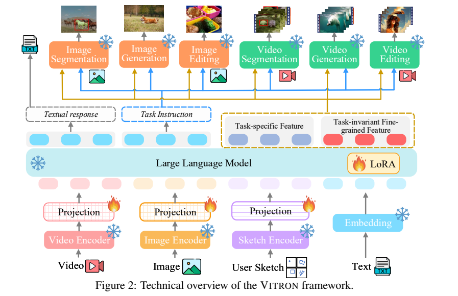
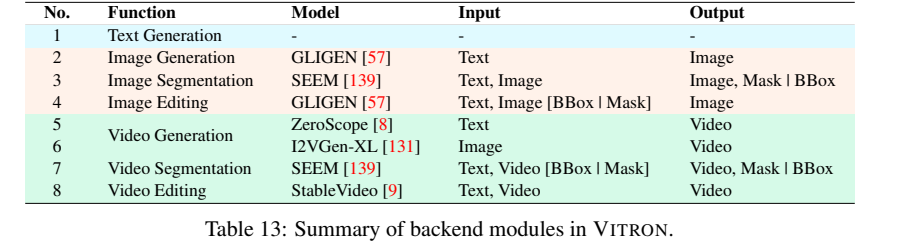
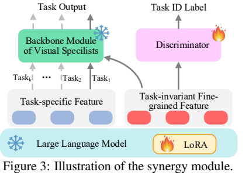
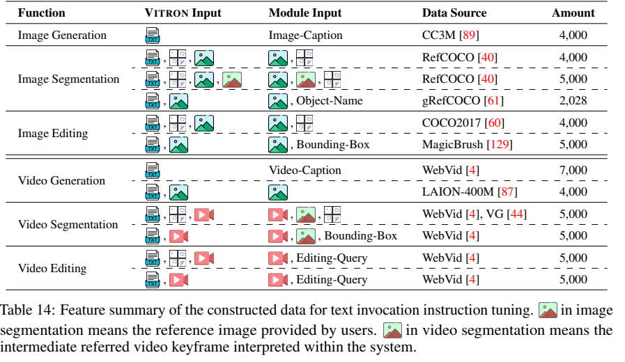
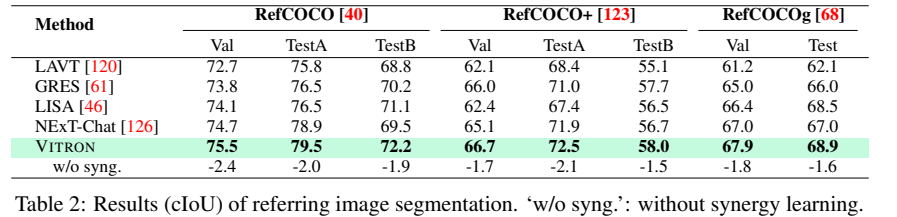
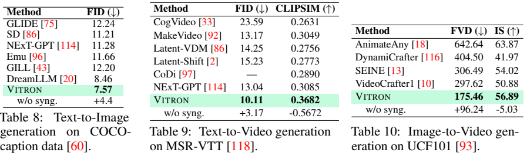
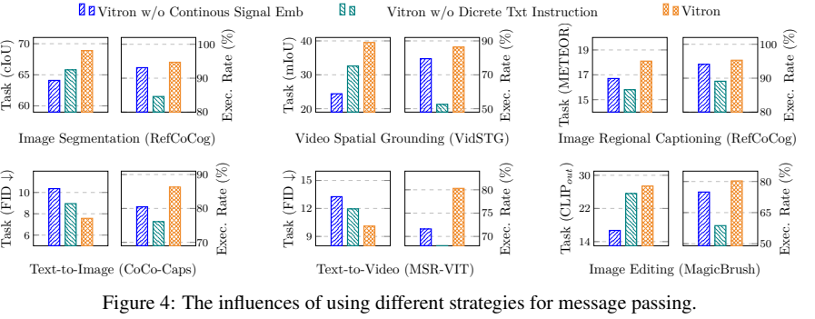

<!-- article-header:start -->
[项目首页](../../../README.md) › [模型系列](../../../reports/model-family-index.md) › [VITRON](../README.md)
<!-- article-header:end -->

# VITRON：用混合调用与共享特征连接图像、视频专家

<!-- article-toc:start -->
<a id="article-toc"></a>

**本篇目录** · [论文定位](#paper-info) · [快速概览](#overview) · [整体架构](#architecture) · [核心原理](#principles) · [数据构建](#data) · [训练流程](#training) · [实验结果](#experiments)
<!-- article-toc:end -->

<a id="paper-info"></a>

## 1. 论文信息与模型定位

| 项目 | 内容 |
|---|---|
| 论文 | *VITRON: A Unified Pixel-level Vision LLM for Understanding, Generating, Segmenting, Editing* |
| 作者 | Hao Fei、Shengqiong Wu、Hanwang Zhang、Tat-Seng Chua、Shuicheng Yan |
| 机构 | Skywork AI、新加坡国立大学、南洋理工大学 |
| 发表与来源 | NeurIPS 2024；本文依据作者公开的 [33 页会议稿](https://haofei.vip/downloads/papers/Skywork_Vitron_2024.pdf)，包括附录 |
| 系列定位 | 基于 Vicuna-7B-v1.5 的视觉通用系统，通过多个专家执行图像与视频的理解、生成、分割、编辑 |
| 官方资源 | [项目主页](https://vitron-llm.github.io/)、[代码](https://github.com/SkyworkAI/Vitron) |

VITRON 关注“同一轮对话如何调用不同视觉功能，并利用细粒度特征让任务相互帮助”。它的统一发生在交互、调度和特征接口层，输出像素仍由专门模型生成，因此 7B 是核心 LLM 规模，不能视作整个系统的总参数量或部署显存。

<a id="overview"></a>

## 2. 快速概览

| 关键设计 | 解决的问题 |
|---|---|
| 图像、视频、区域输入 | 用户既可提问，也可用框、涂鸦或区域指明对象 |
| 文本指令加连续信号 | 文本决定调用什么，连续特征补充视觉信息 |
| 细粒度时空对齐 | 先学习坐标、对象与帧区间，再学习基于定位的问答 |
| 共享与任务专属特征 | 用对抗任务分类降低共享表示中的任务身份信息 |

论文评估 12 种任务、22 个数据集，包含区域问答、指代分割、视频追踪及生成编辑。核心价值是连接功能与训练接口；结果需要连同专家本身和针对性预训练一起理解。

<a id="architecture"></a>

## 3. 整体架构



*原论文 Figure 2，PDF 第 3 页。核心 LLM 使用 LoRA，前端投影连接视觉输入，后端专家执行非文本任务。*

图像与视频都采用 CLIP ViT-L/14@336px。视频逐帧编码后沿时间做平均池化，形成总体特征；这不是原生时空注意力编码器。区域分支参考 Osprey，将区域视觉特征、空间位置及二值几何 mask 编码，支持框选、多边形和涂鸦输入，经线性投影交给 Vicuna。

Vicuna 可以直接输出文本答案，或输出模块名、执行指令、可选区域坐标，再传递特殊信号 token 的隐藏特征。区域文本只负责描述或控制，真正的像素 mask 要由分割后端产生。



*原论文 Table 13，PDF 第 19 页。一个功能可能对应多个专家，例如文生视频与图生视频使用不同模型。*

| 功能 | 后端 |
|---|---|
| 图像生成、编辑 | GLIGEN |
| 图像、视频分割 | SEEM |
| 文生视频 | ZeroScope |
| 图生视频 | I2VGen-XL |
| 视频编辑 | StableVideo |

混合接口让系统兼具可读命令与任务条件信息，但后端更换仍需要新的输入对齐、调用数据或训练，不能把模块扩展性理解为任意模型即插即用且性能不变。

| 模块 | 输入与输出 | 公开机制 |
|---|---|---|
| 视觉/区域前端 | 图像、视频、用户mask → 连续视觉特征 | CLIP逐帧编码再时间平均；区域外观、位置及几何mask单独编码 |
| Vicuna7B v1.5 | 图文条件 → 用户文本或模块调用 | 生成模块名、命令、可选区域和特殊信号token隐藏态 |
| 混合调用接口 | 离散命令及连续信号 → 专家条件 | 文字选择执行模块，投影信号补充不能充分文字化的视觉信息 |
| 视觉后端 | 任务条件 → 图像/视频/mask | GLIGEN、SEEM、ZeroScope、I2VGenXL、StableVideo按任务执行 |
| 共享/私有表示 | signal隐藏态 → 任务专属与共享特征 | 两部分共同传给任务专家，共享特征另接受任务判别对抗 |
| 训练判别器 | 共享特征 → 任务ID | 分类器提高任务判别，表示侧抑制任务身份，非最终用户输出 |


<a id="principles"></a>

## 4. 核心创新与数学原理

### 4.1 可读命令与连续条件互补

论文把信号表示拆成任务专属 $`v^p`$ 与共享 $`v^s`$，拼接后传给第 k 个专家：

```math
v=[v^p;v^s],\qquad y_k\leftarrow M_k(v).
```

文字回答可以直接交付，像素任务则需要后端实际运行。模块名负责“用哪个专家”，连续信号负责“提供什么视觉条件”，可选Region进一步限定操作位置；因此文字坐标本身不生成mask，信号向量也不会自动告诉系统应调用哪一种输出模型。〔固定源§3.2–3.3，第5–6页〕

### 4.2 前端对齐与解码侧对齐解决不同接口

文本调用学习模块名称与命令，连续表示则通过解码侧投影，与专家条件编码器的表示对齐。附录 B.1 列出信号 token 的负对数似然、条件特征 L2 对齐和条件潜空间去噪三类目标。可用以下示意式理解对齐部分：

```math
\mathcal L_{\mathrm{align}}=\Vert P_k(h_{\mathrm{signal}})-E_k(c)\Vert _2^2.
```

这里 P 是投影，E 是专家的条件编码器，c 是 caption；这是本文对描述的数学展开，原报告没有给出统一的各损失权重、信号 token 数量或完整联合公式。



*原论文 Figure 3，PDF 第 6 页。专家读取共享与私有特征，判别器只根据共享特征识别任务。*

前端把图像/区域特征送进语言空间，解码侧把LLM信号送进不同专家条件空间，两者不是共享一套万能投影。更换生成或分割专家时，其条件编码分布可能变化，需相应对齐训练；模块化让职责明确，却不保证任意后端可零训练互换。〔§4.1，第6页〕

### 4.3 对抗任务身份不证明全部共享知识

任务判别器是 4 层、768 维 Transformer。它要提高任务分类准确率，表示学习部分则要阻止分类。用正常交叉熵写出概念目标：

```math
\mathcal L_D=-\sum_k q_k\log D_k(v^s),\qquad \min_D\mathcal L_D,\qquad \min_\theta\bigl(\sum_k\mathcal L_k-\lambda\mathcal L_D\bigr).
```

这是解释性的标准对抗写法，不是报告逐字公式，λ 也没有据此假定具体值。原文 Eq.(4) 写成预测概率乘真实标签的对数，若真实标签为 one-hot，会涉及 log(0)，因此不能直接作为可执行损失照抄。原文也没有给出充分的更新比例或梯度实现。无法识别任务身份只说明一种统计约束，不能证明共享表示已经“纯净”或一定对所有新任务有效。

判别器只看共享分量，专家仍同时取得私有分量，所以任务信息可以留在私有侧供执行，而共享侧被鼓励减少任务专属线索。若判别器能力有限，无法分类也可能源于自身欠拟合；跨任务收益应看去掉synergy的消融，不能仅由分类失败宣称共享表示达到任务无关的最优解。〔§4.3，第6–7页，Figure 3；Table 2–4〕


<a id="data"></a>

## 5. 数据构建与处理

基础前端对齐使用 CC3M 图文、WebVid 视频文本、RefCOCO 区域文本。调用数据则先从已有任务标注设计多种用户输入模板，再用 GPT-4 扩展对话，合计 55,000+ 样本。覆盖纯文本生成、参考图生成、区域编辑、关键帧分割和视频追踪等不同接口。



*原论文 Table 14，PDF 第 20 页。表中各项合计 55,028，属于调用微调集合，不是全部训练样本。*

图像定位使用 Flickr30K Entities、RefCOCO/+/g，由 GPT-4 转成多轮 QA；视频定位使用 LaSOT、GOT10K、DanceTrack、MOT16。图像框是归一化左上、右下坐标，视频还添加起止帧号。QA 在相同定位数据上生成问题与答案。合成回答的合理性不等于经过独立视觉核验，论文未量化生成问答的人工审核比例或残留噪声。

附录的调用示例把框写成 (0.23,0.35,0.11,0.26)，与规定的左上—右下顺序矛盾，不能据此改变坐标约定。B.1 还在视觉信号对齐语料中列出 AudioCaps，但架构没有相应音频分支或评估，不能推导出音频能力。各阶段完整样本规模、去重和污染检查也未充分披露。

<a id="training"></a>

## 6. 训练流程与目标

| 阶段 | 顺序和目标 | 全局 batch / 最大学习率 / 时长 |
|---|---|---|
| 基础多模态能力 | 前端 caption 对齐→文本调用微调→连续特征与解码器对齐 | 128 / 3e-4 / 约 40h |
| 细粒度能力 | 图像定位→视频时空定位→基于定位的问答 | 90 / 1e-5 / 约 35h |
| 跨任务协同 | 对抗任务判别与各任务预测目标共同优化 | 128 / 1e-5 / 约 10h |

前端初始对齐描述为冻结 LLM；后续通过 LoRA 更新 LLM，并训练线性投影。最终阶段原文写作协同目标加各任务损失之和，不是只有判别器学习。附录 C 明确在实验前还对 GLIGEN、SEEM 等后端进行各自数据上的针对性预训练，所以不能把全部提升归因于“冻结专家加少量 LoRA”。

使用 AdamW 和学习率调度器，主文写 10 张 A100 80GB，附录写 10–16 张，本文保留两种披露。三个时长合计约 85h 是阶段说明，不能据此给出精确统一 GPU-hours；LoRA rank、学习率调度类型、训练帧数和完整评估采样配方未充分给出。

<a id="experiments"></a>

## 7. 实验设置与主要结果



*原论文 Table 2，PDF 第 7 页。w/o syng. 行表示相对完整模型的下降量。*

| 任务和指标 | VITRON | 表中对照 |
|---|---:|---|
| RefCOCO TestA，cIoU | 79.5 | NExT-Chat 78.9 |
| VidSTG，mIoU | 39.5 | PG-Video-LLaVA 34.2 |
| DAVIS17 Test-Dev，J&F | 84.2 | ISVOS 82.8 |
| GQA，accuracy | 62.1 | MiniGPT-v2 60.1 |
| ActivityNet-QA，accuracy | 51.0 | Video-LLaVA 45.3 |
| MagicBrush，CLIPout / L1 | 0.274 / 0.047 | Emu-Edit 0.261 / 0.052 |

分割表的 RefCOCO Val/TestA 是 75.5/79.5，对照 74.7/78.9，旁边正文却写略差，本文以表值报告并保留矛盾。cIoU、mIoU、问答 accuracy 和 CLIP 编辑指标各有定义，不能把它们混成一个“像素级能力分数”。



*原论文 Tables 8–10，PDF 第 8 页。FID/FVD 越低越好，CLIPSIM/IS 越高越好。*

文生图 COCO FID=7.57，对照 DreamLLM 8.46；文生视频 MSR-VTT FID=10.11、CLIPSIM=0.3682；图生视频 UCF101 FVD=175.46，优于 VideoCrafter1 的 297.62，但 IS=56.89 仍低于 AnimateAny 的 63.87，因此不能说所有生成指标均最佳。Table 9 的去协同 CLIPSIM 写成下降 0.5672，会把 0.3682 减成负值，存在明显口径疑点，不能当作已验证的提升幅度。



*原论文 Figure 4，PDF 第 9 页。每张图左轴是任务指标，右轴是执行率。*

六任务消融显示混合调用总体更好，文本主要支持正确执行，连续表示主要支持任务质量；双轴图不能把两个柱高当成同单位。去协同使 RefCOCO TestA 降 2.0 个百分点、DAVIS J&F 降 2.1 点；相关性图提供配对收益现象，没有证明因果机制或新任务迁移。

视频编辑由 5 人评分，目标修改/非目标保真得分为 8.9/8.2，对照 Tune-A-Video 7.8/4.6，但样本规模、盲评安排及评分一致性未充分披露。不同基准采用相同或相近既有评测设置，专家经过额外预训练；没有统一等训练预算比较、随机种子误差条和整个专家系统的推理成本。上述结果是论文报告数值，本仓库没有独立复现。

<!-- article-footer:start -->
---

[← 上一篇：Mini-Gemini](../../mini-gemini/arxiv-2403.18814/README.md) · [按发表时间浏览](../../../reports/paper-reading-guide.md#year-2024) · [下一篇：Ferret-UI →](../../ferret/arxiv-2404.05719/README.md)

[返回本篇目录](#article-toc) · [返回模型系列](../README.md)
<!-- article-footer:end -->
