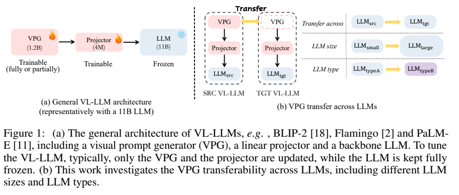
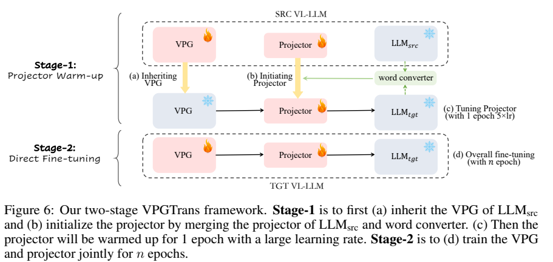
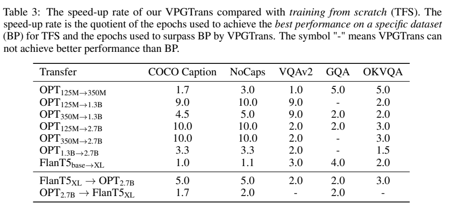
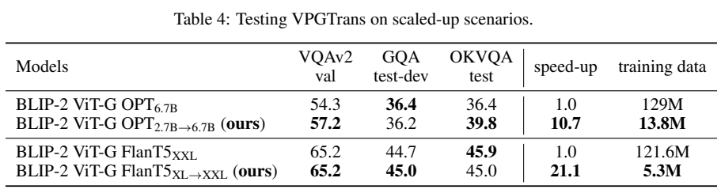
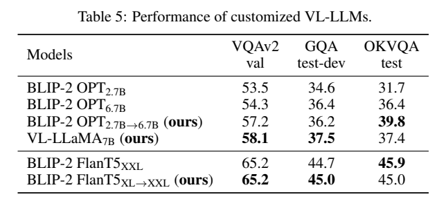

<!-- article-header:start -->
[项目首页](../../../README.md) › [模型系列](../../../reports/model-family-index.md) › [VPGTrans](../README.md)
<!-- article-header:end -->

# VPGTrans：把已训练的视觉提示生成器迁移到另一语言骨干

<!-- article-toc:start -->

**本篇目录** · [论文定位](#paper-info) · [快速概览](#overview) · [整体架构](#architecture) · [核心原理](#principles) · [数据构建](#data) · [训练流程](#training) · [实验结果](#experiments)
<!-- article-toc:end -->

## 1. 论文信息与模型定位

| 项目 | 信息 |
|---|---|
| 论文 | *Transfer Visual Prompt Generator across LLMs* |
| 作者与机构 | Ao Zhang、Hao Fei、Yuan Yao、Wei Ji、Li Li、Zhiyuan Liu、Tat-Seng Chua；新加坡国立大学与清华大学 |
| 来源版本 | [arXiv:2305.01278v1](https://arxiv.org/pdf/2305.01278v1)，2023 年 5 月，17 页 |
| 官方资源 | [VPGTrans/VPGTrans](https://github.com/VPGTrans/VPGTrans)、[项目页](https://vpgtrans.github.io/) |
| 定位 | 迁移训练方法；以 VL-LLaMA、VL-Vicuna 展示定制语言骨干 |

这里的“跨 LLM”指 OPT、Flan-T5、LLaMA 等骨干之间的迁移，包括参数规模和网络类型变化。它研究如何复用视觉语言对齐能力，节省为新语言模型训练视觉接口的成本。论文没有把这种迁移等同于跨自然语言翻译。

## 2. 快速概览

| 问题 | 方案 | 证据边界 |
|---|---|---|
| 新骨干的嵌入维度和表示空间不同 | 继承视觉提示生成器，转换线性投影器 | 不是直接拷贝所有权重 |
| 随机投影器产生不良初始梯度 | 先冻结 VPG，单独预热投影器 | 词转换器初始化仍不能替代预热 |
| 重新适配大型骨干成本高 | 两阶段迁移，缩短达到目标性能的训练 | 加速受任务和迁移方向影响 |
| 图像描述模型回答过短 | 用少量聊天指令适配 VL-Vicuna | 聊天展示主要为定性案例 |

在大型 BLIP-2 适配实验中，OPT 2.7B→6.7B 的报告加速为 10.7 倍，Flan-T5 XL→XXL 为 21.1 倍。这些数字描述指定训练对照，不能用于推断推理速度，也没有包含从零建立全部继承模型的历史成本。（第 3、10–11 页）

## 3. 整体架构

*Figure 1，PDF 第 1 页。图中的 1.2B/11B 是架构示例，不是所有实验的统一规模。*

模型由视觉提示生成器 VPG、线性投影器和冻结 LLM 组成。本文的具体实现基于视觉编码器及 BLIP 系列预训练 Q-Former：查询向量从视觉特征提取定长表示，经投影器转换为 LLM 可以读取的软提示。探索实验采用 CLIP ViT-L，扩展实验采用 ViT-G。视觉编码器保持冻结，迁移第二阶段主要更新 Q-Former 与投影器。（第 2–3、10 页）

源模型与目标模型共享继承的 VPG，但投影器需要适配目标词嵌入空间。VL-LLaMA-7B 将 BLIP-2/OPT-6.7B 的 VPG 迁移到 LLaMA；VL-Vicuna 进一步采用指令微调的语言骨干并加入聊天数据，二者不应当合并为一个检查点。

## 4. 核心创新与数学原理

直接继承 VPG 后联合训练随机投影器，会让视觉接口在目标语言空间尚未对齐时接收不稳定梯度。作者提出先稳住输出接口，再训练视觉查询模块。

第一步训练线性词转换器：对源、目标词表中相同 token 的嵌入进行对齐。不同 tokenizer 只使用共享 token。原文式 1 为：

$$
\mathcal L_{\mathrm{word}}=1-\cos\bigl(g_w(x_s),x_t\bigr).
$$

其中 $x_s,x_t$ 是两个 LLM 的词嵌入，$g_w$ 从源空间映射到目标空间。作者同时实验欧氏距离，报告表现接近。词转换器只需文本数据，但软视觉提示与普通词嵌入存在分布差异，前者的范数可大约高一个数量级，因此初始化后还必须进行图文预热。（第 6–8 页）

**原文式 2 有映射顺序问题。** 按文中定义，源投影器 $f_s(v)=W_s v+b_s$ 是“视觉→源嵌入”，转换器 $g_w(x)=W_wx+b_w$ 是“源→目标嵌入”，原式却写成 $f_s(g_w(v))$，与这些方向的维度不一致。采用列向量记法，合理的组合应为：

$$
f_t(v)=g_w(f_s(v))=W_wW_sv+W_wb_s+b_w.
$$

这是一处根据原文映射定义作出的维度校正，不能当成原论文逐字公式。两个线性映射合并后不必增加推理层数。该方法也不要求不同 LLM 内部隐藏状态逐层对齐。

*Figure 6，PDF 第 7 页。第一阶段冻结 VPG；第二阶段更新 VPG 中可训练部分与投影器。*

## 5. 数据构建与处理

探索实验使用 COCO 与 SBU 的约 140 万图文对，研究同系列大小模型迁移以及 OPT、Flan-T5 间的迁移。大型实验的投影预热仍使用 COCO/SBU，后续训练加入 Visual Genome 和 LAION-COCO 的 BLIP 合成描述。（第 3、10 页）

训练图文对让目标模型继续预测描述，复用的是源模型已有的视觉语言知识。表 4 的训练数据量是该次训练使用的图文样本口径，不代表构建继承 VPG 所需的全部原始数据。COCO 也用于训练，所以 COCO Caption 结果不能解释为没有见过该数据集的严格零样本测试。

VL-Vicuna 另外使用 MiniGPT-4 提供的 3,439 条自指令数据，让模型摆脱短描述式输出。这是聊天适配步骤，与大规模迁移成本实验分开。（第 12–13 页）

## 6. 训练流程与目标

| 阶段 | 更新部分 | 操作 |
|---|---|---|
| 词空间对齐 | 词转换器 | 用共享词嵌入训练，合并到源投影器 |
| 投影器预热 | 投影器 | VPG、视觉编码器、LLM 冻结；1 epoch，使用 5 倍基础学习率 |
| 目标模型适配 | Q-Former 与投影器 | 正常学习率继续图文训练；LLM 与视觉编码器冻结 |
| VL-Vicuna 聊天适配 | VPG 可训练部分与投影器 | 追加自指令训练，保留冻结的语言骨干 |

图文阶段沿用 BLIP-2 的语言建模目标，通过正确描述的 token 似然更新视觉接口。其一般表达为 $-\sum_t\log p(y_t\mid I,y_{<t})$；这里是对训练目标的说明，并非作者新增的独立数学公式。

探索对照训练 10 epochs，学习率先从 $10^{-6}$ 预热到 $10^{-4}$，再余弦下降至 $10^{-5}$；OPT 使用 FP16、有效 batch 1,728，Flan-T5 使用 BF16、batch 1,152，采用梯度累积。Flan-T5 大模型需要降低第二阶段学习率维持稳定。词转换器可在单张 A100 上 15 分钟内、低于 15GB 显存完成，**该数字仅指词转换器**。（第 3、7、10 页）

## 7. 实验设置与主要结果

*Table 3，PDF 第 8 页。“–”表示未超过对照最佳成绩。*

表 3 定义加速比为对照达到其最佳成绩的 epoch 数，除以迁移模型超过该成绩所需的 epoch 数。OPT 125M→1.3B 在 COCO Caption、NoCaps、VQAv2 为 9、10、9 倍，但 GQA 未超过对照；OPT 2.7B→Flan-T5 XL 在 VQAv2、OKVQA 也未超过对照。不同骨干类型的迁移在大模型上较有效，小模型并不保证加速。早期 Figure 4 的探索曲线未计入 3 epochs 的投影器预热；最终方法的 1 epoch 预热计入后续比较，读图时应区分。（第 4、8–11 页）

*Table 4，PDF 第 10 页。问答分数与成本分别列出，不能把加速理解为所有指标同时提升。*

| 目标骨干 | 对照→迁移 VQAv2 / GQA / OKVQA | 使用样本与成本 |
|---|---|---|
| OPT-6.7B | 54.3 / 36.4 / 36.4 → 57.2 / 36.2 / 39.8 | 129M→13.8M；631.5→59.0 A100 GPU 小时 |
| Flan-T5-XXL | 65.2 / 44.7 / 45.9 → 65.2 / 45.0 / 45.0 | 121.6M→5.3M；684.0→32.4 A100 GPU 小时 |

OPT 的样本量约为对照的 10.7%，Flan-T5 约为 4.4%；GPU 小时分别支持 10.7、21.1 倍的报告成本比。OPT 的 GQA 下降 0.2 分，Flan-T5 的 OKVQA 下降 0.9 分，说明迁移更节约资源，但存在任务间权衡。（Figure 2、Table 4）

*Table 5，PDF 第 12 页。该表量化的是 VL-LLaMA；VL-Vicuna 的聊天效果主要见后续案例。*

VL-LLaMA-7B 得到 58.1/37.5/37.4，在所列解码器模型的 VQAv2 与 GQA 上领先，但仍低于 Flan-T5-XXL 的 65.2/45.0；OKVQA 也低于迁移 OPT 的 39.8。VL-Vicuna 展示图像对话能力，同时仍出现把蛋糕、花、花瓶混淆，以及错误读取钟表时间的案例。论文支持“可低成本定制视觉接口”的结论，对开放式聊天可靠性尚没有系统量化评测。

<!-- article-footer:start -->
---

[← 上一篇：LLaMA-Adapter V2](../../llama-adapter/arxiv-2304.15010/README.md) · [按发表时间浏览](../../../reports/paper-reading-guide.md#year-2023) · [下一篇：X-LLM →](../../x-llm/arxiv-2305.04160/README.md)

[返回本篇目录](#article-toc) · [返回模型系列](../README.md)
<!-- article-footer:end -->
