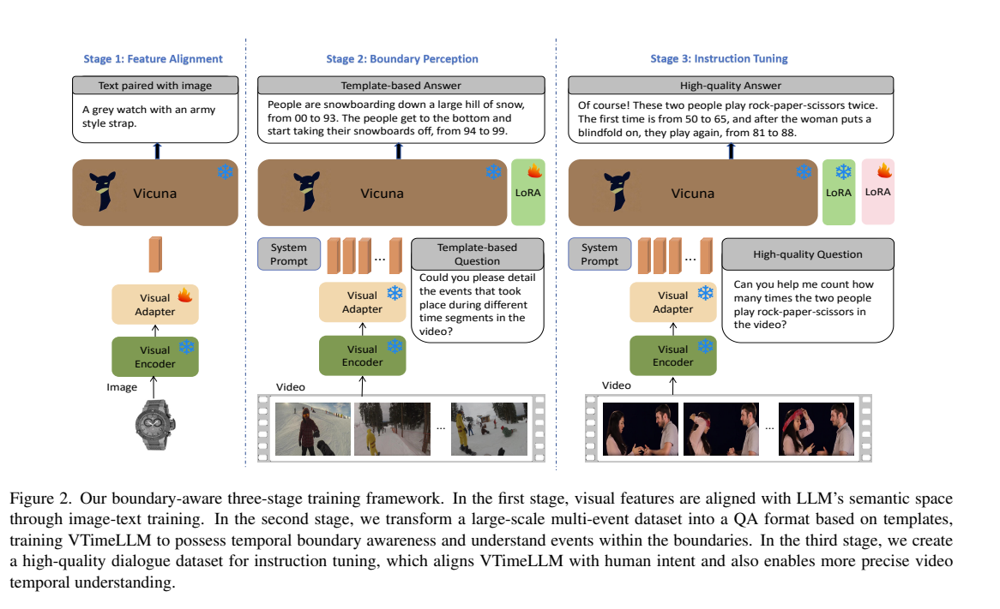
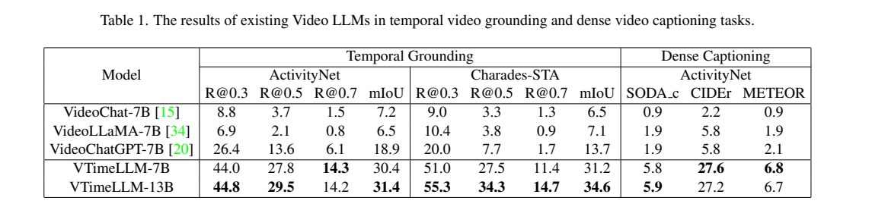
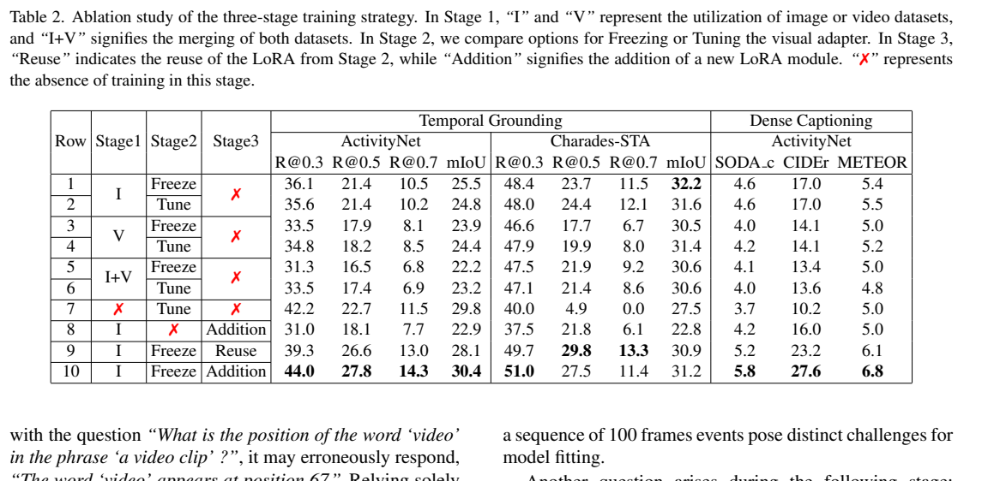
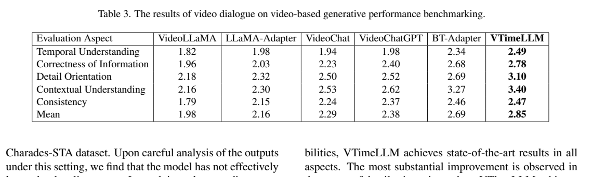

<!-- article-header:start -->
[项目首页](../../../README.md) › [模型系列](../../../reports/model-family-index.md) › [VTimeLLM](../README.md)
<!-- article-header:end -->

# VTimeLLM：以三阶段训练学习视频事件和时间边界

<!-- article-toc:start -->
<a id="article-toc"></a>

**本篇目录** · [论文定位](#paper-info) · [快速概览](#overview) · [整体架构](#architecture) · [核心原理](#principles) · [数据构建](#data) · [训练流程](#training) · [实验结果](#experiments)
<!-- article-toc:end -->

<a id="paper-info"></a>

## 1. 论文信息与模型定位

| 项目 | 信息 |
|---|---|
| 论文 | VTimeLLM: Empower LLM to Grasp Video Moments |
| 作者 | Bin Huang、Xin Wang、Hong Chen、Zihan Song、Wenwu Zhu |
| 团队 | 清华大学 |
| 阅读版本 | [arXiv 2311.18445v1](https://arxiv.org/pdf/2311.18445v1)，2023 年 11 月 |
| 官方仓库 | [huangb23/VTimeLLM](https://github.com/huangb23/VTimeLLM) |
| 语言骨干 | Vicuna v1.5，7B / 13B |
| 定位 | 能用文字描述多个视频事件并给出归一化时间边界的视频助手 |

本工作将“描述整段视频”推进到“描述哪个事件、发生在何处”，重点是时间定位和密集视频描述。方法主要创新在训练阶段及数据任务组织，视觉接口保持简单：每帧一个 CLIP 全局特征，线性投影后交给语言模型处理顺序。（第 1–3 页）

<a id="overview"></a>

## 2. 快速概览

| 要素 | 具体设置 |
|---|---|
| 视频采样 | 均匀抽取 100 帧，包含首尾帧 |
| 视觉特征 | CLIP ViT-L/14 的 CLS，全局表示；视觉编码器冻结 |
| 视觉接口 | 线性层，每帧映射成一个 LLM 输入 token |
| 时间输出 | 00–99 的归一化帧位置，用文字表示起止边界 |
| 三阶段 | 图像特征对齐 → 多事件边界学习 → 高质量对话指令 |
| 语言更新 | 后两阶段使用 LoRA，基础 Vicuna 参数冻结 |

它没有在视觉模块中额外训练时间编码器，也没有为每个时间位置添加专用分类头。模型以输入序列顺序和时间标注监督学习定位，因此空间细节受单个 CLS 特征限制。

<a id="architecture"></a>

## 3. 整体架构



*原文 Figure 2，第 4 页。第一阶段训练视觉适配器，第二阶段训练 LoRA，第三阶段冻结已学内容并引入新 LoRA。*

输入视频被采成 100 帧，CLIP 分别编码每帧。虽然编码器内部产生 CLS 和多个 patch 特征，模型只取 CLS 经线性适配器得到 100 个视觉 token。用户文本中的视频占位位置由这段嵌入替换，随后与文字输入一并送入 Vicuna。（第 3 页）

第一阶段只有单图特征与描述，目的是让接口学会映射视觉语义；第二阶段让语言模型看到视频帧序列与多事件监督；第三阶段改善对话自然度和复杂时间推理。图中两个 LoRA 不表示训练两个独立大模型：第二阶段适配器先合入基础语言权重，第三阶段再训练新适配器。（第 5–6 页）

一次视频定位请求的输入顺序是：均匀采样的 100 帧 → 每帧 CLIP CLS 向量 → 线性映射后的 100 个视频 token → 替换提示中的 `<video>` 占位符 → Vicuna 生成事件描述及边界。视觉模块没有另设时序关系网络，时间关系在有序输入进入 LLM 后建模。输出 `from s to e` 中的 `s/e` 是 00–99 的采样帧索引，而非直接以秒表示；把结果映射回原视频时间时需要结合采样位置。这个时间出口属于文本生成接口，不是额外回归头。（§3.1，PDF 第3页）

| 模块 | 输入与输出 | 公开机制 |
|---|---|---|
| 逐帧 CLIP | 均匀 100 帧 → 100 个 CLS 向量 | ViT-L/14 冻结；不将每帧全部 patch 送入语言模型 |
| 线性适配器 | CLS 向量 → 语言宽度 token | 保持一帧一个位置，替换 video 占位 |
| Vicuna 时间问答 | 有序视频 token、问题 → 事件及边界 | 时间关系在 LLM 内学习，边界以 00–99 文字索引输出 |
| 阶段性 LoRA | 图像对齐、边界数据、对话 → 适配权重 | 第二阶段 LoRA 合入后再训练第三阶段新 LoRA |

<a id="principles"></a>

## 4. 核心创新与数学原理

### 4.1 每帧全局表示与序列建模

原文式（1）–（2）提取并投影全局特征：

```math
v_i^{\mathrm{cls}}=\mathrm{ViT}(\widetilde V_i)_{\mathrm{cls}},\qquad
z_i=f(v_i^{\mathrm{cls}}),\quad i=1,\ldots,100.
```

原文式（3）将 $`Z=[z_1,\ldots,z_{100}]`$ 插入用户问题的视频位置。视觉模块不显式建模跨帧关系，时间理解由语言模型读取有序嵌入后学习。相比保留全部 patch，这大幅减少输入序列，但也降低细微物体和局部动作的直接可见信息。

固定 100 个 CLS 控制语言输入预算，帧顺序提供时间线索；同一全局向量却需要概括整个画面，细小对象和短时动作可能在抽帧或空间汇总时丢失。该设计把跨帧关系学习交给语言模型，没有另增时序编码网络。[依据：§3.1 / Eq1–3](https://arxiv.org/pdf/2311.18445v1#page=3)。

### 4.2 离散边界与视频长度归一化

起止数字范围为 00–99，论文称其为帧索引。首图的 16 秒视频输出“00 到 30”解释为约 0–4.8 秒，展示的是按视频长度归一化的位置。可用 $`\widehat t\approx D\,s/100`$ 理解该示例，而不是把数字 30 当成 30 秒。（第 1、3 页）

该表示省去了单独的连续时间回归头；相应地，定位精度受均匀抽帧及约 1% 长度的离散位置粒度限制。原文没有完整给出任意视频中首尾映射、取整和边界裁剪的实现，不能声称具有毫秒级定位精度。

相同索引差在长视频中对应更长真实时间，因此归一化便于统一输出格式，却不提供统一秒级精度。预测字符串还需结合采样约定还原边界，不能把离散索引当作连续时间测量；原文未说明的首尾取整规则仍应保持未知。

### 4.3 边界感知课程与对话适配

第二阶段分别训练“给事件找区间”和“给区间描述事件”，让视觉内容与位置建立双向关联；第三阶段缓解纯模板训练把普通问题也回答成区间的过拟合。它使用生成监督，未引入专门的 IoU 损失或可学习时间 token 词表。（第 4–6 页）

事件到区间和区间到描述让内容、位置双向关联；高质量对话再教模型何时需要报告时间、何时直接回答一般问题。新增阶段针对模板过拟合的行为问题，保留相同语言出口，并非添加新的时间 IoU 优化器。

<a id="data"></a>

## 5. 数据构建与处理

| 阶段 | 数据 | 组织方式 |
|---|---|---|
| 特征对齐 | LLaVA 整理的 LCS-558K 图像文本对 | 一张图对应一段描述 |
| 边界学习 | InternVid-10M-FLT 中筛出的 134K 视频 | 多个不重叠事件，转换成模板问答 |
| 高质量指令 | ActivityNet 约 4.2K 视频、DiDeMo 约 4K 视频生成约 16K 对话，再加入 VideoInstruct100K 的 20K QA | 合计约 36K 对话/问答 |

第二阶段筛选时，视频长度不超过 120 秒，单个事件超过 3 秒，平均事件时长超过整段视频的 8%。20% 样本构建单轮密集描述，80% 构建多轮事件描述或时间定位；每项任务有十种问题模板，多轮问题不必按事件顺序排列。事件标注来自自动生成流程，不应称为全部精确人工边界。（第 5 页）

第三阶段使用更可靠的人工标注源：ActivityNet 选至少三个不重叠事件、覆盖超过 90% 的视频；DiDeMo 选至少两个不重叠事件、覆盖约 40% 的视频。每段视频生成两份对话。附录明确文本教师为 Vicuna-7B v1.5，接收按序事件文字及符号化边界，未直接观看视频；最后按标注恢复边界。本文不将其替换成 GPT-4 教师。（第 6、11、14 页）

<a id="training"></a>

## 6. 训练流程与目标

| 阶段 | 可训练内容 | Epoch | 学习率 |
|---|---|---:|---:|
| 1：特征对齐 | 线性视觉适配器 | 1 | $`10^{-3}`$ |
| 2：边界学习 | LoRA，视觉适配器冻结 | 2 | $`10^{-4}`$ |
| 3：指令训练 | 将第二阶段 LoRA 合并，再训练新 LoRA | 2 | $`10^{-4}`$ |

全流程 batch size 为 128，使用 AdamW、余弦学习率与 warmup，LoRA rank 64、alpha 128。作者报告 7B 模型可在单 RTX 4090 上于 30 小时内完成训练；这是论文报告条件，不是本仓库的复现测量。（第 6 页）

目标是答案 token 的自回归似然：

```math
\mathcal L=-\sum_{k\in\mathcal A}\log p_\theta(y_k\mid Z,Q,\mathrm{history},y_{\lt k}).
```

原文明确后两阶段只在问答中的答案位置计算损失。该公式是文字训练描述的展开；它同时学习描述词与边界数字，没有独立优化连续定位误差。冻结基础 LLM 与使用 LoRA 更新并不矛盾，真正可训练的是适配器参数。

<a id="experiments"></a>

## 7. 实验设置与主要结果



*原文 Table 1，第 7 页。R@0.5 指首个预测区间满足 IoU≥0.5 的召回率；mIoU 为平均区间交并比。*

| 指标 | 7B | 13B |
|---|---:|---:|
| ActivityNet R@0.5 / mIoU | 27.8 / 30.4 | 29.5 / 31.4 |
| Charades-STA R@0.5 / mIoU | 27.5 / 31.2 | 34.3 / 34.6 |
| ActivityNet SODA_c / CIDEr / METEOR | 5.8 / 27.6 / 6.8 | 5.9 / 27.2 / 6.7 |

Charades-STA 未参与模型训练，体现跨数据集迁移；ActivityNet 的部分训练视频则用于第三阶段，不能将所有主结果都称为数据集零样本。13B 的 Charades 定位提高，但 CIDEr、METEOR 略低，扩大模型并非每个指标单调改善。（第 6–7 页）



*原文 Table 2，第 7 页。“Addition”是合并旧 LoRA 后训练新 LoRA，“Reuse”继续复用原适配器。*

新 LoRA 的完整方案改善多数指标，但 Charades R@0.5 为 27.5，低于 Reuse 的 29.8，不能说逐项都更优。省去第一阶段时，ActivityNet 部分召回看起来较高；作者检查发现模型倾向输出接近整段视频的区间，利用长真实事件取得表面收益，Charades 更严格的短区间评价则明显下降。（第 7–8 页）



*原文 Table 3，第 8 页。GPT-3.5 依据问题和参考答案评分，平均为 2.85，并非准确率。*

VTimeLLM 的时间理解/正确性/细节/上下文/一致性评分为 2.49/2.78/3.10/3.40/2.47，均高于表内当时比较对象。附录说明完整模型的密集描述使用更详细的 JSON 提示，而早期阶段使用模板；其他模型无法解析的回答被排除，正则处理成功比例超过 70%。提示差异与不同有效样本子集会影响对比，须与模型本身收益共同考虑。（第 11–12 页）

原始训练图和结果表的页码、裁剪范围见 [配图清单](figures-manifest.json)。

<!-- article-footer:start -->
---

[← 上一篇：mPLUG-PaperOwl](../../mplug/arxiv-2311.18248/README.md) · [按发表时间浏览](../../../reports/paper-reading-guide.md#year-2023) · [下一篇：ViP-LLaVA →](../../vip-llava/arxiv-2312.00784/README.md)

[返回本篇目录](#article-toc) · [返回模型系列](../README.md)
<!-- article-footer:end -->
